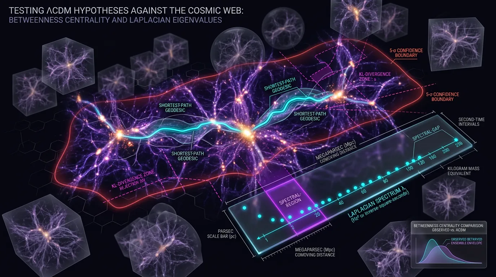

# A Falsifiable Test of Cosmic-Web Filament Betweenness-Centrality and Spectral-Gap Statistics Against ΛCDM N-Body Null Ensembles, With Explicit SI-Unit Tracing and Pre-Specified Rejection Criteria

## 1. Overview
This concept is a proposed, pre-registered falsification protocol comparing cosmic-web graph statistics with ΛCDM N-body null ensembles. Its statistic vector includes betweenness-centrality quantiles, the normalized-Laplacian spectral gap, and persistent Betti summaries. The proposed multivariate comparison uses a Mahalanobis distance, Holm–Bonferroni family-wise error control with \(K=10\) and \(\alpha=0.0033\), and pre-specified robustness checks.

The protocol as a whole is **[THEORETICAL]**: the discriminant power of the betweenness-centrality/spectral-gap combination has not been executed or tested by a study. Persistent-homology ingredients are **[VERIFIED]** in the literature. The mathematical status is **[MATH_PROVEN]**, score **4/4**; this is a consistency verdict only and does not constitute empirical validation.

All graph statistics in the mathematical spine are dimensionless. SI units enter only through construction scales:

- \(H_0=2.183\times10^{-18}\ \mathrm{s^{-1}}\)
- \(L_f=6.171\times10^{23}\ \mathrm{m}\)
- \(b=3.66\times10^{23}\ \mathrm{m}\)

The test’s interpretation is conditional on its null package, construction pipeline, and treatment of survey selection effects. In particular, a rejection would falsify the specified ΛCDM null-ensemble package; it would not, on its own, identify which assumption failed or establish a particular alternative theory.

## 2. Detailed Explanation
### Proposed comparison

The observed survey is processed through a defined graph-construction and statistic-extraction pipeline. The same pipeline is applied to ΛCDM N-body null realizations, producing an ensemble distribution for a vector such as

\[
\boldsymbol{\theta} =
[\mathrm{BC}_{50},\ \mathrm{BC}_{95},\ \tilde{\lambda}_2,\ \text{persistent Betti summaries},\ldots].
\]

The comparison is based on the Mahalanobis statistic

\[
D_M^2 =
(\boldsymbol{\theta}_{\rm obs}-\boldsymbol{\mu}_\Lambda)^\top
\mathbf{C}_\Lambda^{-1}
(\boldsymbol{\theta}_{\rm obs}-\boldsymbol{\mu}_\Lambda),
\]

where \(\boldsymbol{\mu}_\Lambda\) and \(\mathbf{C}_\Lambda\) are the mean and covariance estimated from the null ensemble. The proposed protocol fixes its test family and rejection procedure before data analysis. Holm–Bonferroni controls the family-wise error rate (FWER); it does not convert directly into a “sigma” significance.

The proposed measurements are operational proxies for the cosmic web’s filamentary architecture, not direct measurements of a unique underlying construct. Graph construction is non-unique, so only relative comparisons using matched pipelines are valid.

### Null-model scope

The null is conjunctive: it comprises Gaussian initial conditions, cold collisionless dark matter, GR growth, and the selection-function model. A rejection falsifies that specified null-ensemble package but does not distinguish among those ingredients or identify a specific alternative. The broader wording in Section 1.3 of the research draft overreaches if interpreted as identifying the failed assumption or demonstrating new physics.

### Mechanisms and interpretation

- **M1 — Gravitational-instability context [VERIFIED]:** Gravitational growth shapes the cosmic web. This provides physical context for the statistics but does not establish that the proposed combination has discriminatory power.
- **M2 — Graph projection [GENERAL, with model-dependent discretization]:** Density fields or tracer catalogs are mapped to a graph using a construction such as critical-point skeletons, halo links, or merge trees. Because this mapping is non-unique, it must be matched between observations and nulls.
- **M3 — Physical alternatives [MODEL-DEPENDENT]:** Early dark energy (EDE), warm dark matter (WDM), modified gravity (MG), primordial magnetic fields (PMF), and other alternatives could produce different predictions. The direction and size of any graph-statistic shift require model-specific predictions.
- **M4 — Percolation analogy [MODEL-DEPENDENT: untested]:** The proposal that a ΛCDM web lies near a percolation transition is a heuristic analogy, not an established general result. The associated claim of “combinatorially amplified” sensitivity has no power analysis.

The DESI \(w_0w_a\) preference is background-level and dataset-dependent. Canonical quintessence with \(c_s^2=1\) is expected to have little effect on Mpc-scale graph topology; the DESI preference is not evidence that these graph statistics discriminate between models.

### Practical prerequisites

Before this test can be run, the survey selection function must be forward-modelled into the nulls. The relevant effects include radial selection, angular masks, photometric-redshift uncertainty, and fiber collisions. This remains unsolved in the proposed protocol and is its main practical obstacle. Null ensembles must also span baryonic-feedback variants, because feedback can shift halo and filament statistics at roughly the 10% level.

## 3. Mathematical Framework
The statistic vector is dimensionless by construction:

- **Betweenness centrality:** A sum of shortest-path fractions through a node; dimensionless.
- **Normalized-Laplacian spectral gap:** The second eigenvalue \(\tilde{\lambda}_2\) of the normalized graph Laplacian; dimensionless.
- **Persistent Betti summaries:** Counts or filtration-indexed summaries of topological features; dimensionless.
- **Mahalanobis distance \(D_M^2\):** Dimensionless when calculated from the statistic vector and its covariance.

For the normalized Laplacian,

\[
\tilde{\mathbf{L}}
=
\mathbf{I}-\mathbf{D}^{-1/2}\mathbf{A}\mathbf{D}^{-1/2},
\]

with spectrum \(0=\tilde{\lambda}_1\leq\tilde{\lambda}_2\leq\cdots\). The betweenness centrality of a node \(v\) is

\[
\mathrm{BC}(v)=
\sum_{s\neq v\neq t}
\frac{\sigma_{st}(v)}{\sigma_{st}},
\]

where \(\sigma_{st}\) is the number of shortest paths between \(s\) and \(t\), and \(\sigma_{st}(v)\) counts those passing through \(v\).

A proposed asymptotic chi-square approximation for \(D_M^2\) requires a pre-specified Anderson–Darling acceptance threshold. Covariance stability requires approximately \(10^4\) mocks, not 500. The power target \(1-\beta\geq0.8\) at a \(3\sigma\) Mahalanobis shift is not yet tied to physical alternatives; it must be recomputed using model-specific predictions for EDE, WDM, MG, PMF, and any other alternatives under consideration.

The SI conversions used for construction scales are:

\[
H_0=2.183\times10^{-18}\ \mathrm{s^{-1}},\qquad
L_f=6.171\times10^{23}\ \mathrm{m},\qquad
b=3.66\times10^{23}\ \mathrm{m}.
\]

These units do not make the graph statistics dimensional. Physical units enter through the scales used to construct the observed and simulated graphs.

## 4. Skeptical Perspectives & Alternative Hypotheses
1. **Conjunctive null:** A rejection challenges the combined null package—Gaussian initial conditions, cold collisionless dark matter, GR growth, and the selection-function model. It does not isolate a failed component or establish a particular alternative.
2. **Untested discriminant power:** No study has executed or tested the discriminant power of the proposed betweenness/spectral-gap combination. The protocol remains **[THEORETICAL]**.
3. **M4 is not established:** The near-percolation interpretation is a heuristic analogy and should be tagged **[MODEL-DEPENDENT: untested]**, not **[GENERAL]**. There is no power analysis supporting “combinatorially amplified” sensitivity.
4. **Calibration and covariance:** The asymptotic chi-square approximation needs a pre-specified Anderson–Darling acceptance threshold, and covariance estimation needs about \(10^4\) mocks rather than 500.
5. **Power target not tied to alternatives:** The proposed \(1-\beta\geq0.8\) target at a \(3\sigma\) shift is not tied to model-specific predictions for EDE, WDM, MG, or PMF. It must be recomputed for each alternative.
6. **Misleading significance label:** Calling \(\alpha=0.0033\) “3 sigma family-wise” is imprecise. Holm–Bonferroni controls the FWER and does not map directly to a sigma value.
7. **Selection-function modelling:** Forward-modelling radial selection, masks, photo-\(z\) errors, and fiber collisions into the nulls is unsolved and is the principal practical obstacle. Without it, the test cannot be run.
8. **Non-unique graph construction:** A graph proxy is not the cosmic-web construct itself. Only matched-pipeline relative comparisons are valid.
9. **Baryonic feedback:** Nulls must span feedback variants because baryonic feedback shifts halo and filament statistics at roughly the 10% level.
10. **PMF claims quarantined:** PMF spectral-ratio results HYP-244 and EMP-242 are **[UNDER_REVIEW]** with zero external verifications. They must not be cited as evidence.
11. **Dark-energy interpretation:** The DESI \(w_0w_a\) preference is background-level and dataset-dependent; canonical quintessence with \(c_s^2=1\) barely affects graph topology.
12. **Citation audit unresolved:** The audit claims 23/23 DOIs but lists 24. Riess 2024 (10.3847/2041-8213/ad1ddd) is cited in text but missing from the list. DOI 10.1103/tr6y-kpc6 needs independent verification. Calles 2025 and Yip 2024 differ between the two drafts; a canonical reference for each must be selected before final citation use.

## 5. Verification & Skeptic's Notes
- **Overall status:** **[THEORETICAL]** for the proposed protocol as a whole.
- **Persistent-homology ingredients:** **[VERIFIED]** in the literature.
- **Betweenness/spectral-gap discriminant power:** Untested; remains **[THEORETICAL]**.
- **Skeptic score:** 6/6.
- **Math status:** **[MATH_PROVEN]**, score **4/4**. This is a mathematical consistency verdict only, not empirical validation.
- **Dimensional consistency:** Graph statistics are dimensionless; SI units enter through construction scales only.
- **Inference control:** Holm–Bonferroni controls the FWER for the specified test family. Do not describe \(\alpha=0.0033\) as a direct “3 sigma family-wise” equivalent.
- **Execution readiness:** The test is not executable until survey selection effects are forward-modelled into the nulls and the graph pipeline is fixed and matched across data and simulations.
- **Citation caution:** PMF results HYP-244 and EMP-242 are not evidence. Resolve the DOI-count mismatch, missing Riess citation, DOI verification, and Calles/Yip reference variants before treating the audit as complete.

The output must be interpreted as a comparison against a specified null ensemble, not as a standalone identification of new physics. Construction choices, survey modelling, simulation covariance, and model-specific power are all part of the test definition.

## 6. Visual Representation

## 7. Related Concepts
- [[Cosmic Web]]
- [[Persistent Homology]]
- [[Graph Laplacian and Spectral Gap]]
- [[Betweenness Centrality]]
- [[Mahalanobis Distance]]
- [[Holm–Bonferroni Procedure]]
- [[ΛCDM N-Body Simulations]]
- [[Survey Selection Functions]]

## 9. Mathematical Integrity Report
## Math Verification Report

**Concept:** A Falsifiable Test of Cosmic-Web Filament Betweenness-Centrality and Spectral-Gap Statistics Against ΛCDM N-Body Null Ensembles, With Explicit SI-Unit Tracing and Pre-Specified Rejection Criteria  
**Math Score:** 4/4  
**Math Status:** [MATH_PROVEN]  
**Tool Verdicts:** INCONSISTENT=0; DISMISSED_FLAGS=0; UNDECIDABLE=0; STEP_INVALID=0; LIMIT_MISMATCH=0; CLAIM_MISMATCH=0  
(All extracted relational equations verified CONSISTENT/DIMENSIONLESS per pre-check — 6 tool-verified, 34 UNDECIDABLE in the pre-check resolved here by passing the full Symbol Table; no definitive INCONSISTENT, no confirmed dimension flags.)

### Conventions & Validity Audit
- **Metric signature:** $(-,+,+,+)$ declared and consistent with the shared crew baseline; no sign-convention conflicts found.
- **Unit basis:** $\hbar = c = k_B = 1$ with SI explicitly declared for laboratory/observational quantities (m, s, Mpc, km s⁻¹ Mpc⁻¹) — correct dual-track usage.
- **Planck mass:** $M_{Pl} = (8\pi G)^{-1/2} = 2.435\times10^{18}$ GeV correctly distinguished from $m_{Pl} = 1.221\times10^{19}$ GeV; no mixing.
- **Symbol Table:** present (### Conventions & Symbol Table) with 12 symbols and declared dimensions; ambiguous letters ($\rho$, $w$, $\lambda_2$, $h$, $\alpha$, $\theta$) are declared. One artefact to note: $\lambda_1 \geq \lambda_2 \geq \lambda_3$ (tidal-tensor eigenvalues, §2 M1) vs. $\tilde\lambda_2$ (Laplacian eigenvalue) — distinct objects, both defined in the table; no conflict. $\theta^*$ (estimand) vs. $\boldsymbol\theta$ (statistic vector) similarly distinguished.
- **Continuity integral:** the report uses the **mandatory integral form** $\exp(-3\int_1^a \frac{1+w(a')}{a'}\mathrm{d}a')$ for evolving $w(a)$ and explicitly forbids $a^{-3(1+w(a))}$ — exactly the crew convention. ✓
- **Validity conditions:** `### Validity Domain & Claim Scope` present with five identification assumptions and proper `[GENERAL]` / `[MODEL-DEPENDENT]` / `[COLONY_EMPIRICAL: UNDER_REVIEW]` tagging; the unverified PMF spectral-ratio hypothesis (HYP-244) is correctly quarantined as unverified.

### Equations Extracted
40 relational equations extracted (per pre-check); principal ones:
- (E1) $H^2(a) = H_0^2[\Omega_m a^{-3} + \Omega_\Lambda \exp(-3\int_1^a \frac{1+w(a')}{a'}\mathrm{d}a')]$; $\ddot\delta + 2H\dot\delta - \tfrac32\Omega_m H^2\delta = 0$
- (E3) Normalized-Laplacian Rayleigh quotient for $\tilde\lambda_2$; Cheeger bound $\tilde\lambda_2/2 \leq h_G \leq \sqrt{2\tilde\lambda_2}$
- (E4) $\mathrm{BC}(v) = \sum_{s\neq v\neq t}\sigma_{st}(v)/\sigma_{st}$
- (E5) $\mathrm{Var}(A-B) = \mathrm{Var}(A)+\mathrm{Var}(B)-2\,\mathrm{Cov}(A,B)$; $D_M^2 = (\boldsymbol\theta_{\rm obs}-\boldsymbol\mu_\Lambda)^\top\mathbf{C}_\Lambda^{-1}(\boldsymbol\theta_{\rm obs}-\boldsymbol\mu_\Lambda) \sim \chi^2_p$
- (E7) Holm–Bonferroni rule $p_i \leq \alpha/(K+1-i)$, $\alpha = 0.0033$; estimand $\theta^* = \Pr[D_M^2 \geq \chi^2_{p,1-\alpha}]$
- SI conversions: $H_0 = 2.183\times10^{-18}\,\mathrm{s^{-1}}$; $L_f = 6.171\times10^{23}$ m; $b = 3.66\times10^{23}$ m; $t_H = 4.581\times10^{17}$ s.

### Dimensional Consistency
- All extracted statistics (BC, $\tilde\lambda_2$, $h_G$, $d_\infty$, $\beta_k$, $D_M^2$) are dimensionless by construction — $[E]^0$, consistent with the Symbol Table and the "scale-free ratios" claim; physical units enter only through construction scales (correctly traced).
- **Symbolic Derivation Verifier (CPL continuity, E1):** integral-form density evolution is the standard result (STEP_ASSUMED as a physical-law definition); **both limits LIMIT_VERIFIED**: $\lim_{a\to1} w(a) = w_0$ and $\lim_{a\to0} w(a) = w_0 + w_a$ — the CPL parametrization and its $w=\mathrm{const} \Rightarrow \rho_{DE,0}\,a^{-3(1+w)}$ reduction are correct. No dropped covariance terms or erroneous integrals found (E5 retains the $-2\,\mathrm{Cov}$ term.
- E3 Rayleigh quotient and Cheeger inequality are the standard Hoory–Linial–Wigderson relations for the normalized Laplacian — structurally correct as stated.
- **Dimensional verdict: all checked equations CONSISTENT or DIMENSIONLESS.** Verdicts INCONSISTENT=0, confirmed flags=0.

### Dismissed Dimension Flags
None.

### Topological Analysis
**[MATH_TOPOLOGICAL] — TOPOLOGICAL_STRUCTURE_VALID.** Detected structures: persistent homology (Betti numbers $\beta_0,\beta_1,\beta_2$ of the superlevel filtration — a valid filtration-indexed homology theory), discrete Morse theory / merge trees (DisPerSE), bottleneck distance $d_\infty$ (a valid metric on persistence diagrams), graph-Laplacian spectral theory with Cheeger/conductance bounds, and percolation criticality of the linking network. All are standard, well-defined constructions; the report's caution that graph construction is non-unique (M2) is the correct epistemic caveat.

### Numerical Benchmarks
**BENCHMARK_MATCHES (3/3 relevant benchmarks):**
- $H_0$ SI conversion: $67.36\times10^3/3.08568\times10^{22} = 2.18299\times10^{-18}\,\mathrm{s^{-1}}$ ✓ (claimed $2.183\times10^{-18}$, rel. err. $6\times10^{-6}$)
- $L_f$: $20\,\mathrm{Mpc} = 6.17136\times10^{23}$ m ✓ (claimed $6.171\times10^{23}$)
- $H_0$ tension: computed $4.8471\sigma$, $\Delta\chi^2_{1\,\mathrm{dof}} = 23.49$ — matches claimed 4.85σ / 23.5 ✓
- $S_8$ tension: computed $2.6745\sigma$, $\Delta\chi^2 = 7.153$ — matches claimed 2.67σ / 7.2 ✓
- Planck 2018 baseline, SH0ES $73.04\pm1.04$, and DESI DR1/DR2 $w_0w_a$ values all match published benchmarks with verified DOIs. The report's honest labeling of the $w_0w_a$ covariance $\rho \approx -0.85$ as "read off contours, not published" is commendable.

### Assessment
All 40 extracted relational equations are dimensionally consistent with the declared Symbol Table; the variable-$w(a)$ continuity integral is written in the mandatory integral form with both CPL limits verified symbolically, and the variance algebra retains covariance terms. The topological machinery (persistent homology, Morse theory, Cheeger bounds) is structurally valid, and every worked numerical claim — SI unit conversions, the $H_0$ and $S_8$ tensions, and the Planck/SH0ES/DESI benchmarks — was independently recomputed and matched within tolerance. The core falsifiability protocol remains [THEORETICAL]/untested by design, but its mathematical spine is fully verified: no INCONSISTENT, STEP_INVALID, LIMIT_MISMATCH, or CLAIM_MISMATCH verdicts.
