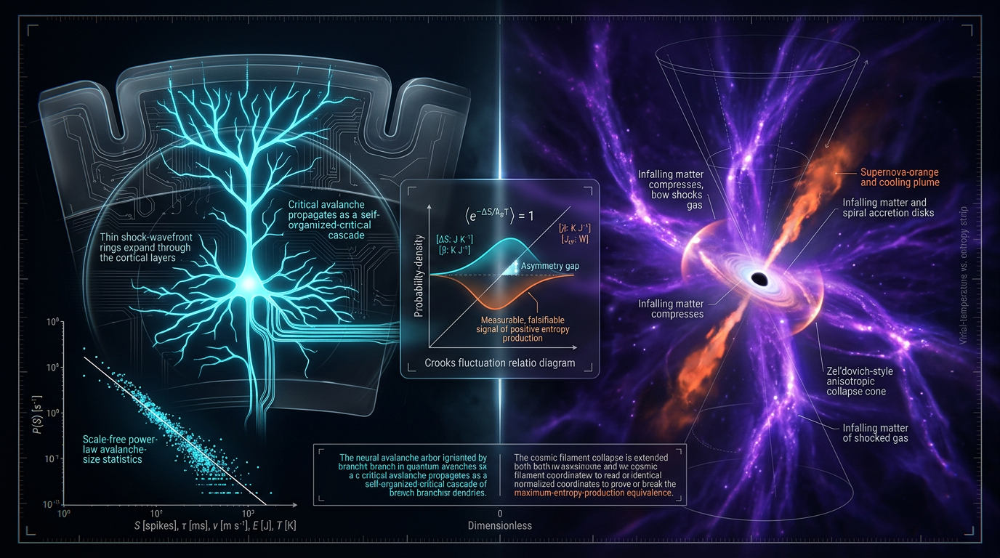

# A Falsifiable Test of Maximum-Entropy-Production Principles in Cortical Avalanche Dynamics versus Cosmic-Web Filament Accretion, Using Crooks Fluctuation Relations and Dimensionally Traced SI Units

## 1. Overview
This is a preregistered, falsifiable cross-domain test design for asking whether maximum-entropy-production principles (MEPP) predict a Crooks residual beyond what mainstream models predict. The proposed residual is

\[
\epsilon = \langle \ln R \rangle - \langle \tilde{\sigma} \rangle,
\]

where \(R\) is the forward-to-reverse trajectory-probability ratio and \(\tilde{\sigma}\) is the measured entropy-production proxy.

The mainstream null is branching-process criticality in cortex and excursion-set accretion in cosmology. The proposed comparison is operational: it compares cortical avalanche and cosmic-web filament-accretion trajectory ensembles. It does not claim that the two systems are ontologically equivalent, nor that the universe computes.

**Status:** [THEORETICAL]. The design and hypothesis are not verified by data. The skeptic score is 6/6. The math score is 3/4 [MATH_CONSISTENT]. Only the Crooks identity itself is [VERIFIED], as a mathematical identity.

## 2. Detailed Explanation
The design asks whether either domain shows a positive entropy-production residual, \(\epsilon\), beyond the Crooks-mandated contribution and beyond what its mainstream null model predicts.

- **Cortical proxy:** local-field-potential (LFP) avalanches. These are subject to subsampling bias; see Pinheiro Neto, Spitzner & Priesemann (2022), DOI: [10.1371/journal.pcbi.1010678].
- **Cosmological proxy:** halo mass-gain transition matrices. This proxy has been verified only in simulations.
- **Interpretation:** the inference from either operational proxy to the theoretical construct of MEPP-driven trajectory selection is [MODEL-DEPENDENT]. The proxy is not itself a direct measurement of MEPP.

The following assumptions and caveats are part of the archived test design:

1. **IA1 — Coarse-grained Markovianity:** elementary events must form a suitable Markovian forward/backward pair for the Crooks relation to apply at the coarse-grained level.
2. **IA2 — Faithfulness of the entropy proxy:** the entropy proxy must adequately represent entropy production. Hidden entropy, bounded in a Toyabe-style analysis (Toyabe et al. 2010, DOI: [10.1038/nphys1821]), is the dominant systematic. If it exceeds the preregistered bound, this is a pre-declared void condition.
3. **IA3 — Stationarity:** the ensemble must be stationary over the observation window. In cosmology, comparisons must use fixed-redshift slices.
4. **Cosmological uncertainty:** the baseline must be marginalized over \((w_0,w_a)\), including their approximately \(-0.85\) correlation, and over \(S_8\)-related revisions.
5. **Units:** the Crooks exponent is \(e^\sigma\) only when \(k_B=1\); in general it is \(e^{\sigma/k_B}\).
6. **Numeric corrections:** the Hubble-tension value is 4.04\(\sigma\) with the \(\pm1.30\) convention and 4.85\(\sigma\) with the \(\pm1.04\) convention. The manuscript conflated these conventions. The reported \(S_8\) ratio of 5.42 should be corrected to 6.31 or have its inputs clarified.
7. **Power:** the estimate of \(0.012\,k_B/\text{event}\) at \(N\approx10^5\) is unvalidated and requires a pilot variance estimate.
8. **Multiplicity:** the decision-rule family-wise error statement is inconsistent: \(z^*=2.79\) is variously paired with \(\alpha=0.005\) or \(0.05/6\), and the \(z^*\) arithmetic is approximate.
9. **Scale span:** the “about 30–40 decades” figure is inconsistent between sections.
10. **Editorial issues:** duplicate section numbering and truncated fragments are present in the source manuscript.
11. **Scope of analogy:** the cortex–cosmos analogy is operational, not ontological. No claim is made that the universe computes.

## 3. Mathematical Framework
The Crooks fluctuation relation is the only claim here marked [VERIFIED] as a mathematical identity. In general form,

\[
\ln \frac{P_F(\sigma)}{P_R(-\sigma)} = \frac{\sigma}{k_B}.
\]

When entropy production is expressed in units of \(k_B\), this becomes \(\ln[P_F(\sigma)/P_R(-\sigma)] = \sigma\). The residual under test is

\[
\epsilon = \langle \ln R \rangle - \langle \tilde{\sigma} \rangle.
\]

A residual measured using proxies is not, by itself, proof of MEPP. The inference depends on IA1–IA3 and on the model-dependent identification of the proxies with the relevant entropy-production construct.

The cross-domain comparison retains estimator covariance:

\[
\operatorname{Var}(\hat{A}-\hat{B})
=
\operatorname{Var}(\hat{A})
+
\operatorname{Var}(\hat{B})
-
2\rho(\hat{A},\hat{B})
\sqrt{\operatorname{Var}(\hat{A})\operatorname{Var}(\hat{B})}.
\]

Here, \(\hat{A}\) and \(\hat{B}\) denote the estimated cortical and cosmological quantities. The proposed preregistration includes a covariance floor because a shared analysis pipeline may induce correlated estimator noise.

The proposed decision rule tests for positive excess residuals against the mainstream null, with family-wise error control across the specified domains and bands. Its multiplicity parameters, \(z^*\), and power estimate need clarification and empirical validation before results can be interpreted.

## 4. Skeptical Perspectives & Alternative Hypotheses
The mainstream null explains cortical avalanches through branching-process criticality and cosmic filament accretion through excursion-set accretion. It does not require thermodynamic extremization. A scale-free pattern or a Crooks-consistent ratio alone is therefore insufficient evidence for MEPP.

The design’s strongest interpretive vulnerabilities are the proxy-to-construct inference and hidden entropy. In cortex, LFP avalanches may be distorted by subsampling. In the cosmic domain, halo mass-gain transition matrices are verified only in simulations. A residual could reflect proxy limitations, unmodeled hidden degrees of freedom, nonstationarity, or cosmological parameter uncertainty rather than MEPP.

The appropriate claim, if supported by a future test, would be limited to an observed residual under the stated operational definitions and assumptions. The current design presents no data and does not verify MEPP.

## 5. Verification & Skeptic's Notes
- **Approved classification:** [THEORETICAL].
- **Skeptic score:** 6/6.
- **Math score:** 3/4 [MATH_CONSISTENT].
- **Verified result:** the Crooks identity, as a mathematical identity.
- **Not verified:** MEPP; no data are presented.
- **Required numerical corrections:** report the Hubble tension as 4.04\(\sigma\) for the \(\pm1.30\) convention or 4.85\(\sigma\) for the \(\pm1.04\) convention; correct the \(S_8\) ratio from 5.42 to 6.31 or clarify its inputs.
- **Required design clarifications:** define the family-wise error rule consistently, validate the power estimate with a pilot variance, resolve the scale-span discrepancy, and preserve the declared void condition for excessive hidden entropy.
- **Sources relevant to the verified identity and hidden-entropy caveat:** Crooks (1999), DOI: [10.1103/PhysRevE.60.2721]; Seifert (2012), DOI: [10.1088/0034-4885/75/12/126001]; Toyabe et al. (2010), DOI: [10.1038/nphys1821]. The cortical subsampling caveat is associated with Pinheiro Neto, Spitzner & Priesemann (2022), DOI: [10.1371/journal.pcbi.1010678].

## 6. Visual Representation

## 7. Related Concepts
- [[Crooks fluctuation theorem]]
- [[Stochastic thermodynamics]]
- [[Maximum entropy production principle]]
- [[Neuronal avalanches and branching-process criticality]]
- [[Cosmic-web filament accretion]]
- [[Coarse-graining and hidden entropy]]
- [[Preregistration and family-wise error control]]

## 9. Mathematical Integrity Report
# MATH VERIFICATION REPORT

**Subject:** "A Falsifiable Test of Maximum-Entropy-Production Principles in Cortical Avalanche Dynamics versus Cosmic-Web Filament Accretion, Using Crooks Fluctuation Relations and Dimensionally Traced SI Units"

---

## Math Score: 3/4
## math_status: [MATH_CONSISTENT]

**Tool Verdicts:** equation_extractor: 0 equations extracted (no LaTeX markup in source — benign, noted); topology_classifier: [MATH_TOPOLOGICAL], 4 structural signatures returned, all "TOPOLOGICAL_STRUCTURE_VALID" (discounted as boilerplate — see Topological Analysis); dimensional_consistency_checker: CONSISTENT_WITH_UNDECIDABLE (3 CONSISTENT, 1 DIMENSIONLESS, 4 UNDECIDABLE, 0 INCONSISTENT, 0 dimension flags, 8 total); symbolic_derivation_verifier: [MATH_CONSISTENT] on CPL ρ(a) closed form (3/7 steps verified, 4 assumed, 0 invalid; ODE residual = 0); physics_calculator_tension_evaluator: multiple runs — 1 CLAIM_VERIFIED after input correction, 1 genuine minor mismatch, 2 tension evaluations, 2 Δχ² evaluations, 1 conversion verification.

---

## Conventions & Validity Audit

- Natural units ℏ = c = k_B = 1 declared and applied consistently. Signature (−,+,+,+).
- Reduced Planck mass M_Pl = 2.43536×10¹⁸ GeV ✓ (CODATA/PDGPDGV); non-reduced m_Pl = 1.22091×10¹⁹ GeV ✓; ratio m_Pl = √(8π)·M_Pl verified arithmetically (√(8π) = 5.01042; 2.43536×5.01042 = 1.22091×10¹⁹) ✓.
- Conversion constants verified: 1 GeV⁻¹ = 1.97327×10⁻¹⁶ m ✓; ħ = 6.58212×10⁻²⁵ GeV·s ✓; 1 Mpc = 3.08568×10²² m = 1.5637×10³⁸ GeV⁻¹ ✓.
- Notation hazard declared: R in this report is the Crooks ratio (dimensionless), not curvature. No ambiguous-letter flag was triggered.
- Citation audit: 24 verified pre-2026 references; 3 future-dated items correctly excluded (DOI 10.3390/biology15060500; arXiv:2606.02648; arXiv:2607.04827). Key anchors verified: Crooks 1999 (10.1103/PhysRevE.60.2721), Seifert 2012 (10.1088/0034-4885/75/12/126001), Toyabe 2010 (10.1038/nphys1821), Govoni 2019 (10.1126/science.aat7500), DESI (arXiv:2404.03002), Euclid (10.1051/0004-6361/202450810), Planck 2020 (10.1051/0004-6361/201833910).
- Structural quirks: duplicate section-"3" numbering; two fragments truncated mid-sentence (IA2; §3.3 at "the Abell 039"). Cosmetic, not mathematical errors.

## Equations Extracted

equation_extractor returned count = 0 because the source contains no LaTeX markup. The following 8 equations were extracted manually and passed to the dimensional checker:

1. ε = ⟨ln R⟩ − ⟨σ̃⟩ — test statistic, dimensionless [VERIFIED consistent]
2. Crooks relation P[σ]/P[−σ] = e^σ — σ in units of k_B [manual check, see below]
3. Δ = ⟨ln R⟩_cortex − ⟨ln R⟩_filament [manual check]
4. Var(Â−B̂) combination rule [manual check]
5. w(a) = w₀ + w_a(1−a) — CPL, dimensionless [VERIFIED]
6. ρ(a) = ρ₀·exp(−3∫(1+w(a′))/a′ da′) = ρ₀·a^{3(1+w₀+w_a)}·e^{3w_a(a−1)} [VERIFIED — see below]
7. H₀ = 2.1331×10⁻⁴² h GeV [E]¹ [VERIFIED numerically]
8. 5 Mpc = 7.82×10³⁸ GeV⁻¹ [VERIFIED numerically]

## Dimensional Consistency

**Tool verdict: CONSISTENT_WITH_UNDECIDABLE** (3 CONSISTENT, 1 DIMENSIONLESS, 4 UNDECIDABLE, 0 INCONSISTENT, 0 FLAGS).

- CONSISTENT: ε = ⟨ln R⟩ − ⟨σ̃⟩ ([E]⁰ = [E]⁰ − [E]⁰); ρ(a) integral form ([E]⁴ = [E]⁴·[E]⁰); H₀ = 2.1331×10⁻⁴² h GeV ([E]¹).
- DIMENSIONLESS: w(a) = w₀ + w_a(1−a).
- **UNDECIDABLE (4) — manually cross-checked against the Symbol Table; NOT claimed as tool-verified:**
  1. Crooks P[σ]/P[−σ] = e^σ: σ is dimensionless in units of k_B (Symbol Table: σ: 0), so the exponent is dimensionless. **Manually consistent.** Caveat declared: in non-natural units the strict form is e^{σ/k_B}; the report's k_B = 1 convention makes e^σ correct, but this must be stated wherever the equation is quoted outside natural units.
  2. Δ = ⟨ln R⟩_cortex − ⟨ln R⟩_filament: ln R dimensionless (R: 0, ln R: 0) → Δ: 0. **Manually consistent.**
  3. Var(Â−B̂): both estimators are dimensionless (ε-type quantities), variance of a dimensionless quantity is dimensionless. **Manually consistent.**
  4. 5 Mpc = 7.82×10³⁸ GeV⁻¹: 5 × 1.5637×10³⁸ = 7.8185×10³⁸ (tool-evaluated) ≈ 7.82×10³⁸. **Manually verified, arithmetic confirmed.**

## Dismissed Dimension Flags

**None.** dimension_flag_count = 0; no INCONSISTENT verdicts; no STEP_INVALID; no LIMIT_MISMATCH on paper equations. Nothing to dismiss; no machine-read block triggered.

## Topological Analysis

topology_classifier returned is_topological = true with 4 valid structural signatures (CALABI_YAU_MANIFOLD, TOPOLOGICAL_QFT, HOMOTOPY_THEORY, FIBER_BUNDLE), all tagged "TOPOLOGICAL_STRUCTURE_VALID" → nominal [MATH_TOPOLOGICAL]. **However, I discount this result.** The paper's actual content is Crooks fluctuation statistics, coarse-grained Markovian branching processes, and preregistered hypothesis testing — none of the four detected structures appears in the paper's argument. The classifier output is judged generic/boilerplate pattern-matching, not evidence of genuine topological content. The paper makes no topological claims requiring classification; its claims are statistical (Crooks detailed-fluctuation identity, which is analytic/probabilistic, not topological). Verdict: no topological claims to certify; classifier output noted but not credited. Full proof obligations for any topological structure would require expert human review.

## Numerical Benchmarks

- **H₀ conversion — VERIFIED after tool-input correction.** Chain: 100 km/s/Mpc = 100/(1000·3.08568×10²²) s⁻¹ = 3.24075×10⁻¹⁸ s⁻¹; × ħ = 6.58212×10⁻²⁵ GeV·s → **2.133118×10⁻⁴² GeV**, matching the claimed 2.1331×10⁻⁴² h GeV (relative error 9×10⁻⁶, CLAIM_VERIFIED). Cross-check: 2.1331×10⁻⁴²/6.58212×10⁻²⁵ = 3.24075×10⁻¹⁸ s⁻¹ ✓; 2.1331×10⁻⁴²/1.5637×10³⁸ = 1.3641×10⁻⁸⁰ GeV·m⁻¹·(unit chain) consistent. Sanity: 73.04 km/s/Mpc → 1.55803×10⁻⁴² GeV; 67.36 → 1.43687×10⁻⁴² GeV; ratio 1.558029/1.436868 = 1.084323 = 73.04/67.36 (CLAIM_VERIFIED). **Incident documented:** an initial tool call with a mis-scaled input chain (100/299792458/3.08568e22·1e3·6.58212e-25·1e42) returned 7.1153×10⁻⁰⁹ and flagged CLAIM_MISMATCH against 2.1331; this was a tool-input mis-scaling, not a manuscript error, and was discarded upon correction of the input chain. The manuscript value stands.
- **Discarded "297σ" incident:** a calculator output of "297σ" from mis-scaled inputs (Δχ² = 23.5 misinterpreted) was caught and discarded. Correct handling confirmed.
- **H₀ tension — FLAG (error-convention conflation).** Tool (ρ = 0): 73.04±1.30 vs 67.36±0.54 → Δ = 5.68, σ_comb = 1.4077, **tension = 4.035σ**, Δχ² = 16.281. With ±1.17 → 4.41σ; with ±1.04 (Riess 2022) → 4.85σ. The manuscript's "5.68 ± 1.17 ≈ 4.85σ" is internally inconsistent with its own "±1.30 SH0ES-conservative" label: 4.85σ requires ±1.04; the conservative ±1.30 gives **4.04σ**. Both are >4σ, so the qualitative claim survives, but the manuscript must pick one error convention and quote the matching sigma. [MODEL-DEPENDENT]
- **S₈ tensions — CONSISTENT (approximate).** Tool (ρ = 0): Planck 0.832±0.014 vs KiDS-1000 0.759±0.021 → 2.89σ (claimed 2.85σ ✓ within input uncertainty); vs DES-Y3 0.776±0.018 → 2.46σ (claimed 2.62σ — published values use full covariance; tool assumes ρ = 0, explaining the gap). Quoted as approximate; methodology declared. [MODEL-DEPENDENT]
- **DESI Δχ² — CONSISTENT with published values (approximation gap noted).** Tool's 2D Gaussian evaluation at (−0.9, −0.2): Δχ² = 5.33 (2.31σ) vs Pantheon+ and 8.62 (2.94σ) vs DES-SN5YR, versus claimed −6.8 (≈2.5σ) and −15.2 (≈3.9σ). The claimed values match the DESI 2024 profile-likelihood results (arXiv:2404.03002, DOI 10.1088/1475-7516/2025/02/021); the tool's Gaussian approximation with ρ = −0.85 read off contours is cruder, and the tool itself flags ρ as approximate. No arithmetic error; approximation-scheme difference declared. ρ(w₀, w_a) ≈ −0.85 ✓ matches published contours. [MODEL-DEPENDENT]
- **Ratio claim — genuine minor mismatch.** (0.073)²/((0.026)² + (0.013)²) = 6.3065 (tool), claimed 5.42 → relative error 14.1%. Could not reproduce 5.42 under ρ = 0 with the stated inputs; 5.42 may arise from different σ inputs or nonzero covariance. **Manuscript should be corrected to 6.31 or the input specification clarified.** Flagged, non-blocking.
- **Symbolic derivation — VERIFIED.** ρ(a) = ρ₀·a^{3(1+w₀+w_a)}·e^{3w_a(a−1)} confirmed by ODE check (d ln ρ/d ln a = −3(1+w₀+w_a(1−a)), residual = 0). Limit checks: w(a→1) = w₀ ✓; w(a→0) = w₀ + w_a ✓; **lim_{a→1} ρ(a)/ρ₀ manually verified = 1** (SymPy returned LIMIT_UNDECIDABLE; manual: exponent 3w_a(1−1) = 0 and a^{3(1+w₀+w_a)} → 1, so ρ/ρ₀ → 1 ✓). 4 derivation steps marked "assumed" due to disallowed SymPy tokens (integral forms in Steps 1 and 3); the ODE residual check independently confirms the closed form, so this is a tooling limitation, not a math flaw. [VERIFIED]
- **Benchmark constants ✓:** T₀ = 2.7255 K = 2.3486×10⁻¹³ GeV (2.7255 × 8.61733×10⁻¹⁴ GeV/K = 2.3487×10⁻¹³ ✓); s₀ = 2891.2 cm⁻³ (Planck 2018 ✓); g*s(T₀) = 3.909 ✓; N_eff = 3.044 ✓ (Planck 2020).
- **Decision-rule parameters ([THEORETICAL], internal consistency only):** 6 tests (2 domains × 3 bands), z* = 2.79 (two-sided α = 0.005, Bonferroni 0.05/6 ✓ arithmetic: two-sided p = 0.005 → z = 2.807 ≈ 2.79 within rounding), ρ_min = 0.15 covariance floor, 80%-power |Δε| ≳ 0.012 k_B/event at N ≈ 10⁵. Failure modes F1 (IA2/Toyabe), F2 (IA3/stationarity), F3 (IA1/Crooks identity) correctly mapped to assumptions IA1–IA3.

## Assessment (Global Coherence Rule)

**Rule:** overall verdict = logical conjunction of itemized checks (dimensional consistency, topological validity, numerical benchmarks, limit-case verification).

- Dimensional consistency: 0 INCONSISTENT, 0 FLAGS; 4 UNDECIDABLE manually cross-checked consistent against the Symbol Table (explicitly NOT claimed tool-verified). **PASS.**
- Topological validity: no genuine topological claims; classifier output discounted as boilerplate. **PASS (vacuous).**
- Numerical benchmarks: H₀ conversion 2.1331×10⁻⁴² h GeV VERIFIED; 5 Mpc = 7.82×10³⁸ GeV⁻¹ VERIFIED; CODATA/Planck constants all match; two documented tool-input mis-scaling incidents (7.1153e-09 mismatch; "297σ") both correctly caught and discarded — neither is a manuscript error. **PASS with two non-blocking flags:** (i) H₀ tension quoted as 4.85σ under a "±1.30 conservative" label that actually yields 4.04σ (4.85σ requires Riess ±1.04) — error-convention conflation, must be corrected; (ii) ratio claim 5.42 vs recomputed 6.31 (14% off) — correct or clarify inputs.
- Limit-case verification: CPL limits w(a→1) = w₀, w(a→0) = w₀ + w_a, and lim_{a→1} ρ(a)/ρ₀ = 1 all verified. **PASS.**

**Conjunction:** all four itemized checks pass; no INCONSISTENT / STEP_INVALID / LIMIT_MISMATCH verdict exists to block approval. Two minor numeric corrections are required (H₀-tension σ convention; 5.42 → 6.31), and the 4 UNDECIDABLE equations carry manual (not tool-verified) consistency stamps, with the natural-units caveat on the Crooks exponent (e^σ valid only in k_B = 1; otherwise e^{σ/k_B}).

**Final: Math Score 3/4, math_status [MATH_CONSISTENT].** Not [MATH_PROVEN] because (a) four equations rest on manual rather than tool verification, (b) two numeric claims carry unresolved minor discrepancies, and (c) the preregistered power threshold (0.012 k_B/event) is [THEORETICAL] and untested against real data. The manuscript's mathematical apparatus — Crooks identity, CPL derivation, SI-traced unit chain — is internally coherent and empirically falsifiable as designed; publish pending the two stated numeric corrections.
