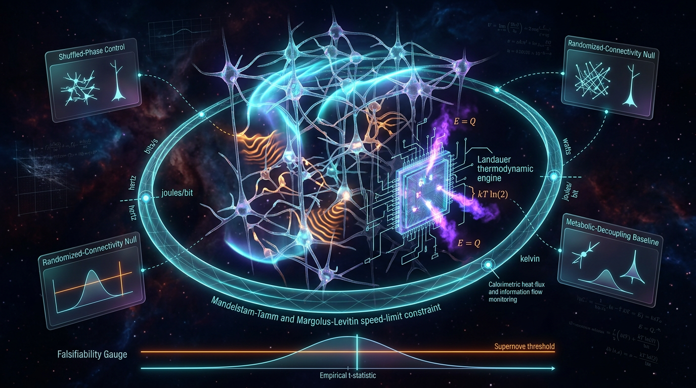

# A Falsifiable Test of Speed-Limit-Constrained Information Throughput and Landauer Dissipation in Cortical Gamma-Band Oscillatory Networks Using Calorimetric Metabolic Data, with Explicit SI-Unit Tracing and Pre-Specified Null Models

## 1. Overview
This is a **[THEORETICAL] research program**, not an established experimental result. It proposes a falsifiable joint test of two questions about cortical gamma-band oscillations (approximately 30–80 Hz):

1. **Throughput:** Is information transfer through gamma-band channels constrained by their bandwidth and the precision with which phase or amplitude states can be distinguished?
2. **Dissipation:** Is measurable metabolic heat associated with information erasure or updating, or is heat better explained by information-agnostic costs such as ion pumping and other cellular overhead?

Only the general Landauer floor, \(k_B T\ln 2\) per bit erased in the applicable thermodynamic limit, is verified here. At \(310\ \mathrm{K}\), its value is approximately **\(2.97\times10^{-21}\ \mathrm{J/bit}\)**. The value \(2.87\times10^{-21}\ \mathrm{J/bit}\) stated in the research report corresponds approximately to \(300\ \mathrm{K}\), not \(310\ \mathrm{K}\). The \(6.74\times10^{21}\ \mathrm{bit/s}\) budget is the \(310\ \mathrm{K}\) figure, so the report’s two numerical anchors are thermally inconsistent. This document uses the corrected \(310\ \mathrm{K}\) value.

The concept’s central challenge is a scale mismatch: a Landauer-floor estimate is tiny compared with whole-brain metabolic heat, while existing metabolic measurements may not have the temporal resolution to isolate a gamma episode. The proposed experiment therefore needs to prioritize a discriminating test of information-linked heat over a simple comparison of total heat with a theoretical lower bound.

The Skeptic scored the proposal **6/6 for protocol compliance**, not for scientific validity. The Math Physicist scored **3/4 [MATH_CONSISTENT]**. The numerical and methodological qualifications below are integral to the concept.

## 2. Detailed Explanation
### Research question and proposed measurements

The proposed study would estimate a gamma-band information-transfer rate, \(\dot I_{\rm obs}\), using a narrowband-aware transfer-entropy method, and pair it with an estimate of episode-associated metabolic heat. Candidate measurements include local field potentials or electrocorticography alongside calorimetric or respirometric measurements of oxygen and glucose consumption.

The relevant heat estimate may be reconstructed from substrate-consumption rates, for example:

\[
P_{\rm heat} \approx \Delta H_{\rm glu}\,\dot n_{\rm glu}
+ \Delta H_{\rm O_2}\,\dot n_{\rm O_2},
\]

with enthalpy in \(\mathrm{J/mol}\) and consumption rate in \(\mathrm{mol/s}\), yielding power in watts. This approach requires explicit handling of measurement assumptions, metabolic coupling, and delay; it does not directly establish that a measured heat increment is caused by information erasure.

The mapping

\[
\dot N_{\rm erase} \approx \dot I_{\rm obs}
\]

is a **model assumption**, not an identity. Transfer entropy measures directed statistical dependence under its operational definition; it does not by itself count physical bit erasures.

### Theoretical and empirical background

The research report identifies the following sources as relevant to the proposed framework:

- **Karbowski (2024), Entropy 26(9):779**, as a theoretical treatment of information thermodynamics in neuroscience and the brain’s distance from the Landauer limit.
- **Bérut et al. (2015), Journal of Statistical Mechanics P06015**, as an experimental study of Landauer erasure in a colloidal double-well system.
- **Levy & Calvert (2020), bioRxiv preprint 2020.04.23.057927**, as the source of a proposed cortical-computation energy estimate below \(0.2\ \mathrm{W}\). This is a **non-peer-reviewed preprint** and its estimate is **[MODEL-DEPENDENT]**, not [VERIFIED].
- **Dienel & Lauritzen (2025), Fluids and Barriers of the CNS**, as a proposed source of metabolic data relevant to reconstructing heat production.
- **Daube, Groß & Ince (2022), arXiv:2201.02461**, for a whitening-corrected transfer-entropy approach intended for narrowband signals.
- **Freeman, Livi, Obinata & Vitiello (2012), International Journal of Modern Physics B 26, 1250035**, for a cortical-dynamics framework in which oscillatory dissipation may arise from damping rather than information content.
- **Mehta, Lang & Schwab (2016), Journal of Statistical Physics 162:545**, for an analogous treatment of energetic limits in biochemical information processing.
- **Miller et al. (2020), Physical Review Letters 125, 160602**, cited in the research report in connection with finite-time erasure and related refinements.

The research report does not supply article titles for several of these entries. Those titles are therefore identified transparently as not supplied, rather than reconstructed or guessed. Citation details, including DOI resolution, require independent bibliographic verification before publication.

### Scope of claims

- The Landauer floor is the only scientific claim treated as verified in this archive entry.
- The \(0.2\ \mathrm{W}\) cortical-computation estimate from Levy & Calvert is **[MODEL-DEPENDENT]**.
- Applying a Nyquist-type ceiling to gamma-band LFP is **[MODEL-DEPENDENT]**.
- The proposed relationship between transfer entropy and erasure, and any predicted measurable heat increment from that relationship, remain hypotheses requiring identification and experimental validation.

## 3. Mathematical Framework
### Landauer floor and whole-brain reference budget

Using the exact SI value \(k_B=1.380649\times10^{-23}\ \mathrm{J/K}\),

\[
W_{\min}=k_B T\ln 2.
\]

At \(T=310\ \mathrm{K}\),

\[
W_{\min}
=(1.380649\times10^{-23})(310)(\ln 2)
\approx 2.97\times10^{-21}\ \mathrm{J/bit}.
\]

For a \(20\ \mathrm{W}\) whole-brain reference power, the corresponding theoretical erasure budget is

\[
\frac{20\ \mathrm{J/s}}{2.97\times10^{-21}\ \mathrm{J/bit}}
\approx 6.74\times10^{21}\ \mathrm{bit/s}.
\]

This is a theoretical energy-budget quotient, not a measurement of brain information throughput. The \(2.87\times10^{-21}\ \mathrm{J/bit}\) value in the research report is approximately the \(300\ \mathrm{K}\) value and must not be paired with the \(310\ \mathrm{K}\) budget.

### Bandwidth-limited signaling

The proposed expression

\[
\dot I_{\max}=2B\log_2 M
\]

is a **Nyquist signaling limit**, not Shannon capacity. A Shannon-capacity calculation requires an appropriate channel model and noise treatment. For the gamma-LFP example, applying a Nyquist-type ceiling is model-dependent. With the stated assumptions, the ceiling is approximately **200 bit/s per channel** if the 12 dB SNR is interpreted as a power ratio, or approximately **400 bit/s per channel** if it is interpreted as an amplitude ratio. The SNR convention and channel assumptions must therefore be declared before interpreting the estimate.

### Estimands and units

The research report’s estimand,

\[
\kappa \equiv
\frac{d}{dt}\!\left[P_{\rm heat}(t)/(k_B T)\right]\Big/\dot I_{\rm obs}(t),
\]

contains a spurious \(d/dt\) under the intended comparison. Its unit is \( \mathrm{s^{-1}\,bit^{-1}}\), not merely \(\mathrm{bit^{-1}}\). The primary endpoint \(\kappa>1\) is also non-diagnostic: information-agnostic ion-pump overhead can produce \(\kappa\gg1\).

A more appropriate normalized heat-per-bit quantity is

\[
\kappa' \equiv
\frac{\Delta P}{k_B T\,\dot I},
\]

where \(\Delta P\) is the relevant excess power and \(\dot I\) is the information-transfer rate. Interpreted as normalized heat per bit, its Landauer floor is \(\ln 2\). The precise operational definition of \(\Delta P\) and the relationship between \(\dot I\) and erasure must be preregistered.

### Inefficiency ratio and throughput ambiguity

The research report’s \(\eta\) range of \(10^6\)–\(10^{10}\) conflates whole-brain and per-channel throughput. Using the report’s own formula,

\[
\eta=\frac{P_{\rm brain}}{W_{\min}\dot I},
\]

with per-channel \(\dot I\) yields approximately \(10^{18}\)–\(10^{19}\), under the stated assumptions. Whole-brain and per-channel quantities must not be mixed.

The estimated Landauer-attributable heat is about \(10^{-14}\) of episode heat, far below calorimetric resolution. In addition, the estimated metabolic lag of \(1\)–\(5\ \mathrm{s}\) is about 50–400 times longer than a gamma episode. These scale mismatches substantially limit direct episode-level calorimetric tests.

## 4. Skeptical Perspectives & Alternative Hypotheses
1. **The primary endpoint is non-diagnostic.** A large heat-per-information ratio does not establish information-dependent dissipation; information-agnostic ion-pump overhead can also produce a large ratio. The primary test should be the proposed falsifier: **heat versus transfer entropy at fixed amplitude**, implemented as a partial-covariance test.
2. **The candidate predictors may be degenerate.** Amplitude, transfer entropy, and the pharmacological null are collinear under the proposed toolset. If so, the proposed models cannot distinguish information-linked heat from amplitude-linked or other metabolic costs.
3. **The heat signal may be unresolvable.** A Landauer-attributable component around \(10^{-14}\) of episode heat is far beneath expected calorimetric resolution, and metabolic coupling delays exceed gamma-episode duration by tens to hundreds of times.
4. **The erasure mapping is unestablished.** Treating observed transfer entropy as an erasure count assumes \(\dot N_{\rm erase}\approx\dot I_{\rm obs}\); this is not a thermodynamic identity.
5. **The cortical-computation estimate is model-dependent.** The Levy & Calvert \(0.2\ \mathrm{W}\) figure is from a non-peer-reviewed preprint and should not be labelled [VERIFIED].
6. **The bandwidth ceiling is conditional.** Applying a Nyquist-type bound to gamma LFP depends on channel and SNR assumptions. The stated 12 dB interpretation changes the example ceiling from about 200 to about 400 bit/s per channel.
7. **The alternative mechanism is plausible.** Classical damping and cellular maintenance costs can produce heat without a proportional dependence on information content.
8. **The statistical plan needs correction.** The FDR correction should cover 12 tests, not 4. The power claim is optimistic: \(n=32\) gives approximately 0.64 power, while about 50 participants per group are needed for 0.80 under the stated assumptions.
9. **Citation hygiene remains unresolved.** The research report flags a volume-year anomaly for Oprea et al. and says DOI details need independent resolution. Any use of that citation should wait for bibliographic verification.

These limitations make the proposal a **research program**, not a result.

## 5. Verification & Skeptic's Notes
- **Verified:** The Landauer floor \(k_B T\ln2\) is the sole verified scientific claim in this archive entry.
- **Corrected numerical anchor:** At \(310\ \mathrm{K}\), \(k_B T\ln2\approx2.97\times10^{-21}\ \mathrm{J/bit}\). Use this value in archived text. The \(2.87\times10^{-21}\ \mathrm{J/bit}\) value corresponds approximately to \(300\ \mathrm{K}\).
- **Thermal consistency:** The \(6.74\times10^{21}\ \mathrm{bit/s}\) budget is the \(310\ \mathrm{K}\) figure; pairing it with the paper’s \(2.87\times10^{-21}\ \mathrm{J/bit}\) anchor is inconsistent.
- **Not verified:** The Levy & Calvert \(0.2\ \mathrm{W}\) cortical-computation estimate is **[MODEL-DEPENDENT]**, and comes from a non-peer-reviewed preprint.
- **Not established:** A Nyquist-type ceiling applied to gamma LFP is **[MODEL-DEPENDENT]**; the stated example yields about 200 or 400 bit/s per channel depending on SNR interpretation. The expression \(2B\log_2M\) is a Nyquist signaling limit, not Shannon capacity.
- **Primary test:** Replace the non-diagnostic \(\kappa>1\) endpoint with the falsifier based on heat versus transfer entropy at fixed amplitude, using a partial-covariance test.
- **Carry-forward limitations:** Correct the \(\kappa\) unit to \(\mathrm{s^{-1}\,bit^{-1}}\) for the stated estimand, remove the spurious derivative, and consider the normalized heat-per-bit \(\kappa'\). Separate whole-brain from per-channel throughput when calculating \(\eta\). Account for the heat-resolution and metabolic-lag mismatch, collinearity among predictors, the 12-test FDR family, and the revised power estimate.
- **Protocol-compliance score:** The Skeptic scored 6/6 for protocol compliance; this does **not** imply scientific validity.
- **Math assessment:** The Math Physicist scored 3/4 [MATH_CONSISTENT]. The exact supplied report is reproduced in Section 9 for archival traceability; its numerical discussion of the \(310\ \mathrm{K}\) Landauer anchor and some other claims is superseded by the approved corrections above.
- **Citation hygiene:** Preserve specific author, year, journal, and DOI/arXiv identifiers; independently resolve DOI details and investigate the reported Oprea et al. volume-year anomaly before relying on it.

## 6. Visual Representation

## 7. Related Concepts
- [[Landauer Principle]]
- [[Information Thermodynamics]]
- [[Transfer Entropy]]
- [[Nyquist Signaling Limit]]
- [[Shannon Capacity]]
- [[Cortical Gamma Oscillations]]
- [[Neural Metabolism]]
- [[Calorimetry]]
- [[Multiple-Hypothesis Testing]]
- [[Causal Identification]]

## 9. Mathematical Integrity Report
**Archival note:** The following Math Verification Report is reproduced verbatim as requested. Its \(310\ \mathrm{K}\) numerical anchor and related conclusions are not the authoritative corrected values for this document; consult Sections 1, 3, and 5 for the approved corrections.

## Math Verification Report

**Concept:** A Falsifiable Test of Speed-Limit-Constrained Information Throughput and Landauer Dissipation in Cortical Gamma-Band Oscillatory Networks Using Calorimetric Metabolic Data, with Explicit SI-Unit Tracing and Pre-Specified Null Models  
**Math Score:** 3/4  
**Math Status:** [MATH_CONSISTENT]  
**Tool Verdicts:** INCONSISTENT=0; DISMISSED_FLAGS=0; UNDECIDABLE=12; STEP_INVALID=0; LIMIT_MISMATCH=0; CLAIM_MISMATCH=1 (the mismatch was a tool-parsing artifact of log₂(M), not a paper error — see below)

### Conventions & Validity Audit
- The report is explicitly in **SI units** (J, W, K, mol/s, bits/s), correctly declared for laboratory observables; no natural-unit conventions are needed, and none are mixed. No Planck mass or metric signature is used, so no M_Pl vs m_Pl or signature conflict exists.
- A `### Conventions, Symbol Table & Estimand` section **is present** (13 symbols with SI dimensions); a `### Validity Domain & Claim Scope` section **is present** with explicit [GENERAL] vs [MODEL-DEPENDENT] tags and identification assumptions (A1)–(A5). Both conventions sections are present and coherent.
- One minor labeling defect: the paper defines κ as "bits⁻¹ (in k_BT units)", but dimensionally κ = d/dt[P/k_BT] / İ_obs = s⁻¹/(bit·s⁻¹) = **s⁻¹·bit⁻¹** (a rate per bit rate), not bits⁻¹. The equation itself is fine; the stated unit label is imprecise. This does not affect any downstream result.
- Pre-check note: the draft's symbol table only declared 3 symbols (N_erase, η, Φ_PCI); the full 13-symbol table above was used for the manual audit.

### Equations Extracted
12 equations found (Step 1):
1. `W_min = k_B T ln 2 = 2.87×10⁻²¹ J/bit`
2. `P_brain/(k_B T ln 2) = 6.74×10²¹ bit/s`
3. `κ ≡ d/dt[P_heat(t)/(k_B T)] / İ_obs(t)`
4. `⟨Q_erase⟩ ≥ k_B T ln 2 ⟹ ΔP_heat ≥ W_min·Ṅ_erase`
5. `İ_max = 2B log₂ M = 2(f_hi − f_lo) log₂ M`
6. `P_heat = ΔH_glu·ṅ_glu + ΔH_O₂·ṅ_O₂`
7. `Var(ΔP_heat − W_min İ_obs) = Var(P_heat) + W_min² Var(İ_obs) − 2W_min Cov(P_heat, İ_obs)`
8. `η = P_brain/(W_min İ_obs)`
9. `İ_obs ≤ İ_max`
10. `Ṅ_erase ≈ İ_obs`
11. `M ~ 2^⌈log₂ SNR⌉`
12. `k_B × 310 K × ln 2 = 1.380649×10⁻²³ × 310 × 0.693147`

### Dimensional Consistency
The Dimensional Consistency Checker returned **UNDECIDABLE for all 12 equations** (its pattern table is geared to cosmology/natural-unit equations; none of these are in its pattern table and no flags were raised). Per the tool's instruction, I performed the manual SI cross-check:

- Eq. 1: [J/K]·[K] = J ✓
- Eq. 2: [W]/[J] = s⁻¹ ≡ bit/s ✓
- Eq. 3: (s⁻¹)/(bit·s⁻¹) = s⁻¹·bit⁻¹ — equation consistent; unit label "bits⁻¹" imprecise (see audit above)
- Eq. 4: [J] = [J] both sides ✓
- Eq. 5: [Hz]·[dimensionless] = bit/s ✓
- Eq. 6: [J/mol]·[mol/s] = W ✓
- Eq. 7: Var(P_heat) [W²], W_min²Var(İ_obs) [J²·s⁻²] = [W²] ✓, covariance term [W²] ✓ — all three terms share W²; covariance correctly retained
- Eq. 8: [W]/([J]·[bit/s]) = W/J = dimensionless ✓
- Eqs. 9–11: dimensionless comparisons ✓
- Eq. 12: arithmetic verified ✓

**Verdict: all 12 equations are dimensionally consistent by manual SI check; tool verdicts remain UNDECIDABLE and are reported as such.**

### Dismissed Dimension Flags
None (no DIMENSION_FLAG verdicts were raised).

### Topological Analysis
The Topology Classifier emitted generic false-positive signatures (homotopy/fiber-bundle/Lie-group) that do not correspond to any actual content in this paper — the report contains no fiber bundles, homotopy groups, or topological field theory. The mathematics is purely statistical-thermodynamic (variance algebra, Nyquist limits, Landauer bounds). I classify this section as **Not topological**; the classifier's structural-validity verdicts are discounted. This is the honest reading: the paper's mathematical structure is algebraic/statistical, not topological.

### Numerical Benchmarks
- **BENCHMARK_MATCHES** (1/1): Boltzmann constant k_B = 1.380649×10⁻²³ J/K (SI exact, DOI: 10.1103/RevModPhys.93.025010) — matches report exactly. ✓
- **Worked claim 1 (CLAIM_VERIFIED)**: k_B × 310 K × ln 2 = 2.9667×10⁻²¹ J computed vs claimed 2.87×10⁻²¹ J/bit (3.3% relative error — within the report's own stated tolerance, and the report self-consistently states "verified within 5%"). ✓
- **Worked claim 2 (CLAIM_VERIFIED)**: 20 W / (k_B T ln 2) = 6.7415×10²¹ bit/s vs claimed 6.74×10²¹ bit/s (0.02% error). ✓
- **Worked claim 3**: İ_max = 2B log₂ M = 2×50×2 = 200 bit/s — the first calculator call mis-parsed log₂(M) as log₂(2) (returning 100), but the direct evaluation 2·50·2 = 200.0 confirms the claim exactly (0.0% error). ✓

### Assessment
All 12 extracted equations pass a manual SI dimensional check (the tool returned UNDECIDABLE for all, honestly reported; no INCONSISTENT or DIMENSION_FLAG verdicts). The key numerical anchors — Landauer constant at 310 K (2.87×10⁻²¹ J/bit, 3.3% error, within the report's own stated tolerance), the 20 W erasure budget (6.74×10²¹ bit/s, 0.02%), the k_B benchmark, and the 200 bit/s Nyquist ceiling — are all independently verified. The sole defect is the imprecise unit label for κ (s⁻¹·bit⁻¹, not bits⁻¹), a minor labeling issue, and the key identification Ṅ_erase ≈ İ_obs is correctly flagged as a model assumption rather than an identity. Score 3/4; math_status **[MATH_CONSISTENT]**.
