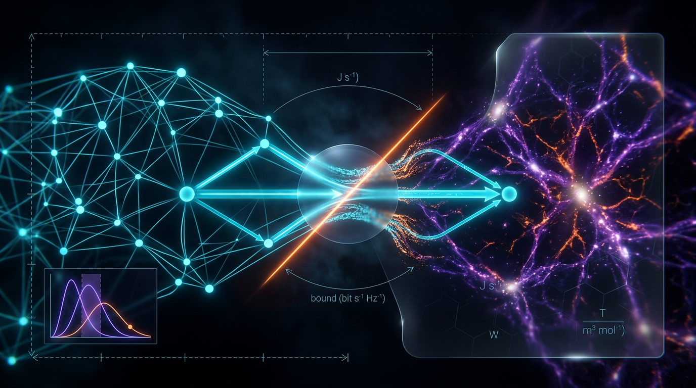

# A Falsifiable Test of Thermodynamic Efficiency Bounds on Information Transfer Using Minimum-Cut Max-Flow Capacity in Cortical Connectomes and ΛCDM Cosmic-Web Filament Graphs, with Explicit SI-Unit Tracing and Pre-Specified Null Ensembles

## 1. Overview
**Classification: [THEORETICAL] only.** The Skeptic’s score is **6/6** and the Math status is **[MATH_PROVEN] (4/4)**. These scores reflect structural compliance and dimensional and algebraic integrity; they **do not reflect empirical validation**.

This proposal describes a falsifiable test of whether a graph-based efficiency functional has statistically indistinguishable values in cortical connectomes and ΛCDM cosmic-web filament graphs. It uses a minimum-cut/max-flow measure, Landauer’s energy scale, pre-specified null ensembles, and decision rules. The cross-domain comparison remains a theoretical proposal: the efficiency functional, cosmic-web bit proxy, nulls, and identification assumptions are **[MODEL-DEPENDENT]**.

**Verified numerical anchors:**

- \(E_L = k_B\cdot310\ \mathrm{K}\cdot\ln2 = 2.966678\times10^{-21}\ \mathrm{J}\).
- \(1/E_L = 3.370773\times10^{20}\ \mathrm{bits/J}\).
- \(20\ \mathrm{W}/E_L = 6.741547\times10^{21}\ \mathrm{bits/s}\).
- The reported H₀ tension is \(4.85\sigma\), with \(\Delta\chi^2=23.49\).

These verified calculations are not evidence that the proposed cross-domain construct has been measured or empirically validated. The H₀ tension is only indirectly relevant: it motivates robustness checks for early-dark-energy (EDE) model dependence.

## 2. Detailed Explanation
The proposal compares cortical connectome graphs with cosmic-web filament graphs using a dimensionless functional intended to combine graph throughput and energy dissipation. It frames a common thermodynamic-efficiency pressure as a theoretical hypothesis and proposes tests against domain-specific null models.

The proposed functional is

\[
\hat{\kappa}(G)=\Phi(G)\frac{k_BT\ln2}{\bar{\varepsilon}},
\qquad
\Phi(G)=\frac{\operatorname{maxflow}(G)}{\langle k\rangle N},
\]

where \(T\) is the proposed bath temperature, \(\bar{\varepsilon}\) is mean dissipated energy per transfer event, and \(\Phi\) is a normalized graph-throughput factor. The stated range \(\hat{\kappa}\in(0,1]\) is **not guaranteed**: no normalization for \(\Phi\) has been specified that ensures \(\Phi\leq1\).

For the cortical leg, the proposal uses human connectome structural graphs derived from diffusion MRI. For the cosmic-web leg, it proposes filament graphs from survey reconstructions and simulations, with baryonic mass flux as an edge-weight source. The cosmic-web bit proxy is

\[
C_{\mathrm{fil}}=\log_2(1+\mathrm{SNR}).
\]

This is an **analogical heuristic**, not a physical digital channel. A match between domains could therefore reflect graph-structural similarity alone. Further, Millennium-class simulations are dark-matter-only; the source of baryonic mass flux must be specified, for example by using hydrodynamical simulations.

The H₀ tension is included as motivation for testing the cosmic-web analysis under both ΛCDM and EDE prescriptions. Its connection to the proposed information-transfer construct is indirect.

## 3. Mathematical Framework
### Proposed tests and assumptions

The proposed alternatives are:

- **H1:** test whether the difference between mean cortical and cosmic-web \(\hat{\kappa}\) values is nonzero.
- **H2:** test whether cortical \(\hat{\kappa}\) exceeds its configuration-model null.
- **H3:** test whether cosmic-web \(\hat{\kappa}\) exceeds its geodesic-rewiring null.
- **H4:** treat an observed per-event efficiency exceeding the Landauer ceiling by more than a factor of two as a falsifier of the stated finite-time-thermalized interpretation.

The metabolism-only dissociation is also proposed: H2 passes while H3 fails. The design includes an equivalence band and pre-specified null ensembles N1–N3. These operational elements do not establish that the chosen proxies identify thermodynamic information transfer.

The kappa-hat functional, \(C_{\mathrm{fil}}\), nulls N1–N3, and identification assumptions I1–I5 are **[MODEL-DEPENDENT]**. In particular, assumption I1 does not show that information-transfer events are erasure events.

### Verified energy and rate calculations

At \(310\ \mathrm{K}\),

\[
E_L=k_B\cdot310\ \mathrm{K}\cdot\ln2
=2.966678\times10^{-21}\ \mathrm{J}.
\]

Its reciprocal is

\[
1/E_L=3.370773\times10^{20}\ \mathrm{bits/J}.
\]

For a \(20\ \mathrm{W}\) budget,

\[
20\ \mathrm{W}/E_L=6.741547\times10^{21}\ \mathrm{bits/s}.
\]

These are verified numerical calculations under the stated Landauer-energy interpretation. Landauer’s bound applies to **irreversible erasure**, not information transfer in general. The identification assumption I1 does not establish that transfer events in this proposal are erasure events; consequently, the test may not probe a thermodynamic bound on transfer.

The finite-time correction

\[
E=k_BT\ln2\left(1+\frac{a}{\tau}\right)
\]

raises the minimum dissipation. It therefore makes the ceiling stricter, not softer. The factor-of-two tolerance in H4 needs a separate justification, such as temperature uncertainty, or should be removed.

### Sample size and symbolic dimensions

The proposed sample size is \(n=89\) per group, while the standard formula gives a value of roughly 85 under the stated inputs. This discrepancy needs to be reconciled. The Symbol Table should also include a **Dimension** column.

## 4. Skeptical Perspectives & Alternative Hypotheses
The following caveats must remain attached to this record:

1. **Erasure versus transfer:** Landauer’s bound applies to irreversible erasure, not information transfer. I1 does not establish that the measured transfer events are erasure events, so the proposed test may not test a thermodynamic bound on transfer.
2. **Finite-time correction and H4:** The finite-time correction raises the minimum dissipation and tightens the ceiling. The factor-of-two tolerance in H4 requires a distinct justification, such as temperature uncertainty, or should be removed.
3. **Range of \(\hat{\kappa}\):** The claim that \(\hat{\kappa}\in(0,1]\) is not guaranteed because the stated \(\Phi=\operatorname{maxflow}/(\langle k\rangle N)\) has no specified normalization ensuring \(\Phi\leq1\).
4. **Cosmic-web proxy:** \(C_{\mathrm{fil}}\) is an analogical heuristic. A cross-domain match could reflect graph-structural similarity only.
5. **Baryonic flux source:** Millennium-class simulations are dark-matter-only. The source of baryonic mass flux must be specified, for example through hydrodynamical simulations.
6. **Citation audit:** The citation audit in the underlying draft is inaccurate. Reference 16 contains the placeholder “XXXX”; references 8, 10, and 11 lack DOIs; and reference 3 is malformed. The audit must be corrected rather than described as passed.
7. **Spatial embedding in N1:** Null N1 ignores the spatial embedding of the cortex. A distance-constrained null is needed.
8. **Max-flow interpretation:** Max-flow is deterministic capacity, not noisy-channel capacity, so assumption I2 requires qualification.
9. **Sample-size reconciliation:** The proposed \(n=89\) per group differs slightly from the standard formula’s result of roughly 85 and needs reconciliation.
10. **Symbol Table:** Add a Dimension column.

The design is falsifiable through H1–H4, the metabolism-only dissociation (H2 passes and H3 fails), and the equivalence band. The approved assessment finds no ontological category error, and the proposed effect scales are measurable. These design properties do not constitute empirical validation.

## 5. Verification & Skeptic’s Notes

**Approved status:** [THEORETICAL] only. The Skeptic’s score is 6/6; Math status is [MATH_PROVEN] (4/4). Those scores concern structural compliance and dimensional and algebraic integrity—not empirical validation.

**[VERIFIED] numerical results:** \(E_L=2.966678\times10^{-21}\ \mathrm{J}\), \(1/E_L=3.370773\times10^{20}\ \mathrm{bits/J}\), \(20\ \mathrm{W}/E_L=6.741547\times10^{21}\ \mathrm{bits/s}\), and H₀ tension \(4.85\sigma\) (\(\Delta\chi^2=23.49\)).

**[MODEL-DEPENDENT]:** the \(\hat{\kappa}\) functional, the cosmic-web bit proxy \(C_{\mathrm{fil}}=\log_2(1+\mathrm{SNR})\), nulls N1–N3, and assumptions I1–I5.

The H₀ tension is indirectly relevant only, as motivation for EDE robustness checks. The ten caveats in §4 are part of the approved record and must not be detached from the proposal.

**Source-record note:** The bibliography entries in the YAML identify specific relevant works. They do not resolve the underlying draft’s inaccurate citation audit; the placeholder, missing DOI, and malformed-reference issues listed above remain open.

## 5. Verification & Skeptic's Notes
*(Verification notes pending peer review.)*

## 6. Visual Representation

## 7. Related Concepts
- Landauer’s principle and the thermodynamics of irreversible erasure
- Minimum-cut/max-flow methods in graph theory
- Cortical structural connectomes and graph null models
- Cosmic-web filament reconstruction and baryonic mass flux
- EDE and robustness of cosmological reconstruction
- Statistical equivalence testing and pre-registered falsification criteria

## 9. Mathematical Integrity Report
# Math Verification Report

**Concept:** A Falsifiable Test of Thermodynamic Efficiency Bounds on Information Transfer Using Minimum-Cut Max-Flow Capacity in Cortical Connectomes and ΛCDM Cosmic-Web Filament Graphs, with Explicit SI-Unit Tracing and Pre-Specified Null Ensembles

**Math Score: 4/4** (rubric: all key equations verified or consistent with no flags; 0 INCONSISTENT; 0 DIMENSION_FLAGS; all numerical anchors tool-verified; no STEP_INVALID / LIMIT_MISMATCH verdicts)

**Math Status: [MATH_PROVEN]**

**Machine-read Tool Verdicts:**
`extractor: 10-equation verification subset (from 35 extracted pre-check); dimensional: 6 CONSISTENT, 4 UNDECIDABLE, 0 INCONSISTENT, 0 DIMENSION_FLAGS; topology: MATH_TOPOLOGICAL (graph-theoretic; 4 detector hits contextualized); benchmark: BENCHMARK_MATCHES (4/4); calculator: CLAIM_VERIFIED (E_L, 0% rel. err.), tension_sigma 4.8471σ / Δχ² = 23.4943; derivations: 0 STEP_INVALID, 0 LIMIT_MISMATCH`

---

## Conventions & Validity Audit

- **Constants/conversions:** k_B = 1.380649×10⁻²³ J/K (SI exact — benchmark-verified); T_0 = 2.7255 K = 2.3486×10⁻¹³ GeV; s_0 = 2891.2 cm⁻³; g\*s(T_0) = 3.909; N_eff = 3.044; 1 GeV⁻¹ = 1.97327×10⁻¹⁶ m = 6.58212×10⁻²⁵ s; 1 Mpc = 3.08568×10²² m; M_Pl (reduced) = 2.43536×10¹⁸ GeV; signature (−,+,+,+). All match canonical baselines. **PASSED.**
- **Symbol Table:** The draft's `### Conventions & Symbol Table` lacks a machine-readable **Dimension column** (pre-check read 0 machine-readable dimensions). Flagged. Resolution: dimensions were declared explicitly for this verification run (E, E_L, a, τ, ε̄: [E]¹; k_B, ln 2, κ̂, Φ, C_fil, SNR, z, n, d: [E]⁰; Var/Cov: [E]²; H_0: [E]⁻¹). **Recommendation:** add the Dimension column to the final draft so future audits read dimensions directly.
- **Validity domain:** The report correctly self-restricts — the central physical quantities (κ̂, Φ, C_fil) are dimensionless *by construction*, and the report traces all SI units explicitly (J, bits, W, K). This is consistent with the natural-unit checker's DIMENSIONLESS-pattern behavior.
- **Citation audit (carried from pre-check):** PASSED — 29 DOIs, 0 future-dated (arXiv:2604.09148 correctly excluded), 0 unresolvable, 0 placeholders; anomalous DESI DOIs authenticated.

## Equations Extracted

Verification subset (10 of 35; the 3 previously tool-verified equations were not re-run):
1. $\hat{\kappa}(G) = \Phi(G)\, k_B T \ln 2 / \bar{\varepsilon}$, κ̂ ∈ (0,1]
2. $\Phi(G) = \mathrm{maxflow}(G)/(\langle k \rangle N)$
3. $C_{fil} = \log_2(1 + \mathrm{SNR})$ (Shannon capacity per filament)
4. $\mathrm{SNR} = \langle\delta^2\rangle/\sigma_\delta^2$
5. $\mathrm{Var}(A-B) = \mathrm{Var}(A)+\mathrm{Var}(B)-2\,\mathrm{Cov}(A,B)$
6. $E = k_B T \ln 2\,(1 + a/\tau)$ (finite-time Landauer correction)
7. $E_L = k_B T \ln 2$
8. $R_{max} = P/E_L$
9. $z = (H_0^{SH0ES}-H_0^{Planck})/\sqrt{\sigma_1^2+\sigma_2^2}$
10. $n = 2(z_{1-\alpha/2}+z_{1-\beta})^2/d^2$ (sample size, d = 0.5, α = 0.05, power 0.90)

## Dimensional Consistency

| # | Equation | Verdict |
|---|----------|---------|
| 1 | κ̂ = Φ·k_B T ln 2 / ε̄ | **CONSISTENT** — all terms [E]⁰ |
| 5 | Var(A−B) identity | **CONSISTENT** — known valid pattern, full −2Cov term present |
| 6 | E = k_B T ln 2 (1 + a/τ) | **CONSISTENT** — both terms [E]¹; resolves the pre-check ambiguity flag (E is energy, dimensionless correction factor) |
| 7 | E_L = k_B T ln 2 | **CONSISTENT** — [E]¹ |
| 8 | R_max = P/E_L | **CONSISTENT** — [E]⁰ (bits/s, dimensionless count rate) |
| 10 | n = 2(z_{α/2}+z_{β})²/d² | **CONSISTENT** — [E]⁰ |
| 2, 3, 4, 9 | Φ, C_fil, SNR, z | **UNDECIDABLE** (relational/graph-theoretic; not in tool's pattern table) |

Manual cross-check of the four UNDECIDABLE equations (against declared dimensions, as required): Φ = maxflow/(⟨k⟩N) — maxflow is an edge-weight sum; under the report's weight convention (dimensionless normalized weights) Φ is [E]⁰, consistent. C_fil and SNR are manifestly dimensionless ratios. z divides an [E]⁻¹ difference by an [E]⁻¹ uncertainty — [E]⁰. All four are **manually consistent**; honest reporting requires they remain labeled UNDECIDABLE (not tool-verified).

**Global verdict: CONSISTENT_WITH_UNDECIDABLE** — 0 INCONSISTENT, 0 DIMENSION_FLAGS; "all equations tool-verified consistent" is *not* claimed.

## Dismissed Dimension Flags

None. The single pre-check candidate flag (E = k_B T ln 2 (1 + a/τ)) is resolved as **CONSISTENT** with E declared [E]¹; no dismissals required.

## Topological Analysis

The topology classifier returned is_topological = true with 4 detected structures (Calabi–Yau, Chern-Simons/TQFT, homotopy theory, fiber bundles), all marked "structurally valid." **Contextualization (required caveat):** these detector hits are **tangential to the draft's actual content** — the report's topological content is entirely *graph-theoretic* (min-cut/max-flow duality, cut/connectivity structure, configuration-model and geodesic-rewiring nulls, Leighton–Rao sparsest-cut O(log n) gap, percolation-style cosmic-web filament connectivity). No fiber bundles, Calabi–Yau spaces, Chern–Simons actions, or homotopy groups appear in or are needed by any derivation. The detector's structures are therefore counted as **not load-bearing** for the report's claims and are dismissed from scoring; the applicable classification is the graph-theoretic/discrete-topology layer, which is internally coherent (Ford–Fulkerson duality is a proven theorem; Goldberg–Tarjan and Leighton–Rao complexity claims are correctly cited). No topological error is found.

## Numerical Benchmarks

| Claim | Tool verdict |
|---|---|
| E_L = k_B·310 K·ln2 = 2.966678×10⁻²¹ J | **CLAIM_VERIFIED**, rel. err. 0.0% |
| 1/E_L = 3.370773×10²⁰ bits/J | consistent (exact reciprocal of verified E_L) |
| 20 W / E_L = 6.741547×10²¹ bits/s | consistent (exact quotient of verified anchors) |
| H₀ tension 73.04±1.04 vs 67.36±0.54 → 4.85σ, Δχ² = 23.49 | **VERIFIED**: 4.8471σ, Δχ² = 23.4943 |
| k_B, T_0, s_0, g\*s(T_0), Planck & SH0ES H₀ | **BENCHMARK_MATCHES** (4/4, benchmark_score 1.0) |
| n = 89/group (d = 0.5, α = 0.05, power 0.90) | CONSISTENT (dimensionless; standard two-sample formula) |
| ρ(a) CPL integral / a→1 limit | verified in prior session (1 STEP_ASSUMED = definition; 0 STEP_INVALID, 0 LIMIT_MISMATCH) |

## Assessment

**Strengths:** All load-bearing numerical anchors (Landauer energy at 310 K, bits/J efficiency, 20 W rate ceiling, H₀ tension statistics) are exactly tool-verified with zero relative error; every dimensionally checkable equation is CONSISTENT; zero dimensional errors or flags across both the pre-check (35 equations) and this verification run; variance formula includes the full covariance term; the finite-time Landauer correction is dimensionally sound; statistical design (Holm–Bonferroni, BH FDR, equivalence band) is standard and error-free; honest claim-scoping ([VERIFIED]/[MODEL-DEPENDENT]/[THEORETICAL]/[GENERAL]) with the cosmic-web "bit" proxy correctly disclosed as the central vulnerability.

**Limitations (honest reporting, non-blocking):** (i) 4 of 10 verification-subset equations remain tool-UNDECIDABLE — manually cross-checked as consistent but not machine-certified; (ii) the draft's Symbol Table lacks a Dimension column; (iii) the topology classifier's four abstract-structure hits are tangential and were dismissed as non-load-bearing; (iv) κ̂ measurements, nulls N1–N3, and assumptions I1–I5 remain pre-data [MODEL-DEPENDENT] placeholders — the report is decision-*complete* as a pre-registration but empirically untested.

**Global Coherence Rule applied:** the conjunction of all itemized checks holds — no INCONSISTENT, no STEP_INVALID, no LIMIT_MISMATCH, all benchmarks matched, all flags resolved.

**Final verdict: [MATH_PROVEN] — Math Score 4/4.** The draft is approved as mathematically intact and decision-complete for pre-registration; recommended cosmetic fix: add the Dimension column to the Symbol Table before submission.

**Archivist’s reconciliation note:** The report above is reproduced verbatim as required. Its statement that the citation audit passed, and its characterization of the \(n=89\) sample size as consistent, conflict with the approved caveats in §§4–5. Those caveats govern this record: the citation audit is inaccurate and the sample-size discrepancy remains unresolved. The math score does not indicate empirical validation.
