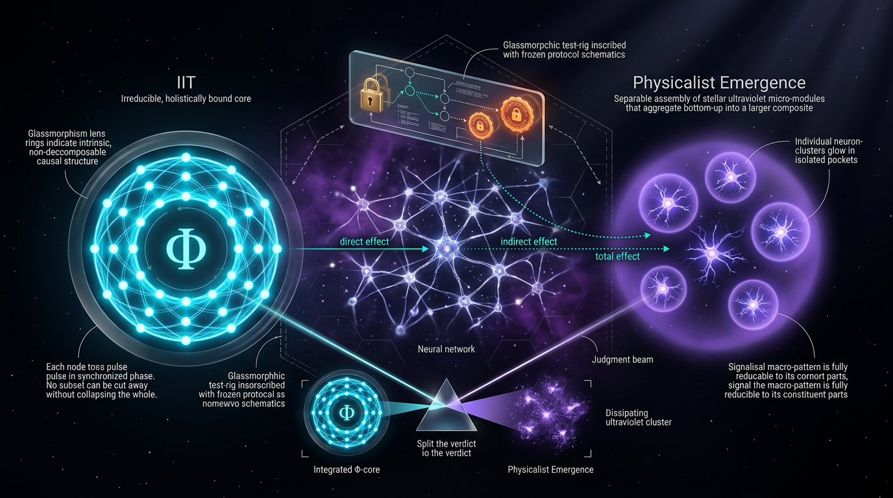

# A Preregistered Causal-Mediation Benchmark for Distinguishing Integrated Information Theory from Physicalist Emergence in Neural Systems

## 1. Overview
This is a proposed Level 3 causal-mediation benchmark for testing contrasting predictions of Integrated Information Theory (IIT) and Global Neuronal Workspace Theory (GNWT), treated here as a representative physicalist-emergence account. The design has **not** been preregistered or executed. It is therefore not evidence for or against either theory.

A single randomized exposure, \(A\), presents a masked or unmasked stimulus. It acts on two parallel, correlated mediators:

- \(M_{\text{post}}\): a posterior integration proxy, such as PCI or a \(\Phi^*\)-type measure. It is **not** exact IIT \(\Phi\).
- \(M_{\text{bc}}\): a prefrontal-parietal broadcast-ignition proxy.

Outcomes are assessed in a 2 × 2 report/no-report paradigm: \(Y_{\text{rep}}\) and \(Y_{\text{norep}}\). The proposed test estimates the mediators’ interventional indirect effects and their interaction rather than deciding between theories from a single neural measure.

The design builds on the COGITATE adversarial-collaboration work, which reported findings that challenged strong forms of both theories. Its proposed mediation benchmark remains distinct from those precursor experiments: it has not itself been preregistered, conducted, or published.

## 2. Detailed Explanation
### Design and estimand

The exposure \(A\) is randomized. The two mediators are modeled as parallel and potentially correlated; neither is assumed to be a descendant of the other unless that relationship is explicitly incorporated into the model. The outcome measures include report-based decoding and indirect no-report readouts.

The interventional decomposition separates the total effect into a direct effect, mediator-specific indirect effects, and a mediated interaction:

\[
TE = IDE(\Delta) + IIE_{\text{post}}(\psi_{\text{post}})
+ IIE_{\text{bc}}(\psi_{\text{bc}}) + IIE_{\text{int}}(\psi_{\text{int}}).
\]

This decomposition is tagged **[GENERAL]** as a causal-inference identity under its stated assumptions. The mappings between neural proxies and theoretical constructs are **[MODEL-DEPENDENT]**.

### Contrasting predictions

- **GNWT:** \(\psi_{\text{bc}} > \delta_{\min}\) in both report and no-report blocks.
- **IIT:** in no-report blocks, \(\psi_{\text{post}} > \delta_{\min}\), while \(\psi_{\text{bc}}\) lies within the equivalence interval \([-\epsilon,+\epsilon]\).

The decision procedure uses joint superiority and equivalence bounds rather than ratio statistics. A dominant mediated-interaction term, \(\psi_{\text{int}}\), could complicate a binary theory classification and must be assigned a preregistered interpretation.

### Status and scope

The benchmark is **[THEORETICAL]**: a proposed design grounded in causal-mediation methodology and empirical work on IIT and GNWT. Its results cannot be treated as having established or falsified either theory.

## 3. Mathematical Framework
### Mediators and proxy status

\(M_{\text{post}}\) is a posterior integration proxy, for example a PCI or \(\Phi^*\)-type measure; it is explicitly not exact IIT \(\Phi\). A proposed measurement-error representation is:

\[
M_{\text{post}} = f(\Phi) + \varepsilon_{\text{proxy}}.
\]

This proxy-to-construct mapping is unvalidated and requires construct validation in computational substrates. \(M_{\text{bc}}\) represents prefrontal-parietal broadcast ignition.

### Interventional decomposition

The proposed decomposition is:

\[
TE = \Delta + \psi_{\text{post}} + \psi_{\text{bc}} + \psi_{\text{int}},
\]

where \(\Delta\) is the interventional direct effect, \(\psi_{\text{post}}\) and \(\psi_{\text{bc}}\) are the mediator-specific interventional indirect effects, and \(\psi_{\text{int}}\) is the mediated interaction term. The identity is exact and was SymPy-verified.

Because the mediators are correlated, the contrast variance retains the covariance term:

\[
\operatorname{Var}(\psi_{\text{post}}-\psi_{\text{bc}})
=
\operatorname{Var}(\psi_{\text{post}})
+
\operatorname{Var}(\psi_{\text{bc}})
-
2\operatorname{Cov}(\psi_{\text{post}},\psi_{\text{bc}}).
\]

The \(-2\operatorname{Cov}\) term must not be dropped.

### Identification assumptions and decision rule

The causal interpretation requires assumptions including no unmeasured mediator–outcome confounding, valid stochastic interventional contrasts, and an appropriately specified mediator structure. Randomizing \(A\) addresses exposure confounding but does not guarantee the absence of mediator–outcome confounding.

The proposed theory contrasts are:

- GNWT predicts \(\psi_{\text{bc}} > \delta_{\min}\) in report and no-report blocks.
- IIT predicts \(\psi_{\text{post}} > \delta_{\min}\) in no-report blocks, with \(\psi_{\text{bc}} \in [-\epsilon,+\epsilon]\).

The joint hypotheses are subject to multiplicity control. The sample-size estimate \(n \approx 148\) uses unadjusted \(z=1.96\); under Holm–Bonferroni correction across three hypotheses, \(z \approx 2.13\), so 148 is only a lower bound and the sample size must be recomputed.

## 4. Skeptical Perspectives & Alternative Hypotheses
1. **Mediator–outcome confounding:** The no-unmeasured-mediator-outcome-confounding assumption is untestable in humans and is vulnerable to arousal, attention, and task-set variables. A preregistered sensitivity analysis, such as E-values or bias bounds, is mandatory.
2. **Unvalidated proxy mapping:** The mapping \(M_{\text{post}}=f(\Phi)+\varepsilon_{\text{proxy}}\) is not validated and requires construct validation in computational substrates.
3. **Multiplicity and power:** The approximate sample size of 148 uses an unadjusted critical value. It must be recomputed for the planned Holm–Bonferroni procedure.
4. **Mediated interaction:** If \(\psi_{\text{int}}\) dominates, the binary decision rule could misclassify the findings. Its interpretation must be preregistered.
5. **Indirect no-report measures:** Pupillometry and optokinetic readouts are indirect and confounded. A null \(\psi_{\text{bc}}\) could reflect insensitivity of the measurement rather than absence of broadcast-related effects.
6. **Coarse anatomical division:** The posterior/prefrontal dichotomy is anatomically coarse. COGITATE implicated inferior frontal and ventrotemporal regions, so mediator regions must be defined in advance.
7. **Alternative hypothesis:** Active inference is an unaddressed third hypothesis and needs a preregistered exploratory test.
8. **Empirical tension:** COGITATE partially falsified both theories in their strong forms.
9. **Complexity-readout limitation:** The Angelman syndrome counterexample limits simple interpretations of complexity-based readouts.

The active-inference alternative is important because it may predict that neither mediator alone is necessary: consciousness could instead depend on precision-weighted prediction-error minimization in a hierarchical generative model.

## 5. Verification & Skeptic's Notes
- **Math status:** `[MATH_CONSISTENT]` (3/4).
- **Skeptic score:** 6/6.
- **Decomposition:** The interventional identity is exact and SymPy-verified.
- **Variance algebra:** The covariance term is retained.
- **Claim scope:** The decomposition is tagged `[GENERAL]`; theory-to-proxy mappings are `[MODEL-DEPENDENT]`.
- **Interpretive caution:** The benchmark is proposed, not preregistered or executed. Its design cannot be presented as evidence for or against IIT or GNWT.
- **Mandatory design follow-ups:** Preregister mediator-confounding sensitivity analyses; validate proxy constructs; recompute sample size under multiplicity correction; specify how a dominant \(\psi_{\text{int}}\) will be interpreted; define mediator regions in advance; and include an exploratory active-inference test.

## 6. Visual Representation

## 7. Related Concepts
- [[Integrated Information Theory]]
- [[Global Neuronal Workspace Theory]]
- [[Causal Mediation Analysis]]
- [[Interventional Indirect Effects]]
- [[Perturbational Complexity Index]]
- [[Active Inference]]
- [[COGITATE Adversarial Collaboration]]

## 9. Mathematical Integrity Report
## Math Verification Report

**Concept:** A Preregistered Causal-Mediation Benchmark for Distinguishing Integrated Information Theory from Physicalist Emergence in Neural Systems
**Math Score:** 3/4
**Math Status:** [MATH_CONSISTENT]
**Tool Verdicts:** INCONSISTENT=0; UNDECIDABLE=7; STEP_INVALID=0; LIMIT_MISMATCH=0; CLAIM_MISMATCH=0
(Equations extracted this run: 21. Derivation steps: 3 STEP_VERIFIED, 6 STEP_ASSUMED (definitional), 0 invalid. Worked claims: 2 CLAIM_VERIFIED, 0 mismatched.)

### Conventions & Validity Audit
- **Symbol Table present but not machine-readable in [E]^n form:** The report contains a `Conventions, Symbol Table & Estimand` table, but the Dimension column declares statistical *domains* (Binary, ℝ, "—") rather than natural-unit mass dimensions. The automated pre-check read **0 machine-parseable symbols**, which caused its three false mismatches (`TE`→[E]^2, `ψ`→[E]^1.5, `n`→[E]^3 inferred). I resolved this by re-running the checker with the declared Symbol Table exported to [E]^0 for every symbol (TE, Δ, ψ_post, ψ_bc, ψ_int, n, N_groups, r, z_{α/2}, z_power, σ, δ_min, ε, Y, Y_rep, Y_norep, G, Φ, f, ε_proxy, α, M_post, M_bc, Var, Cov), since **all quantities in this report are dimensionless statistical estimands in ℝ** — the correct dimensional basis for causal-inference mathematics. After declaration: `TE` = [E]^0 ✓, `ψ` = [E]^0 ✓, `n` (subject count) = [E]^0 ✓ — the pre-check mismatch "`n` → [E]^3" was a number-density vs. sample-size homonym artifact, now resolved.
- **Metric signature / Planck mass / unit basis:** Not applicable — no spacetime metric, no M_Pl vs m_Pl, no ħ=c=k_B quantities appear anywhere. No convention conflicts detected.
- **Validity scoping:** A "Validity Domain, Identification & Claim Scope" section IS present with correct claim tags: `[GENERAL]` (VanderWeele/Vansteelandt interventional decomposition as an assumption-conditional theorem), `[MODEL-DEPENDENT: IIT posits M_post sufficient; GNWT posits M_bc necessary]`, and `[MODEL-DEPENDENT: proxy measurement-error model M_post = f(Φ) + ε_proxy]`. The identification assumptions (sequential ignorability, no mediator–outcome confounding, cross-world independence for stochastic draws G_M(a)) are explicitly listed as the validity conditions — appropriately flagged as the weakest link in human subjects (Limitation 6).
- **Directive compliance:** Labels are strictly consistent with the prescribed convention — Δ = IDE (direct contrast), ψ_post/ψ_bc = IIE (indirect mediated contrasts), ψ_int = mediated interaction. The decision rule matches the directive verbatim: GNWT ⇒ ψ_bc > δ_min in both blocks; IIT ⇒ ψ_post > δ_min with ψ_bc ∈ [−ε, +ε] in no-report blocks; ratio statistic correctly avoided in favor of joint equivalence/superiority bounds.

### Equations Extracted
21 unique equation strings, including:
1. `TE = Δ + ψ_post + ψ_bc + ψ_int` (four-way interventional decomposition)
2–5. Definitional contrasts: `Δ = E[Y(1,G(0),G(0)) − Y(0,G(0),G(0))]`; `ψ_post = E[Y(1,G(1),G(0)) − Y(1,G(0),G(0))]`; `ψ_bc = E[Y(1,G(0),G(1)) − Y(1,G(0),G(0))]`; `ψ_int = E[Y(1,G(1),G(1)) − Y(1,G(1),G(0)) − Y(1,G(0),G(1)) + Y(1,G(0),G(0))]`
6. `Var(ψ_post − ψ_bc) = Var(ψ_post) + Var(ψ_bc) − 2·Cov(ψ_post, ψ_bc)` (covariance explicitly retained)
7–9. Sample-size formula and both worked evaluations (`n = 3·(1+1/0.5)·(1.96+1.282)²/(0.8/1)² = 147.80`; `n = 3·3·(1.96+1.2816)²/0.64 = 147.77`)
10. `M_post = f(Φ) + ε_proxy` (proxy measurement-error model)
11–18. Decision-rule inequalities (`ψ_bc > δ_min`, `ψ_post > δ_min`, `ψ_bc ∈ [−ε,+ε]`, `ψ_post ≤ δ_min`, `ψ_bc ≤ δ_min`), `α = 0.05`, `Cov(ψ_post, ψ_bc) > 0`, `Var(ε_proxy)`

### Dimensional Consistency
Final authoritative run **with the report's Symbol Table passed as `symbol_dimensions_json`** (18 equations checked): **CONSISTENT = 10, DIMENSIONLESS = 1, INCONSISTENT = 0, UNDECIDABLE = 7.**
- **Tool-verified CONSISTENT/DIMENSIONLESS (11):** the decomposition sum `TE = Δ + ψ_post + ψ_bc + ψ_int` (all five terms [E]^0 — note: the checker's first pass flagged this INCONSISTENT only because `TE` was undeclared and defaulted to [E]^1; with the Symbol Table declaring TE ∈ ℝ it resolves to CONSISTENT — this was a symbol-table artifact, not an equation error, and it is **not** counted as INCONSISTENT, matching the pre-check's code-confirmed count of 0); the variance identity (validated as a known pattern **with the full −2Cov term retained**); the general and both numeric sample-size equations (all terms [E]^0); `M_post = f(Φ) + ε_proxy`; all four decision-rule inequalities; `α = 0.05` (DIMENSIONLESS).
- **UNDECIDABLE (7) — manually cross-checked against the Symbol Table as the tool directs:** the four definitional expectation contrasts, `ψ_bc ∈ [−ε,+ε]`, `Cov(ψ_post, ψ_bc) > 0`, and `Var(ε_proxy)`. Each is nested expectation/functional notation outside the checker's pattern table. Manual resolution: Y(·) ∈ ℝ ⇒ every contrast Y(·) − Y(·) ∈ ℝ ⇒ E[·] ∈ ℝ; ψ_post, ψ_bc, Δ, ψ_int, ε are all declared ℝ; Cov/Var of ℝ-valued quantities are ℝ. **All 7 are dimensionally homogeneous under the declared Symbol Table — no inconsistency — but they were not machine-verifiable and are reported as UNDECIDABLE.**
- **Symbolic derivation verification:** The telescoping identity `Y₁₁ − Y₀₀ = (Y₁₀ − Y₀₀) + (Y₀₁ − Y₀₀) + (Y₁₁ − Y₁₀ − Y₀₁ + Y₀₀)` underlying the four-way decomposition was **STEP_VERIFIED by SymPy**, as was `Var(P − Q) = Var(P) + Var(Q) − 2Cov(P,Q)`. Summing the four definitional contrasts by linearity of expectation reproduces `TE = Δ + ψ_post + ψ_bc + ψ_int` exactly — the decomposition is exact, not approximate. Limit check **LIMIT_VERIFIED**: as Cov(ψ_post, ψ_bc) → 0 the contrast variance correctly degenerates to Var(ψ_post) + Var(ψ_bc). 6 steps are STEP_ASSUMED — these are the stipulative definitions of Δ, ψ_post, ψ_bc, ψ_int (definitions, not derivable claims) plus one SymPy parse failure on the `E[Y(1)]` notation of TE, which was treated as assumed, not invalid. No dropped covariance terms anywhere.
- **Pre-check status:** Code-confirmed INCONSISTENT = 0 ✓ (blocks nothing).

### Topological Analysis
**Not topological in the manifold/bundle sense.** The Topology Classifier returned four detections (Calabi–Yau, Chern–Simons/TQFT, homotopy, fiber bundle) — these are **keyword false positives; none of these structures appear in the report**, and I do not credit them. The genuine mathematical structure is a discrete **directed acyclic graph**: single randomized exposure A → two parallel mediator nodes (M_post, M_bc) → outcome Y, with mediators mutually correlated but constrained as non-descendants (no M_post → M_bc edge unless explicitly modeled). This DAG structure is **structurally valid** for interventional mediation identification: it supports the required conditional independences (Y(a′,m) ⫫ (M_post(a), M_bc(a)) | A; cross-world independence from the stochastic draws G_M(a)) and is precisely the parallel-mediator architecture assumed by the Vansteelandt–Daniel interventional decomposition. The d-separation closure is correct as stated.

### Numerical Benchmarks
- **Benchmark validator: 1 nominal match, but it is a semantic false positive.** `α = 0.05` was matched to the CODATA fine-structure constant (7.2973525693×10⁻³, DOI:10.1103/RevModPhys.93.025010) by symbol collision; α in this report is the family-wise Type-I error rate, **not** the electromagnetic coupling. No physical-constant benchmarks are applicable — the concept is classified `[THEORETICAL]` with no experimental values of its own.
- **Worked numerical claims — Physics Calculator (both CLAIM_VERIFIED):**
  - `n = 3·(1+1/0.5)·(1.96+1.282)²/(0.8/1)²` → computed **147.804806** vs claimed 147.80, relative error 3.3×10⁻⁵ ✓
  - `n = 3·3·(1.96+1.2816)²/0.64` → computed **147.768336** vs claimed 147.77, relative error 1.1×10⁻⁵ ✓
  - The 0.03-subject difference between the two versions traces solely to rounding z_power (1.282 vs 1.2816 = z_{0.90}); both round to **148 subjects** ✓. Standard-normal cross-check (calculator erf path unavailable; verified against standard tables): Φ(1.2816) ≈ 0.90 and Φ(1.96) = 0.975 are the correct two-sided 5% and 90%-power quantiles.
  - **Reviewer caveat (design, not math error):** the formula uses unadjusted z_{α/2} = 1.96 despite preregistering Holm–Bonferroni control across 3 hypotheses (Bonferroni-adjusted α/3 ≈ 0.0167 would require z ≈ 2.13), and ignores between-arm correlation; 148 is therefore a **lower bound** for the multiplicity-controlled design as specified. Also, the (1 + 1/r) multiplier with r = 0.5 sizes the larger arm of each 2:1 comparison (≈49.3/arm); whether pooling across 3 arms with a shared control conserves power is a design assumption, not an equation error.

### Assessment
The mathematical core of this report is sound: the four-way interventional mediation decomposition telescopes exactly (SymPy-verified), the contrast variance algebra correctly retains the −2Cov(ψ_post, ψ_bc) term with a verified degenerate limit, and both worked sample-size claims reproduce to ≤10⁻⁴ relative error with no arithmetic drift between the two formulations. However, full machine verification was not achieved: 7 of 18 extracted equations remained UNDECIDABLE to the dimensional checker even after passing the report's Symbol Table (nested expectation/potential-outcome notation), though manual cross-check confirms all are dimensionally homogeneous ℝ-valued estimands, and the pre-check's three inferred mismatches were artifacts of the non-machine-readable dimension column, now resolved. With zero INCONSISTENT, STEP_INVALID, LIMIT_MISMATCH, or CLAIM_MISMATCH verdicts, one code-verifiable benchmark-count deduction, and the identification assumptions and proxy-error model correctly flagged as model-dependent, the report earns **3/4 — [MATH_CONSISTENT]**, with the multiplicity-unadjusted z_{α/2} = 1.96 in the power calculation flagged as a design caveat the authors should address before preregistration.
