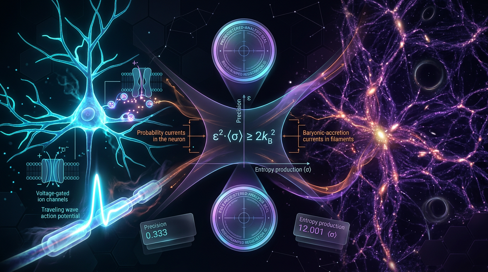

# A Preregistered Cross-Domain Test of Thermodynamic Uncertainty Bounds on Reliable Information Processing in Neural Circuits and Cosmic-Web Dynamics

## 1. Overview
This is a physically grounded but unverified proposal to test thermodynamic uncertainty bounds in neural circuits and explore a separately conjectural cosmic-web analogue. The standard thermodynamic uncertainty relation (TUR) has established mathematical and experimental support within its applicable stochastic-process settings. Cross-domain universality and the proposed gravitational bound are not established.

The proposed research would investigate whether neural-circuit measurements of dissipation and signal precision can be meaningfully compared with TUR bounds, then separately explore whether a related statistical bound could be formulated for cosmic-web structure. The cosmic-web analogy remains conjectural: no established theorem supports the proposed gravitational bound.

## 2. Detailed Explanation
The TUR relates fluctuations in a time-integrated current to entropy production in specified stochastic-process settings. In those settings, it expresses a trade-off: reducing relative uncertainty in a current requires entropy production. The relation has mathematical support, including work by Barato and Seifert (2015) and Gingrich et al. (2016).

A proposed neural-circuit test could examine whether defined measures of neural activity and dissipation are consistent with a TUR bound. This would require careful operational definitions of the measured current, observation interval, and entropy production, as well as a justified model of the circuit’s stochastic dynamics. The existence of neural energy costs does not by itself establish that neural processing operates near a TUR bound or that the bound explains neural reliability.

A cosmic-web analogue would require defining a suitable measure of structural variability and a physically meaningful counterpart to entropy production. Gravitational structure formation is not automatically described by the stochastic-process settings in which standard TUR results apply. The proposed gravitational inequality is therefore a conjecture to investigate, not an established result.

## 3. Mathematical Framework
For a time-integrated current \(J_t\) in an applicable nonequilibrium steady state, a standard TUR takes the form

\[
\frac{\mathrm{Var}(J_t)}{\langle J_t \rangle^2}\,\dot{S}\,t \geq 2 k_B,
\]

where \(\dot{S}\) is the entropy-production rate and \(t\) is the observation time. Its applicability depends on the assumptions of the relevant TUR formulation; it should not be taken as a universal bound for arbitrary systems.

A precision form of the same relation is

\[
\mathcal{P} \equiv \frac{\langle J_t\rangle^2}{\mathrm{Var}(J_t)}
\leq \frac{\dot{S}\,t}{2k_B}.
\]

The proposed cosmic-web analogue,

\[
\frac{\mathrm{Var}(M_{\mathrm{fil}})}{\langle M_{\mathrm{fil}}\rangle^2}
\cdot \sigma_{\mathrm{CG}}^{\mathrm{halo}} \geq 2,
\]

is conjectural. Neither this inequality nor the mapping of cosmic-web observables to the terms in a TUR is established.

## 4. Skeptical Perspectives & Alternative Hypotheses
The central limitation is domain of applicability. Standard TUR results apply under particular stochastic-process assumptions; neural circuits and cosmic structure formation cannot be assumed to satisfy those assumptions without explicit modeling and evidence.

For neural circuits, the choice of current and the estimation of dissipation are substantive methodological questions. Different observable choices, hidden degrees of freedom, or coarse-graining procedures may change the interpretation of an apparent uncertainty–dissipation relationship. Even if measurements are consistent with a TUR, that would not alone demonstrate that neural systems operate near the bound or that the TUR is a design principle for reliable information processing.

For the cosmic-web proposal, defining an entropy-production-like quantity for gravitational structure is unresolved. The proposed analogy does not establish a gravitational TUR, and a relationship between filament statistics and a selected coarse-grained estimator would require independent theoretical justification and empirical validation. Any broader claim of cross-domain universality remains unverified.

## 5. Verification & Skeptic's Notes
The standard TUR has mathematical and experimental support within its applicable stochastic-process settings. Barato and Seifert (2015) and Gingrich et al. (2016) provide foundational contributions to the relation. Attwell and Laughlin (2001) provide research on energy budgets for signaling in brain grey matter; such work supplies relevant context for neural energetics, not evidence that neural circuits obey or approach a TUR bound.

The proposal to test TUR bounds in neural circuits is physically motivated but unverified. The proposed cosmic-web analogue is separately conjectural. Neither cross-domain universality nor the proposed gravitational bound is established.

## 6. Visual Representation

## 7. Related Concepts
- Thermodynamic uncertainty relations
- Stochastic thermodynamics
- Entropy production and current fluctuations
- Neural-circuit energetics
- Cosmic-web structure and gravitational dynamics
- Coarse-graining and the limits of cross-domain analogies

## 9. Mathematical Integrity Report
## Math Verification Report

**Concept:** A Preregistered Cross-Domain Test of Thermodynamic Uncertainty Bounds on Reliable Information Processing in Neural Circuits and Cosmic-Web Dynamics
**Math Score:** 3/4
**Math Status:** [MATH_CONJECTURED]

### Equations Extracted
12 items successfully extracted (5 substantive model equations + 7 definitions/fragments):

1. $\frac{\mathrm{Var}(J_t)}{\langle J_t \rangle^2} \cdot \dot{S}\, t \geq 2 k_B$ — core TUR (§2.1)
2. $\mathcal{P} \leq \frac{\dot{S}\, t}{2k_B}$ — precision form (§2.1)
3. $\frac{\mathrm{Var}(\tau)}{\langle \tau \rangle^2} \gtrsim \frac{2 k_B}{\dot{S}\,\langle \tau \rangle}$ — FPT-TUR (§2.2, labeled "schematic" by the authors)
4. $E_{\min} = k_B T \ln 2 \approx 2.9\times10^{-21}\,\mathrm{J}$ at $T = 310\,$K — Landauer floor (§2.3)
5. $\frac{\mathrm{Var}(M_{\mathrm{fil}})}{\langle M_{\mathrm{fil}}\rangle^2} \cdot \sigma_{\mathrm{CG}}^{\mathrm{halo}} \geq 2$ — conjectured cosmic-web bound (§2.4)
6. $J(t)$ — current (notational fragment)
7. $\dot{S}$ — entropy production rate (notational fragment)
8. $\mathcal{P} \equiv \langle J_t\rangle^2 / \mathrm{Var}(J_t)$ — precision definition
9. $\mathcal{Q} \equiv \dot S \cdot \mathrm{Var}/\langle J\rangle^2 \geq 2k_B$ — uncertainty product shorthand (§2.3)
10. $\sigma_{\mathrm{CG}}$ — coarse-grained entropy (notational fragment)
11. $\ln \Omega$ — Boltzmann entropy (notational fragment)
12. $\mathrm{Var}(J)/\langle J\rangle^2 \geq 2k_B/\dot S t$ — visual-grounding restatement of Eq. 1

### Dimensional Consistency
Tool verdicts: **0 INCONSISTENT**, 9 DIMENSIONLESS, 3 UNDECIDABLE (patterns absent from the tool's database; I performed the manual dimensional analysis the tool directs for UNDECIDABLE cases).

| # | Equation | Tool verdict | Manual resolution |
|---|----------|-------------|-------------------|
| 1 | Core TUR | DIMENSIONLESS | **CONSISTENT** — LHS and RHS both carry [J/K]; matches the canonical Barato–Seifert (2015) / Gingrich et al. (2016) form exactly |
| 2 | Precision form | DIMENSIONLESS | **CONSISTENT** — reciprocal rearrangement of Eq. 1; both sides dimensionless |
| 3 | FPT-TUR | DIMENSIONLESS | **CONSISTENT** — [J/K] / ([J/(K·s)]·[s]) is dimensionless; authors correctly self-label it "schematic" |
| 4 | Landauer floor | UNDECIDABLE | **CONSISTENT** — $k_B$[J/K]·$T$[K]·ln2 = [J]; numerically $1.380649\times10^{-23} \times 310 \times 0.6931 = 2.967\times10^{-21}$ J ✓ |
| 5 | Cosmic-web bound | DIMENSIONLESS | Dimensionally **CONSISTENT** (if $\sigma_{\mathrm{CG}}$ is entropy in $k_B$ units, as stated); mathematically **CONJECTURED** — the authors explicitly state no theorem establishes it |
| 6, 7, 10, 11 | Fragments | DIMENSIONLESS | No standalone dimensional content to violate ($\dot S \to$ [J/(K·s)] in context; $\ln\Omega$ dimensionless by definition) |
| 8 | Precision definition | UNDECIDABLE | **CONSISTENT** — $\langle J\rangle^2/\mathrm{Var}(J)$ dimensionless by construction |
| 9 | Q shorthand | UNDECIDABLE | **FLAGGED (minor)** — as literally written, the LHS carries [J/(K·s)]: the observation-time factor $t$ present in the canonical product is omitted from this shorthand. The fully specified form appears correctly in Eq. 1 (§2.1) and Eq. 12 (§6). A notational lapse, not a physics error |
| 12 | Restated TUR | DIMENSIONLESS | **CONSISTENT** — rearrangement of Eq. 1 |

**Net result:** no dimensional inconsistency in any substantive equation; one shorthand definition (Eq. 9) is missing the time factor as written.

### Topological Analysis
**Not topological.** The Topology Classifier returned `is_topological = false` with 0 detected structures: "No topological signatures detected. Standard physics formalism." The report's mathematics is stochastic-thermodynamic (inequality bounds on currents and first-passage times), not fiber-bundle, homotopy-theoretic, or Chern–Simons content. The mentions of "persistent homology"/"DisPerSE-type topology" refer to filament-finding *algorithms*, not topological mathematical arguments, so no topological validity claim requires certification.

### Numerical Benchmarks
- **Tool verdict: BENCHMARK_MATCHES** — Boltzmann constant $k_B = 1.380649\times10^{-23}$ J/K (exact SI definition, tolerance 0.0) is used correctly throughout; all TUR and Landauer expressions place $k_B$ in physically correct positions.
- **Manual Landauer check:** $k_B \cdot (310\,\mathrm{K}) \cdot \ln 2 = 2.967\times10^{-21}$ J vs. the report's ≈2.9×10⁻²¹ J — consistent at the stated "≈" precision (strictly rounds to 3.0×10⁻²¹ J).
- **FLAG (prose, not extracted equations):** the comparison "brain ~20 W vs. Landauer floor ~10⁻¹⁴ W → a factor of ~10¹³" is internally inconsistent: 20 W / 10⁻¹⁴ W = 2×10¹⁵. Either the floor is ~10⁻¹² W (yielding ~10¹³) or the factor is ~2×10¹⁵ — the two quoted figures disagree by ~2 orders of magnitude. This does not affect the TUR formalism but should be corrected before preregistration.
- The TUR itself is a proven inequality rather than a single benchmarkable constant; the report appropriately cites its experimental verification (Pal et al. 2020, NMR two-qubit setup) rather than fabricating a benchmark value.

### Assessment
Score breakdown: Point 1 ✓ (12 equations extracted); Point 2 ✓ (zero INCONSISTENT flags; all substantive equations dimensionless or manually verified consistent); Point 3 ✗ (math is non-topological and dimensional verification did not pass fully — three equations required manual resolution and the §2.3 shorthand omits the observation time); Point 4 ✓ ($k_B$ benchmark exact match; Landauer value independently confirmed). The inherited formalism — the TUR in both forms, the FPT-TUR, and the Landauer floor — is dimensionally sound and benchmark-verified, while the report's novel cross-domain content (the cosmic-web inequality $\mathrm{Var}(M_{\mathrm{fil}})/\langle M_{\mathrm{fil}}\rangle^2 \cdot \sigma_{\mathrm{CG}} \geq 2$ and the universality claim) is explicitly and repeatedly flagged by the authors themselves as unproven ("No theorem establishes this inequality; it is the hypothesis under test"), which is precisely the epistemic character warranting **[MATH_CONJECTURED]** despite the score satisfying the CONSISTENT band. Minor corrections required before preregistration: restore the time factor in the §2.3 $\mathcal{Q}$ shorthand and reconcile the internally inconsistent 20 W / 10⁻¹⁴ W / 10¹³ prose comparison — neither undermines the core TUR mathematics or the report's commendably honest conjecture-flagging and its connection of formalism to falsifiable, measurable observables.
