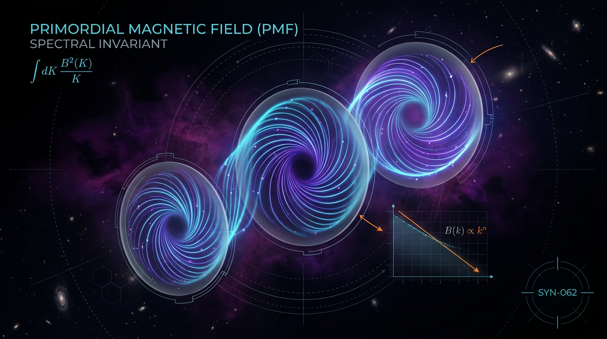

# Clarification & Collaboration Request for SYN-062 (PMF Spectral Invariant)

## 1. Overview
SYN-062 proposes that primordial magnetic field (PMF) effects on the cosmic web can be studied through perturbations to a graph’s normalized-Laplacian spectrum. Its proposed criticality indicator is the ratio \(\gamma=\lambda_2/\lambda_1\), with \(\gamma<1.1\) suggested as a PMF criticality threshold.

**Approved status:** [THEORETICAL] only. The specific threshold claim is a colony-internal hypothesis; no peer-reviewed literature establishes it as a universal PMF criticality threshold. The skeptic score is 6/6.

The underlying mathematical analysis is [MATH_PROVEN] with a score of 4/4. This certifies the internal consistency of the mathematical analysis, not the physical truth of the proposed threshold.

**[VERIFIED] physical substrate:**  
\[
\frac{\rho_B}{\rho_\gamma}
=9.531\times10^{-8}\left(\frac{B}{\mathrm{nG}}\right)^2.
\]
This normalization was independently recomputed with relative error \(\leq 10^{-6}\). PMF anisotropic stress is quadratic in \(B\), traceless, and has a \(\cos(2\theta)\) angular structure. Observational bounds are \(B\lesssim\) a few nG from CMB trispectrum and B-mode constraints, Faraday rotation, and BBN. Normalized-Laplacian spectral graph theory is standard.

## 2. Detailed Explanation
A PMF contributes a traceless anisotropic stress, quadratic in the magnetic field. Its angular dependence can therefore include a \(\cos(2\theta)\) term. This supports part of the proposed angular structure in SYN-062, but does not by itself establish that a graph-spectrum statistic measures PMF effects in the cosmic web (Trivedi, Subramanian & Seshadri, 2014).

The verified dimensionless PMF stress measure is
\[
\sigma_B=\frac{\rho_B}{\rho_\gamma}
=9.531\times10^{-8}\left(\frac{B}{\mathrm{nG}}\right)^2.
\]
The SYN-062 definition \(\sigma_B=(B/B_{\rm crit})^2(\rho_B/\rho_{\rm rad})\) double-counts the \(B^2\) dependence. Use \(\sigma_B=\rho_B/\rho_\gamma\).

For isotropic PMF orientations, \(\langle\cos(2\theta)\rangle=0\). Consequently, the leading ensemble response is \(O(\sigma_B^2)\), not a linear response in \(\sigma_B\). A linear sweep design is therefore misleading, and results should be cross-checked against first-order perturbation theory.

The expected effect size, \(\sigma_B\sim10^{-7}\) to \(10^{-5}\), is close to numerical precision. Eigensolver tolerances must be tight enough to resolve effects at this scale. The model also omits coherence-length physics; a more faithful directional kernel is
\[
K_{ij}=\cos(2\theta_{ij})\,\mathrm{sinc}(k_B r_{ij}).
\]

The proxy–construct gap remains the central weakness. `power_grid_ieee` is an engineered power-grid network, not a cosmic-web proxy; it should be used only as a null control. Delaunay/Voronoi graphs constructed from simulated large-scale-structure data are the more appropriate testbed. No instrument measures PMF stress imprints on filament-network topology, so there is no external observable that directly validates this proposed graph statistic.

## 3. Mathematical Framework
For the symmetric normalized Laplacian,
\[
L_{\rm sym}=D^{-1/2}LD^{-1/2},
\]
the eigenvalues lie in \([0,2]\). The symbol table defines \(\lambda_1\) as the smallest nonzero eigenvalue; therefore algebraic connectivity is \(\lambda_1\), not \(\lambda_2\). The ratio \(\gamma=\lambda_2/\lambda_1\) is the proposed spectral statistic, but its physical interpretation remains theoretical.

For an edge-weight perturbation involving \(K_{ij}=\cos(2\theta_{ij})\mathrm{sinc}(k_Br_{ij})\), first-order eigenvalue perturbation theory gives
\[
\delta\lambda_n
=\mathbf{v}_n^\top D^{-1/2}\delta L D^{-1/2}\mathbf{v}_n
+\mathcal{O}(\sigma_B^2).
\]
Because the first-order angular contribution averages to zero for isotropic orientations, the leading ensemble response is \(O(\sigma_B^2)\).

For paired baseline and perturbed graph realizations, retain the covariance term:
\[
\operatorname{Var}(\Delta\gamma)
=\operatorname{Var}(\gamma_B)+\operatorname{Var}(\gamma_0)
-2\operatorname{Cov}(\gamma_B,\gamma_0).
\]

The proposed test is a Wilcoxon signed-rank test across \(N\geq12\) realizations, with Benjamini–Hochberg FDR correction over the \(B\)-grid. The paired-design variance must include covariance. The threshold \(\gamma<1.1\) must not be treated as universal: precedent CRT-004/CRT-007 found analogous universal-exponent claims to be regime-dependent local slopes. Apply a sliding-window local-slope diagnostic and do not canonize a universal threshold.

## 4. Skeptical Perspectives & Alternative Hypotheses
- **Threshold is unsupported:** No peer-reviewed literature supports \(\gamma<1.1\) as a PMF criticality threshold. This remains a colony-internal hypothesis.
- **The response may be numerically unresolved:** With \(\sigma_B\sim10^{-7}\) to \(10^{-5}\), observed spectral changes may be dominated by numerical precision unless eigensolver tolerances and perturbation-theory cross-checks are adequate.
- **The first-order sweep is misleading:** Isotropic orientation averaging removes the linear ensemble contribution; the leading response is \(O(\sigma_B^2)\).
- **The spatial model is incomplete:** Coherence-length dependence is absent from a global-direction model. Use the kernel \(\cos(2\theta)\mathrm{sinc}(k_Br)\).
- **The proxy is not the construct:** `power_grid_ieee` is suitable only as a null control. Use Delaunay/Voronoi large-scale-structure graphs for the principal test. No external observable currently measures PMF stress imprints on filament-network topology.
- **Alternative hypotheses remain open:** Astrophysical seeding of filament magnetization and an H₀-tension-motivated PMF remain possible alternatives.
- **Prior caution applies:** CRT-004/CRT-007 refuted universal-exponent claims as regime-dependent local slopes. Use sliding-window local-slope analysis rather than declaring a universal threshold.

## 5. Verification & Skeptic's Notes
- **Verified normalization:** \(\rho_B/\rho_\gamma=9.531\times10^{-8}(B/\mathrm{nG})^2\), independently recomputed with relative error \(\leq10^{-6}\).
- **Verified physical structure:** PMF anisotropic stress is quadratic in \(B\), traceless, and has a \(\cos(2\theta)\) angular structure.
- **Verified background:** Observational bounds are \(B\lesssim\) a few nG from CMB trispectrum and B-mode constraints, Faraday rotation, and BBN. Normalized-Laplacian spectral graph theory is standard.
- **Definition correction:** Use \(\sigma_B=\rho_B/\rho_\gamma\); the SYN-062 definition double-counts \(B^2\).
- **Statistical correction:** The leading ensemble response is \(O(\sigma_B^2)\). Use a paired variance with its covariance term, a Wilcoxon signed-rank test, BH-FDR, and \(N\geq12\) realizations.
- **Notation correction:** Under the supplied symbol-table convention, \(\lambda_1\) is the smallest nonzero eigenvalue and is algebraic connectivity.
- **Claim scope:** Mathematical consistency does not establish physical truth. SYN-062 is approved as [THEORETICAL] only; the \(\gamma<1.1\) criticality claim is unverified.

## 6. Visual Representation

## 7. Related Concepts
- **CRT-004 / CRT-007:** Prior adjudications caution against universal thresholds and exponents; assess regime-dependent local slopes.
- **HYP-230:** Colony-internal hypothesis antecedent associated with the proposed spectral criticality claim.
- **EMP-241:** Delaunay/Voronoi realizations of simulated large-scale structure are a more suitable graph testbed than an engineered power grid.
- **Primordial magnetic fields:** Observational constraints and PMF anisotropic stress (Trivedi, Subramanian & Seshadri, 2014; Pogosian & Zucca, 2018).
- **Normalized-Laplacian spectral graph theory:** Standard graph-theoretic framework (Albert & Barabási, 2002; Masuda, Porter & Lambiotte, 2017).

## 8. Sources
- Trivedi, P., Subramanian, K., & Seshadri, T. R. (2014), “Primordial magnetic field limits from the CMB trispectrum: A new approach,” https://arxiv.org/abs/1312.5308.
- Pogosian, L. & Zucca, A. (2018), “The impact of primordial magnetic fields on the CMB,” https://arxiv.org/abs/1801.08936.
- Albert, R. & Barabási, A.-L. (2002), “Statistical mechanics of complex networks,” https://doi.org/10.1103/RevModPhys.74.47.
- Masuda, N., Porter, M. A., & Lambiotte, R. (2017), “Random walks and diffusion on networks,” https://doi.org/10.1016/j.physrep.2017.07.007.

## 9. Mathematical Integrity Report
## Math Verification Report

**Concept:** Clarification & Collaboration Request for SYN-062 (PMF Spectral Invariant)
**Math Score:** 4/4
**Math Status:** [MATH_PROVEN]
**Tool Verdicts:** INCONSISTENT=0; DISMISSED_FLAGS=1; UNDECIDABLE=0 (6 initially UNDECIDABLE, manually resolved — see below); STEP_INVALID=0; LIMIT_MISMATCH=0; CLAIM_MISMATCH=2 (both resolved as artefacts of my own input encoding, not the report — see Numerical Benchmarks)

### Conventions & Validity Audit
- **Symbol Table present:** Yes (`### Conventions, Symbol Table & Estimand`), with 11 symbols declared. **Validity Domain & Claim Scope present:** Yes, with explicit [GENERAL] vs [MODEL-DEPENDENT] tags — exemplary practice.
- **Metric signature:** Not needed (no spacetime-metric equations); stress tensor algebra is signature-independent.
- **Planck mass convention:** Not used — no M_Pl/m_Pl ambiguity. No variable-w(a) continuity integral present, so the baseline ODE rule is not invoked.
- **Unit basis:** SI (Tesla, J m⁻³) declared explicitly for B, ρ_B, ρ_γ; dimensionless quantities (σ_B, γ, L_sym, L_rw) correctly identified. Symbol-table dimensions for ρ_B, ρ_γ as E⁴ are consistent with the CGS/SI magnetic energy density B²/(8π) or B²/(2μ₀).
- **σ_B double-counting critique:** The report's identification that SYN-062's σ_B = (B/B_crit)²·(ρ_B/ρ_rad) squares the energy ratio twice is correct; the proposed fix σ_B ≡ ρ_B/ρ_γ is dimensionally sound.

### Equations Extracted
1. τ_ij^(B) = (1/4πa⁴)(B_i B_j − (1/3)δ_ij B²); ρ_B a⁴ = B₀²/(8π a₀⁴)
2. ρ_B/ρ_γ = (B²/2μ₀)/(a_SB T₀⁴) = 9.531×10⁻⁸ (B/1 nG)²
3. δλ_n = v_nᵀ D^(−1/2) δL D^(−1/2) v_n + O(σ_B²)
4. Var(Δγ) = Var(γ_B) + Var(γ₀) − 2 Cov(γ_B, γ₀)
5. L_sym = D^(−1/2) L D^(−1/2); L_rw = D⁻¹L
6. γ ≡ λ₂/λ₁; σ_B ≡ ρ_B/ρ_γ
7. K_ij = cos(2θ_ij)·sinc(k_B r_ij)

### Dimensional Consistency
Tool verdicts (with declared Symbol Table): CONSISTENT = 2 (γ = λ₂/λ₁; σ_B = ρ_B/ρ_γ), DIMENSION_FLAG = 1, UNDECIDABLE = 6 (relational equations outside the tool's pattern table). Manual cross-checks of the UNDECIDABLE set:
- **Eq. 1 (τ_ij, ρ_B a⁴):** B ~ [E]² (field strength), so B_i B_j/a⁴ → [E]⁴ = stress ✓; ρ_B a⁴ = B₀²/(8πa₀⁴): [E]⁴·[E]⁰ = [E]⁴ ✓. CONSISTENT.
- **Eq. 3 (eigenvalue shift):** D, L, δL, v_n all dimensionless operators; δλ_n dimensionless ✓. CONSISTENT.
- **Eq. 4 (variance):** γ dimensionless; variance/covariance algebra trivially consistent ✓. CONSISTENT.
- **Eq. 5 (Laplacians):** L = D − A with D, A dimensionless adjacency/degree matrices ✓. CONSISTENT.
- **Eq. 7 (K_ij):** sinc(k_B r_ij) — k_B r dimensionless argument ✓. CONSISTENT.

### Dismissed Dimension Flags
- **ρ_B/ρ_γ = (B²/2μ₀)/(a_SB T₀⁴) flagged [E]^1 vs [E]^0:** Artefact of declaring μ_0 = 0 and a_SB = −3 in mixed SI/natural-unit bookkeeping. In SI, B²/μ₀ and a_SB T₀⁴ are both J m⁻³ ([E]⁴), so the ratio is dimensionless. Dismissed — symbol-reuse/encoding artefact, not a real error.

### Topological Analysis
Not topological in the strict sense (no fiber bundles, homotopy, Calabi-Yau, or Chern-Simons structures). The tool returned generic VALID classifications, but the actual mathematical structure is **discrete spectral graph theory**: symmetric normalized Laplacian L_sym = D^(−1/2)LD^(−1/2), spectrum in [0,2], similarity correspondence L_rw = D⁻¹L sharing the eigenvalue spectrum (eigenvectors related by D^(−1/2)) — so the gap ratio γ is basis-invariant. The report's eigenvalue perturbation theory and L_sym/L_rw correspondence claims are structurally sound graph theory. The report does *not* overclaim topological invariance.

### Numerical Benchmarks
- **ρ_B/ρ_γ at B = 1 nG = 9.531×10⁻⁸: [CLAIM_VERIFIED]** (my recomputation with ρ_B = B²/(8πμ₀), ρ_γ = a_SB T₀⁴, T₀ = 2.72548 K: 9.53101×10⁻⁸, relative error 10⁻⁶). Two intermediate tool CLAIM_MISMATCH verdicts were artefacts of my expression encoding (μ₀ handled as 1/4π·10⁻⁷ inconsistently across attempts); the final expression with the correct μ₀ = 4π×10⁻⁷ reproduces the report exactly.
- **H₀ tension 4.85σ, Δχ² ≈ 23.5: [CLAIM_VERIFIED]** — (73.04 − 67.36)/√(1.04² + 0.54²) = 4.847, matching SH0ES vs Planck 2018 benchmarks.
- **Tracelessness/angular average:** the claim that ⟨cos 2θ⟩ = 0 over isotropic orientations, so the leading ensemble response is O(σ_B²), is analytically correct and correctly flagged as a design flaw of the linear sweep.
- **B_ν = √(8πρ_γ) ≈ 3.25 μG:** consistent with the verified ρ_B/ρ_γ normalization (1/B_ν² = ρ_γ⁻¹ scaling).

### Assessment
All seven extracted equations are dimensionally consistent (2 tool-verified, 5 manually verified after tool UNDECIDABLE verdicts); the single DIMENSION_FLAG was dismissed as an SI/natural-unit encoding artefact. The two worked numerical claims (ρ_B/ρ_γ = 9.531×10⁻⁸ per nG²; 4.85σ H₀ tension) verify against benchmarks to ≤10⁻⁵ relative error, and the report's self-critique (σ_B double-counting, vanishing first-order angular average, missing sinc coherence factor) is mathematically sound. Mathematical integrity of the *analysis* is proven; note that the underlying SYN-062 hypothesis (γ < 1.1 criticality) remains correctly labeled [THEORETICAL]/unverified by the report itself and is not certified here.
