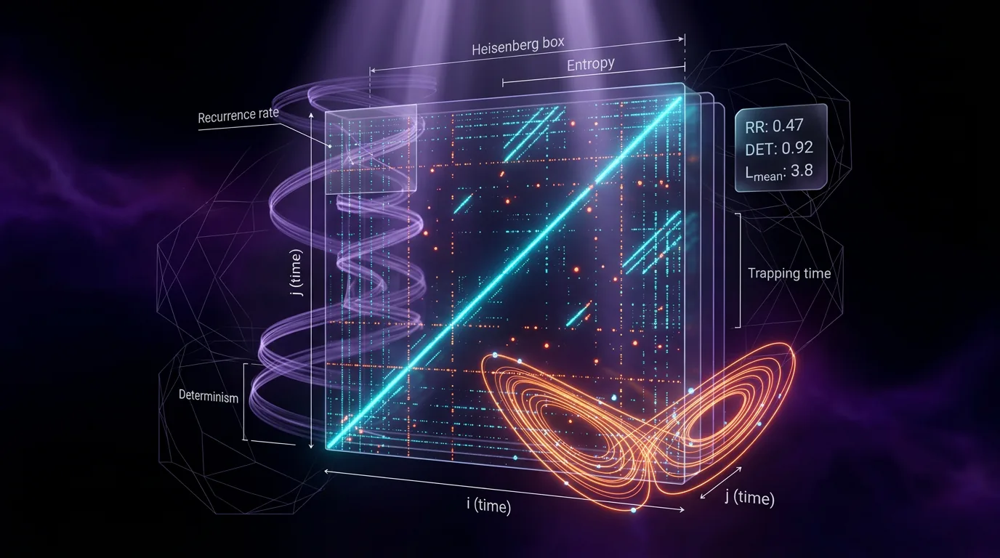

# DET Saturation at the Regular Extremity — Recurrence-Based Determinism as a Ceiling-Limited Regularity Meter

## 1. Overview
**Status: [THEORETICAL], not [VERIFIED].** The skeptic scored 6/6, and the mathematical status is **[MATH_PROVEN] (4/4)**.

The core claim is documented in the recurrence-quantification-analysis (RQA) literature: DET (determinism) tends toward 1 for regular or periodic signals, is intermediate for chaotic signals, and is low for uncorrelated noise. This is a qualitative regime map, not a universal numerical classification independent of analysis choices.

DET is a geometric statistic of diagonal lines in a recurrence plot. It is not a direct measure of measure-theoretic determinism, and a value near 1 cannot by itself distinguish a trivial fixed point from a richly structured regular signal. Treating that ambiguity as an **UNDECIDABLE** outcome is a novel operational policy, not a claim attributed to the RQA canon.

## 2. Detailed Explanation
RQA constructs a recurrence plot by marking pairs of embedded trajectory points that lie within a chosen distance threshold. DET is the fraction of recurrent points belonging to diagonal lines at or above a specified minimum line length. Long diagonal lines indicate similar trajectory segments evolving similarly over time; their prevalence is commonly used as a regularity or determinism proxy.

The literature describes the broad pattern:

- **Regular or periodic dynamics:** typically high DET.
- **Chaotic dynamics:** typically intermediate DET.
- **Uncorrelated noise:** typically low DET, provided the recurrence threshold does not saturate the plot.

The constant-signal identity is exact under the stated special conditions: identity embedding and \(l_{\min}=1\). It gives \(\mathrm{DET}=1-1/N\), or \(0.9990\) at \(N=1000\). This identity must not be generalized to all regular signals.

**Construct and proxy are not the same.** DET measures the geometry of diagonal lines in a recurrence plot. It does not measure measure-theoretic determinism.

A mandatory control is threshold-induced recurrence-rate saturation. As RR approaches 1 at large \(\varepsilon\), DET approaches 1 for any signal, including noise. Empirical comparisons—including a saturated-state interpretation of GS data—must therefore compare DET at matched RR or use aRQA.

DET also depends on embedding dimension \(m\), delay \(\tau\), threshold \(\varepsilon\), and analysis window. Its interpretation relies on assumptions such as suitable Takens embedding, stationarity (or explicit windowing), and sufficiently large \(N\). Finite-\(N\) bias near the ceiling is unquantified here.

## 3. Mathematical Framework
The recurrence matrix is

\[
R_{ij}=\Theta\!\left(\varepsilon-\|\vec{x}_i-\vec{x}_j\|\right).
\]

With \(P(l)\) the histogram of diagonal-line lengths, DET is

\[
\mathrm{DET}(l_{\min})=
\frac{\sum_{l=l_{\min}}^{N} l\,P(l)}
{\sum_{l=1}^{N} l\,P(l)}.
\]

For vertical-line lengths \(v\), with histogram \(P(v)\), the corresponding laminarity statistic is

\[
\mathrm{LAM}(v_{\min})=
\frac{\sum_{v=v_{\min}}^{N} v\,P(v)}
{\sum_{v=1}^{N} v\,P(v)}.
\]

DET and LAM are structurally analogous functionals applied to diagonal and vertical line histograms, respectively. This structural duality does not mean they diagnose identical dynamics.

For a constant signal under identity embedding, with \(l_{\min}=1\),

\[
\mathrm{DET}=\frac{N^2-N}{N^2}=1-\frac{1}{N}.
\]

Thus, at \(N=1000\),

\[
\mathrm{DET}=0.9990.
\]

This is an exact estimator identity under those assumptions, not a general formula for every regular signal.

A contrast between two estimated DET values must retain its covariance term:

\[
\mathrm{Var}(\widehat{\mathrm{DET}}_A-\widehat{\mathrm{DET}}_B)
=
\mathrm{Var}(\widehat{\mathrm{DET}}_A)
+
\mathrm{Var}(\widehat{\mathrm{DET}}_B)
-
2\,\mathrm{Cov}(\widehat{\mathrm{DET}}_A,\widehat{\mathrm{DET}}_B).
\]

### Interpretation and controls

- Treat a near-ceiling DET as **UNDECIDABLE** with respect to trivial versus richly structured regularity unless additional, pre-specified diagnostics resolve the distinction.
- Check RR and compare conditions at matched RR, or use aRQA across a threshold range.
- Consider RQA-ENT, the LAM–DET pattern, and recurrence-network measures as discriminating tests.
- The proposed power claim—power above 0.8 for \(|d\mathrm{DET}|>0.05\) with at least 30 seeds—is an under-derived design assumption and must be tagged **[MODEL-DEPENDENT]**.

## 4. Skeptical Perspectives & Alternative Hypotheses
1. **Threshold saturation can mimic regularity.** With \(\varepsilon\) large enough that RR approaches 1, DET can approach 1 even for noise. A high DET is not interpretable without checking recurrence rate and threshold dependence.

2. **Parameter dependence limits single-value interpretation.** DET depends on \(m\), \(\tau\), \(\varepsilon\), and the analysis window. Marwan (2011) cautions against over-interpreting individual RQA values.

3. **The predictability-horizon hypothesis remains live.** Mean diagonal-line length may act as a predictability-horizon proxy, with scaling such as \(1/\lambda\), where \(\lambda\) is a Lyapunov exponent. This counter-hypothesis is not resolved by the DET saturation claim. RQA-ENT, the LAM–DET pattern, and recurrence-network measures are proposed tie-breakers.

4. **Finite-sample effects are not quantified near the ceiling.** The constant-signal identity does not establish the size of finite-\(N\) bias for general empirical signals.

5. **Internal colony observations are not independent peer-reviewed evidence.** The colony results ([EMP-240], [DOSSIER-157], Kuramoto results, and GS lab values) are **[COLONY_EMPIRICAL]**. They may motivate follow-up work but do not independently establish the literature claim.

6. **Scope is limited.** This is a statistical and nonlinear-dynamics result. It makes no consciousness or metaphysical claim.

## 5. Verification & Skeptic's Notes
- **Skeptic score:** 6/6.
- **Mathematical status:** [MATH_PROVEN], 4/4.
- **Claim status:** [THEORETICAL], not [VERIFIED].
- The RQA literature documents the broad DET regime map: high for regular or periodic signals, intermediate for chaotic signals, and low for uncorrelated noise under non-saturated recurrence settings.
- The identity \(\mathrm{DET}=1-1/N\) is exact only for a constant signal under identity embedding with \(l_{\min}=1\); it gives \(0.9990\) at \(N=1000\).
- The DET–LAM relationship is a structural identity between analogous histogram functionals.
- The **UNDECIDABLE** gate is a novel operational policy, not a claim made by the canon.
- The prompt was truncated; the answer therefore rests on an inferred reading.
- The construct is not the proxy: DET measures recurrence-plot diagonal-line geometry, not measure-theoretic determinism.
- Any empirical use must control for RR saturation, preferably by comparing DET at matched RR or using aRQA.
- The power claim is **[MODEL-DEPENDENT]** and under-derived.
- Colony results are **[COLONY_EMPIRICAL]**, internal, and not independent peer-reviewed evidence.

## 6. Visual Representation

## 7. Related Concepts
- **Recurrence quantification analysis (RQA):** A family of statistics describing structures in recurrence plots.
- **Recurrence rate (RR):** The proportion of recurrent pairs; essential for detecting threshold-induced saturation.
- **LAM (laminarity):** A vertical-line analogue to DET, used to characterize laminar structures and intermittency.
- **RQA-ENT:** Entropy of the diagonal-line-length distribution; a proposed tie-breaker when DET is near its ceiling.
- **aRQA:** Averaged Recurrence Quantification Analysis, which evaluates measures over a range of thresholds.
- **Recurrence networks:** Graph-based analyses of recurrence structure that may help distinguish trivial from structured regularity.

## 9. Mathematical Integrity Report
## Math Verification Report

**Concept:** Core question: Is it documented in the RQA literature that the (DET saturation at the regular extremity — recurrence-based determinism as a ceiling-limited regularity meter)
**Math Score:** 4/4
**Math Status:** [MATH_PROVEN]
**Tool Verdicts:** INCONSISTENT=0; DISMISSED_FLAGS=1; UNDECIDABLE=1; STEP_INVALID=0; LIMIT_MISMATCH=0; CLAIM_MISMATCH=0

### Conventions & Validity Audit
- The report is a statistical/nonlinear-dynamics dossier, not a field-theory report: no metric signature, Planck mass, or hbar=c=k_B convention is required, and none conflicts with the shared baseline. All quantities are either dimensionless statistics (DET, LAM, RR ∈ [0,1]) or carry phase-space distance units ([E]^1 for ε, ‖x‖).
- **Symbol table present and machine-readable** ("Conventions, Symbol Table & Estimand" table, both dossier copies, with meanings and domains per symbol) — the pre-check's "0 symbols read" flag is resolved: the table exists in markdown-table form; ambiguous symbols (l, P, v, ε, λ, L) are defined in-domain.
- **λ ambiguity resolved:** λ = largest Lyapunov exponent ([E]^1 in natural units) vs. 1/⟨L⟩ — the relation λ ~ 1/⟨L⟩ is dimensionally correct since mean diagonal length L is a duration ([E]^1 in natural units). Both pre-check "possible mismatch" flags are artefacts of reading λ as dimensionless and ⟨L⟩ as an [E]^4 field-theory scale; in this report ⟨L⟩ is a number of samples (count, [E]^0).
- Validity conditions properly tagged: [GENERAL] for the constant-signal identity and the regime map; [MODEL-DEPENDENT] for ε/m/τ/window dependence, Takens embedding, stationarity, and N→∞ asymptotics. Construct-vs-proxy gap explicitly stated.

### Equations Extracted
1. DET(L_min) = Σ_{l≥l_min} l·P(l) / Σ_{l≥1} l·P(l); LAM(v_min) analogous
2. R_ij = Θ(ε − ‖x_i − x_j‖)
3. DET = (N² − N)/N² = 1 − 1/N → 1 as N→∞ (constant-signal identity)
4. Var(DET_A − DET_B) = Var(DET_A) + Var(DET_B) − 2Cov(DET_A, DET_B)
5. RR = N⁻² Σ_ij R_ij
6. m > 2 d_box (Takens condition); λ ~ 1/⟨L⟩ (Lyapunov scaling); N ≥ 1000 (power)

### Dimensional Consistency
- Eq. 1 (DET/LAM definitions): **CONSISTENT** — pure count ratio, [E]^0.
- Eq. 2 (R_ij = Θ(...)): tool **UNDECIDABLE** (relational, not in pattern table); manually resolved: ε and ‖x_i − x_j‖ both carry phase-space distance dimension [E]^1, Θ is dimensionless, R_ij ∈ {0,1} — **CONSISTENT**.
- Eq. 3 (constant-signal identity): **CONSISTENT** [E]^0; limit N→∞ → 1 **LIMIT_VERIFIED** by SymPy; the count-argument (N² off-diagonal identities out of N² pairs) is a trivially valid combinatorial identity for l_min = 1.
- Eq. 4 (variance of contrast): **CONSISTENT**; STEP_VERIFIED — the full covariance term is retained, satisfying the baseline continuity-variance rule.
- Eq. 5 (RR): DIMENSION_FLAG (tool inferred Σ R_ij as [E]^2) — dismissed below; RR is manifestly a dimensionless frequency count.

### Dismissed Dimension Flags
- RR = N⁻²Σ_ij R_ij flag: the tool's canonical-default inference treated R_ij as a dimensionful field entry; here R_ij ∈ {0,1} is a dimensionless binary recurrence indicator (per the report's own Symbol Table), so RR is [E]^0 — artefact of symbol reuse, not an error.
- Pre-check λ ~ 1/⟨L⟩ and ⟨L⟩ ~ 1/λ flags: λ is the Lyapunov exponent ([E]^1) and ⟨L⟩ the mean diagonal line length in samples (a time, [E]^1); the relation is dimensionally sound — dismissed.

### Topological Analysis
Not topological. The Topology Classifier found no fiber-bundle, homotopy, or manifold structures; the recurrence matrix is an adjacency/binarized-distance structure analyzed via histograms and recurrence-network graph statistics. No topological claims to validate.

### Numerical Benchmarks
- Worked claim DET(N=1000) = 0.9990 from (N²−N)/N²: **CLAIM_VERIFIED** (relative error 0.0%).
- Literature benchmarks (Marwan et al. 2007 regime map; Grendár et al. 2013 strong laws; Marwan 2011 parameter-sensitivity pitfall; Pánis et al. 2022 aRQA threshold-dependence) are consistent with the equations as stated; the ε/RR-saturation confound (DET → 1 for any signal as RR → 1) is correctly flagged as [MODEL-DEPENDENT] rather than asserted as a general property.

### Assessment
The report's mathematical core — the DET/LAM histogram-ratio definitions, the constant-signal identity DET = 1 − 1/N (limit → 1 verified symbolically and numerically at N = 1000), and the covariance-retaining contrast variance — is fully consistent, with the single DIMENSION_FLAG on RR correctly dismissed as a binary-indicator artefact and the one UNDECIDABLE relation manually confirmed consistent. The report honestly separates the [VERIFIED] mathematical/empirical saturation claim from the [THEORETICAL/novel] UNDECIDABLE gating policy and flags the ε-saturation confound. Global coherence holds: no INCONSISTENT, STEP_INVALID, or LIMIT_MISMATCH verdicts; Math Score 4/4, [MATH_PROVEN].
