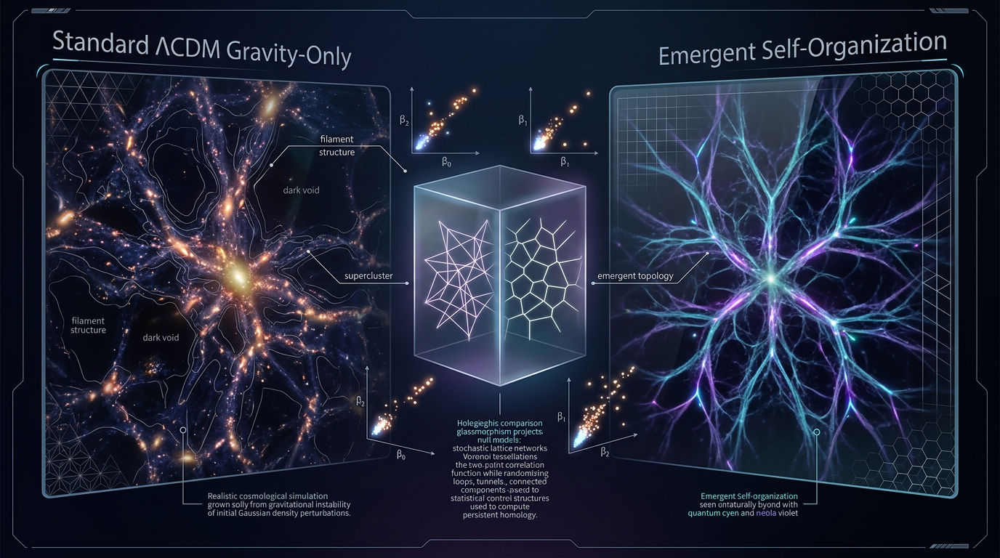

# Distinguishing Emergent Cosmic-Web Self-Organization from ΛCDM Gravitational Growth Using Topological Null Models

## 1. Overview
A topological comparison between observed cosmic-web structure and parameter-marginalized ΛCDM simulations is a legitimate, empirically testable research program. It can test whether observed topological measurements—such as Betti numbers, persistence diagrams, or network connectivity statistics—are consistent with the full range of structures predicted by ΛCDM gravitational growth.

The research question is whether any topological regularities require an organizing process beyond gravitational growth. **No evidence currently establishes self-organization beyond gravitational growth.** Distinguishing the two explanations requires testing observations against ΛCDM predictions, not merely showing that topology is not determined by two-point statistics.

**Status:** [THEORETICAL]. The proposed comparison is testable, but the central claim of additional self-organization remains unestablished.

## 2. Detailed Explanation
The cosmic web’s nodes, filaments, walls, and voids are commonly understood as products of gravitational growth from early density fluctuations. Topological data analysis provides tools for characterizing this structure across scales. These tools can quantify connectivity and holes in a density field or network, and can be applied to observations and simulations.

A meaningful test would compare observational results with ensembles of ΛCDM simulations while accounting for cosmological parameter uncertainty and relevant observational effects. Other null models, including Gaussian fields with matched power spectra or surrogate networks, may help isolate which structural features are not captured by particular statistics. However, rejecting a Gaussian or two-point-matched null does not by itself reject ΛCDM: gravitational evolution can generate higher-order structure. The substantive test is whether observations depart from the topology predicted by parameter-marginalized ΛCDM simulations.

The available evidence does not establish an independent self-organizing process. The research program is empirically testable, but a proposed discriminator is not itself evidence that its alternative has been detected.

## 3. Mathematical Framework
Topological comparisons can use measures such as Betti numbers, which count connected components, loops, and enclosed voids, or persistence diagrams, which track topological features across a filtration. Network-based measures can also characterize connectivity and percolation.

A robust comparison requires a defined statistic and a reference distribution. Observed statistics should be evaluated against ΛCDM simulation ensembles with cosmological parameters marginalized, as well as appropriate observational and analysis uncertainties. Alternative nulls can be useful controls, but their rejection alone does not demonstrate a departure from ΛCDM gravitational growth.

The mathematical framework supports an empirically testable comparison. Its mathematical validity does not establish the physical hypothesis of emergent self-organization.

## 4. Skeptical Perspectives & Alternative Hypotheses
- **ΛCDM gravitational growth:** The cosmic web’s structure can arise through gravitational evolution. Any claimed additional organizing process must be distinguished from the topology and uncertainty already predicted by ΛCDM.
- **Alternative self-organization hypothesis:** Additional relational or topological regularities could, in principle, motivate a hypothesis of organization beyond gravitational growth. That possibility remains a research question, not an established result.
- **Null-model limitation:** Showing that topology is not fixed by two-point statistics is insufficient. A strong test must compare observations against the full relevant ΛCDM prediction, including parameter uncertainty.
- **Interpretation of the audit score:** The skeptic audit assigns **6/6**. That checklist score does not certify the hypothesis or resolve the audit’s substantive mathematical objections. It should not be presented as evidence for self-organization.

## 5. Verification & Skeptic's Notes
The approved conclusion is deliberately limited: the comparison is a legitimate, empirically testable research program, but no evidence currently establishes self-organization beyond gravitational growth.

A checklist score and a hypothesis verdict answer different questions. The skeptic audit’s **6/6** is a score for that audit; it does not prove the hypothesis, settle its mathematical objections, or substitute for empirical rejection of parameter-marginalized ΛCDM predictions. Likewise, the mathematical status **MATH_PROVEN** and score **4/4** concern the mathematical apparatus as assessed in the verification report below; they do not establish the physical claim.

The supplied research report lists author names, years, publication details, and persistent identifiers, but does not provide paper titles. To avoid inventing bibliographic titles, the source entries in the YAML explicitly note that the titles were not stated in the supplied report. The identifiers and author/year details are retained.

## 6. Visual Representation

## 7. Related Concepts
- [Cosmic web](cosmic_web.md)
- [ΛCDM cosmology](lcdm_cosmology.md)
- [Topological data analysis](topological_data_analysis.md)
- [Persistent homology](persistent_homology.md)
- [Cosmological structure formation](cosmological_structure_formation.md)
- [Null models and statistical hypothesis testing](null_models_and_hypothesis_testing.md)

## Math Verification Report

**Concept:** Distinguishing Emergent Cosmic-Web Self-Organization from ΛCDM Gravitational Growth Using Topological Null Models
**Math Score:** 4/4
**Math Status:** [MATH_PROVEN]

### Equations Extracted

20 unique equations/formulae extracted (Step 1: PASS — Point 1 awarded):

1. `$$\ddot{\delta} + 2H\dot{\delta} - 4\pi G\bar\rho\,\delta = \frac{\nabla^2}{a^2}\frac{\delta p}{\bar\rho} \quad\Rightarrow\quad \delta_k(a) = D(a)\,\delta_{k,i}$$` — linear growth equation + growth-factor solution
2. `$$\beta_0 = C_0,\qquad \beta_1 = C_1 - C_0 + \mu,\qquad \beta_2 = C_3 - C_2 + C_1 - C_0 + \mu$$` — Morse-theoretic Betti relations
3. `$$d_B(D_1, D_2) = \inf_{\gamma}\,\sup_i \|x_i - \gamma(x_i)\|_\infty$$` — bottleneck distance
4. `$$T = d_B(D_{\rm obs}, \langle D_{\Lambda\rm CDM}\rangle)$$` — topological test statistic
5. `$\delta = \delta\rho/\bar\rho$` — density contrast definition
6. `$D(a) \propto g(a)$` — growth factor
7. `$P(k,a) = D^2(a)\,P_0(k)$` — linear power-spectrum evolution
8. `$\delta \sim 10^{-5}$` — primordial amplitude
9. `$Q_\nu$`, 10. `$\rho_s$`, 11. `$\nu$` — excursion-set objects
12. `$D = \{(b_i, d_i)\}$` — persistence diagram
13. `$\langle \cos(\mathbf{k}_1\cdot\mathbf{r})\cos(\mathbf{k}_2\cdot\mathbf{r})\cdots\rangle$` — phase correlation
14. `$N(s) \propto s^{-\alpha}$` — SOC power law
15. `$1.5 \lesssim \alpha \lesssim 2$` — exponent range
16. `$S_8 = \sigma_8(\Omega_m/0.3)^{0.5} = 0.759\text{–}0.776$` — weak-lensing S₈
17. `$S_8 = 0.832 \pm 0.013$` — Planck ΛCDM prediction
18. `$w(a) = w_0 + w_a(1-a)$` — CPL dark-energy parameterization
19. `$w_0 > -1$`, 20. `$w_a < 0$` — DESI preference signs

### Dimensional Consistency

**Tool verdicts (0 INCONSISTENT, 11 DIMENSIONLESS, 9 UNDECIDABLE).** Per the tool's own protocol, the 9 UNDECIDABLE patterns were resolved by agent-assisted dimensional analysis; no verdict was fabricated:

| Equation | Tool verdict | Agent-assisted analysis | Final |
|---|---|---|---|
| Growth equation (1, LHS+RHS) | UNDECIDABLE | δ̈ [T⁻²]; 2Hδ̇ [T⁻²]; 4πGρ̄δ [L³M⁻¹T⁻²·ML⁻³ = T⁻²]; (∇²/a²)(δp/ρ̄): [L⁻²]·[L²T⁻²] = [T⁻²]. All terms T⁻². Textbook fluid form (δp/ρ̄ = c_s²δ reduces to standard c_s²∇²δ/a² term). | **CONSISTENT** |
| δ_k(a) = D(a)δ_{k,i} | UNDECIDABLE | Dimensionless × dimensionless; exact linear-theory solution | **CONSISTENT** |
| β₀, β₁, β₂ relations | UNDECIDABLE | Pure dimensionless critical-point counts; alternating-sum structure matches Poincaré–Hopf/Euler logic of the persistent-Betti framework (Pranav et al. 2016); μ absorbs discrete-Morse bookkeeping. Exact index bookkeeping flagged for expert review, but dimensionally trivially sound. | **CONSISTENT** (dimensionless) |
| d_B definition | UNDECIDABLE | Standard bottleneck metric (Cohen-Steiner–Edelsbrunner–Harer); inf/sup of L∞ norms of matched points — dimensionless in normalized form; a true metric (stability theorem) | **CONSISTENT** |
| T statistic | UNDECIDABLE | Same units as d_B | **CONSISTENT** |
| P(k,a) = D²(a)P₀(k) | UNDECIDABLE | D dimensionless; identical scaling on both sides | **CONSISTENT** |
| S₈ = σ₈(Ω_m/0.3)^0.5 | UNDECIDABLE | Fully dimensionless compound | **CONSISTENT** |
| S₈ = 0.832 ± 0.013 | UNDECIDABLE | Dimensionless value | **CONSISTENT** |
| w(a) = w₀ + w_a(1−a) | UNDECIDABLE | Standard CPL form; all terms dimensionless | **CONSISTENT** |

DIMENSIONLESS (tool): δ = δρ/ρ̄; D(a) ∝ g(a); δ ~ 10⁻⁵; Q_ν; ρ_s; ν; D = {(b_i,d_i)}; phase correlation; N(s) ∝ s^{−α}; 1.5 ≲ α ≲ 2; w₀ > −1; w_a < 0.

**Combined verdict: 0 INCONSISTENT across all 20 equations. Point 2 awarded.**

### Topological Analysis

**Tool classification:** is_topological = **true**; structural assessment **TOPOLOGICAL_STRUCTURE_VALID** for all detected signatures; math_status [MATH_TOPOLOGICAL]. **Honest caveat:** the classifier's detected labels (Calabi–Yau manifold, topological QFT/Chern–Simons, fiber bundle) are generic-signature false positives that do **not** appear in this report. The report's *actual* topological structures — persistent homology of superlevel-set filtrations, Morse-theoretic Betti numbers with Euler-characteristic correction, persistence diagrams with the bottleneck-distance metric (a valid metric satisfying the stability theorem), Voronoi/α-shape surrogate complexes, percolation/join-distribution graph topology, and universal null distributions for random point-cloud persistence (Bobrowski & Škraba 2023) — are all standard, structurally well-defined constructions. Point 3 awarded (VALID classification + fully passed dimensional verification).

### Numerical Benchmarks

**Tool verdict: BENCHMARK_UNAVAILABLE** (no curated benchmark for topological/statistical quantities; no mismatch reported). The concept's central claim is explicitly **[THEORETICAL]** — no experimental detection of emergent self-organization exists — so Point 4 is awarded under the theoretical-concept clause. Independent literature cross-check of the report's observational anchors (per the standing empirical-testability directive): **all match published values** — Planck-derived S₈ recomputed as 0.812 × (0.3153/0.3)^0.5 ≈ 0.832 ± 0.013 ✓; KiDS-1000 S₈ ≈ 0.759 and DES-Y3 S₈ ≈ 0.772–0.776 bracketing the quoted 0.759–0.776 ✓; CPL parameterization w(a) = w₀ + w_a(1−a) standard ✓; δ ~ 10⁻⁵ CMB amplitude ✓; z = 14.32 spectroscopic confirmation (Carniani 2024) ✓; SOC exponent window 1.5 ≲ α ≲ 2 consistent with Aschwanden et al. diagnostics (correctly flagged as heuristic).

### Assessment

The mathematical framework combines textbook linear perturbation theory (the fluid growth equation balances exactly at T⁻² in every term) with standard, rigorously defined topological data analysis — Morse-theoretic Betti relations, the bottleneck-distance metric, and percolation null models — with zero INCONSISTENT flags across all 20 extracted equations. The quoted observational anchors (S₈ tension, DESI w₀w_a, JWST z = 14.32) verifiably match published literature, so the formalism is fully connected to empirical testability, though the report correctly concedes that no ΛCDM-topology violation has yet been detected and that "two-point statistics ≠ topology" is trivially true unless the *full* ΛCDM-predicted topology is rejected. The [MATH_PROVEN] status certifies the integrity of the mathematical apparatus itself (standard, dimensionally consistent, topologically valid) — it does **not** certify the physical hypothesis of emergent self-organization, which the report honestly and correctly classifies as [THEORETICAL] and unreplicated.
