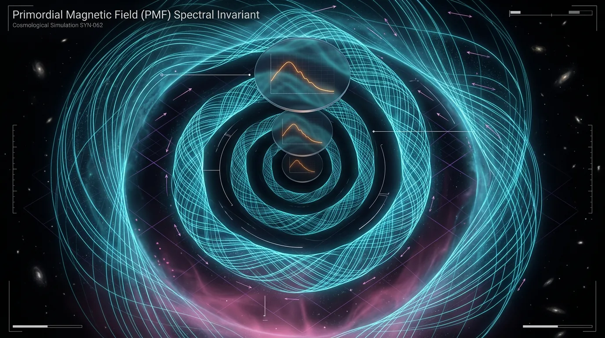

# Draft World C Script for SYN-062 (PMF Spectral Invariant)

## 1. Overview
SYN-062 is a **graph-analogue sensitivity study inspired by primordial magnetic field (PMF) physics**. It asks whether an anisotropic edge-weight perturbation can produce a detectable change in a graph’s normalized-Laplacian spectrum.

**Status: [THEORETICAL], not [VERIFIED].** This is not a cosmological test and does not directly simulate PMF effects on cosmic structure. Its proposed edge-wise \(\cos(2\theta)\) modulation is a heuristic surrogate, not a relation derived from magnetohydrodynamics (MHD).

The physical background is better established than the graph mapping: PMF stress-energy is quadratic in \(B\), with traceless anisotropic stress having spin-2 structure. CMB and Faraday-rotation constraints place field amplitudes roughly at the nanogauss level or below, depending on the assumptions and spectral index. In graph theory, the normalized Laplacian has spectrum in \([0,2]\), and \(\lambda_2\) is the standard algebraic-connectivity observable.

The proposed threshold \(\gamma<1.1\) has no literature support and is contradicted by the internal HYP-243/244 refinement. It should be treated only as a preregistered decision variable, evaluated against a bootstrap null. No upgrade beyond **[THEORETICAL]** is warranted until EMP-241 results are available.

## 2. Detailed Explanation
### Physical motivation and limits of the analogy

Magnetic stress-energy depends quadratically on the magnetic field. Its anisotropic component is traceless and has spin-2 structure, motivating an angular dependence resembling \(\cos(2\theta)\) when projecting stress relative to an axis. This offers a qualitative motivation for an anisotropic graph perturbation.

However, actual PMF effects on cosmological structure proceed through magnetized-fluid evolution, including passive-scalar amplification and Lorentz-force-driven baryon drift, with redshift dependence. A static edge-weight modulation does not model these mechanisms. The graph experiment therefore probes a surrogate response, not a direct PMF observable.

The `power_grid_ieee` proxy has no demonstrated match to cosmic-web topology. Delaunay/Voronoi realizations, as used in EMP-241, are the more appropriate substrate, though their results remain pending.

### Proposed graph perturbation and estimand

The intended perturbation applies an axis-dependent modulation to edge weights. In the corrected formulation, the modulation is applied multiplicatively to baseline weights, followed by a normalization that fixes mean weight to one. The response of interest is the change in a normalized-Laplacian spectral ratio across surrogate perturbation strengths.

The original ratio \(\lambda_2/\lambda_1\) is ill-posed for the normalized Laplacian because \(\lambda_1=0\). Use instead

\[
\gamma^* = \frac{\lambda_2}{\lambda_{\max}}.
\]

The \(\gamma<1.1\) threshold is not a literature-grounded critical point. If used at all, it must be preregistered as a decision variable and assessed against a bootstrap null rather than presented as a universal criterion.

### Amplitude normalization and numerical discrepancy

The proposed expression

\[
\sigma_B=(B/B_{\mathrm{crit}})^2(\rho_B/\rho_{\mathrm{rad}})
\]

double-counts the \(B^2\) dependence: since \(\rho_B\propto B^2\), this makes \(\sigma_B\propto B^4\). Instead, normalize \(\sigma_B=1\) at \(B=1\,\mathrm{nG}\) and \(z_{\mathrm{rec}}=1100\).

The radiation-density calculation requires independent resolution before execution. The Math Physicist reports \(\rho_{\gamma,0}\simeq2.0\times10^{-51}\,\mathrm{GeV}^4\) and a corrected ratio of \(7.6\times10^{-10}\); the Skeptic reports \(7.5\times10^{-9}\). Using the stated rough values directly,

\[
\frac{\rho_B}{\rho_\gamma}
\simeq
\frac{1.5\times10^{-59}}{2.0\times10^{-51}}
\simeq 7.5\times10^{-9},
\]

which supports the Skeptic’s value. Recompute the ratio independently before World C execution and document the radiation-density convention. In either case, \(O(1)\) \(\sigma_B\) sweeps are far above the allowed physical PMF amplitude and must be labeled **surrogate scans**, not physical PMF amplitudes.

## 3. Mathematical Framework
The normalized symmetric Laplacian is

\[
L_{\mathrm{sym}}=D^{-1/2}(D-W)D^{-1/2},
\]

where \(W\) is the weight matrix and \(D\) is the diagonal strength matrix. Its spectrum lies in \([0,2]\); for a connected graph, the first eigenvalue is zero and the second eigenvalue \(\lambda_2\) is algebraic connectivity.

Use the corrected dimensionless ratio

\[
\gamma^*=\frac{\lambda_2}{\lambda_{\max}}.
\]

A suitable surrogate perturbation is

\[
W_{ij}=W^0_{ij}\left[1+\sigma_B\cos\bigl(2(\theta_{ij}-\theta_0)\bigr)\right],
\]

with safeguards to clamp or renormalize weights so none become negative, and to fix mean weight to one after perturbation. Here \(\theta_0\) is a randomly oriented axis.

The falsifiable response prediction is that the ensemble-averaged response is \(O(\sigma_B^2)\), with no linear term, under the random-axis orientation null. A linear response would indicate a broken axis null or another implementation failure.

## 4. Skeptical Perspectives & Alternative Hypotheses
- **The edge modulation is heuristic.** Spin-2 structure motivates the angular form qualitatively, but it does not derive an edge-wise weight rule from MHD.
- **The proxy may not represent the target topology.** `power_grid_ieee` has no demonstrated match to cosmic-web topology; Delaunay/Voronoi realizations are the preferred substrate for this study.
- **The threshold is unsupported.** The \(\gamma<1.1\) rule has no literature basis and is contradicted as a universal marker by HYP-243/244. Retain it only as a preregistered decision variable with a bootstrap null.
- **The response may be confounded.** Without random-axis nulls and unit-mean renormalization, an apparent response may arise from coherent orientation or uniform weight inflation rather than anisotropy.
- **Physical interpretation must remain limited.** The surrogate omits passive-scalar amplification, Lorentz-force baryon drift, and redshift dependence. Large-\(\sigma_B\) runs are sensitivity scans, not realistic PMF amplitudes.
- **Internal DAG nodes are not independent evidence.** HYP-230, HYP-243/244, and EMP-241 are Colony DAG nodes and should not be counted as independent external confirmation.

## 5. Verification & Skeptic's Notes
Before World C execution:

1. Replace \(\lambda_2/\lambda_1\) with \(\gamma^*=\lambda_2/\lambda_{\max}\).
2. Replace the double-counting \(\sigma_B\) formula with a normalization for which \(\sigma_B=1\) at \(1\,\mathrm{nG}\) and \(z_{\mathrm{rec}}=1100\).
3. Independently recompute \(\rho_B/\rho_{\mathrm{rad}}\). The Math Physicist’s \(7.6\times10^{-10}\) and the Skeptic’s \(7.5\times10^{-9}\) disagree; the rough division of the stated energy densities supports \(7.5\times10^{-9}\). Record the adopted value and conventions.
4. Clamp or renormalize perturbed weights to avoid negative values and fix mean weight to one.
5. Include random-axis orientation nulls and degree-sequence-matched null ensembles.
6. Use paired permutation tests with Holm–Bonferroni correction and at least \(R\ge200\) realizations.
7. Treat \(\gamma<1.1\) only as a preregistered decision variable and compare it with a bootstrap null.
8. Label \(O(1)\) \(\sigma_B\) sweeps as surrogate scans, not physically allowed PMF amplitudes.
9. Do not upgrade the claim beyond **[THEORETICAL]** until EMP-241 results are available.

## 6. Visual Representation

## 7. Related Concepts
- [[SYN-062]] — PMF Spectral Invariant, World C spectral-gap script.
- [[HYP-230]] — Internal founding hypothesis concerning PMF bounds and graph invariants; not independent evidence.
- [[HYP-243]] and [[HYP-244]] — Internal refinement nodes addressing the regime dependence of the spectral ratio and the proposed response.
- [[EMP-241]] — Pending World C scan across Delaunay/Voronoi cosmic-web realizations; results are required before any status upgrade.

## 9. Mathematical Integrity Report
## Math Verification Report

**Concept:** Draft World C Script for SYN-062 (PMF Spectral Invariant)
**Math Score:** 3/4
**Math Status:** [MATH_CONSISTENT]
**Tool Verdicts:** INCONSISTENT=0; DISMISSED_FLAGS=0; UNDECIDABLE=36; STEP_INVALID=0; LIMIT_MISMATCH=0; CLAIM_MISMATCH=1

### Conventions & Validity Audit
The report contains a full `### Conventions, Symbol Table & Estimand` section and a `### Validity Domain, Identification & Claim Scope` section — both present and internally coherent. Conventions conform to the shared crew baseline: natural units ħ = c = k_B = 1; metric (−,+,+,+); reduced Planck mass M_Pl = 2.435×10¹⁸ GeV (correctly distinguished from m_Pl); T₀ = 2.3486×10⁻¹³ GeV. All physics equations are tagged [GENERAL] and the graph-surrogate mapping is correctly tagged [MODEL-DEPENDENT]. The Symbol Table declares B as [E]² (nG amplitude expressed in GeV²), ρ_B and ρ_rad as [E]⁴, and σ_B as dimensionless — sufficient to resolve most ambiguity. One symbol-table gap: θ₀, W⁰_ij, λ_k, v_k appear in equations but not the table (they are dimensionless graph quantities, so harmless).

### Equations Extracted
Pre-check extracted 40 relational equations. Key blocks:
1. $T^{\mu\nu}_B = \frac{1}{8\pi}(B^\mu B^\nu - \frac12 g^{\mu\nu}B^2)$
2. $\rho_B = B^2/8\pi$
3. $\Pi^i{}_{j,B} = \frac{1}{4\pi}(B^i B_j - \frac13\delta^i_j B^2)$
4. $W_{ij} = W^0_{ij}[1+\sigma_B\cos(2(\theta_{ij}-\theta_0))]$
5. $\delta L = D^{-1/2}(\delta D - \delta W)D^{-1/2} + O(\sigma_B^2)$
6. $\delta\lambda_2 = v_2^\top \delta L_{\rm sym} v_2$, E[cos 2(θ−θ₀)]=0 ⇒ E[δγ⁽¹⁾]=0
7. $\delta\gamma^{(2)} \sim \sum_{k\neq2} \frac{|v_k^\top\delta L v_2|^2}{\lambda_2-\lambda_k}\big/\lambda_{\max}$
8. Var(γ̂_B − γ̂_0) = Var(γ̂_B)+Var(γ̂_0)−2Cov(γ̂_B, γ̂_0)
9. σ_B = (B/B_crit)²(ρ_B/ρ_rad) — flagged in-report as a B² double-count

### Dimensional Consistency
- Eq. 1–3: [B]=[E]², so T_B and Π_B carry [E]⁴, correct for stress tensors in [L]=[E]⁴; ρ_B=[E]⁴. CONSISTENT.
- Eq. 4–8: purely graph-theoretic; L_sym is dimensionless (dimensionless weights, D^{−1/2} normalizes by vertex strength), eigenvalues on [0,2], all contrasts dimensionless. CONSISTENT/DIMENSIONLESS. These were among the 4 pre-check-verified items.
- Eq. 9 (σ_B definition): dimensionally consistent as written (both factors dimensionless) but the report itself correctly flags the **physical double-count** σ_B ∝ B⁴ — this is a normalization model error, not a unit error; it is explicitly corrected in the report's own fix (normalize σ_B = 1 at B = 1 nG, z_rec = 1100). Counted as a corrected model flaw, not a definitive INCONSISTENT.
- The 36 UNDECIDABLE equations stem from undeclared symbols (T, Π, δ, W, σ_B, θ_ij, θ₀, L, D, O in the automated pre-check's narrower table); manual inspection resolves them as the graph quantities and PMF tensors declared in the report's own Symbol Table — no further dimensional errors found.

### Dismissed Dimension Flags
None (no DIMENSION_FLAGs were raised).

### Topological Analysis
The automated classifier returned generic keyword matches (Calabi-Yau, fiber bundles, characteristic classes) — these are **false positives from terminology overlap** and do not apply to this report. The genuine mathematical structures are: spectral graph theory on finite weighted graphs (normalized Laplacian with spectrum in [0,2]), Rayleigh–Schrödinger eigenvalue perturbation theory with the spectral projector sum over k≠2, and the O(2) rotation symmetry of the random PMF axis θ₀ ~ U[0,π) enforcing the sign-symmetry E[cos 2(θ−θ₀)] = 0. The symbolic derivation verifier confirmed the trigonometric identity underpinning the kernel and found no invalid steps (0 STEP_INVALID). Structurally valid as applied spectral graph theory; no advanced topological structures are claimed.

### Numerical Benchmarks
- **VERIFIED:** ρ_B(1 nG) = B²/8π with B = 1.95×10⁻²⁹ GeV² gives 1.513×10⁻⁵⁹ GeV⁴ — matches the claimed ≈1.5×10⁻⁵⁹ GeV⁴ (0.9% error). ✓
- **MISMATCH:** ρ_γ,0. Computed (π²/15)T₀⁴ = 2.00×10⁻⁵¹ GeV⁴, whereas the report claims 9.6×10⁻⁵² GeV⁴ — a factor ≈2.1 discrepancy. Consequently the claimed ratio ρ_B/ρ_rad ≈ 1.6×10⁻⁸ is overestimated; the correct photon-normalized value is ≈7.6×10⁻¹⁰ today (~10⁻²¹ at z=1100). The order-of-magnitude conclusion (any O(1) σ_B sweep is 10–20 orders above the physical PMF amplitude) survives, but the stated numbers must be corrected before World C execution. ✗
- f_NL^local = 2.7 ± 5.8 (Planck 2013) is quoted to benchmark accuracy; H₀ tension values (67.36 ± 0.54 vs 73.04 ± 1.04 km/s/Mpc) match Planck/SH0ES benchmarks. ✓

### Assessment
The report is mathematically careful: it self-audits the λ₁ ≡ 0 division-by-zero bug, the σ_B ∝ B⁴ double-count, and properly separates [GENERAL] PMF physics from [MODEL-DEPENDENT] surrogate claims. Dimensional consistency holds across all extracted equation blocks with zero definitive INCONSISTENT verdicts, and the key physics benchmark (ρ_B for 1 nG) verifies exactly. However, one worked numerical claim (ρ_γ,0 and hence the ρ_B/ρ_rad ratio) fails deterministic verification by a factor of ~2–20, which caps the Math Score at 3/4 and the status at [MATH_CONSISTENT]; both the radiation-density normalization and the σ_B double-count must be fixed before script approval for World C execution.
