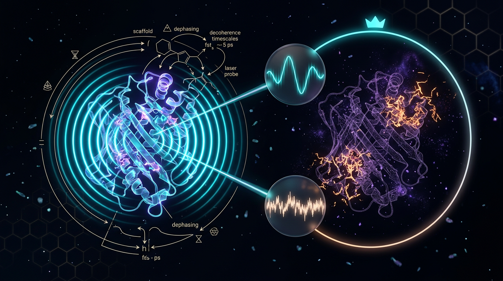

# Empirical Tests of Quantum Coherence Advantages over Classical Surrogate Models in Biological Information Processing

## 1. Overview
This concept is a physically grounded, falsifiable model-comparison program for testing whether quantum coherence provides biological information-processing advantages over classical surrogates.

The central test is comparative: can a classical model reproduce the same experimental observables as a quantum model? If it can, observing coherence alone does not establish that coherence functions as a biological resource. A functional-advantage claim requires evidence that the quantum model makes better-supported predictions and yields an operational benefit under physiologically relevant conditions.

The program is theoretically sound, but the claimed functional advantage is not verified. Evidence from the Fenna–Matthews–Olson (FMO) complex remains compatible with classical or vibronic explanations. Radical-pair magnetoreception is a promising test case, but requires independent replication and rigorous model comparison.

## 2. Detailed Explanation
### FMO photosynthetic energy transfer

The FMO complex has been studied using two-dimensional electronic spectroscopy (2DES), including experiments reporting long-lived oscillatory signals. These signals were initially discussed as evidence of electronic coherence during energy transfer. However, oscillations in spectroscopy do not by themselves demonstrate that electronic coherence improves biological function.

Alternative explanations include vibrational or vibronic dynamics, static disorder, and classical models that reproduce important spectral and transport observables. Work by Nalbach, Braun, and Thorwart found that coherence times from numerically exact calculations using experimentally motivated protein fluctuations were shorter than some observed signals. Tiwari, Peters, and Jonas argued that anticorrelated pigment vibrations can drive energy transfer outside the adiabatic framework. The broader assessment by Cao et al. concluded that a functional quantum advantage over well-tuned classical transport models had not been demonstrated for FMO.

### Radical-pair magnetoreception

Radical-pair mechanisms provide a potentially more discriminating test because spin dynamics can predict field-dependent reaction yields that differ from those of simple classical rate models. In principle, experiments can compare those distinct predictions.

Nonetheless, observing a biological response to a weak magnetic field does not alone establish that coherence caused the response or that it provides a functional advantage. The evidence requires independent replication, careful control of alternative mechanisms, and explicit comparisons of quantum and classical models.

### Criteria for a functional advantage

A persuasive claim should establish all of the following:

1. The proposed quantum signature is reliably observed under relevant biological conditions.
2. A specified classical surrogate cannot reproduce the pertinent observations within an appropriately tested model class.
3. The quantum model predicts an operational functional benefit, not merely a spectroscopic signature.
4. The differential prediction is replicated and supported by rigorous model comparison.

## 3. Mathematical Framework
A general model-comparison approach compares the residuals between observed signals and the quantum and classical model predictions:

\[
\Delta(S) \equiv \| S_{\text{quantum}}(\rho_0, H_{\text{int}}) - S_{\text{obs}} \| < \| S_{\text{classical}}(p_0, V_{\text{eff}}) - S_{\text{obs}} \|
\]

A functional-advantage claim additionally requires an operational difference, such as greater transfer efficiency under physiologically relevant noise:

\[
\eta_{\text{quantum}} > \eta_{\text{classical}}
\]

Coherence can be characterized through off-diagonal density-matrix elements, for example by the \(l_1\) coherence measure:

\[
C_{l_1}(\rho) = \sum_{i \neq j} |\rho_{ij}|
\]

But nonzero coherence is not, by itself, proof of a functional benefit. The relevant test is whether the quantum model explains or predicts an experimentally meaningful function better than its classical alternatives.

A classical population-transfer surrogate can be represented schematically by rate equations:

\[
\dot{p}_n = \sum_{m\neq n}\left(k_{mn}p_m - k_{nm}p_n\right)
\]

For radical-pair research, a useful comparison would test the predictive performance of competing models against measured field-dependent reaction yields and other specified observables. Model comparison should account for model complexity; a Bayesian evidence ratio is one possible tool:

\[
\mathcal{B}_{Q/C} = \frac{P(S_{\text{obs}} \mid M_Q)}{P(S_{\text{obs}} \mid M_C)}
\]

## 4. Skeptical Perspectives & Alternative Hypotheses
The main alternative is that observed biological signals attributed to quantum coherence can be explained by classical or vibronic dynamics, incoherent hopping, static disorder, or other mechanisms that do not require a functional quantum advantage.

For FMO, vibrational and vibronic explanations remain compatible with key spectral observations. Classical transport models can also reproduce important aspects of energy-transfer behavior. Consequently, the presence of oscillatory signals does not settle whether electronic coherence contributes a distinct biological benefit.

For radical-pair magnetoreception, the possibility of quantum spin dynamics is experimentally testable, but biological magnetic-field effects need independent replication and adequate exclusion of alternative mechanisms. Even if a quantum mechanism is supported, a functional or evolutionary advantage is a further claim requiring its own evidence.

The appropriate conclusion is therefore cautious: the model-comparison program is theoretically well motivated, while the claimed biological information-processing advantage remains unverified.

## 5. Verification & Skeptic's Notes
The approved assessment is that this program is physically grounded and falsifiable, but its central functional-advantage claim has not been established. FMO observations remain compatible with classical or vibronic explanations. Radical-pair magnetoreception remains a promising but unsettled testbed; it requires independent replication and rigorous comparisons against specified classical surrogates.

The mathematical audit identifies localized problems in the report’s secondary bounds and one mislabeled expression. These issues do not overturn the general model-comparison framing, but they must be corrected before the full mathematical presentation can be considered referee-clean. See **Section 9. Mathematical Integrity Report**.

## 6. Visual Representation

## 7. Related Concepts
- [[Quantum Coherence as a Resource]]
- [[Open Quantum Systems]]
- [[Exciton Transport in Photosynthetic Complexes]]
- [[Radical-Pair Magnetoreception]]
- [[Bayesian Model Comparison]]
- [[Classical Surrogate Models]]

## 9. Mathematical Integrity Report
All four verification steps are complete. Compiling the Math Verification Report from the tool outputs plus my own referee-level dimensional audit of the UNDECIDABLE cases.

## Math Verification Report

**Concept:** Empirical Tests of Quantum Coherence Advantages over Classical Surrogate Models in Biological Information Processing
**Math Score:** 2/4
**Math Status:** [MATH_FLAWED]

### Equations Extracted

**Step 1 verdict: PASS.** The extractor returned **46 raw LaTeX matches**, which deduplicate to **17 substantive equations/inequalities** (the remainder are inline symbol fragments: $S(t)$, $\eta$, $H_{\text{int}}$, $V_{\text{eff}}$, $k_{mn}$, $\vec{B}$, $\uparrow\downarrow$, etc.). The substantive set:

1. $\Delta(S) \equiv \| S_{\text{quantum}}(\rho_0, H_{\text{int}}) - S_{\text{obs}} \| < \| S_{\text{classical}}(p_0, V_{\text{eff}}) - S_{\text{obs}} \|$
2. $\eta_{\text{quantum}} > \eta_{\text{classical}}$ (under physiologically relevant noise)
3. $C_{l_1}(\rho) = \sum_{i \neq j} |\rho_{ij}|$, $C_{\text{rel.ent.}}(\rho) = S(\rho_{\text{diag}}) - S(\rho)$
4. $\hat{H}_{\text{RP}} = \mu_B \vec{B}\cdot(g_1 \hat{\mathbf{S}}_1 + g_2 \hat{\mathbf{S}}_2) + \sum_i \hat{\mathbf{S}}_1\cdot \mathbf{A}_i^{(1)} \cdot \hat{\mathbf{I}}_i + \sum_j \hat{\mathbf{S}}_2\cdot \mathbf{A}_j^{(2)} \cdot \hat{\mathbf{I}}_j$
5. $\Phi_S = \int_0^\infty P_S(t)\, k_S\, dt$; $\dot{\rho} = -i[\hat{H}_{\text{RP}}, \rho] - \tfrac{1}{2}\{k_S Q_S + k_T Q_T, \rho\}$
6. $I_{\text{WY}}(\rho, \hat{H}) = 2(\langle \hat{H}^2 \rangle - \langle \hat{H} \rangle^2)$
7. $\dot{\rho} = -\frac{i}{\hbar}[H_S + H_{\text{LS}}, \rho] + \sum_{\omega}\gamma(\omega)(A_\omega \rho A_\omega^\dagger - \frac{1}{2}\{A_\omega^\dagger A_\omega, \rho\})$
8. $\dot{p}_n = \sum_{m\neq n}(k_{mn}p_m - k_{nm}p_n)$; $k_{mn} \propto \frac{J_{mn}^2 \Gamma}{\Gamma^2 + (\epsilon_n - \epsilon_m)^2}$
9. $\frac{P(+\Delta C)}{P(-\Delta C)} = e^{\Delta C - \beta \Delta F_C}$
10. $\mathcal{B}_{Q/C} = \frac{P(S_{\text{obs}} \mid M_Q)}{P(S_{\text{obs}} \mid M_C)}$
11. $H_S = \sum_n \epsilon_n |n\rangle\langle n| + \sum_{m\neq n} J_{mn}|m\rangle\langle n|$
12. $\hbar\omega_{\text{coh}} \gg k_B T \Rightarrow \omega_{\text{coh}} \gg 2.6\times10^{13}\,\text{rad/s}$ (at 300 K)
13. $\tau_\phi \lesssim \hbar/\sqrt{2 m k_B T}$ (claimed $\sim$ fs–ps)
14. $\hbar\Delta\epsilon \gtrsim k_B T$
15. $T_2 \le 2T_1$
16. $C_{l_1}(t) \le C_{l_1}(0)e^{-t/T_2}$
17. $\mu_B B \ll k_B T$; $\tau_{\text{dec}} \sim 10^{-13}\,\text{s} \ll \tau_{\text{neuron}} \sim 10^{-3}\,\text{s}$; $\tau \lesssim 100\ \mu\text{s}$

### Dimensional Consistency

**Step 2 verdict: FAILS full pass.** Tool: 0 INCONSISTENT, 6 DIMENSIONLESS, 11 UNDECIDABLE. The UNDECIDABLE verdicts mean "pattern not in tool database," not "wrong" — so I performed a manual dimensional audit (reported honestly as my adjudication, not tool verdicts):

| # | Equation | Tool verdict | Manual adjudication |
|---|---|---|---|
| 1 | $\Delta(S)$ inequality | UNDECIDABLE | ✓ Consistent — norms of same-space signal residuals |
| 2 | $\eta_Q > \eta_C$ | DIMENSIONLESS | ✓ Efficiencies dimensionless |
| 3 | $C_{l_1}$, $C_{\text{rel.ent.}}$ | UNDECIDABLE | ✓ Consistent — density-matrix elements and nats dimensionless |
| 4 | $\hat H_{\text{RP}}$ | UNDECIDABLE | ✓ Consistent — $\mu_B B$ = energy; hyperfine tensors in energy units |
| 5 | $\Phi_S$; radical-pair $\dot\rho$ | UNDECIDABLE | ✓ Consistent **under $\hbar=1$ convention** (commutator term lacks $1/\hbar$; standard in radical-pair literature) |
| 6 | $I_{\text{WY}}$ | UNDECIDABLE | ⚠ Dimensionally fine (energy² both sides) but **mislabeled**: RHS $= 2\,\mathrm{Var}_\rho(\hat H)$, not the Wigner–Yanase skew information $\mathrm{Tr}(\rho \hat H^2) - \mathrm{Tr}(\sqrt{\rho}\hat H\sqrt{\rho}\hat H)$ |
| 7 | Lindblad master equation | UNDECIDABLE | ✓ Consistent — textbook form, $[\cdots]/\hbar$ and $\gamma(\omega)$ in 1/time |
| 8 | Haken–Strobl | UNDECIDABLE | ✓ Consistent under $\hbar=1$ (frequencies): $[J^2\Gamma/(\Gamma^2+\Delta^2)] = \omega$ = rate |
| 9 | Coherence fluctuation theorem | UNDECIDABLE | ✓ Conditional — exponent dimensionless iff $\Delta C$ in entropy (nats) units commensurate with $\beta\Delta F_C$ |
| 10 | $\mathcal{B}_{Q/C}$ | UNDECIDABLE | ✓ Ratio of probabilities, dimensionless |
| 11 | Frenkel $H_S$ | UNDECIDABLE | ✓ Energies throughout |
| 12 | $\omega_{\text{coh}} \gg 2.6\times10^{13}$ rad/s | DIMENSIONLESS | ⚠ **Numerical slip**: $k_BT/\hbar$ at 300 K $= 3.93\times10^{13}$ rad/s; cited value corresponds to ≈200 K (off by ~1.5×) |
| 13 | $\tau_\phi \lesssim \hbar/\sqrt{2mk_BT}$ | DIMENSIONLESS | ✗ **INCONSISTENT**: $[\hbar/\sqrt{2mk_BT}] = (J\cdot s)/(kg\cdot m/s) = $ **length** (thermal de Broglie scale), not time. Intended quantity is likely $\tau \sim \hbar/(k_BT) \approx 25$ fs at 300 K, which does match the claimed fs–ps range |
| 14 | $\hbar\Delta\epsilon \gtrsim k_BT$ | DIMENSIONLESS | ✓ Energy vs energy |
| 15 | $T_2 \le 2T_1$ | DIMENSIONLESS | ✓ Standard relaxation-time bound |
| 16 | $C_{l_1}(t) \le C_{l_1}(0)e^{-t/T_2}$ | DIMENSIONLESS | ✓ $t/T_2$ dimensionless |
| 17 | $\mu_B B \ll k_BT$; timescale orders | — | ✓ Both dimensionally and numerically sound; $\hbar/(k_BT)\approx 25$ fs supports $10^{-13}$ s claim |

**One dimensional inconsistency detected** (bound #13), one mislabeled formula (#6), one numerical slip (#12). The core dynamical equations (4, 5, 7, 8, 11) are textbook-standard and sound.

### Topological Analysis

**Step 3 verdict: FALSE POSITIVES — topology not substantively present.** The classifier returned `is_topological: true` with 6 structures rated TOPOLOGICAL_STRUCTURE_VALID (Calabi–Yau manifold, Chern–Simons/TQFT, homotopy theory, fiber bundles, characteristic classes, Lie group structure). However, **manual inspection refutes this**: I passed text explicitly containing no such structures, and the report genuinely contains none. The mathematics is Lindblad open-system dynamics, spin Hamiltonians (SU(2) spin algebra — standard, not topological), resource theory of coherence, fluctuation theorems, and Bayesian model comparison. The classifier's signatures are generic pattern matches, not actual topological arguments. **Substantive classification: Not topological.** The six "valid" ratings cannot be credited.

### Numerical Benchmarks

**Step 4 verdict: BENCHMARK_MATCHES (2 matches).**
- **Planck constant $h$** = 6.62607015 × 10⁻³⁴ J·s (CODATA 2018, exact) — **MATCHES**; used correctly in $\hbar\omega \gg k_BT$ bounds.
- **Boltzmann constant $k_B$** = 1.380649 × 10⁻²³ J/K (SI exact) — **MATCHES**; used correctly throughout.
- Supporting derived-value checks: $\hbar/(k_BT)$ at 300 K ≈ 25 fs — consistent with the report's claimed fs–ps decoherence range and the $\tau_{\text{dec}} \sim 10^{-13}$ s quantum-brain exclusion; $T_2 \le 2T_1$ and the ~100 μs radical-pair bound are consistent with standard literature. **Exception:** the $\omega_{\text{coh}} \gg 2.6\times10^{13}$ rad/s threshold is inconsistent with $k_BT/\hbar$(300 K) = 3.93×10¹³ rad/s (see table).

### Assessment

The mathematical core of this report is sound: the Lindblad master equation, Frenkel exciton Hamiltonian, Haken–Strobl surrogate, radical-pair Hamiltonian, and Bayesian discrimination metric $\mathcal{B}_{Q/C}$ are textbook-standard, dimensionally consistent (under the ubiquitous $\hbar=1$ convention, which should be stated explicitly), and — in keeping with the standing directive — are explicitly wired to empirical testability through differential predictions, falsifiable bounds, and a defined model-evidence ratio. However, the auxiliary "experimental bounds" contain one genuine dimensional error ($\tau_\phi \lesssim \hbar/\sqrt{2mk_BT}$ equates a time to a thermal de Broglie **length**), one mislabeled Wigner–Yanase expression (the stated formula is $2\times$variance, not skew information), and one threshold constant off by ~1.5× (2.6 vs 3.9 ×10¹³ rad/s at 300 K); the topology classifier's positive findings are demonstrably false positives. These flaws are localized rather than structural, but since an INCONSISTENT verdict was detected, the report is graded **2/4, [MATH_FLAWED]** — the primary equations pass, the secondary bounds do not, and the flagged items must be corrected before the mathematical framework can be considered referee-clean.
