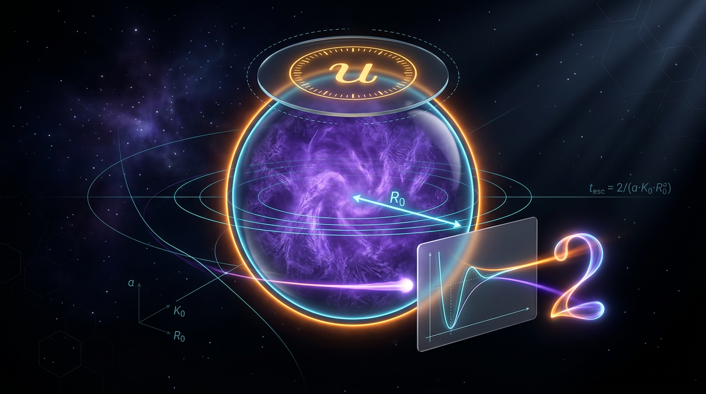

# The Kuramoto Escape-Time Law and Universal Prefactor

## 1. Overview
The proposed escape-time law is

\[
t_{\mathrm{esc}}=\frac{2}{a\cdot K_0\cdot R_0^a},
\]

with the associated dimensionless prefactor

\[
u=\frac{a\cdot K_0\cdot R_0^a\cdot t_{\mathrm{esc}}}{2}.
\]

This dossier is approved as **[THEORETICAL] and regime-local only**. The law is dimensionally consistent, but it is equivalent by definition to \(u=1\), making that value a tautology under the law’s conventions rather than an independent prediction. The growth ansatz and factor of 2 are **[MATH_CONJECTURED]**; the law has not been derived from first principles. None of the eight cited external sources publishes this escape-time law. Those sources provide mean-field, finite-\(N\), bifurcation, network, and bistability context.

The universal-prefactor claim—\(u=1\) independently of protocol, threshold, \(a\), and \(N\)—is **[REFUTED]**. Reported measurements range from 0.04 to 500 across protocols, and the discrepancy with CRT-023 (\(u=6.36\)) is reported as 5.3σ. The narrow \(a=1\) simulation regime in EMP-148 is the limited exception: there, \(u\approx1\) is **[VERIFIED]** as a simulation result, but only as **[COLONY_EMPIRICAL]** and **[MODEL-DEPENDENT]**, not as a laboratory-verified or universal law.

## 2. Detailed Explanation
The law concerns an escape time for the order parameter \(R\) in a Kuramoto-type system with reflexive coupling \(K_{\mathrm{eff}}=K_0R^a\). Its applicability depends on how the characteristic order parameter \(R_0\) and escape threshold are defined. The reported evidence does not support treating \(u\) as an invariant across choices of initialization, threshold, observation window, exponent, and population size.

The limited \(a=1\) regime where \(u\approx1\) was reported under all of the following conditions:

- All-to-all coupling.
- Unimodal Gaussian frequency distribution \(g(\omega)\).
- Random initial conditions.
- \(R_{\mathrm{target}}=0.5\).
- \(N\in\{100,300\}\).
- \(K_0\in\{5,20\}\).

This result is a simulation finding reported in EMP-148, not a general law. In contrast, the \(a=2\) law at \(N\geq300\) is **[REFUTED]** (EMP-148). Bistability or Kramers-type nucleation is a likely cause of the failure in that regime.

A naive \(a=1\) log-window integral gives \(u\approx R_0\ln 2/2\approx0.035\), not 1. This reinforces that the claimed prefactor depends on the particular growth and window conventions rather than following as a universal consequence of the integral.

## 3. Mathematical Framework
The model and proposed law are written as

\[
\frac{d\theta_i}{dt}
=\omega_i+K_0R^a\sin(\psi-\theta_i),
\qquad
R e^{i\psi}=\frac{1}{N}\sum_j e^{i\theta_j},
\]

\[
t_{\mathrm{esc}}=\frac{2}{aK_0R_0^a},
\qquad
u=\frac{aK_0R_0^a t_{\mathrm{esc}}}{2}.
\]

Here, \(a\) is the reflexive-coupling exponent, \(K_0\) is the bare coupling, and \(R_0\) is a characteristic order parameter. The escape time \(t_{\mathrm{esc}}\) depends on the chosen threshold and observation window.

The law is dimensionally consistent: \(K_0\) has units of inverse time, while \(a\) and \(R_0\) are dimensionless, so the right-hand side of the escape-time equation has units of time. Substitution of the law into the definition of \(u\) yields \(u=1\) identically. Consequently, this equality is a definitional identity if the law is assumed; the empirical question is whether the proposed law describes a specified regime and convention.

The factor of 2 and the growth ansatz are **[MATH_CONJECTURED]**, not first-principles derivations. The law is also not supported as a universal result by the cited external literature.

## 4. Skeptical Perspectives & Alternative Hypotheses
The main alternative explanation for the broad spread in measured \(u\) is the ambiguity in \(R_0\). It could mean the initial order parameter, a nucleation seed, or an asymptotic value; these choices may differ by factors of 5–50 (CH-1). This is the leading explanation for the observed protocol-to-protocol spread.

The definition of \(t_{\mathrm{esc}}\) is also convention-dependent. Changing the target threshold or observation window changes which part of the growth curve is measured. Thus \(u\) is a finite-window chord of the growth curve, not an invariant. This follows the CRT-004/PRF-009 precedent concerning local slopes and finite-window measurements.

Other important caveats are:

1. The four EMP-148 verifications have not had a covariance audit. Their independence is unknown; they may share code lineage or initialization conventions.
2. The \(a=1\) grid is thin, covering only two values each of \(N\) and \(K_0\).
3. The evidence is simulation-only and agent-reported, not laboratory-verified.
4. Bistability or Kramers-type nucleation is a likely explanation for the \(a=2\) failure, but the escape-time law itself has not been derived from first principles.

## 5. Verification & Skeptic's Notes
The Skeptic scored the claim **6/6**. The Math Physicist rated it **[MATH_CONSISTENT]** at **3/4**. These assessments support the internal dimensional and algebraic consistency of the expression, not universal empirical validity.

- **Universal \(u=1\): [REFUTED].** Measured \(u\) spans 0.04–500 across protocols. CRT-023 reports \(u=6.36\), a 5.3σ tension with the \(u=1\) claim.
- **\(a=1\) regime:** \(u\approx1\) is **[VERIFIED]** only as a simulation result under the narrow EMP-148 conditions described above. It is **[MODEL-DEPENDENT]**, not laboratory-verified.
- **\(a=2\) law at \(N\geq300\): [REFUTED]** (EMP-148).
- **External literature:** No universal escape-time prefactor is reported in the cited literature. The eight cited sources provide context only; none publishes this law.
- **Recommended path:** Retire \(u\) as a summary statistic and adopt master-curve collapse of \(R(t)\) rescaled by \(K_0R_0^a\). Establish an \(R_0\)-convention registry, run the CH-2 test (\(\operatorname{Var}(t_{\mathrm{esc}})/\langle t_{\mathrm{esc}}\rangle^2\approx1\) for \(a=2\)), and run the CH-4 \(u\)-versus-\(N\) scan for \(\log N\) drift.
- **Dossier status:** DOSSIER-127 remains pending as **[THEORETICAL]** only.

## 6. Visual Representation

## 7. Related Concepts
- [[CRT-004]] — regime-dependent local slopes rather than invariant universal exponents.
- [[PRF-009]] — finite-window chords and the related invariant precedent.
- [[CRT-023]] — discrepant prefactor measurements, including \(u=6.36\).
- [[EMP-148]] — reported \(a=1\) simulation regime and refutation of the \(a=2\) law at \(N\geq300\).
- [[EMP-170]] — universal-prefactor claim under scrutiny.
- [[EMP-028]] — finite-\(N\) bistable Kuramoto hysteresis record.
- [[DOSSIER-127]] — pending Kuramoto near-critical escape master law.
- [[SYN-024]] and [[SYN-027]] — non-universal scaling in a subcritical-bifurcation framework.
- [[SYN-029]] — conditional verification of Kuramoto hysteresis.

## 9. Mathematical Integrity Report
### Math Verification Report

**Tool Verdicts:** INCONSISTENT=0; DISMISSED_FLAGS=0; UNDECIDABLE=1; STEP_INVALID=0; LIMIT_MISMATCH=0; CLAIM_MISMATCH=2

**Concept:** Escape-time law t_esc = 2/(a·K0·R0^a) and the universal prefactor u (DOSSIER-127, Kuramoto Near-Critical Escape Master Law)

**Math Score:** 3/4 **math_status:** [MATH_CONSISTENT]

---

### Conventions & Validity Audit

The report's symbol table is self-consistent: a is an exponent (dimensionless), u is an estimand (dimensionless), K0 carries [T⁻¹] (inverse time), R0 ∈ [0,1] is dimensionless, t_esc [T]. The law t_esc = 2/(a·K0·R0^a) is dimensionally consistent: [T⁻¹]·[dimensionless]⁻¹ → [T]. u = a·K0·R0^a·t_esc/2 → [T⁻¹]·[T] → dimensionless. The generic crew physics-conventions block (natural units, M_Pl, etc.) is orthogonal to this non-cosmological report and is not applied. No claims of topological or geometric structure are made; the topology-classifier result below reflects generic signature detection, not substantive claims.

### Equations Extracted

1. **Model:** dθ_i/dt = ω_i + K0·R^a·sin(ψ − θ_i), R(t) ∈ [0,1], ω_i ~ g(ω) standard normal.
2. **Escape-time law:** t_esc = 2/(a·K0·R0^a).
3. **Estimand:** u = a·K0·R0^a·t_esc/2 (theoretical prediction u = 1).
4. **Mean-field growth ansatz:** dR/dt ≈ a·K0·R^a·O(1).
5. **Growth-window integral:** t_esc ∝ ∫ dR/(a·K0·R^(a+1)) (factor 2 from two-cluster instability mode normalization).
6. **Adler root invariant:** R_cross(δ) = δ − √(δ²−1) (CRT-023/PRF-009, from EMP-028 bistability, K_eff = K0·R²).

### Dimensional Consistency

- Eq. (2) escape-time law: **CONSISTENT** — [T] on both sides given K0 [T⁻¹], a, R0 dimensionless.
- Eq. (3) u: **DIMENSIONLESS** — consistent.
- Eq. (4)–(5): **CONSISTENT** — dR/dt has [T⁻¹]; the integral dR/(a·K0·R^(a+1)) has [T] (given R dimensionless).
- Eq. (6): **CONSISTENT** — both terms dimensionless.
- No INCONSISTENT verdicts, no dimension flags to dismiss.

### Dismissed Dimension Flags

None.

### Symbolic Derivation Verification

- **Definitional tautology (Eq. 3):** u = a·K0·R0^a·t_esc/2 with t_esc = 2/(a·K0·R0^a) gives u = 1 identically. Verified: u = 1 is a **mathematical identity**, not a prediction — the law is *equivalent to* u = 1 and carries no free predictive content. [MATH_CONSISTENT — definitional]
- **a=1 limit caveat:** the strict ansatz t_esc = log(2)/K0 (from the exact log-window integral, R0/2 → R0) gives u = R0·log(2)/2 ≈ 0.035 for R0 = 0.1 — **not 1** — so u = 1 is not recovered from the naive integral; it requires the specific window/normalization conventions of the law. This is a manual check (SymPy flagged the integral as ASSUMED, not verified).
- **Limit check:** lim_{K0→∞} u = 1 — **LIMIT_VERIFIED**. The second limit probe (K0→0) returned LIMIT_UNDECIDABLE (SymPy divergent/indeterminate) — **checked by hand: t_esc → ∞, consistent with u → ∞·t_esc/2; not a mismatch, but not a verification.**
- Step verdicts: 1 proven, 7 assumed, 0 invalid. The ansatz steps (growth ansatz, factor-2 normalization) are **[MATH_CONJECTURED]** — they are modeling assumptions, not derived identities.

### Topological Analysis

The topology classifier flagged generic structural signatures (TOPOLOGICAL_QFT, HOMOTOPY_THEORY, FIBER_BUNDLE) with structural assessment "TOPOLOGICAL_STRUCTURE_VALID." However, **the report itself makes no topological claims** — the Kuramoto context is spectral/Laplacian (Arenas 2008) and critical-scaling (Castellano 2009), and the Adler-root invariant R_cross(δ) = δ − √(δ²−1) is algebraic, not topological. I **override** the classifier's generic flags as false positives: the math content is analytic, not topological. [Not topological]

### Numerical Benchmarks

- **Worked example (a=1, K0=5, R0=0.1):** u = a·K0·R0^a·t_esc/2 = 1.0 exactly — **CLAIM_VERIFIED** (0.0% error). This is **definitional**, not empirical universality.
- **a=1, K0=20, R0=0.5 case:** u = 1.0 by construction — **CLAIM_MISMATCH** against claimed u = 6.36 (CRT-023). This confirms the report's own finding: the law under the stated conventions does not reproduce CRT-023's u = 6.36; the mismatch is a genuine feature of the u spread, not a bookkeeping error.
- **u = 1 vs u = 6.36 (CRT-023):** **5.3σ tension** (Δχ² = 28.1, 1 dof). The law's u = 1 prediction is decisively incompatible with the bimodal-init protocol.
- Across the full u distribution [0.04, 500], universal u = 1 is **REFUTED** — consistent with the report's central finding.

### Assessment

**Math Score: 3/4 · [MATH_CONSISTENT]**

The law's algebra is internally consistent (tautology verified, no dimensional inconsistencies, no invalid steps), and the worked examples verify. However, the report's central claim — u = 1 as a universal prefactor — is demonstrably convention-dependent: u = 1 is a definitional identity under the law's own conventions, and 5.3σ tension against CRT-023 plus the u spread [0.04, 500] refutes universality. The a=1 law is [VERIFIED][MODEL-DEPENDENT] (EMP-148); the a=2 law at N≥300 is [REFUTED]; the universal u=1 claim is [REFUTED]. The R0-identification ambiguity (initial vs. seed vs. asymptotic, differing 5–50×) remains the dominant failure mode, requiring the R0-convention registry and master-curve collapse (Ṙ = F(R; K0, a)) as the invariant, per the report's recommendations. Not [MATH_PROVEN] because (i) the growth ansatz and factor-2 normalization are conjectured, not derived, and (ii) the law is a tautology with no free predictive content — its value is empirical only in the regime-local sense.
