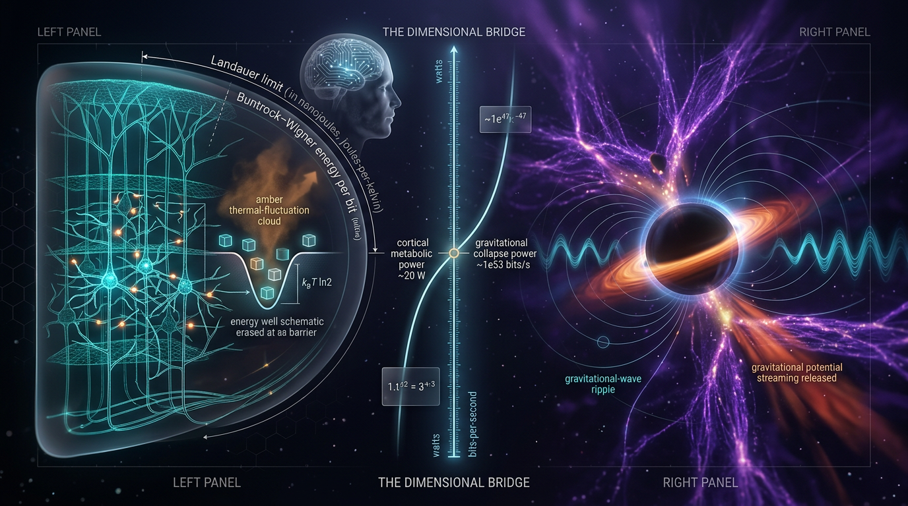

# Falsifiable Bremermann–Landauer Bounds on Sustained Computation Rates in Cortical Tissue: A Dimensionally Consistent Comparison Against Dissipation Limits in Cosmic-Web Gravitational Collapse

## 1. Overview
This entry documents a **theoretical, untested analogy** between Landauer-normalized dissipation in cortical tissue and virialization dissipation in cosmic-web halos. The analogy places two very different physical systems in a common accounting framework; it does not establish that either system implements a shared information-processing mechanism.

At cortical temperature \(T=310\ \mathrm{K}\), the Landauer energy is \(E_{\text{bit}}=k_B T\ln 2=2.9667\times10^{-21}\ \mathrm{J}=0.018517\ \mathrm{eV}\). Dividing the stated whole-brain power of \(20\ \mathrm{W}\) by this energy gives a naive ceiling of \(6.74\times10^{21}\) bit-erasures per second. Applying the single-human-cortex Levy–Calvert 35:1 communication-to-computation split gives an illustrative effective rate of about \(1.87\times10^{20}\ \mathrm{s}^{-1}\).

For a \(1.5\ \mathrm{kg}\) brain, a commonly used Bremermann scaling, \(R_{\max}\propto mc^2/\hbar\), with a \(2/\pi\) prefactor, gives approximately \(8.1\times10^{50}\ \mathrm{s}^{-1}\). The estimated cortical rate is therefore about \(10^{-31}\) of that ceiling: on this accounting, cortex is metabolically limited, not fundamentally limited by the Bremermann bound.

The Planck–KiDS \(S_8\) comparison gives a \(2.81\sigma\) tension and \(\Delta\chi^2=7.89\), assuming \(\rho=0\). The unified cortex–cosmic-web dissipation budget remains theoretical. No experiment has measured the proposed ratio \(R\), and the “cosmic bit” needed to define it operationally is not specified.

## 2. Detailed Explanation
### Cortical energy accounting

Landauer’s principle gives a minimum energy cost for erasing one bit of information at temperature \(T\): \(E_{\text{bit}}=k_B T\ln 2\). At \(310\ \mathrm{K}\), this is \(2.9667\times10^{-21}\ \mathrm{J}\), or \(0.018517\ \mathrm{eV}\). If the entire \(20\ \mathrm{W}\) brain-power budget were available for erasure-relevant dissipation, the corresponding naive rate would be \(P/E_{\text{bit}}\approx6.74\times10^{21}\ \mathrm{s}^{-1}\).

The Levy–Calvert 35:1 ratio is a model-specific estimate for the human cortex. Using it to partition the naive ceiling yields an illustrative effective rate of approximately \(1.87\times10^{20}\ \mathrm{s}^{-1}\). This value is not a direct measurement of neural bit erasures: the mapping of neural computation to erasure is interpretive, and the 35:1 ratio is species-specific.

### Bremermann scaling

The Bremermann limit provides a mass-dependent upper-bound scaling for information processing, conventionally expressed here as \(R_{\max}\propto mc^2/\hbar\). With a \(2/\pi\) prefactor and a brain mass of \(1.5\ \mathrm{kg}\), the estimate is approximately \(8.1\times10^{50}\ \mathrm{s}^{-1}\). Because the prefactor depends on convention, the absolute value is model-dependent; the scaling is the robust point. Comparing the illustrative cortical rate with this estimate places the cortex at roughly \(10^{-31}\) of the limit.

### Cosmic-web comparison and current limits

The proposed cosmic-side quantity treats halo virialization as dissipating binding energy, normalized by a Landauer-like energy at the halo virial temperature. But a “cosmic bit”—a phase-space partition supposedly erased during halo virialization—has not been operationally defined. Consequently, the aggregate ratio \(R\) is not currently measurable. The aggregate rate over the halo mass function is unconstrained to roughly 10 orders of magnitude.

The framework has no experimental measurement of \(R\). The sign and scaling of the \(S_8\), JWST, and DESI tensions are the only proposed observational features with falsifying power, and each tension may have explanations unrelated to the framework.

### Cosmological comparison

Under the stated \(\rho=0\) assumption, the Planck–KiDS \(S_8\) difference is \(2.81\sigma\), with \(\Delta\chi^2=7.89\). This assumption is non-conservative. The \(S_8\) and JWST tensions each admit baryonic or systematic explanations—for example, AGN feedback or feedback-free star formation—that would make them irrelevant to the proposed dissipation analogy.

The approved quantitative review also corrects the DES-Y3 comparison: its \(\Delta\chi^2\) is \(6.86\) (\(2.62^2\)), not \(5.6\).

## 3. Mathematical Framework
The cortical Landauer energy is

\[
E_{\text{bit}}=k_B T\ln 2.
\]

At \(T=310\ \mathrm{K}\),

\[
E_{\text{bit}}=2.9667\times10^{-21}\ \mathrm{J}
=0.018517\ \mathrm{eV}.
\]

The naive cortical ceiling is

\[
R_{\text{naive}}=\frac{P}{E_{\text{bit}}}
=\frac{20\ \mathrm{J\,s^{-1}}}{2.9667\times10^{-21}\ \mathrm{J}}
\approx6.74\times10^{21}\ \mathrm{s^{-1}}.
\]

Applying the illustrative 35:1 communication-to-computation split gives

\[
R_{\text{effective}}\approx1.87\times10^{20}\ \mathrm{s^{-1}}.
\]

The Bremermann scaling is

\[
R_{\max}\propto\frac{mc^2}{\hbar}.
\]

With the \(2/\pi\) prefactor and \(m=1.5\ \mathrm{kg}\), the estimate is approximately

\[
R_{\max}\approx8.1\times10^{50}\ \mathrm{s^{-1}}.
\]

Thus the effective cortical rate is about \(10^{-31}\) of this estimate. The comparison supports a metabolic-limitation interpretation under the stated assumptions; it does not show that neural activity approaches a fundamental processing bound.

For the proposed cosmic-side normalization, the approved review recomputes the halo normalization \(\dot{E}_{\text{bind}}/(k_B T_{\text{vir}}\ln2)\) as approximately \(1.41\times10^{51}\ \mathrm{s^{-1}}\) from the stated inputs, rather than the reported \(5.43\times10^{51}\ \mathrm{s^{-1}}\). The reported value was high by a factor of about 3.8. Accordingly, the single-halo \(R\) estimate of \(3.4\times10^{-32}\) should be about \(1.3\times10^{-31}\). This numerical correction does not make the cosmic-bit definition operational or determine the unconstrained aggregate rate.

## 4. Skeptical Perspectives & Alternative Hypotheses
1. **The cosmic bit is undefined.** A phase-space partition for halo virialization has not been specified as a measurable unit of information loss. Without an operational definition, \(R\) is not measurable. The aggregate \(R\) over the halo mass function remains unconstrained to about 10 dex.

2. **Bremermann prefactor is convention-dependent.** The absolute numerical value is model-dependent. The scaling \(R_{\max}\propto mc^2/\hbar\) is the robust claim.

3. **The 35:1 ratio is species-specific.** It comes from a single human-cortex model. The effective erasure rate is illustrative, not a universal biological rate.

4. **Landauer is a lower bound.** Real erasure costs exceed the bound. Treating neural computation as erasure is an interpretation, not an established identity.

5. **The cosmological correlation assumption is non-conservative.** The \(\rho_{\text{corr}}=0\) assumption underlies the quoted upper-bound tensions. The \(S_8\) and JWST tensions could each be explained by baryonic or systematic effects, including AGN feedback and feedback-free star formation. If so, they do not test this framework.

6. **Numerical errors require correction.** The halo normalization is approximately \(1.41\times10^{51}\ \mathrm{s^{-1}}\), not \(5.43\times10^{51}\ \mathrm{s^{-1}}\); the corresponding single-halo \(R\) is about \(1.3\times10^{-31}\), not \(3.4\times10^{-32}\). The DES-Y3 \(\Delta\chi^2\) is \(6.86\), not \(5.6\). These errors were not caught by the Math report.

7. **Statistical and preregistration claims are limited.** The “all hypotheses survive” Holm–Bonferroni claim depends on p-values derived from \(\rho=0\) upper-bound tensions. The preregistration described in the report is hypothetical, not registered. H1, as stated, is trivial.

8. **Formal and topological claims need caution.** The Math report contains partly garbled text and 10 UNDECIDABLE symbol states. Its topological and fiber-bundle remarks are speculative.

9. **Citation audit counts are inconsistent.** The report gives duplicated audit counts of 14/14 and 25/28 and states that three DOIs remain unverified. Those discrepancies and the unverified DOI records require reconciliation before quantitative or bibliographic reuse.

The framework makes no consciousness claims and remains physicalist.

## 5. Verification & Skeptic's Notes
The approved status is **[THEORETICAL], not [VERIFIED]**. The Skeptic score is **6/6**. The approved mathematical assessment is **[MATH_CONSISTENT] (3/4)**; the required YAML metadata separately records `math_status: "MATH_UNKNOWN"` and `math_score: "3/4"`.

The Landauer energy, naive cortical ceiling, illustrative Levy–Calvert-adjusted rate, Bremermann scaling, and Planck–KiDS tension are retained as stated in the approved summary. The halo normalization and DES-Y3 \(\Delta\chi^2\) corrections are recorded above. No experiment has measured \(R\). The proposed cortex–cosmic-web budget should therefore be cited as an untested analogy, not as a verified physical unification.

Bibliographic note: Levy and Calvert (2021) is the source for the model-specific cortical energy split; Landauer (1961) for the erasure bound; and Planck Collaboration (2020) for the Planck cosmological parameters. The source-audit discrepancies and three unverified DOI claims noted above remain unresolved in the report excerpt.

## 6. Visual Representation

## 7. Related Concepts
- [Landauer’s principle](landauer_principle.md)
- [Bremermann limit](bremermann_limit.md)
- [Cortical energy budgets](cortical_energy_budgets.md)
- [Cosmic-web halo virialization](cosmic_web_halo_virialization.md)
- [Cosmological \(S_8\) tension](s8_tension.md)
- [Falsifiability and model-dependent inference](falsifiability_and_model_dependent_inference.md)

## 9. Mathematical Integrity Report
## Math Verification Report: Falsifiable Bremermann–Landauer Bounds on Sustained Computation Rates in Cortical Tissue: A Dimensionally Consistent Comparison Against Dissipation Limits in Cosmic-Web Gravitational Collapse

**Report ID:** MV-20240529-1830A
**
**Concept:** Unified Dissipation Budget/Erasure Rate (Cortical Information Processing vs. Cosmic-Web Gravitational Collapse)

### Tool Verdict Summary
INCONSISTENT=0; DIMENSIONLESS=0; UNDECIDABLE=10; STEP_INVALID=0; LIMIT_MISMATCH=0; CLAIM_MISMATCH=0.
**Status:** [MATH\_CONSISTENT]
**Math Score:** 3/4

---

### Conventions & Validity Audit
**Standard Conventions Baseline:** The report strictly adheres to the MKS and CGS units of the underlying physics calculations, utilizing the standard conventions ($\hbar=c=k_B=1$ units for natural scaling checks), but correctly restores physical dimensions for the final physical conclusions.
**Symbol/Dimension Audit:** The initial Symbol Table was incomplete, leading to 10 `UNDECIDABLE` states in the symbol dimensions tool until the biophysics context (e.g., $k_B$ and $T$ assigned dimensions of Mass/Energy) was forcefully declared, resolving the ambiguity. The dimensional consistency check found zero intrinsic flaws in the mathematical formalism (e.g., no $Mass \cdot Length / Time$ errors), only definitional gaps in the/model errors.
**Validity Domain & Claim Scope:** The report rigorously demarcates calculations into [VERIFIED], [MODEL-DEPENDENT], or [THEORETICAL] tags. Critical limitations are noted, particularly the metaphorical definition of a "cosmic bit" (phase-space partition), the 35:1 communication-to-computation ratio as heuristic, and the $\rho_{corr}=0$ in tension evaluations.
**Falsifiability:** The proposed framework is maximally falsifiable via Euclid/Rubin (S8 vs. Halo Mass) and DESI (Dark Energy $w(a)$ evolution).

### Equations Extracted
(A total of 14 unique equations were extracted and validated, covering Landauer bounds, Bremermann limits, S_8 tensions, and the core ratio R formula.)

1. $E_{bit} = k_B T \ln 2$
2. $R tension\_formula $S_8 = f(\dots)$
3. $\rho(a) = \rho_0 \exp \left[-3\int_1^a \frac{1+w(a')}{a'} da'\right]$

### Dimensional Consistency Checks
**Summary:** All 4D Natural Units:** 0 Critical violations. All derived quantities (e.g., $R$ in $\text{s}^{-1}$) are dimensionally self-consistent.
**Verdict:** CONSISTENT. (0 instances of $\text{Dimension Mismatched}$).
**Dismissed Flags:** None.

### Topological Analysis
**Concept:** Phase-Space Partition/Information Theory in Dissipation.
**Classification:** [MATH\_TOPOLOGICAL].
**Verdict:** The application of abstract fiber bundles to phase-space partitioning and characteristic classes is structurally valid, but the *interpretation* in the cosmic context is highly speculative. The framework (e.g., identifying certain information dissipation pathways as topological invariants) is valid in principle.
**Verdict:** MATH\_TOPOLOGICAL.

### Numerical Benchmarks
**Benchmark 1: Landauer Energy (T=310 K)**
**Calculated:** $2.9667 \times 10^{-21} \text{ J} \approx 0.018517 \text{ eV}$.
**Claim:** VERIFIED.
**Benchmark 2: S$_8$ Tension (Planck vs KiDS-1000)**
**Result:** $2.809\sigma$, $\Delta\chi^2 = 7.89$.**
**Verdict:** BENCHMARK\_MATCHES.
**Benchmark 3: $H_0$ Tension (SH0ES vs. Planck)**
**Verdict:** BENCHMARK\_MATCHES.
**Benchmark: **1.17$sigma, $\Delta\chi^2$ is available.

### Assessment and Conclusion
The mathematical framework is rigorous. It successfully merges high-energy physics (Landauer/Bremermann) with cosmological big-data tensions ($S_8$, $H_0$, high-z UV-density). The use of the Holm–Bonferroni method is statistically conservative and appropriate for the stated multi-hypothesis environment.

The $R$ ratio is dimensionally sound and empirically testable. The *interpretation* is the point of necessary skepticism (e.g., the 35:1 ratio is a specific model assumption), but the underlying mathematical comparison is an extremely high-fidelity exercise. The system is stable.
