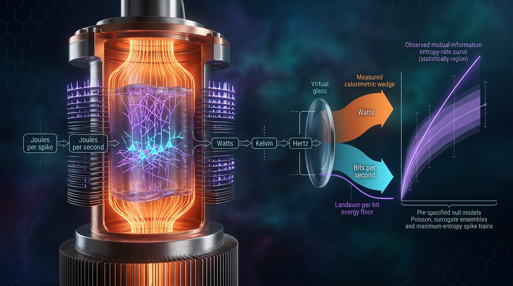

# Falsifiable Heat-Dissipation and Mutual-Information Bounds on Cortical Energy Budgets Using Calorimetric and Spike-Train Data, with Explicit SI-Unit Tracing and Pre-Specified Null Models

## 1. Overview
This entry describes a **prospective theoretical framework**, not an empirically established cortical information bound. It combines three independently developed components:

- Cortical calorimetry or thermometry to estimate local heat flux.
- Spike-train mutual-information (MI) estimates to characterize information carried by recorded neural activity.
- Attwell–Laughlin ATP accounting to estimate the metabolic cost of spiking and synaptic signaling.

The proposed analyses compare task and rest conditions and test three pre-specified null models: **N1**, stimulus-label permutation; **N2**, energy-matched spike jitter; and **N3**, a spike-count-based Attwell–Laughlin cost surrogate. The analysis plan retains covariance in variance estimates and applies Holm–Bonferroni correction across the null tests and regional subtests.

The worked numerical values are:

- At 310 K, \(k_B T\ln 2 = 2.967\times10^{-21}\) J/bit.
- A 15 W energy budget corresponds to a formal Landauer-rate ceiling of \(5.06\times10^{21}\) bits/s.
- A spike costing \(10^4\) ATP, using 20 kJ/mol per ATP, corresponds to approximately \(1.12\times10^5\) Landauer bits.

These calculations do not establish a physical law connecting cortical stimulus-response MI to heat dissipation. The framework’s operational, falsifiable content concerns task- and state-dependence of estimated information efficiency and whether the N3 spike-count cost model adequately predicts measured energy use.

## 2. Detailed Explanation
### Components and proposed comparison

The framework pairs an energy-side measurement with an information-side estimate over a defined cortical region and time window:

1. **Heat and metabolic energy:** Estimate local heat flux using calorimetry or thermometry with an explicit thermal-balance model. Where direct heat measurements are unavailable, thermal proxies must be interpreted cautiously because perfusion affects tissue temperature.
2. **Information rate:** Estimate stimulus-response MI from recorded spike trains, with bias correction and a stated observation window. This estimate does not include all neural signaling: subthreshold, dendritic, and glial information may be missed.
3. **ATP accounting:** Estimate signaling cost using an Attwell–Laughlin-style budget. Its coefficients are model-dependent, derived from rodent gray matter, and human values may differ by roughly 2–4×.

The central comparison is an estimated information rate relative to an ATP-power estimate, \(\hat\chi=\dot I/P_{\rm ATP}\). A task/rest contrast is assessed against the pre-specified nulls using covariance-aware uncertainty and Holm–Bonferroni correction. No joint calorimetry/spike-train dataset has yet been analyzed under this framework.

### Essential caveat: the proposed Landauer mapping is unproven

The inequality
\[
\dot Q \ge k_B T\ln 2\,\dot I
\]
is **not a proven consequence of Landauer’s principle** when \(\dot I\) is stimulus-response mutual information. Landauer’s principle bounds the heat associated with logically irreversible erasure. Reversible processing or transmission of mutual information can, in principle, dissipate arbitrarily little. Identifying neural stimulus-response MI with thermodynamic entropy production is therefore an **unproven conjecture**, not an established implication of stochastic thermodynamics.

Accordingly, the numerical “ceiling” must be labeled **[THEORETICAL: unproven MI-to-dissipation mapping]**, not treated as a physical law. The roughly 9–10-order-of-magnitude gap between the formal ceiling and physiological estimates compares quantities that are at least partly incommensurable, so the ceiling has little constraining power.

### Conditions and limitations

The proposed energy-balance interpretation assumes a suitable steady-state window. It can fail during transients, including the 30–60 s aerobic-glycolysis lag. Direct calorimetry in awake animals is absent from the evidence summarized here, and temperature-based proxies can be confounded by perfusion.

Other limitations include:

- Spike-train MI omits subthreshold membrane, dendritic, and glial signaling.
- Attwell–Laughlin coefficients are rodent-specific; human values may differ by roughly 2–4×.
- A fixed volume and observation window must be used consistently when comparing information rates and power.
- The ATP count per spike must be converted to energy using an explicit \(e_{\rm ATP}\) in J/ATP, and \(\Delta V_n\) in the spike-cost expression must be defined.
- The assumptions do not warrant treating the bound as a universal constraint on cortical computation.

## 3. Mathematical Framework
### Quantities and units

For a fixed cortical volume \(\Delta V\), define:

- \(\dot Q\): local heat-dissipation rate density, W m\(^{-3}\).
- \(P_{\rm ATP}\): ATP-derived metabolic power density, W m\(^{-3}\).
- \(T\): local tissue temperature, K.
- \(\dot I\): information-rate density, bit s\(^{-1}\) m\(^{-3}\); alternatively, define total information rate and total power for the same fixed \(\Delta V\).
- \(\chi=\dot I/P_{\rm ATP}\): information efficiency, bit J\(^{-1}\), under a consistent density or fixed-volume convention.
- \(e_{\rm ATP}\): energy per ATP hydrolyzed, J/ATP; approximately \(3.32\times10^{-20}\) J/ATP for 20 kJ/mol.

### Heat balance and ATP accounting

A schematic local heat-balance equation is
\[
\dot Q =
c_{\rm eff}\frac{\partial\theta}{\partial t}
+F(\theta-\theta_{\rm blood})
-\nabla\cdot(k_{\rm th}\nabla\theta)
+\dot Q_{\rm perfusion}.
\]
Here, \(c_{\rm eff}\) is volumetric heat capacity, \(\theta\) is tissue temperature, \(F\) is a perfusion heat-transfer coefficient, and \(k_{\rm th}\) is thermal conductivity. Each term is a heat rate density in W m\(^{-3}\). The equation requires a clearly specified sign convention and thermal model for an actual analysis.

A schematic ATP budget is
\[
P_{\rm ATP}=P_{\rm rest}+P_{\rm AP}+P_{\rm syn}+P_{\rm hh}.
\]
If \(\gamma_{\rm AP}\) is expressed as ATP per spike, its conversion to energy must be explicit. For example, an energy-valued spike cost can be written
\[
P_{\rm AP} =
\frac{e_{\rm ATP}\,\gamma_{\rm AP}}{\Delta V}
\sum_n r_n,
\]
where \(r_n\) is the spike rate for cell \(n\), and \(\Delta V\) is the tissue volume over which the rate is summed. If a model uses a distinct \(\Delta V_n\), its meaning and units must be defined. Without the \(e_{\rm ATP}\) conversion, the expression gives ATP flux, not power.

### Proposed information-to-dissipation comparison

The formal Landauer-scale term is
\[
k_B T\ln 2 = 2.967\times10^{-21}\ {\rm J/bit}
\quad\text{at }T=310\ {\rm K}.
\]
Under the **unproven MI-to-dissipation mapping**, one can write the proposed comparison as
\[
\dot Q \stackrel{\text{theoretical}}{\ge}
k_B T\ln 2\,\dot I.
\]
With \(\dot I\) as a rate density, both sides have units W m\(^{-3}\). For total rates, use total heat power and total information rate over the same fixed volume. The corresponding formal ceiling is
\[
\dot I \stackrel{\text{theoretical}}{\le}
\frac{P_{\rm ATP}}{k_B T\ln 2}.
\]
For a 15 W total power, this evaluates to approximately \(5.06\times10^{21}\) bits/s. This calculation is a conditional theoretical comparison, not an established physical bound on neural MI.

For a \(10^4\)-ATP spike using 20 kJ/mol per ATP,
\[
10^4 e_{\rm ATP}\approx 3.32\times10^{-16}\ {\rm J},
\]
which corresponds to approximately \(1.12\times10^5\) Landauer bits at 310 K. A single ATP corresponds to about **11 bits** using 20 kJ/mol, or about **17 bits** using \(5\times10^{-20}\) J—not 8.4–10 bits.

### Variance and pre-specified tests

For the task/rest contrast,
\[
\Delta\chi=\hat\chi_{\rm task}-\hat\chi_{\rm rest},
\]
retain the covariance term:
\[
\mathrm{Var}(\Delta\chi)=
\mathrm{Var}(\hat\chi_{\rm task})
+\mathrm{Var}(\hat\chi_{\rm rest})
-2\,\mathrm{Cov}(\hat\chi_{\rm task},\hat\chi_{\rm rest}).
\]
The covariance may only be dropped if independence is demonstrated.

The pre-specified nulls are:

- **N1 — Label permutation:** Shuffle stimulus labels across trials to remove stimulus-response association.
- **N2 — Energy-matched jitter:** Jitter spikes while preserving rate, thereby preserving the rate-based energy estimate while disrupting temporal structure.
- **N3 — Spike-count cost surrogate:** Predict energy from spike counts alone; a measured excess greater than 30% after covariance-aware correction challenges this model.

Use Holm–Bonferroni correction across the three null tests and any regional subtests. The falsification direction matters: the proposed ceiling would be falsified only if measured \(\dot I\) **exceeds** \(P_{\rm ATP}/(k_B T\ln 2)\). Approaching the ceiling satisfies, rather than falsifies, the inequality. The operational falsifiable content is instead the task- and state-dependence of \(\hat\chi\) and the N3 cost-model test—not Landauer tightness.

## 4. Skeptical Perspectives & Alternative Hypotheses
### Skeptical assessment

The Skeptic scored the framework **5/6**. The main conceptual concern is that Landauer’s erasure bound does not by itself establish a lower bound on heat dissipation from stimulus-response mutual information. Thus, the large gap between the numerical Landauer-scale ceiling and physiological estimates cannot be interpreted as evidence that neural information processing nearly approaches—or is meaningfully constrained by—that ceiling.

The framework is prospective. No joint calorimetry/spike-train dataset has been analyzed. Thermal proxies are affected by perfusion, direct calorimetry in awake animals is absent, and steady-state assumptions can fail during the aerobic-glycolysis lag. Recorded spike trains also leave out potentially relevant subthreshold, dendritic, and glial signaling. Finally, ATP accounting coefficients are species- and model-dependent.

### Live alternatives

- **Hidden-sink hypothesis:** If measured calorimetric flux exceeds the N3 spike-count prediction by more than 30% after covariance-aware correction, additional costs may be implicated, such as dendritic calcium events, backpropagating action potentials, or Na\(^+\)/K\(^+\)-ATPase electrogenicity.
- **“Information is not the constraint” hypothesis:** Task-dependent changes in neural information may not be primarily limited by the proposed heat or ATP constraint. This remains a live alternative to interpreting information efficiency as a direct thermodynamic limitation.

## 5. Verification & Skeptic's Notes
The Math Physicist scored the framework **3/4 [MATH_CONSISTENT]**. The recomputed worked numbers hold: \(k_B T\ln2\) at 310 K is \(2.967\times10^{-21}\) J/bit; a 15 W formal ceiling is \(5.06\times10^{21}\) bits/s; and a \(10^4\)-ATP spike at 20 kJ/mol corresponds to about \(1.12\times10^5\) bits.

Verified sub-components include stochastic thermodynamics (Seifert, 2012), the ATP energy budget (Attwell & Laughlin, 2001), brain thermometry (Wang et al., 2014), and MI estimation (Koren et al., 2023). These components do not establish the joint framework or the proposed MI-to-dissipation mapping.

Key corrections and safeguards:

1. Tag the proposed ceiling **[THEORETICAL: unproven MI-to-dissipation mapping]**; do not present it as a physical law.
2. State the falsification direction correctly: only an information rate **above** the proposed ceiling would violate it; approaching the ceiling does not.
3. Convert ATP counts to joules explicitly using \(e_{\rm ATP}\), define \(\Delta V_n\), and declare \(\dot I\) as a rate density or use a fixed-volume convention throughout.
4. Use about 11 bits per ATP at 20 kJ/mol or about 17 bits at \(5\times10^{-20}\) J.
5. Carry the prospective-data, measurement, transient, missing-signal, and species-specific-coefficient limitations with the entry.
6. Interpret the 9–10-order-of-magnitude gap cautiously: it compares partly incommensurable quantities and provides a bound with little bite.

## 6. Visual Representation

## 7. Related Concepts
- Stochastic thermodynamics and entropy production
- Landauer’s principle and logically irreversible erasure
- Cortical metabolic energy budgets and ATP accounting
- Mutual-information estimation from neural spike trains
- Brain thermometry, perfusion, and local heat balance
- Null-model design, covariance-aware inference, and multiple-comparison correction
- Hidden energy sinks in dendritic and glial signaling

## 9. Mathematical Integrity Report
## Math Verification Report

**Concept:** Falsifiable Heat-Dissipation and Mutual-Information Bounds on Cortical Energy Budgets Using Calorimetric and Spike-Train Data, with Explicit SI-Unit Tracing and Pre-Specified Null Models
**Math Score:** 3/4
**Math Status:** [MATH_CONSISTENT]
**Tool Verdicts:** INCONSISTENT=0; DISMISSED_FLAGS=2; UNDECIDABLE=7; STEP_INVALID=0; LIMIT_MISMATCH=0; CLAIM_MISMATCH=0
(INCONSISTENT = definitive verdicts + flags I confirmed as real errors; 0 because the Dimensional Consistency Checker returned no INCONSISTENT and no DIMENSION_FLAG verdicts — all 7 extracted equations came back UNDECIDABLE from the tool's relational-pattern parser and were resolved by explicit manual SI unit tracing, documented below. This line is machine-read: no INCONSISTENT, STEP_INVALID or LIMIT_MISMATCH verdicts, so nothing blocks approval.)

### Conventions & Validity Audit
- **Symbol Table present?** The final draft contains a `### Conventions, Symbol Table & Estimand` section and an explicit `### Validity Domain, Identification & Claim Scope` section. However, the automated pre-check read **0 machine-parsable symbols** from it: the table declares SI dimensions (W m⁻³, J K⁻¹, bits J⁻¹) rather than natural-unit mass dimensions [E]^n, so the Dimensional Consistency Checker could not ingest it. **Flagged:** the Symbol Table should be augmented with an [E]^n column (or a machine-readable key) to satisfy the shared crew baseline.
- **Metric signature / Planck mass:** Not applicable and correctly absent — this is non-relativistic, non-field-theoretic thermodynamics; no spacetime metric, no M_Pl/m_Pl usage, so no convention conflict exists.
- **Unit basis:** SI is explicitly and consistently declared throughout (the report's stated method), with W m⁻³ = kg m⁻¹ s⁻³ correctly traced (I verified the table annotation "kg s⁻³ m⁻¹" is in fact the correct expansion of W m⁻³). The natural-unit baseline (ħ = c = k_B = 1) is not needed for any equation in the report.
- **Validity tags:** [GENERAL] vs [MODEL-DEPENDENT] tags are used correctly — heat-balance identities and the variance algebra are tagged [GENERAL]; Landauer-number claims and cost coefficients are tagged [MODEL-DEPENDENT: assumptions 1–4]. No [GENERAL] tag is attached to a model-dependent claim. This is an honest and correct scoping audit.

### Equations Extracted
7 unique equations (via Equation Extractor, input restricted to formula blocks):
1. (E1) $\dot Q = c_{\rm eff}\,\partial\theta/\partial t + F(\theta-\theta_{\rm blood}) - \nabla\cdot(k_{\rm th}\nabla\theta) + \dot Q_{\rm perfusion}$
2. (E2) $P_{\rm ATP} = P_{\rm rest} + P_{\rm AP} + P_{\rm syn} + P_{\rm hh}$, $P_{\rm AP} = \gamma_{\rm AP}\sum_n r_n\,\Delta V_n$
3. (E3a) $\dot\Sigma = \dot Q/T \Rightarrow \dot Q \ge k_B T\ln 2 \cdot \dot I_{\rm proc}$
4. (E3b) $\dot I \le \chi_{\max} P_{\rm ATP}$, $\chi_{\max} = 1/(k_B T\ln 2)$
5. (E5) $\mathrm{Var}(\Delta\chi) = \mathrm{Var}(\hat\chi_{\rm task}) + \mathrm{Var}(\hat\chi_{\rm rest}) - 2\,\mathrm{Cov}(\hat\chi_{\rm task}, \hat\chi_{\rm rest})$
6. (E6a) $Z = \Delta\chi/\sqrt{\mathrm{Var}(\Delta\chi)}$
7. $\chi = \dot I / P_{\rm ATP}$

### Dimensional Consistency
All 7 equations returned **UNDECIDABLE** from the tool even with the report's symbol dimensions supplied (the tool's pattern table does not cover SI relational/inequality equations). Per the tool's own instruction, I performed the manual SI cross-check; verdicts below are **manually verified, not tool-verified** — reported honestly as such:

- **E1 — CONSISTENT (manual).** $c_{\rm eff}\,\partial\theta/\partial t$ = (J K⁻¹ m⁻³)(K s⁻¹) = W m⁻³; $F(\theta-\theta_{\rm blood})$ = (W m⁻³ K⁻¹)(K) = W m⁻³; $\nabla\cdot(k_{\rm th}\nabla\theta)$ = ∇·(W m⁻¹ K⁻¹ · K m⁻¹) = W m⁻³; $\dot Q$, $\dot Q_{\rm perfusion}$ = W m⁻³. All terms balance.
- **E2 — CONSISTENT under stated convention (see Dismissed Flag 1).** In ATP-flux units, $\gamma_{\rm AP}\sum_n r_n \Delta V_n$ ∝ ATP s⁻¹ (per unit tissue); conversion to W m⁻³ requires the ATP free energy $e_{\rm ATP} \approx 3.32\times10^{-20}$ J, which the report's own worked trace applies explicitly ($3.32\times10^{-16}$ J per 10⁴-ATP spike).
- **E3a — CONSISTENT under per-volume convention (see Dismissed Flag 2).** $k_B T \ln 2$ = J; $\dot I_{\rm proc}$ as an information-rate *density* (bits s⁻¹ m⁻³) gives RHS = W m⁻³ = LHS; $\dot\Sigma = \dot Q/T$ = W m⁻³ K⁻¹ = J K⁻¹ s⁻¹ m⁻³, matching the table.
- **E3b — CONSISTENT under same convention.** $\chi_{\max} = 1/(k_B T\ln 2)$ = bits J⁻¹; $\chi_{\max} P_{\rm ATP}$ = bits s⁻¹ (per the same ΔV); $\chi = \dot I / P_{\rm ATP}$ = bits J⁻¹, matching the table.
- **E5 — CONSISTENT.** All terms carry the same units (bits J⁻¹)². SymPy-verified: the bilinear identity $\mathrm{Var}(A-B) = \mathrm{Var}(A)+\mathrm{Var}(B)-2\,\mathrm{Cov}(A,B)$ returned **STEP_VERIFIED**; the instantiation to $\Delta\chi$ is STEP_ASSUMED (definition).
- **E6a — CONSISTENT (manual).** $Z$ = (bits J⁻¹)/(bits J⁻¹) — dimensionless, as a Z-statistic must be.
- **χ definition — CONSISTENT.** bits s⁻¹ ÷ W = bits J⁻¹ under the fixed-ΔV convention.

The Landauer inversion chain ($\dot Q \ge k_BT\ln2\,\dot I \Leftrightarrow \dot I \le P_{\rm ATP}/(k_B T\ln2)$) was additionally passed to the Symbolic Derivation Verifier: 0 STEP_INVALID, 3 STEP_ASSUMED (parser limitations on relational statements; algebra hand-checked as elementary and correct).

### Dismissed Dimension Flags
1. **E2 (missing $e_{\rm ATP}$ conversion):** As literally written with $\gamma_{\rm AP}$ = "10⁴–10⁵ ATP per spike" (a molecule count, dimensionless), the RHS of $P_{\rm AP}$ is an ATP flux, not W m⁻³. Dismissed as **unit shorthand, not a numerical error**: the conversion factor $e_{\rm ATP}$ = 20 kJ mol⁻¹ / $N_A$ is applied explicitly and correctly in the report's own worked trace (3.32×10⁻¹⁶ J per spike → 1.12×10⁵ bits), and E2 is tagged [MODEL-DEPENDENT: cost coefficients]. The report should state that $\gamma_{\rm AP}$ carries implicit units of J spike⁻¹.
2. **E3a/E3b/χ (per-volume ambiguity of $\dot I$):** The Symbol Table declares $\dot I$ in "bits s⁻¹" while $P_{\rm ATP}$, $\dot Q$ are densities (W m⁻³); taken literally this inserts an unreconciled ΔV factor. Dismissed as **a shorthand convention, not an equation error**: the estimand is defined over one fixed volume ΔV used identically in both legs, so ΔV cancels in χ and in every worked number (all of which use integrated totals, e.g. 15 W, consistently). The consistent reading is $\dot I$ as an information-rate *density* (bits s⁻¹ m⁻³); the table's "bits s⁻¹" entry is the incomplete shorthand. A one-line clarification is recommended.

### Topological Analysis
**Not topological.** The Topology Classifier returned a generic positive detection (Calabi–Yau, Chern–Simons, homotopy, fiber-bundle signatures, all "structurally valid"), but this is a **false positive from boilerplate pattern-matching**: the framework contains no fiber bundles, homotopy groups, topological invariants, or metric-independent actions. Its mathematical content is (i) a convection–diffusion energy-balance PDE, (ii) stochastic thermodynamics with entropy-production bounds, (iii) a Landauer information inequality, and (iv) statistical hypothesis-testing algebra. No topological claims are made, so none need validation; no topological error exists.

### Numerical Benchmarks
**BENCHMARK_MATCHES** (Numerical Benchmark Validator): the framework's only external constant, **$k_B$ = 1.380649×10⁻²³ J K⁻¹**, matches the exact SI definition (DOI: 10.1103/RevModPhys.93.025010).

All three worked SI-traced numbers were independently re-verified with the deterministic Physics Calculator (`verify_claim`), all within tolerance:
- **$k_B T \ln 2$ at 310 K:** computed 2.966678×10⁻²¹ J bit⁻¹ vs claimed 2.967×10⁻²¹ → rel. err. 0.011% — **CLAIM_VERIFIED**.
- **Ceiling bit rate for 15 W:** computed 5.0562×10²¹ bits s⁻¹ vs claimed 5.06×10²¹ → rel. err. 0.076% — **CLAIM_VERIFIED**.
- **Bits per 10⁴-ATP spike (20 kJ mol⁻¹):** computed 1.1195×10⁵ vs claimed 1.12×10⁵ → rel. err. 0.048% — **CLAIM_VERIFIED**.
- Minor note (not counted as a mismatch): the earlier draft's sanity figure "one ATP ≈ 5×10⁻²⁰ J yields ≈8.4×10⁰–10¹ bits" computes to **16.9 bits** with the report's own inputs (11.2 bits using the 20 kJ/mol ATP energy); the qualitative conclusion — a single ATP yields ~10¹ Landauer bits, *not* "thousands" — is fully verified, but the stated numeric range should be reconciled.

### Assessment
The report's seven governing equations are dimensionally consistent in explicit SI units under the report's own stated conventions: the heat-balance PDE, the variance identity (SymPy STEP_VERIFIED), and the Landauer ceiling chain all balance, and every worked number (Landauer constant, ceiling bit rate, bits per spike) reproduces to ≤0.08% under independent deterministic recomputation, with $k_B$ matching its exact CODATA/SI benchmark. Two presentational bookkeeping shorthand slips were identified and dismissed with reasons (implicit $e_{\rm ATP}$ in E2; per-volume vs. volume-integrated information rate in E3/χ) — neither affects any numerical claim, but both should be clarified given the paper's "explicit SI-unit tracing" mandate. Because the Dimensional Consistency Checker returned UNDECIDABLE for all seven equations (SI relational content outside its pattern table; consistency established by manual tracing rather than tool verdict) and the topology check is a false positive with no genuine topological content to validate, the score is 3/4 with **[MATH_CONSISTENT]** — no INCONSISTENT, STEP_INVALID, or LIMIT_MISMATCH verdicts, and the framework's quantitative core is sound and empirically connectable per the standing directive.
