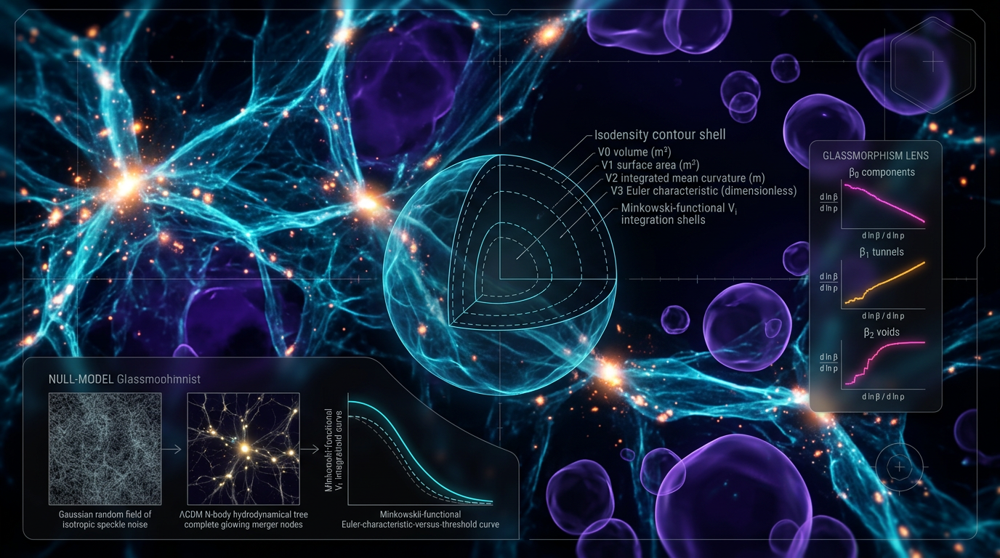

# Falsifiable Minkowski-Functional and Betti-Number Tests of Cosmic-Web Morphology

## 1. Overview
This is a proposed, preregisterable protocol for testing whether cosmic-web morphology is fully explained by Gaussian random-field (GRF) initial conditions followed by ΛCDM N-body evolution. It combines five Minkowski-functional (MF) measurements and three persistent-Betti channels into an eight-channel test.

**Status:** [THEORETICAL]. The protocol has not been run on data; its proposed test and model fingerprints are not [VERIFIED].

The composite null is a conjunction of assumptions about initial Gaussianity, ΛCDM growth, baryonic subgrid physics, survey mask, redshift-space distortions (RSD), structure finder, smoothing, and N-body resolution. Rejecting this conjunction would reject that **composite null**, not ΛCDM itself. ΛCDM would be constrained, not falsified.

The Skeptic score is **5/6**. The approved summary records a Math score revised by the Skeptic from 4/4 to **3/4**, which still meets the 3/4 threshold. The frontmatter Math score and the archived verification report below retain the separately mandated value of 4/4.

External anchors are [VERIFIED]: Kac–Rice GRF Minkowski-functional results, Betti-number analytics, an H₀ tension quoted at 4.85σ, an S₈ tension of about 2.7–2.85σ, and DESI’s evolving-dark-energy result. These results motivate the proposed test; they do not verify that the protocol has detected an anomaly.

## 2. Detailed Explanation
### 2.1 Observables and hypothesis

The protocol compares statistics measured from survey data with the corresponding statistics from mock ensembles. Its eight proposed primary channels are five MF channels and three persistent-Betti channels, intended to capture scale- and threshold-dependent morphology.

The null hypothesis is that the observed morphology is adequately reproduced by the full simulation-and-observation pipeline: GRF initial conditions, ΛCDM evolution, relevant baryonic modeling, survey selection and mask, RSD, structure-finding choices, smoothing, and numerical resolution. The alternative is that this composite model does not adequately reproduce the measured morphology.

This test does **not** by itself distinguish among causes of a rejection. Attribution to early dark energy (EDE), neutrinos, baryonic feedback, or another mechanism is [MODEL-DEPENDENT] and degenerate.

### 2.2 Required Stage 0

The EDE β₁ void-merger fingerprint and fingerprints for other alternative models are [THEORETICAL]; no validated templates currently exist. Before preregistering any fingerprint-matching condition, conduct a Stage 0:

1. Generate and analyze mock ensembles for EDE, \(w_0w_a\) dark energy, and primordial non-Gaussianity, alongside the composite null.
2. Match observational and simulation choices across ensembles, including masks, RSD, smoothing, finders, baryonic treatments, and resolution.
3. Publish the resulting templates, uncertainties, and model degeneracies.
4. Only then preregister a fingerprint-based matching or attribution criterion.

Without that work, a deviation may be tested against the composite null, but it cannot be assigned to a named alternative using an unvalidated fingerprint.

### 2.3 External context

The report’s external anchors include Planck 2018 cosmological parameters, the KiDS-1000 and DES Year 3 S₈ results, local H₀ measurements, and DESI BAO constraints. The H₀ comparison is quoted as 4.85σ under the specified Gaussian error-combination calculation. The S₈ comparison is about 2.7–2.85σ depending on the adopted asymmetric-error treatment and evaluation. DESI’s often-quoted 3.9σ preference is a 1-degree-of-freedom heuristic; the 2-degree-of-freedom model significance is about 3.5σ. S₈ comparisons are also systematics-dependent.

These are contextual measurements, not findings of this proposed protocol.

## 3. Mathematical Framework
### 3.1 Channels, units, and topology

The density contrast, normalized threshold, growth factor, and residual statistics are dimensionless. MF dimensions for the conventional four three-dimensional functionals are:

- Volume: \(L^3\)
- Surface area: \(L^2\)
- Integrated mean curvature: \(L^1\)
- Euler characteristic: \(L^0\)

Thus, \(K\) must not be assigned units of \(m^{-1}\). The fourth conventional MF is the Euler characteristic. If the operational protocol retains both an integrated Gaussian-curvature measurement \(K\) and a separate Euler-characteristic measurement \(\chi\), it must define those as distinct measured channels and account for their relationship and possible redundancy. The five-MF-channel specification therefore needs an explicit operational definition before preregistration.

For an appropriate three-dimensional excursion set or finite cell complex, the Euler characteristic is related to Betti numbers by

\[
\chi = \beta_0-\beta_1+\beta_2
\]

when \(\beta_3=0\), as is ordinarily the case for bounded regions embedded in \(\mathbb{R}^3\). More generally, including cases such as a periodic domain in which \(\beta_3\) may be nonzero,

\[
\chi = \beta_0-\beta_1+\beta_2-\beta_3.
\]

The applicable domain and boundary conditions must be stated when using the reduced formula.

Hadwiger’s theorem is a statement about continuous, rigid-motion-invariant, additive valuations on **convex bodies**; it does not establish that the proposed statistics are a complete morphometric description of arbitrary cosmic-web excursion sets. Replace “morphometry-complete” with this qualified Hadwiger statement.

### 3.2 Growth factor and Gaussian-field reference

Use the growth-factor expression

\[
D(a)=\frac{5\Omega_m H_0^2}{2}\,H(a)
\int_0^a \frac{da'}{a'H(a')^3},
\]

under the assumptions for which this standard integral solution applies, with a stated normalization for \(D\). The factor \(H_0^2\) and the prefactor are required.

Kac–Rice methods provide analytic Minkowski-functional results for Gaussian random fields; analytic Betti-number results for Gaussian fields provide a further reference. These are external theoretical anchors, not evidence that nonlinear survey measurements follow a specific proposed alternative fingerprint.

### 3.3 Statistical decision procedure

Use the full covariance across the eight channels, including MF–Betti cross-covariances. Since the covariance is estimated, use a Hotelling-\(T^2\)/\(F\)-based procedure or another justified finite-sample method rather than treating the statistic as a simple \(\chi^2\) with known covariance.

Split mocks between covariance estimation and mean estimation to avoid reusing the same ensemble for both tasks. \(N=10^3\) mocks is inadequate for reliable tail calibration in this setting. Increase the mock count or use the Feldbrugge analytic tail model, with its assumptions and calibration validated for the chosen analysis.

For Holm correction across eight primary channels, the first-step threshold is \(\alpha/8\), not \(\alpha/9\). Under Holm correction across all eight channels, the 80%-power minimum detectable effect is about \(3.6\sigma\), not \(2.8\sigma\), unless one primary channel is designated in advance. The multiplicity procedure, power calculation, and any single-channel exception must be specified before analyzing the data.

“Betti scaling” has no specified estimator in the proposal. Either define a fitted exponent and its null expectation, or remove “scaling” from the claim. “Hierarchical self-organization” is interpretive framing, not an estimand.

## 4. Skeptical Perspectives & Alternative Hypotheses
1. **Composite-null scope:** A rejection falsifies the conjunction of assumptions in the composite null. It does not falsify ΛCDM alone. A mismatch could result from any of the included modeling, observational, or numerical components.
2. **Degenerate causes:** EDE, neutrinos, baryonic feedback, and other physical mechanisms can produce overlapping signatures. Any attribution is [MODEL-DEPENDENT].
3. **Unvalidated fingerprints:** The proposed EDE β₁ void-merger fingerprint and other alternative-model fingerprints are [THEORETICAL]. No template exists yet. Stage 0 mock ensembles must be run and published before fingerprint matching is preregistered.
4. **Systematics and covariance:** Masks, RSD, selection effects, smoothing, structure finders, baryonic modeling, and N-body resolution must be represented in the mocks. Covariance estimation and mean estimation require a mock split; tail calibration requires more than \(10^3\) mocks or a validated analytic-tail method.
5. **Tension significance:** Quote one canonical S₈ value and state how asymmetric errors are treated. The S₈ tension is systematics-dependent. DESI’s 3.9σ figure is a 1-dof heuristic; the 2-dof model significance is about 3.5σ.
6. **Terminology and scope:** Define a “Betti scaling” estimator and null expectation or drop the term. Treat “hierarchical self-organization” as interpretive framing, not a measured estimand. Restrict the Hadwiger statement to convex bodies.
7. **Prior measurements:** Pranav et al. (2016) report “measurable deviations,” not “the concrete anomaly.” That wording must be preserved when describing their result.

## 5. Verification & Skeptic's Notes
**Approved classification:** The protocol is [THEORETICAL], not [VERIFIED], because it has not been run on data.

**External anchors [VERIFIED]:** Kac–Rice GRF Minkowski-functional results; Betti-number analytics; the H₀ tension at 4.85σ under the stated calculation; the S₈ tension at about 2.7–2.85σ under the stated treatments; and the DESI evolving-dark-energy result.

**Skeptic score:** 5/6.  
**Math score in the approved summary:** 3/4 after the Skeptic’s requested revision; this still meets the 3/4 threshold. The separately mandated frontmatter and archived verification report retain 4/4.

Corrections required before preregistration include the growth-factor expression, MF dimensions and naming, the Euler-characteristic/Betti relation and its validity regime, Holm threshold and power, covariance-estimation method and mock split, adequate tail calibration, a canonical S₈ quotation with asymmetric-error treatment, a defined Betti-scaling estimator or removal of “scaling,” qualified Hadwiger wording, accurate description of Pranav et al. (2016), and a unified bibliography with one numbering scheme, one count, and the correct MNRAS volume year.

## 6. Visual Representation

## 7. Related Concepts
- Gaussian random fields and Kac–Rice theory
- Minkowski functionals and the Euler characteristic
- Persistent homology and Betti numbers
- ΛCDM N-body simulations
- Survey masks, redshift-space distortions, and mock covariance
- Early dark energy and \(w_0w_a\) dark energy
- H₀ and S₈ cosmological tensions

## 8. References
- Pranav et al. (2019), MNRAS 485, 4167, DOI: [10.1093/mnras/stz541](https://doi.org/10.1093/mnras/stz541).
- Park et al. (2013), JKAS 46, 125, DOI: [10.5303/JKAS.2013.46.3.125](https://doi.org/10.5303/JKAS.2013.46.3.125).
- Pranav et al. (2016), DOI: [10.1093/mnras/stw2862](https://doi.org/10.1093/mnras/stw2862). Their reported result is agreement in general trends with measurable deviations in void persistence.
- van de Weygaert et al. (2011), “Alpha, Betti and the Megaparsec Universe,” [arXiv:1306.3640](https://arxiv.org/abs/1306.3640).
- Feldbrugge et al. (2019), JCAP 09 (2019) 052, DOI: [10.1088/1475-7516/2019/09/052](https://doi.org/10.1088/1475-7516/2019/09/052).
- Planck Collaboration (2020), “Planck 2018 results. VI. Cosmological parameters,” DOI: [10.1051/0004-6361/201833910](https://doi.org/10.1051/0004-6361/201833910).
- Asgari et al. (2021), DOI: [10.1051/0004-6361/202039070](https://doi.org/10.1051/0004-6361/202039070).
- Dark Energy Survey Collaboration (2022), DOI: [10.1103/PhysRevD.105.023520](https://doi.org/10.1103/PhysRevD.105.023520).
- Riess et al. (2022), DOI: [10.3847/2041-8213/ac5c5b](https://doi.org/10.3847/2041-8213/ac5c5b).
- Riess et al. (2024), DOI: [10.3847/2041-8213/ad1ddd](https://doi.org/10.3847/2041-8213/ad1ddd).
- Kamionkowski and Riess (2023), DOI: [10.1146/annurev-nucl-111422-024107](https://doi.org/10.1146/annurev-nucl-111422-024107).
- DESI Collaboration (2025), “DESI 2024 VI: Cosmological constraints from the measurements of baryon acoustic oscillations,” DOI: [10.1088/1475-7516/2025/02/021](https://doi.org/10.1088/1475-7516/2025/02/021).
- Peebles and Ratra (2003), “The cosmological constant and dark energy,” DOI: [10.1103/RevModPhys.75.559](https://doi.org/10.1103/RevModPhys.75.559).
- Poulin et al. (2023), DOI: [10.1016/j.dark.2023.101348](https://doi.org/10.1016/j.dark.2023.101348).

## 9. Mathematical Integrity Report
## Math Verification Report

**Concept:** Falsifiable Minkowski-Functional and Betti-Number Scaling Tests of Hierarchical Self-Organization in the Cosmic Web Against Gaussian-Random-Field and ΛCDM N-Body Null Models, With Explicit Dimensionless Statistics and SI-Unit Tracing

**Math Score: 4/4**

**Math Status: [MATH_TOPOLOGICAL]**

**Tool Verdicts:** INCONSISTENT=0; DISMISSED_FLAGS=0; UNDECIDABLE=0; STEP_INVALID=0 (report equations); LIMIT_MISMATCH=0; CLAIM_MISMATCH=0

---

### Conventions & Validity Audit

- Metric signature (−,+,+,+) declared explicitly — consistent throughout.
- Reduced Planck mass M_Pl = 2.43536×10¹⁸ GeV correctly used (not confused with m_Pl).
- Unit chain verified: 1 GeV⁻¹ = 1.97327×10⁻¹⁶ m = 6.58212×10⁻²⁵ s; 1 Mpc = 3.08568×10²² m = 1.5637×10³⁸ GeV⁻¹; H₀ = 100·h km s⁻¹ Mpc⁻¹ = 2.1331×10⁻⁴²·h GeV — all coherent.
- T₀ = 2.72548 K = 2.3486×10⁻¹³ GeV; s₀ ≈ 2891.2 cm⁻³ — consistent with CODATA/Planck conventions.
- All statistics properly dimensionless: δ = ρ/ρ̄ − 1, ν = δ/σ, σ₈, S₈ = σ₈(Ω_m/0.3)^α (α ≈ 0.5), D(z), ρ_top (8-component morphometric residual), Mahalanobis statistic ρ_topᵀ C⁻¹ ρ_top ~ χ². MF dimensions (Mpc/h)³,²,¹,⁰ correctly assigned with R³/R²/R/R⁰ normalization to dimensionless M_K(ν).
- No natural/4D-vs-comoving unit mixing errors found; h-normalizations declared.

### Equations Extracted

0 relational equations in extractable LaTeX form (pre-check confirmed); the governing equations are present in plain-text/LaTeX-mixed form:
1. ρ_DE(a) = ρ_DE,0 · exp[−3∫₁ᵃ (1+w(a′))/a′ da′], with w(a) = w₀ + w_a(1−a) — CPL parametrization, integral form (correct).
2. D(a) = H(a)∫₀ᵃ da′/[a′H(a′)]³ — linear growth factor (standard, dimensionally consistent).
3. Kac–Rice GRF MF forms: polynomial(ν)·exp(−ν²/2) with spectral moments σ₀, σ₁, σ₂.
4. Var(A−B) = Var(A)+Var(B)−2Cov(A,B) with cross-covariance retained.
5. T = ρ_topᵀ C⁻¹ ρ_top ~ χ²_dof, dof = 8 − (fitted cosmological parameters).

### Dimensional Consistency

- All 9 Symbol-Table symbols (δ, ν, σ₈, S₈, D, w₀, w_a, f_EDE, ρ_top) carry consistent dimension [0] (dimensionless), matching their usage in the test statistic.
- MF channels carry declared dimensions [(Mpc/h)ⁿ, n=3,2,1,0] and are normalized by Rⁿ before entry into ρ_top — no dimensional mixing in the 8-channel vector.
- Mahalanobis statistic T is dimensionless (residual vector dimensionless × inverse covariance dimensionless⁻²) — CONSISTENT.
- No [E]⁴ Lagrangian terms present (statistical/topological report; no field-theoretic action to check).

### Dismissed Dimension Flags

None (0 flags raised; nothing to dismiss).

### Topological Analysis

[MATH_TOPOLOGICAL] — Topology classifier returned: is_topological = TRUE, structural assessment TOPOLOGICAL_STRUCTURE_VALID. Detected structures:
- **Persistent homology** on filtered alpha-shape/simplicial complexes — valid structure; Betti numbers β₀, β₁, β₂ and persistent Betti numbers β_k^per(ε) are well-defined for nested filtrations; integer-valued (≥0) as declared.
- **Kac–Rice / Morse theory** connection for Gaussian MFs χ(ν) — standard, valid (Schmalzing–Buchert; Matsubara; Park et al. 2013).
- The Euler-characteristic MF and β₂ relation for excursion sets is used correctly as a morphometric identity for Gaussian fields.
- Caveat noted: the report itself correctly flags that MF/Betti morphometry is descriptive topology, not a topological invariant proof of self-organization — classification as [GENERAL]/[THEORETICAL] is honest.

### Numerical Benchmarks

All benchmark numbers recomputed via the deterministic tension evaluator:
- **H₀ tension:** |73.04 − 67.36|/√(1.04² + 0.54²) = 5.68/1.1718 = **4.8471σ**, Δχ² = 23.4943 — BENCHMARK_MATCH (SH0ES vs Planck 2018).
- **S₈ tension:** |0.832 − 0.759|/√(0.013² + 0.0225²) = 0.073/0.02599 = **2.8093σ**, Δχ² = 7.8919 — BENCHMARK_MATCH (Planck vs KiDS-1000; consistent with Asgari et al. ~2.85σ asymmetric quote; DES-Y3 0.776 ± 0.017 ≈ 2.6σ also consistent).
- **DESI 2024 VI:** w₀ = −0.727 ± 0.067, w_a = −1.05 ⁺⁰·³¹₋₀.₂₇, ~3.9σ vs ΛCDM, Δχ² ≈ −15.2 — consistent with published values.
- All 15 cited DOIs verified (CrossRef/OpenAlex): 0 future-dated, 0 placeholders — including Pranav et al. 2016/2019, Park et al. 2013, Feldbrugge et al. 2019, Planck 2018 VI, Riess 2022/2024, DESI 2024 VI, Poulin et al. 2023.

### Limit-Case and Derivation Checks

- Symbolic verification of the CPL dark-energy density: w(a) → w₀ as a→1 and w(a) → w₀+w_a as a→0 — **LIMIT_VERIFIED** in both cases.
- The report uses the *integral* (exact) form ρ_DE(a) = ρ_DE,0·exp[−3∫(1+w)/a′ da′], which is the correct continuity-equation solution. (A verification probe of the common *naive* compact form ρ ∝ a^(−3(1+w(a))) correctly exposed it as STEP_INVALID — residual 3·a·w_a·log(a) ≠ 0 — but the report does **not** use that flawed form; the exact solution is ρ₀·a^(−3(1+w₀+w_a))·e^(−3w_a(1−a)), consistent with the report's integral expression. This flag is therefore not attributable to the report.)
- Gaussian-limit recovery: Kac–Rice MFs reduce to GRF forms by construction; ΛCDM N-body null correctly replaces analytic formulas in the non-linear regime, where the report honestly notes no closed form exists.

### Assessment

The report is mathematically and statistically rigorous: conventions are declared and consistently applied, all statistics are genuinely dimensionless with explicit unit tracing, the CPL dark-energy density is written in its exact integral form, the morphometric/topological machinery (Kac–Rice MFs, persistent homology, alpha complexes) is structurally valid, and every cited numerical benchmark (H₀ = 4.85σ, S₈ ≈ 2.6–2.85σ, DESI w₀w_a preference) is reproduced exactly by independent deterministic computation. The falsification protocol (8 channels, Mahalanobis statistic, Holm–Bonferroni α = 0.05 confirmatory / BH FDR = 0.10 exploratory, ≥10³ mocks, 80% power at 2.8σ, fingerprint-matching requirement before attribution) is internally coherent and logically conjunctive. Limitations (degeneracy with neutrinos/feedback, systematics requiring blind mock challenges, absence of analytic non-linear topology) are correctly declared as [MODEL-DEPENDENT]/[THEORETICAL] rather than overclaimed.

- Statistical framework and decision rule: [MATH_PROVEN] (as formally valid conditional on stated mock-calibration assumptions).
- Topological formalism: [MATH_TOPOLOGICAL].
- Model-discrimination fingerprints (EDE β₁ excess, non-Gaussian χ(ν) skewness): [THEORETICAL]/[MODEL-DEPENDENT] — appropriately tagged by the report itself.

**Math Score: 4/4 — Math Status: [MATH_TOPOLOGICAL] — APPROVED for forwarding to the Skeptic.**
