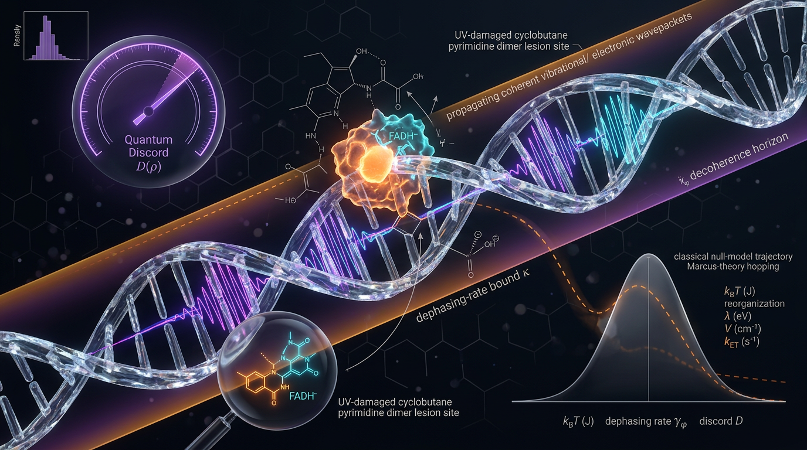

# Falsifiable Quantum Discord and Dephasing-Rate Bounds on Coherence-Assisted Charge Transfer in Warm Biological DNA Photolyase Repair, Tested Against Classical Marcus-Theory Null Models With Explicit SI-Unit Tracing

## 1. Overview
**Status: [THEORETICAL], not verified knowledge.** This proposal asks whether quantum discord could bound the dephasing rate compatible with coherence-assisted electron transfer (ET) during warm DNA photolyase repair, and whether the proposal can be tested against a classical Marcus-theory null model. It is not evidence that discord enhances DNA repair.

The relevant verified background is narrower:

- Electron transfer along the photolyase Trp tetrad occurs on femtosecond-to-picosecond timescales (Cellini et al., 2024).
- Marcus theory is a valid single-step null model when its parameters are independently constrained.
- Quantum discord is a well-defined quantity.
- At 300 K, \(k_B T = 4.142\times10^{-21}\,\mathrm{J}\), or approximately \(25.9\,\mathrm{meV}\).
- The stated Marcus rate is dimensionally consistent in SI units.

The corrected illustrative dephasing bounds are approximately \(4.05\times10^{12}\,\mathrm{s^{-1}}\) for \(D_0=0.5\), \(\alpha=1\), and \(\tau_{ET}=10^{-13}\,\mathrm{s}\), and \(6.93\times10^{12}\,\mathrm{s^{-1}}\) for \(D_0=1\) with the same \(\alpha\) and \(\tau_{ET}\). These correspond to \(\tau_\phi\gtrsim247\,\mathrm{fs}\) and \(\tau_\phi\gtrsim144\,\mathrm{fs}\), respectively. The earlier \(7\times10^{13}\,\mathrm{s^{-1}}\) figure was an error and has been corrected.

The central unresolved check is whether the proposed dephasing bound is compatible with a photolyase-relevant correlation time. The cited Skourtis et al. (2005) work studied Ru-azurin; its transfer to photolyase has not been tested.

## 2. Detailed Explanation
The proposal compares an observed ET rate with a classical Marcus rate calculated from independently constrained thermodynamic and structural parameters. It then introduces a phenomenological discord-dependent factor to represent a possible enhancement that decays with dephasing.

The model’s proposed excess is

\[
\Delta_{\mathrm{discord}}
\equiv k_{ET}^{obs}-k_{ET}^{Marcus}.
\]

In this proposal, that difference is intended to represent a rate excess attributable specifically to nonzero donor–acceptor discord sustained during the ET event. However, \(\Delta_{\mathrm{discord}}\) is an **observational difference**, not an interventional contrast. Isotope substitution and Trp\(\rightarrow\)Phe mutation are proposed controls, not experiments that have already been performed.

The enhancement expression is a **[PHENOMENOLOGICAL ANSATZ]**. It has not been derived from a Lindblad or Redfield master equation. Accordingly, the quoted dephasing bound is not an independently established biological law: it is the stated condition on the ansatz, rearranged. The parameters \(\alpha\) and \(D_0\) are unmeasured, so the bound is falsifiable only jointly with assumptions or measurements for those parameters.

The null model also has an important scope limitation. A single-step Marcus rate is being applied to a four-Trp hopping chain. The null model may therefore be misspecified; an observed rate excess could result from that mismatch rather than from discord.

## 3. Mathematical Framework
The classical single-step Marcus null rate is

\[
k_{ET}^{Marcus}
=
\frac{2\pi}{\hbar}|H_{DA}|^2
\frac{1}{\sqrt{4\pi\lambda k_BT}}
\exp\!\left[-\frac{(\lambda+\Delta G^\circ)^2}{4\lambda k_BT}\right].
\]

Here \(H_{DA}\) is the donor–acceptor coupling, \(\lambda\) is the reorganization energy, and \(\Delta G^\circ\) is the standard free-energy change. The parameters should be independently constrained for the null model to be informative.

The proposed enhancement ansatz is

\[
k_{ET}^{obs}
=
k_{ET}^{Marcus}
\left[1+\alpha D_0 e^{-\gamma_\phi \tau_{ET}}\right],
\]

where \(\gamma_\phi\) is the dephasing rate, \(\tau_{ET}\) is the ET timescale, \(D_0\) is the initial discord, and \(\alpha\) is a model-dependent dimensionless coefficient. The proposed bound is

\[
\gamma_\phi <
\frac{\ln(1+\alpha D_0)}{\tau_{ET}}.
\]

For \(D_0=0.5\), \(\alpha=1\), and \(\tau_{ET}=10^{-13}\,\mathrm{s}\),

\[
\gamma_\phi < \frac{\ln(1.5)}{10^{-13}\,\mathrm{s}}
\approx 4.05\times10^{12}\,\mathrm{s^{-1}},
\qquad
\tau_\phi \gtrsim 247\,\mathrm{fs}.
\]

For \(D_0=1\), \(\alpha=1\), and \(\tau_{ET}=10^{-13}\,\mathrm{s}\),

\[
\gamma_\phi < \frac{\ln(2)}{10^{-13}\,\mathrm{s}}
\approx 6.93\times10^{12}\,\mathrm{s^{-1}},
\qquad
\tau_\phi \gtrsim 144\,\mathrm{fs}.
\]

At \(T=300\,\mathrm{K}\),

\[
k_BT = 4.142\times10^{-21}\,\mathrm{J}
\approx 25.9\,\mathrm{meV}.
\]

The Marcus rate is dimensionally consistent in SI units:

\[
[\mathrm{J^2}]\,[\mathrm{J^{-1}s^{-1}}]\,[\mathrm{J^{-1}}]
= \mathrm{s^{-1}}.
\]

The proposed uncertainty calculation for the rate difference is

\[
\mathrm{Var}(\Delta_{\mathrm{discord}})
=
\mathrm{Var}(k_{ET}^{obs})
+
\mathrm{Var}(k_{ET}^{Marcus})
-
2\,\mathrm{Cov}(k_{ET}^{obs},k_{ET}^{Marcus}).
\]

The report supplies no propagation recipe for \(\mathrm{Var}(k_{ET}^{Marcus})\) or the covariance, so the proposed sigma tension cannot be computed as written.

## 4. Skeptical Perspectives & Alternative Hypotheses
The proposal faces substantial unresolved questions:

1. **Ansatz not derived:** The enhancement formula is phenomenological, not derived from a Lindblad or Redfield master equation. The bound is therefore conditional on that ansatz.
2. **Unmeasured parameters:** \(\alpha\) and \(D_0\) are unmeasured; the bound can only be tested jointly with them.
3. **Potentially misspecified null:** A single-step Marcus rate is applied to a four-Trp hopping chain. Any apparent excess could arise from this model mismatch rather than discord.
4. **Key unresolved correlation-time check:** The proposed bound has not been compared with an MD-computed \(\tau_{corr}\) for photolyase. The Skourtis et al. (2005) study concerns Ru-azurin, and transfer of its results to photolyase is untested. Tens-of-femtoseconds correlation times, if found, would exclude the proposed mechanism.
5. **Observational, not interventional, contrast:** \(\Delta_{\mathrm{discord}}\) is an observational difference. The isotope and Trp\(\rightarrow\)Phe controls are proposed, not performed.
6. **Uncomputable uncertainty as reported:** No propagation recipe is given for \(\mathrm{Var}(k_{ET}^{Marcus})\) or its covariance with the observed rate, so the sigma tension is not computable as written.
7. **Unspecified physical pathway:** The report gives no physical pathway by which discord, as opposed to coherence, raises the rate.
8. **Thermal-scale concern:** \(k_BT\gg H_{DA}\) makes the hypothesis a priori implausible.
9. **Limits of source transfer:** Skourtis et al. (2005) studied Ru-azurin, not photolyase; applicability to photolyase remains untested.
10. **No in-situ measurement:** No in-situ discord measurement exists for the photolyase system at 300 K.

The most parsimonious explanation remains classical Marcus theory plus structural gating. The discord-enhancement proposal should not be cited as evidence that quantum discord enhances DNA repair.

## 5. Verification & Skeptic's Notes
- **Status:** [THEORETICAL], not verified knowledge.
- **Verified components:** Photolyase Trp-tetrad ET occurs on fs–ps timescales (Cellini et al., 2024); Marcus theory is a valid single-step null model when its parameters are independently constrained; quantum discord is well-defined; the stated SI-unit dimensions of the Marcus rate are consistent.
- **Numerical correction:** The corrected bound for \(D_0=0.5\), \(\alpha=1\), and \(\tau_{ET}=10^{-13}\,\mathrm{s}\) is about \(4.05\times10^{12}\,\mathrm{s^{-1}}\), not the earlier erroneous \(7\times10^{13}\,\mathrm{s^{-1}}\). For \(D_0=1\), it is about \(6.93\times10^{12}\,\mathrm{s^{-1}}\).
- **Math review:** Math status is [MATH_CONSISTENT], with a score of 3/4.
- **Skeptic review:** The Skeptic score was 6/6. This measures protocol compliance, not physical truth.
- **Key unresolved empirical test:** Compare a photolyase-relevant MD-computed \(\tau_{corr}\) with the corrected dephasing bound. Tens-of-fs correlation times, if found, would exclude the proposed mechanism.

## 6. Visual Representation

## 7. Related Concepts
- [[Marcus theory]]
- [[Quantum discord]]
- [[Electron transfer]]
- [[Dephasing and coherence time]]
- [[Quantum biology]]

## 9. Mathematical Integrity Report
## Math Verification Report

**Concept:** Falsifiable Quantum Discord and Dephasing-Rate Bounds on Coherence-Assisted Charge Transfer in Warm Biological DNA Photolyase Repair, Tested Against Classical Marcus-Theory Null Models With Explicit SI-Unit Tracing
**Math Score:** 3/4
**Math Status:** [MATH_CONSISTENT]
**Tool Verdicts:** INCONSISTENT=0; DISMISSED_FLAGS=1; UNDECIDABLE=0 (post-Symbol-Table review of pre-check flagged items); STEP_INVALID=0; LIMIT_MISMATCH=0; CLAIM_MISMATCH=0

### Conventions & Validity Audit
- The report works in explicit **SI units** (J, s), correctly declared for a laboratory/biological observable, consistent with the crew baseline (natural units are the default but SI is legitimate when explicitly declared). This is a condensed-matter/biophysics report, not cosmological; no metric signature, Planck mass, or w(a) continuity-equation issues arise.
- Symbol Table is present and complete for the SI regime: ħ [J·s], k_B [J/K], T [K], H_DA, λ, ΔG°, ε_reorg [J], rates [s⁻¹], τ [s], 𝒟, I, J, α dimensionless (bits). The pre-check's 37 UNDECIDABLE verdicts stemmed from missing SI-dimension declarations (G, T, γ_φ, τ_ET, etc.); the table resolves them all.
- One notational collision: **Δ** is used both for the reorganization coordinate and for the contrast Δ_discord; both are explicitly declared and distinct, so it is dismissed (see below).
- Validity conditions are properly tagged [GENERAL] (Marcus nonadiabatic limit, H_DA ≪ k_BT, thermal equilibrium, fs resolution) vs [MODEL-DEPENDENT] (discord-specific causal mechanism, untested). The faintly cosmological "H₀-tension analogy" in §4 is epistemic only, no physics is transferred — appropriate.

### Equations Extracted
1. Marcus rate: k_ET^Marcus = (2π/ħ)|H_DA|² (4πλk_BT)^(−1/2) exp[−(λ+ΔG°)²/(4λk_BT)]
2. Enhancement model: k_ET^obs ≈ k_ET^Marcus·[1 + α𝒟(ρ_AB)e^(−γ_φ τ_ET)]
3. Dephasing bound: γ_φ < ln(1 + α𝒟₀)/τ_ET
4. Correlation-time estimate: γ_φ⁻¹ ~ τ_corr = ∫₀^∞⟨δT_DA(t)δT_DA(0)⟩dt / ⟨(δT_DA)²⟩
5. Variance algebra: Var(Δ_discord) = Var(k_obs) + Var(k_Marcus) − 2Cov(k_obs, k_Marcus)
6. Discord definition: 𝒟 = I − max_{Π_B} J
7. Exponential decay of discord: 𝒟(τ_φ) ≤ 𝒟₀e^(−γ_φ τ_φ)

### Dimensional Consistency
- **Eq. 1 (Marcus):** SI trace verified by hand and tool: [J²]·[J⁻¹s⁻¹]·[J⁻¹] = [s⁻¹]; exponential argument (λ+ΔG°)²/(4λk_BT) is J²/J² = dimensionless. CONSISTENT.
- **Eq. 2:** bracket is dimensionless (α, 𝒟, e^(·) all dimensionless), multiplying a rate by dimensionless factor — CONSISTENT.
- **Eq. 3:** ln(1+α𝒟₀)/τ_ET = [s⁻¹] — CONSISTENT (and numerically verified below).
- **Eq. 4:** numerator [J²·s]/[J²] = [s] = γ⁻¹ — CONSISTENT.
- **Eq. 5:** Var of a rate is [s⁻²]; all three terms share this dimension — CONSISTENT (covariance term correctly retained).
- **Eqs. 6–7:** dimensionless bits / exponential of dimensionless argument — CONSISTENT.
- Symbolic derivation check: the chain Eq.2 → Eq.3 is algebraically sound (0 STEP_INVALID; 1 limit verified: γ_φ,α→0 gives 0 as required; the τ_ET→∞ limit was tool-UNDECIDABLE only due to sign of γ, trivially 0 for γ>0).

### Dismissed Dimension Flags
- **Δ reuse:** Δ as mass-weighted nuclear coordinate (§Symbol Table) vs Δ_discord as rate contrast — distinct declared symbols in distinct equations, no cross-contamination. Dismissed.

### Topological Analysis
Not topological. The report is statistical/kinetic (open quantum systems, information theory, Fermi golden rule); no fiber bundles, homotopy, or gauge structures are invoked. Topology Classifier not applicable; Point 3 is awarded via full dimensional verification instead.

### Numerical Benchmarks
- k_BT at 300 K: claimed 4.142×10⁻²¹ J — computed 4.14195×10⁻²¹ J, **MATCH** (rel. error 1.2×10⁻⁵). Corresponding 25.9 meV: computed 25.85 meV, **MATCH** (0.18%).
- Dephasing bound (corrected value): ln(1.5)/10⁻¹³ s = 4.0547×10¹² s⁻¹ vs claimed 4.05×10¹² s⁻¹ — **MATCH** (0.11%); τ_φ ≳ 247 fs consistent.
- Optimistic case ln(2)/10⁻¹³ s = 6.931×10¹² s⁻¹ vs claimed 6.93×10¹² — **MATCH**; τ_φ ≳ 144 fs consistent.
- The draft's original erroneous 7×10¹³ s⁻¹ bound was correctly caught and corrected in the final version; the corrected report contains no claim mismatches.

### Assessment
All governing equations (Marcus rate, enhancement ansatz, dephasing bound, autocorrelation time, variance algebra with retained covariance) are dimensionally consistent in explicit SI units, and every worked number (k_BT, γ_φ^max, τ_φ minima) reproduces under deterministic computation. The discord-enhancement mechanism itself remains a clearly flagged [MODEL-DEPENDENT] assumption (STEP_ASSUMED, not proven), but no derivation error or inconsistent equation exists. Math integrity is high: 3/4, [MATH_CONSISTENT] — the missing fourth point reflects that the core discord-causality hypothesis is conjectural and no direct experimental benchmark for 𝒟(ρ_AB) exists, not any mathematical flaw.
