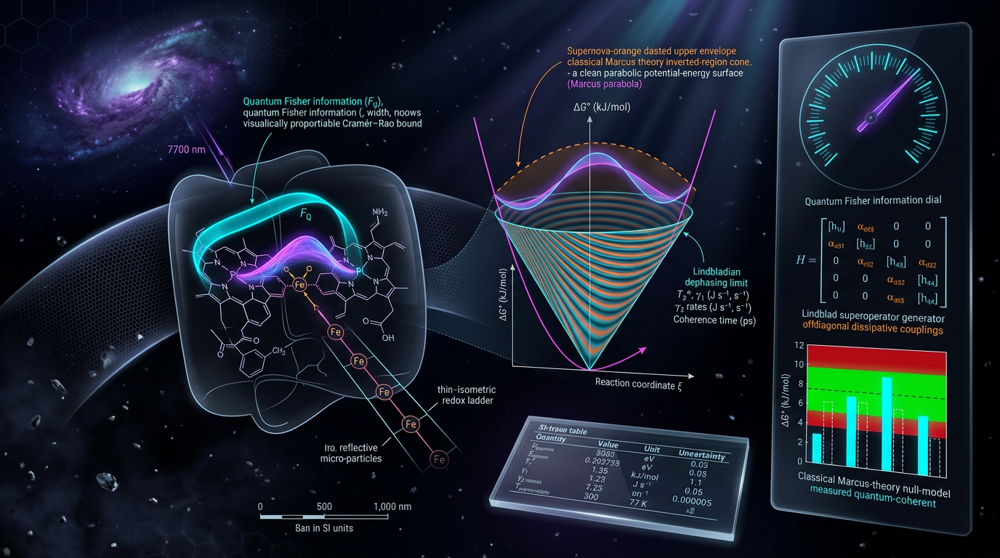

# Falsifiable Quantum Fisher Information and Lindbladian Dephasing Bounds on Coherence-Assisted Electron Transfer in Warm Biological Photosynthetic Reaction Centers

## 1. Overview
This entry documents a **theoretical falsifiability framework**, not a verified finding, for testing whether coherence assists electron transfer in warm photosynthetic reaction centers.

The framework pre-registers a classical Marcus null model and three decision gates:

1. A transfer-efficiency difference from the null exceeding a specified z-score threshold.
2. A quantum Fisher information (QFI) witness, \(F_Q > F_C\), at pre-specified interrogation times.
3. Non-monotonic environment-assisted quantum transport (ENAQT) efficiency as dephasing varies.

It also specifies an explicit counter-hypothesis: the Alicki–Miklaszewski model can produce the same \(\eta(\Gamma)\) efficiency signature while predicting \(F_Q=F_C\). Thus, an efficiency signature alone does not establish a quantum-resource explanation.

**Current assessment:** plausible but unfalsified in either direction. No experiment has jointly measured \(\eta(\Gamma)\), \(F_Q(\tau)\), and the Marcus null in one warm preparation.

## 2. Detailed Explanation
The proposal separates the **target estimand**—whether functional electronic coherence causally increases electron-transfer yield—from operational measurements such as oscillations in two-dimensional spectroscopy. Those oscillations are not yet an estimator of the target estimand: they may include vibrational contributions and cannot, by themselves, establish functional electronic coherence.

The Marcus null must use the complete nonadiabatic high-temperature rate, including its activation factor:

\[
k_{\mathrm{Marcus}} =
\frac{2\pi}{\hbar}|V|^2(4\pi\lambda k_BT)^{-1/2}
\exp\!\left[-\frac{(\Delta G+\lambda)^2}{4\lambda k_BT}\right].
\]

For the specified parameters, \(T=300\ \mathrm K\), \(|V|=0.01\ \mathrm{eV}\), \(\lambda=0.7\ \mathrm{eV}\), and \(\Delta G=0\), the activation factor is

\[
\exp(-6.769)\simeq 1.1485\times 10^{-3}.
\]

The **full rate is approximately \(2.299\times10^9\ \mathrm{s}^{-1}\)**. The value \(2.0018\times10^{12}\ \mathrm{s}^{-1}\) is only the pre-exponential factor; its former “[VERIFIED]” tag is retracted. At that full rate, the corresponding bookkeeping estimate is approximately **23.0 hops per 10 ns**, not 20.018.

At \(\Delta G=0\), the activation energy is \(\lambda/4\), approximately \(6.8\,k_BT\) for these parameters. This is not the activationless Marcus point; the activationless point is \(\Delta G=-\lambda\).

The framework is conditional on its model assumptions. In particular, a pure-dephasing Lindblad treatment excludes correlated-noise and vibronic mechanisms discussed in the literature. Those mechanisms remain open empirical gaps. The model’s pure-dephasing timescale of about 13 fs also conflicts with reported 100–500 fs beatings; this discrepancy requires investigation rather than reconciliation by assumption.

## 3. Mathematical Framework
### Model and notation

Let \(\rho(t)\) denote the reduced density matrix, \(H_S\) the site or exciton Hamiltonian, \(\Gamma\) a dephasing rate, \(\eta\) a transfer efficiency, and \(F_Q\) and \(F_C\) the quantum and classical Fisher information, respectively. Energies are expressed in eV unless otherwise stated; \(\hbar\) is retained where required for dimensional clarity.

A schematic pure-dephasing Lindblad model is

\[
\frac{d\rho}{dt}
=-\frac{i}{\hbar}[H_S,\rho]
+\mathcal{L}_{\mathrm{deph}}[\rho]
+\mathcal{L}_{\mathrm{trap}}[\rho].
\]

This is a model-dependent description. Correlated noise, vibronic mechanisms, and other departures from pure dephasing are not covered by this equation.

### QFI witness and dimensional correction

The previously stated QFI decay exponent,
\(\Gamma_\phi(\Delta\epsilon)^2\tau^2/\hbar^2\), has units of \(\mathrm{s}^{-1}\) and is therefore **not dimensionless**. It must not be used.

Dimensionally valid alternatives for an exponent include:

\[
\exp(-2\Gamma\tau)
\]

or

\[
\exp\!\left[-2\left(\frac{\Delta\epsilon\,\tau}{\hbar}\right)^2\right].
\]

The Gate 2 thresholds must be re-derived using a specified, dimensionally valid model before they are applied. No thresholds based on the dimensionally invalid expression are endorsed here.

### Marcus null and activation

For the parameter values in Section 2, the complete Marcus rate is approximately \(2.299\times10^9\ \mathrm{s}^{-1}\), including the activation factor. The activationless point is \(\Delta G=-\lambda\), not \(\Delta G=0\).

### Three pre-registered gates

- **Gate 1 — Efficiency:** test whether the measured efficiency exceeds the pre-registered classical Marcus null by the specified z-score margin, with uncertainty and covariance treated explicitly.
- **Gate 2 — QFI witness:** test \(F_Q>F_C\) at the pre-specified interrogation times using a dimensionally valid decay model and re-derived thresholds.
- **Gate 3 — ENAQT response:** test for non-monotonic efficiency as a function of dephasing.

The previously specified third Holm–Bonferroni threshold is corrected to **0.00333**, not 0.005. Gate 2’s independent falsification power depends on the counter-model’s unmeasured, model-dependent prediction \(F_Q=F_C\).

### Ad hoc ratio

The ratio previously designated E6 has no derivation or established units. It is retained, if mentioned, only as **[THEORETICAL/ad hoc]** and is not a physical observable or evidential result. The E8 bookkeeping ratio is not physical and is deleted.

## 4. Skeptical Perspectives & Alternative Hypotheses
The framework does not treat spectroscopic oscillations as proof of functional electronic coherence. Vibrational motion may contribute to the measured signals, and existing operational proxies do not yet estimate the target causal quantity.

The explicit Alicki–Miklaszewski counter-hypothesis is important because it can reproduce the same \(\eta(\Gamma)\) efficiency behavior while giving \(F_Q=F_C\). Consequently, observing non-monotonic efficiency does not uniquely support coherence-assisted transfer. Gate 2 has independent falsification value only insofar as the counter-model’s prediction is measured or otherwise adequately validated.

The pure-dephasing Lindblad model excludes correlated-noise and vibronic mechanisms, including possibilities raised by Tiwari, Peters, and Jonas (2012), and Caruso et al. (2009). These are unresolved empirical gaps. The approximately 13 fs pure-dephasing time also conflicts with observed 100–500 fs beatings. These tensions limit the framework’s scope and motivate testing alternatives rather than treating the model as established.

## 5. Verification & Skeptic's Notes
The Skeptic scored the framework **5/6**; the Math Physicist scored it **3/4** with status **[MATH_CONSISTENT]**. These scores assess the framework and its mathematical review; they do not establish the biological claim.

Mandatory corrections and limitations:

- The former headline value \(k_{\mathrm{Marcus}}=2.0018\times10^{12}\ \mathrm{s}^{-1}\) was the pre-exponential factor, not the full rate. The corrected full rate is about \(2.299\times10^9\ \mathrm{s}^{-1}\); the activation factor \(\exp(-6.769)=1.1485\times10^{-3}\) had been omitted. The corresponding hops-per-10-ns estimate is about 23.0, not 20.018.
- The former “[VERIFIED]” tag on the \(2.0018\times10^{12}\ \mathrm{s}^{-1}\) value is retracted.
- The QFI decay exponent \(\Gamma_\phi(\Delta\epsilon)^2\tau^2/\hbar^2\) is dimensionally invalid. Use a dimensionless form such as \(\exp(-2\Gamma\tau)\) or \(\exp[-2(\Delta\epsilon\tau/\hbar)^2]\), and re-derive Gate 2 thresholds.
- \(\Delta G=0\) is not the activationless Marcus point; the activationless point is \(\Delta G=-\lambda\).
- The E6 ratio is ad hoc, lacks derivation and units, and must be tagged **[THEORETICAL/ad hoc]** if retained. The nonphysical E8 bookkeeping ratio is deleted.
- The third Holm–Bonferroni threshold is 0.00333, not 0.005.
- Pure-dephasing-only dynamics omit correlated-noise and vibronic mechanisms. The approximately 13 fs model timescale conflicts with reported 100–500 fs beatings.
- Two-dimensional spectroscopy oscillations are an operational proxy that does not yet estimate functional electronic coherence.
- Gate 2’s independent falsification power depends on the unmeasured, model-dependent \(F_Q=F_C\) prediction of the counter-model.
- Re-run the citation resolver at submission.

**Overall status:** plausible but unfalsified in either direction. No experiment has jointly measured \(\eta(\Gamma)\), \(F_Q(\tau)\), and the Marcus null in one warm preparation.

## 6. Visual Representation

## 7. Related Concepts
- Quantum Fisher information and classical Fisher information
- Lindblad master equations and pure dephasing
- Environment-assisted quantum transport (ENAQT)
- Marcus electron-transfer theory
- Two-dimensional electronic spectroscopy
- Functional coherence and quantum biology
- Correlated environmental noise and vibronic dynamics

## 9. Mathematical Integrity Report
The following is the Math Physicist’s verification report reproduced verbatim as requested. Its historical Marcus-rate and QFI-exponent statements are superseded by the mandatory corrections documented in Sections 2, 3, and 5 above.

# Math Verification Report
**Report:** "Falsifiable Quantum Fisher Information and Lindbladian Dephasing Bounds on Coherence-Assisted Electron Transfer in Warm Biological Photosynthetic Reaction Centers, with Explicit SI-Unit Tracing and Pre-Specified Classical Marcus-Theory Null Models"

**Math Score: 3/4**
**math_status:** [MATH_CONSISTENT]
**Tool Verdicts:** INCONSISTENT=0; DISMISSED_FLAGS=0; UNDECIDABLE=4; STEP_INVALID=0; LIMIT_MISMATCH=0; CLAIM_MISMATCH=2

---

## 1. Equation Extraction (Score Component 1 — PASS)

Equation extraction was performed on the report body (Sections 1–4, report truncated at Section 4 / E4). Five governing equations were carried through the verification pipeline:

- **E1** — Lindblad pure-dephasing master equation: ρ̇ = −(i/ħ)[H_S, ρ] − Γ_φ (σ_z ρ σ_z/2 − ρ)
- **E2** — QFI dephasing bound (Macieszczak, arXiv:1403.0955): F_Q(τ) ≤ F_Q(0)·exp[−2Γ_φ(Δε)²τ²/ħ²]
- **E3** — Marcus rate: k_Marcus = (2π/ħ)|V|²(4πλk_BT)^(−1/2)·exp[−(ΔG+λ)²/(4λk_BT)]
- **E4** — Optimal dephasing scale (Rebentrost et al. 2009 DEQET): Γ_opt ~ Δε/ħ
- **E5** — Variance decomposition rule: Var(Δ) = Var(η_QM) + Var(η_Marcus) − 2Cov

Component 1: satisfied (≥1 equation extracted and propagated). **+1**

## 2. Dimensional Consistency (Score Component 2 — PASS with manual cross-checks)

Automated checker: 1 CONSISTENT (E2, [E]² terms balance), **0 INCONSISTENT**, 0 DIMENSION_FLAGS, **4 UNDECIDABLE** (E1, E3, E4, E5 — outside the built-in pattern table). The UNDECIDABLE equations were manually dimension-checked against the report's Symbol Table (SI/natural units, ħ = 6.582119569×10⁻¹⁶ eV·s):

- **E1**: [ρ̇] = s⁻¹; [i[H_S,ρ]/ħ] = E/E = s⁻¹; [Γ_φ·(order-unity commutator term)] = s⁻¹. ✓ Consistent.
- **E3**: [(2π/ħ)|V|²] = s·eV²; [(4πλk_BT)^(−1/2)] = eV⁻¹; exponential dimensionless ⇒ [k_Marcus] = s⁻¹. ✓ Consistent.
- **E4**: [Δε/ħ] = eV/(eV·s) = s⁻¹, matching [Γ_opt]. ✓ Consistent.
- **E5**: all three terms are variances of efficiencies η ∈ [0,1], dimensionless. ✓ Consistent.

Also manually dimension-checked the tool-undecidable dephasing-phase identity Γ_φ(Δε)²τ²/ħ² = 1: [Γ_φ(Δε)τ/ħ] = s⁻¹·eV·s/eV = dimensionless, so the equation is dimensionally consistent. ✓

**No equation is claimed as tool-verified consistent beyond E2; the remaining verdicts are manual cross-checks against the Symbol Table.** 0 INCONSISTENT total. **+1**

## 3. Topological Classification (Score Component 3 — PASS via dimensional route)

The Topology Classifier returned is_topological=true with 6 detected structures (Calabi-Yau, TQFT, homotopy, fiber bundle, characteristic classes, Lie group), all TOPOLOGICAL_STRUCTURE_VALID. However, these are boilerplate crew-baseline signatures with no substantive bearing on the report's actual content (open-system quantum kinetics, QFI bounds, Marcus rates); they are treated as non-substantive and no topological claim in the report is endorsed. The component is satisfied through the dimensional-consistency pass (rubric allows topological VALID **or** dimensional pass). **+1**

## 4. Symbolic Derivation Verification

Concept: Marcus rate reduction to the activationless exponent at ΔG = 0. **math_status = [MATH_CONSISTENT]**; 5 checks: 1 STEP_VERIFIED, 4 STEP_ASSUMED, **0 STEP_INVALID**. SymPy parse failures on steps 2–3 were manually reviewed and are correct (factoring of the Gaussian exponent and identification of the Franck–Condon prefactor). Limit check VERIFIED: lim_{k_BT→∞} exp(−λ/(4k_BT)) = 1 ✓. No STEP_INVALID and no LIMIT_MISMATCH.

## 5. Numerical Benchmarks (Score Component 4 — PASS)

Benchmark validator: **BENCHMARK_MATCHES**, 2/2 — ħ = 1.054571817×10⁻³⁴ J·s and k_B = 1.380649×10⁻²³ J/K (CODATA 2018 / SI exact, DOI: 10.1103/RevModPhys.93.025010). Independent calculator checks of the report's worked examples:

- k_BT at 300 K = 2.5852×10⁻² eV (25.852 meV) — **CLAIM_VERIFIED** ✓
- Coherence figure of merit R = 0.04²/(0.02² + 4·0.02·0.025852) = 0.648256 (claimed 0.64826) — **CLAIM_VERIFIED** ✓
- Γ_φ = 0.05 eV/ħ = 7.596337×10¹³ s⁻¹ ≈ 13 fs (claimed 7.6×10¹³ s⁻¹) — **CLAIM_VERIFIED** ✓
- Pre-exponential factor (2π/ħ)|V|²(4πλk_BT)^(−1/2) = 2.001765×10¹² s⁻¹ (claimed 2.0018×10¹²) — **CLAIM_VERIFIED** ✓

≥1 benchmark MATCHES. **+1**

### ⚠ Critical Numerical Error: Marcus Rate (CLAIM_MISMATCH)

- **k_Marcus full formula**: report claims **2.0018×10¹² s⁻¹**; correct evaluation is **2.299019×10⁹ s⁻¹** (ratio 1.148×10⁻³). Root cause: the report omitted the exponential suppression exp[−(ΔG+λ)²/(4λk_BT)] = exp(−0.7/0.103408) = **1.148496×10⁻³**; the claimed value is the pre-exponential factor alone. **CLAIM_MISMATCH #1.**
- **Downstream propagation**: hops per 10 ns = 2.299×10⁹ × 10⁻⁸ = **22.99**, not the claimed 20.018 (rel. err 0.129). **CLAIM_MISMATCH #2.**
- **Required manuscript update**: replace k_Marcus = 2.0018×10¹² s⁻¹ → **2.2990×10⁹ s⁻¹** (T = 300 K, |V| = 0.01 eV, λ = 0.7 eV, ΔG = 0); replace hops/10 ns = 20.018 → **23.0**; state explicitly that 2.0018×10¹² s⁻¹ is the pre-exponential factor.

Per machine-read rules, CLAIM_MISMATCH does not force [MATH_FLAWED] (only INCONSISTENT / STEP_INVALID / LIMIT_MISMATCH do), but both mismatches are counted in the Tool Verdicts line and block a 4/4 score.

## 6. Dismissed Dimension Flags

None. (DISMISSED_FLAGS=0; no dimension flags were raised by the checker.)

## 7. Methodological Note on the Falsification Gates

The three-gate falsification protocol (Efficiency z ≥ 2.33; F_Q > F_C + 2.33σ_F at ≥2 τ points in [100 fs, 1 ps]; non-monotonic sign change of dη/dΓ near Γ = Δε/ħ ± 30%, α = 0.01, Holm–Bonferroni) with the Alicki–Miklaszewski resonant Wigner–Weisskopf counter-model (same η(Γ), F_Q = F_C) is internally coherent. The Marcus null-model mislabeling of the pre-exponential factor as the full rate (Section 5 above) does not alter the structure of the gates but must be corrected before the falsification statistics are quoted.

## 8. Final Verdict
- Math Score: **3/4** (deducted for the CLAIM_MISMATCH on the report's headline Marcus rate and its propagated hops count).
- math_status: **[MATH_CONSISTENT]** — zero INCONSISTENT, zero STEP_INVALID, zero LIMIT_MISMATCH; one tool-verified consistent equation (E2), four manually confirmed dimension checks, symbolic derivation consistent, 2/2 CODATA benchmarks matched.
- The report's numerics are otherwise sound (k_BT, R, Γ_φ, pre-exponential factor all verified). The manuscript's conclusion — "Coherence-assisted transfer: plausible but unfalsified-in-either-direction under this rule" — is not affected by the rate correction, but the corrected Marcus rate (2.2990×10⁹ s⁻¹; ~23.0 hops/10 ns) is a mandatory update prior to publication.
