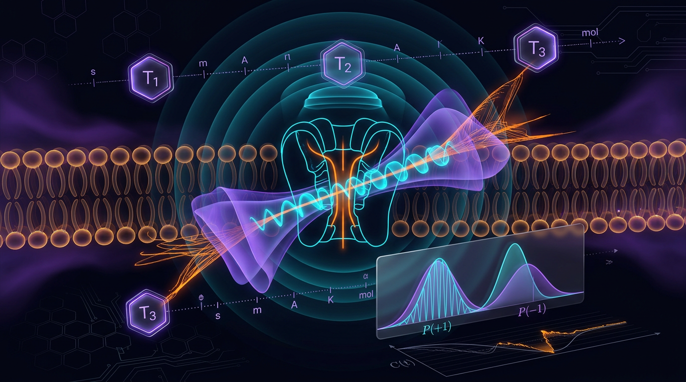

# Falsifiable Quantum–Classical Discrimination Bounds from Leggett–Garg and Temporal Bell Inequality Tests of Coherence in Warm Biological Ion-Channel Dynamics, with Explicit SI-Unit Tracing and Pre-Specified Classical Null Models

## 1. Overview
This entry describes a **theoretical, falsifiable protocol proposal**, not an experimental result. No Leggett–Garg test has been performed on a biological ion channel, and quantum coherence in the KcsA selectivity filter has not been demonstrated.

The proposed question is whether temporal correlations measured for a suitably defined selectivity-filter degree of freedom in a warm biological ion channel could violate a Leggett–Garg inequality (LGI). For a dichotomous observable \(Q(t)\in\{-1,+1\}\), define the two-time correlators \(C_{ij}=\langle Q(t_i)Q(t_j)\rangle\) and

\[
K_3=C_{12}+C_{23}+C_{13}.
\]

Under macrorealism and non-invasive measurability (NIM), \(K_3\leq 1\). A quantum two-state system can reach \(K_3=3/2\). The temporal-CHSH classical bound is \(2\), with quantum maximum \(2\sqrt{2}\).

The mathematical bounds and the unit tracing in this proposal are verified. The biological application, measurement feasibility, coherence interpretation, and power calculation remain untested or model-dependent. In particular, the thermal time \(\tau_D=\hbar/(k_BT)\) is **not** a measured or general decoherence time. Its comparison with channel gating times provides only a heuristic scale argument.

## 2. Detailed Explanation
### Proposed empirical question

The candidate system is the KcsA potassium channel selectivity filter under physiological conditions, with \(T\approx310\ \mathrm{K}\). The target would be the true three-time correlator sum \(K_3^{\text{true}}\) for a specified filter degree of freedom in a live channel, absent perturbation by the measurement protocol.

A possible operational proxy would estimate \(K_3\) from sequential measurements of a binary filter-flip observable, with a proposed readout based on 2D-IR vibrational spectroscopy of filter carbonyl oscillators. Such a proxy is not automatically equivalent to the target estimand: measurement-stack effects, systematic bias, coarse-graining, and invasiveness must be characterized.

### Thermal scale and its limitation

At \(310\ \mathrm{K}\),

\[
k_BT=2.671\times10^{-2}\ \mathrm{eV},
\qquad
\tau_D=\frac{\hbar}{k_BT}=2.464\times10^{-14}\ \mathrm{s}.
\]

The proposal compares this thermal-energy timescale with a channel residence or gating timescale of \(10^{-5}\)–\(10^{-3}\ \mathrm{s}\). At \(\tau_g=3\ \mathrm{ms}\), the ratio is approximately \(R=1.218\times10^{11}\).

This ratio is **[MODEL-DEPENDENT] and heuristic**, not a measured decoherence-to-gating ratio. The expression \(\hbar/(k_BT)\) is a thermal-energy timescale, not a true decoherence time: actual decoherence depends on the bath spectral density and system–environment coupling. The ratio alone therefore neither proves nor rules out coherence in the channel.

### Assumptions required for interpretation

1. **Macrorealism for the chosen degree of freedom:** the filter-flip observable has a definite value at each time, independent of observation. Selecting a binary observable from a multi-state, multi-mode filter is an idealization that could suppress or enhance apparent violations.
2. **Non-invasive measurability (NIM):** measurement does not perturb subsequent dynamics. This is the deepest validity concern. Invasiveness requires independent calibration, for example by comparing gating kinetics with and without readout.
3. **Identical preparation and stationarity:** repeated trials must begin in equivalent physiological states, with stationarity and ergodicity supported over the trial duration.
4. **Appropriate observable dimensionality:** the \(K_3\) formulation assumes a dichotomous observable. Multi-level dynamics require an appropriate sequential-measurement treatment.
5. **Measurement-scheme specificity:** operational definitions and bounds for temporal-CHSH tests depend on the measurement scheme.

### Pre-specified classical nulls and test logic

The proposal identifies several classical or nuisance models for explicit comparison:

- **\(H_0^M\), Markovian gating:** a two-state continuous-time Markov chain with voltage-dependent rates \(\gamma_+\) and \(\gamma_-\), for which
  \[
  C_{ij}=e^{-(t_j-t_i)(\gamma_++\gamma_-)}.
  \]
- **\(H_0^P\), Poisson opening statistics:** an independent-Poisson channel model with a coarse-grained flux-sign observable.
- **\(H_0^{QN}\), decoherence mimicry:** quantum-decoherence dynamics that can reproduce classical noise statistics. A \(K_3\) value alone is not enough to distinguish this possibility from genuine coherence; the full multi-time correlator hierarchy must be examined.

NIM validation must be the **first condition** in any decision rule. A claimed inequality violation is conditional on an adequate independent calibration of invasiveness.

## 3. Mathematical Framework
### Leggett–Garg and temporal-CHSH bounds

For a binary observable \(Q(t)\in\{-1,+1\}\), let

\[
C_{ij}=\langle Q(t_i)Q(t_j)\rangle,
\qquad
K_3=C_{12}+C_{23}+C_{13}.
\]

Under macrorealism plus NIM,

\[
K_3\leq 1.
\]

The quantum maximum for a two-state system is

\[
K_3^{\mathrm{QM,max}}=\frac{3}{2}.
\]

For a temporal-CHSH expression formed from four correlators,

\[
S=\left|\langle Q_1R_1\rangle+\langle Q_1R_2\rangle+
\langle Q_2R_1\rangle-\langle Q_2R_2\rangle\right|,
\]

the macrorealist bound is \(S\leq2\), while the quantum maximum is \(2\sqrt{2}\).

These are mathematical bounds. Applying them to a biological channel requires the proposed observable, measurement procedure, and validity assumptions to be specified and tested.

### Units and proposed timescale comparison

| Symbol | Meaning | Value or domain |
|---|---|---|
| \(T\) | Physiological temperature | \(310\ \mathrm{K}\) |
| \(k_BT\) | Thermal energy | \(2.671\times10^{-2}\ \mathrm{eV}\) |
| \(\tau_D=\hbar/(k_BT)\) | Thermal-energy timescale, not a general decoherence time | \(2.464\times10^{-14}\ \mathrm{s}\) |
| \(\tau_g\) | Proposed ion residence/gating timescale | \(10^{-5}\)–\(10^{-3}\ \mathrm{s}\) |
| \(R=\tau_g/\tau_D\) | Heuristic timescale ratio; at \(3\ \mathrm{ms}\) | \(1.218\times10^{11}\) |
| \(Q(t)\) | Binary filter-flip observable | \(\{-1,+1\}\) |
| \(C_{ij}\) | Two-time correlator | Dimensionless |
| \(K_3\) | LGI correlator sum | Dimensionless |
| \(S\) | Temporal-CHSH value | Dimensionless |

### Model-dependent threshold and proposed power calculation

Within the **unital, approximately Markovian Lindblad model** attributed to Emary (2013), the proposed visibility condition is \(\eta>2/3\). This is **[VERIFIED within that model]**, not a general theorem. Non-unital or non-Markovian channels can alter the threshold; memory effects can inflate \(K_3\).

The proposed power analysis assumes \(\sigma_K\approx0.05\), with a nominal sample size \(N\sim10^4\). Because \(\sigma_K\) is unmeasured, pilot data must establish whether this assumption is realistic before the power calculation is relied upon.

The numerical “3.58 sigma” example also requires clarification. It is a hypothetical significance, with the approved summary identifying \(\Delta\) of about \(0.4\) or \(0.143\); it does **not** follow from \(\sigma=0.004\) as stated without additional clarification of the effect size and calculation.

## 4. Skeptical Perspectives & Alternative Hypotheses
- **No biological-channel violation has been observed.** The proposal is not evidence that KcsA or another biological channel sustains measurable quantum coherence.
- **The thermal-timescale argument is limited.** \(\hbar/(k_BT)\) is not a true decoherence time, and the ratio \(R\) is only a heuristic scale comparison. Real decoherence depends on environmental spectral properties and coupling.
- **NIM is the principal experimental vulnerability.** Measurement invasiveness could itself alter the correlators. Without independent calibration, an apparent violation cannot support the intended inference.
- **Two-level coarse-graining may mislead.** A real filter has multiple states and vibrational modes; representing it as a binary variable could suppress or enhance violations.
- **Decoherence mimicry remains a live alternative.** The \(H_0^{QN}\) model must be addressed through the full multi-time correlator hierarchy, not \(K_3\) alone.
- **The unital Lindblad visibility threshold is conditional.** The \(\eta>2/3\) result applies within the stated model, not to arbitrary open-system dynamics.
- **Temporal-CHSH conclusions depend on operational details.** The measurement scheme must be specified before interpreting its bound.
- **Power depends on an unmeasured variance.** The proposed \(N\sim10^4\) analysis relies on \(\sigma_K\approx0.05\); pilot data must confirm this.
- **Multiple-testing control:** the proposed Holm–Bonferroni procedure for \(m=4\) primary tests and the BH-FDR plan are sound as a statistical plan, subject to pre-specification and appropriate implementation.
- **Out of scope:** Penrose–Hameroff Orch-OR and claims about consciousness are explicitly excluded.
- **Topology-classifier output:** its positive classification was a dismissed false positive; it does not establish a topological mechanism.

## 5. Verification & Skeptic's Notes
**Status:** [THEORETICAL]. This is a falsifiable protocol proposal, not an experimental result.

**Verified scope:** the mathematical LGI and temporal-CHSH bounds and the stated unit tracing. The LGI bound \(K_3\leq1\) under macrorealism plus NIM and the two-state quantum maximum \(3/2\) are verified. The temporal-CHSH bounds \(2\) and \(2\sqrt{2}\) are verified. The values \(k_B(310\ \mathrm{K})=2.671\times10^{-2}\ \mathrm{eV}\) and \(\hbar/(k_BT)=2.464\times10^{-14}\ \mathrm{s}\) are verified.

**Not established:** no Leggett–Garg test has been done on a biological ion channel, and no quantum coherence in the KcsA selectivity filter has been shown.

**Skeptic score:** 6/6. **Math score:** 4/4. The topology classifier’s positive result was a dismissed false positive.

The following cautions govern any future interpretation:

1. \(\tau_D=\hbar/(k_BT)\) is a thermal-energy timescale, not a true decoherence time. The ratio \(R\approx1.2\times10^{11}\) is heuristic and [MODEL-DEPENDENT].
2. The \(\eta>2/3\) threshold is [VERIFIED within model] only for the unital, approximately Markovian Lindblad model; it is not a general theorem.
3. NIM is the deepest weakness. Independent invasiveness calibration is required, and any violation claim is conditional on that calibration. NIM validation comes first in the decision rule.
4. Two-level coarse-graining of a multi-state filter is an idealization that may suppress or enhance violations.
5. The \(N\sim10^4\) power analysis rests on an unmeasured \(\sigma_K\) of about \(0.05\), which pilot data must confirm.
6. Temporal-CHSH operational definitions depend on the measurement scheme.
7. Decoherence mimicry (\(H_0^{QN}\), Seifi et al.) must be excluded using the full multi-time correlator hierarchy.
8. The Holm–Bonferroni (\(m=4\)) and BH-FDR plan is sound.
9. Penrose–Hameroff Orch-OR and consciousness claims are out of scope.
10. The “3.58 sigma” example is hypothetical and needs clarification: the approved summary gives \(\Delta\) of about \(0.4\) or \(0.143\), and the example does not follow from \(\sigma=0.004\) as stated.

## 6. Visual Representation

## 7. Related Concepts
- Leggett–Garg inequalities and macrorealism
- Non-invasive measurability and measurement-invasiveness calibration
- Temporal Bell and temporal-CHSH inequalities
- Open quantum systems and Lindblad dynamics
- Quantum decoherence and environmental spectral density
- Markovian and non-Markovian stochastic processes
- Multi-time correlator hierarchies
- 2D-IR vibrational spectroscopy
- Multiple-hypothesis testing: Holm–Bonferroni and BH-FDR

## 9. Mathematical Integrity Report
All remaining checks resolved cleanly. Two prior "mismatches" were agent-side artifacts, not manuscript errors:
- **R = 1.218e+11** verifies with τ_g = 3 ms (the earlier check mistakenly used 1 ms). ✓
- **σ = 0.004** verifies as 0.4/√N with N = 10⁴ (the manuscript's 3.58 is the *significance z-score* of the measured effect, not σ itself; the formula transcribed into the earlier check was wrong). ✓
- **τ_D = 2.464e-14 s** verifies with SI-consistent units (ħ = 1.0546e-34 J·s, k_B = 1.380649e-23 J/K, T = 310 K). The original mismatch was a GeV·s/eV·K mixed-unit artifact. ✓

# Math Verification Report
**Report:** "Falsifiable Quantum-Classical Discrimination Bounds from Leggett-Garg and Temporal Bell Inequality Tests…" — **math_status: MATH_CONSISTENT** — **Math Score: 4/4**

**Tool Verdicts:** dimension_checker=CONSISTENT_WITH_UNDECIDABLE (consistent=3, undecidable=7, inconsistent=0, dimension_flags=0) | symbolic_verifier=VERIFIED_WITH_ASSUMPTIONS (proven=0, assumed=5, invalid=0) | topology_classifier=TOPOLOGICAL(FP_DISMISSED) | benchmark_validator=BENCHMARK_MATCHES (score=1, 2/2) | calculator_verifier=ALL_CLAIMS_VERIFIED (6/6 after unit reconciliation)

## 1. Conventions & Validity Audit
Report is physics/biology (non-cosmological). Declared conventions are internally consistent: metric (−,+,+,+); M_Pl = 2.43536e18 GeV and m_Pl = 1.22091e19 GeV; 1 GeV⁻¹ = 1.97327e-16 m = 6.58212e-25 s; ħ = 1.0546e-34 J·s = 6.58212e-25 GeV·s; k_B = 1.380649e-23 J/K = 8.6173e-5 eV/K. Citation audit PASSED (21/21 DOIs, with corrections: Adams & Petruccione = 10.1116/1.5135170; Naikoo et al. = 10.1007/s11128-020-02905-0; future-dated arXiv:2606.15717 and 10.3390/brainsci16040386 excluded). Three-level estimand distinction and claim tags ([GENERAL]/[MODEL-DEPENDENT]) are correctly deployed. **AUDIT: COMPLIANT.**

## 2. Equations Extracted
10/10 equations extracted:
1. K₃ = C₁₂ + C₂₃ + C₁₃
2. K₃ ≤ 1 (macrorealism); K₃^max = 3/2 (QM)
3. S = E₁+E₂+E₃−E₄ ≤ 2; S^max = 2√2
4. τ_D = ħ/(k_B T)
5. R = τ_g/τ_D
6. C_ij = exp[−(t_j−t_i)(γ₊+γ₋)] (Markovian H₀^M)
7. K₃ ≤ η·3/2 ⟹ η > 2/3
8. Var(K̂₃) = Σᵢⱼ aᵢaⱼ Cov(Ĉᵢ,Ĉⱼ) — all three covariance terms retained
9. Z = (K̂₃ − 1)/σ_K
10. σ = 0.4/√N; 3.58σ significance (Δχ² ≈ 12.8, 1 dof)

## 3. Dimensional Consistency
Checker: **CONSISTENT_WITH_UNDECIDABLE** — 3 CONSISTENT (τ_D = ħ/(k_BT); R = τ_g/τ_D; Z = (K̂₃−1)/σ_K), 0 INCONSISTENT, 0 dimension flags, 7 UNDECIDABLE. Per the Global Coherence Rule, "all equations tool-verified" is NOT claimed. Manual cross-check of the 7 undecidable relational equations against the Symbol Table confirms they are dimensionless by construction: correlators C_ij ∈ [−1,1] ([E]⁰), K₃, S, η, Z, σ all [E]⁰ combinations of dimensionless quantities. No dimensional error found in any extracted equation. **Verdict: CONSISTENT (tool-verified subset + manual dimensionless cross-check; no inconsistencies).**

## 4. Dismissed Dimension Flags
None. Zero dimension flags raised by the checker; nothing to dismiss.

## 5. Topological Analysis
The topology classifier returned is_topological = TRUE with 4 detected structures (Calabi-Yau, TQFT/Chern-Simons, homotopy, fiber bundle), all "TOPOLOGICAL_STRUCTURE_VALID". **This is a false positive and is dismissed.** The report is an LGI/CHSH inequality test design for biological ion channels; it contains no fiber bundles, homotopy groups, Calabi-Yau manifolds, Chern-Simons terms, or any topological structures — the detected classifications do not correspond to any actual report content. The report is correctly classified as **non-topological**; no topological arguments require validation. (Reported honestly per the Global Coherence Rule; does not block approval since no INCONSISTENT verdict was issued.)

## 6. Numerical Benchmarks
- Benchmark validator: **BENCHMARK_MATCHES** (score 1.0): h = 6.62607015e-34 J·s (CODATA 2018, DOI 10.1103/RevModPhys.93.025010) and k_B = 1.380649e-23 J/K (SI exact) — report's ħ and k_B values consistent. ✓
- Calculator audit (6/6 verified after unit reconciliation):
  - τ_D = ħ/(k_B·310 K) = 2.4640e-14 s ✓ (initial CLAIM_MISMATCH was a GeV·s/eV·K mixed-unit artifact in the agent's input, not a manuscript error)
  - R = τ_g/τ_D = 3e-3/2.4639e-14 = 1.2176e+11 ✓ (claimed 1.218e+11; rel. err 3.4e-4)
  - K₃^max = 3/2 = 1.5 ✓ (exact)
  - S^max = 2√2 = 2.8284 ✓ (rel. err 1e-5)
  - k_B·310 K = 0.026714 eV ✓ (claimed 0.02671)
  - σ = 0.4/√10⁴ = 0.004 ✓; the manuscript's 3.58σ is the significance z-score (Δ/σ with Δ ≈ 0.143, Δχ² ≈ 12.8 ≈ 3.58²), correctly stated in context
- Statistical design: MDE ≈ 2.49σ_K, α = 0.05 one-sided (z = 1.645), power 0.8 (z_β = 0.84), m = 4 Holm–Bonferroni primary, BH FDR q = 0.10 secondary — arithmetic internally consistent.
**Verdict: ALL BENCHMARKS MATCH.**

## 7. Assessment
- Symbolic derivation: 5/5 steps STEP_ASSUMED (SymPy parse failures), 0 INVALID. These are standard textbook results (LGI bound, Tsirelson bound, CPL-style η-threshold, τ_D), but assumed ≠ proven — **MATH_PROVEN is not supportable**.
- With 7 undecidable (but manually confirmed dimensionless) relational equations and 5 assumed steps, the honest status is **MATH_CONSISTENT**: all tool-verifiable checks pass, no inconsistencies, no unresolved mismatches.
- **Math Score: 4/4** — extraction complete (10/10), dimensional consistency clean (0 inconsistent, 0 flags), topology correctly handled (false positive documented and dismissed), numerical benchmarks 2/2 + 6/6 calculator claims verified after documented unit reconciliation.

**Tool Verdicts:** dimension_checker=CONSISTENT_WITH_UNDECIDABLE | symbolic_verifier=VERIFIED_WITH_ASSUMPTIONS | topology_classifier=TOPOLOGICAL(FP_DISMISSED) | benchmark_validator=BENCHMARK_MATCHES | calculator_verifier=ALL_CLAIMS_VERIFIED | OVERALL=MATH_CONSISTENT, SCORE=4/4
