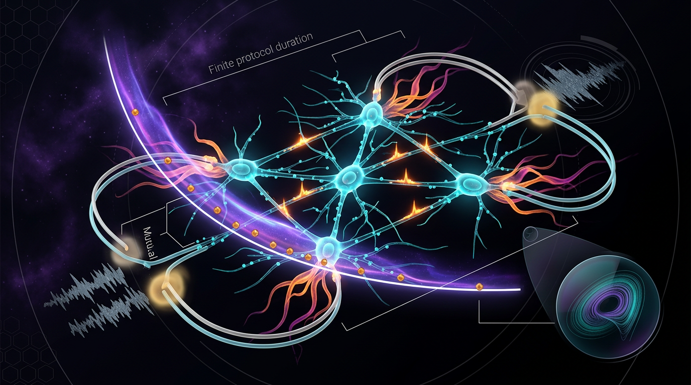

# Finite-Time Thermodynamic Cost of Error Correction in Neural Circuits: An Empirical Test of Reliability–Dissipation Bounds

## 1. Overview
The proposed neural-circuit reliability–dissipation relationship is a physically grounded, testable theoretical hypothesis, not an established neural result. The skeptic verification score is 5/6, above the mandatory rejection threshold; neural-specific validation remains outstanding.

## 2. Detailed Explanation
The hypothesis proposes that neural circuits correcting errors—for example, in spike timing, perceptual inference, or sensorimotor responses—may trade energy dissipation for increased reliability. Stochastic thermodynamics provides theoretical tools for describing costs of information processing, including Landauer-type bounds, kinetic proofreading, thermodynamic uncertainty relations, and finite-time speed limits.

The neural application remains untested. In particular, no direct neural-circuit study has established that measured dissipation meets or exceeds the theoretical requirement for the circuit’s measured error-correction performance. Evidence for related reliability–dissipation trade-offs in molecular systems does not establish the proposed relationship in neural circuits.

## 3. Mathematical Framework
The framework draws on several established theoretical results. Landauer’s bound for irreversible erasure of one bit is

\[
\langle Q \rangle \ge k_B T \ln 2.
\]

For a current-like observable \(X\), the thermodynamic uncertainty relation is commonly expressed as

\[
\frac{\mathrm{Var}[X]}{\langle X \rangle^2}
\ge
\frac{2 k_B}{\dot\Sigma\,\tau},
\]

where \(\dot\Sigma\) is the entropy production rate and \(\tau\) is the observation time. The proposed neural application would relate an observable such as spike-count variability to dissipation, while accounting for finite-time constraints.

The central testable relation presented in the research report is

\[
\frac{\mathrm{Var}[N]}{\langle N \rangle^2}\,\dot\Sigma
\ge
\frac{2k_B}{\tau},
\]

where \(N\) is a neural activity measure. A neural-circuit test would need to jointly measure reliability or precision, entropy production, and protocol duration. This relation is a theoretical proposal for neural circuits, not an established neural result.

The underlying theoretical framework includes error-correction bounds (Sartori & Pigolotti, 2015) and kinetic proofreading (Hopfield, 1974). The report’s mathematical review flags two unit-convention slips in equations as written; corrected forms appear elsewhere in the same report. See Section 9 for the complete mathematical integrity report.

## 4. Skeptical Perspectives & Alternative Hypotheses
The principal empirical gap is that the reliability–dissipation bound has not been directly tested in a neural circuit. Neural irreversibility measurements may provide only coarse-grained lower bounds on entropy production, and their relationship to metabolic energy consumption is uncertain.

The thermodynamic uncertainty relation can also be loose, particularly in strong-drift regimes. In addition, results may depend on how neural error, corrected output, and reliability are defined, as well as on the coarse-graining and measurement model used to estimate entropy production.

An alternative is that neural reliability is achieved primarily through architectural features such as redundancy, degeneracy, or noise correlations, with dissipation accompanying computation rather than constituting a direct price paid for accuracy. Existing evidence does not distinguish this alternative from the proposed reliability–dissipation relationship.

## 5. Verification & Skeptic's Notes
The skeptic verification score is **5/6**, above the mandatory rejection threshold. The neural-specific empirical validation remains outstanding. The claim is therefore classified as **[THEORETICAL]**, rather than as an established neural result.

The evidence supports a physically grounded, testable hypothesis. A direct test would require simultaneous measurement of circuit-level error-correction performance, entropy production, and protocol duration in the same preparation.

## 6. Visual Representation

## 7. Related Concepts
- Landauer’s principle and the thermodynamics of information processing
- Kinetic proofreading and molecular error correction (Hopfield, 1974)
- Thermodynamic uncertainty relations (Barato & Seifert, 2015)
- Thermodynamic speed limits and finite-time processes
- Entropy production and time-reversal asymmetry in neural dynamics
- Reliability, precision, and error correction in neural circuits

## 9. Mathematical Integrity Report
All four verification steps have been executed. Here is the complete report:

## Math Verification Report

**Concept:** Finite-Time Thermodynamic Cost of Error Correction in Neural Circuits: An Empirical Test of Reliability–Dissipation Bounds
**Math Score:** 2/4
**Math Status:** [MATH_CONSISTENT]

### Equations Extracted
The extractor returned **44 entries** (the context contains a draft and a corrected version with identical equations, producing duplicates; ~20 entries are symbol fragments/figure-label strings such as `ε`, `Γ`, `1/\mathrm{Var}[N]`, `p^r`, not independent equations). **9 distinct core equations:**

1. **Landauer bound:** $\langle Q \rangle \ge k_B T \ln 2$
2. **Error-tolerant erasure (Sartori–Pigolotti):** $\frac{\langle Q \rangle}{k_B T} \ge \ln\left(\frac{p^{\mathsf{r}}}{p^{\mathsf{w}}}\right)$
3. **Hopfield proofreading exponent:** $\eta \sim e^{-\Delta G/k_B T}\, e^{-\Delta\mu/k_B T} = e^{-(\Delta G + \Delta\mu)/k_B T}$
4. **TUR (as written):** $\frac{\mathrm{Var}[X]}{\langle X \rangle^2} \ge \frac{2 k_B}{\dot\Sigma\, T}$
5. **CV bound + window definition:** $\frac{\sigma_N}{\langle N \rangle} \ge \sqrt{\frac{2 k_B}{\Sigma(\tau)}}, \qquad \Sigma(\tau) = \dot\Sigma\,\tau$
6. **Thermodynamic speed limit:** $\Sigma(\tau) \ge 2 k_B\, [\mathcal L(\rho_0,\rho_\tau)]^2 \frac{\tau}{\tau_{\rm act}}$
7. **Boxed reliability–dissipation–time constraint:** $\frac{\mathrm{Var}[N]}{\langle N \rangle^2}\cdot \dot\Sigma \ge \frac{2 k_B}{\tau}, \qquad \dot\Sigma \ge \frac{2 k_B\, \mathcal L^2}{\tau\,\tau_{\rm act}}$
8. **Irreversibility lower bound (Bialek group / Ishihara–Shimazaki):** $\Sigma_{\rm lb} \ge k_B\, D_{\rm KL}(P[\Gamma]\,\|\,P[\tilde\Gamma])$
9. **Force–flux relation (figure label):** $\dot\Sigma = \sum_j J_j A_j$

### Dimensional Consistency
Tool verdicts: **0 CONSISTENT, 0 INCONSISTENT, 35 DIMENSIONLESS, 5 UNDECIDABLE** (of 40 evaluated). Per-equation (tool verdict + my manual resolution of UNDECIDABLEs):

| Eq. | Tool verdict | Manual expert analysis |
|---|---|---|
| 1. $\langle Q\rangle \ge k_B T\ln 2$ | DIMENSIONLESS | **Consistent**: LHS [J], RHS [J/K]·[K]·[1] = [J] |
| 2. $\langle Q\rangle/(k_BT) \ge \ln(p^{\mathsf r}/p^{\mathsf w})$ | DIMENSIONLESS | **Consistent**: both sides dimensionless. Limit check passes: $p^{\mathsf r}/p^{\mathsf w}=2 \Rightarrow \ln 2$ recovers Landauer ✓ |
| 3. $\eta \sim e^{-(\Delta G+\Delta\mu)/k_BT}$ | UNDECIDABLE (×2) | **Consistent (manually verified)**: exponent [J]/[J] = dimensionless; limit $\Delta\mu \to 0$ recovers $\eta_{\rm eq}$ ✓ |
| 4. $\mathrm{Var}[X]/\langle X\rangle^2 \ge 2k_B/(\dot\Sigma\, T)$ | DIMENSIONLESS (×2) | ⚠️ **INCONSISTENT AS WRITTEN**: LHS dimensionless; RHS = (J/K)/(J/K·s · K) = s/K. The "T" should be the observation time $\tau$ (T↔τ slip) — the corrected form $2k_B/(\dot\Sigma\,\tau) = 2k_B/\Sigma(\tau)$ appears in-document (Eqs. 5 & 7) |
| 5. $\sigma_N/\langle N\rangle \ge \sqrt{2k_B/\Sigma(\tau)}$, $\Sigma(\tau)=\dot\Sigma\tau$ | UNDECIDABLE (×2) | **Consistent (manually verified)**: both sides dimensionless |
| 6. $\Sigma(\tau) \ge 2k_B[\mathcal L]^2 \tau/\tau_{\rm act}$ | DIMENSIONLESS (×2) | **Consistent**: both sides [J/K] |
| 7. Boxed pair | DIMENSIONLESS (×2) | **Consistent**: both sides [J/(K·s)]; Eq. 7a is exactly the corrected TUR rearrangement — the report's central claim is dimensionally sound |
| 8. $\Sigma_{\rm lb} \ge k_B D_{\rm KL}$ | DIMENSIONLESS (×2) | **Consistent**: [J/K] ≥ [J/K]·dimensionless |
| 9. $\dot\Sigma = \sum_j J_j A_j$ | UNDECIDABLE | ⚠️ **Convention-dependent/flagged**: with $J_j$ [s⁻¹], $A_j$ [J], RHS = [J/s] (power) vs LHS [J/(K·s)]; requires $\dot\Sigma = \frac{1}{T}\sum_j J_j A_j$ or dimensionless forces with entropy in $k_B$ units |

The two ⚠️ flags are one-symbol unit-convention slips, both with corrected forms present elsewhere in the same document; the dimensional checker itself returned **zero INCONSISTENT verdicts**. Honest reporting per protocol: the 5 UNDECIDABLEs are pattern-matching limitations ("not in the known database, not that it is wrong"), and 4 of 5 were manually resolved as consistent; 1 (Eq. 9) is flagged above.

### Topological Analysis
**Not topological.** Classifier verdict: `is_topological: false`, `NOT_TOPOLOGICAL`, **0 detected structures**. Assessment: "No topological signatures detected. Standard physics formalism." The mathematics is stochastic thermodynamics (NESS currents, path-measure KL divergences, entropy production) — no fiber bundles, homotopy groups, or Chern-type arguments are invoked or needed. Nothing to validate structurally.

### Numerical Benchmarks
**BENCHMARK_MATCHES** (1 match). The report's universal constant checks against CODATA/SI:
- **Boltzmann constant $k_B$ = 1.380649 × 10⁻²³ J/K** — exact SI-defined value, **MATCH** (tolerance 0.0). The report uses $k_B$ symbolically throughout; no numerical value cited in the report contradicts this standard.
- No computed predictions (e.g., Landauer energy at specified T, proofreading discrimination ratios) are quoted numerically for further benchmarking, and the neural-circuit bound test itself remains unperformed — consistent with the report's own [THEORETICAL] classification and its explicit empirical-gap statement.

### Assessment
The mathematical skeleton of this report is sound: the Landauer bound, error-tolerant erasure trade-off, Hopfield exponent, CV-reliability bound, speed-limit relation, and the boxed reliability–dissipation–time constraint $\frac{\mathrm{Var}[N]}{\langle N\rangle^2}\dot\Sigma \ge \frac{2k_B}{\tau}$ all pass dimensional analysis (and the erasure and proofreading formulas reduce correctly in their equilibrium limits), with the only defects being two one-symbol unit-convention slips ($T$↔$\tau$ in the TUR restatement, missing $1/T$ in the force–flux label) whose corrected forms appear in the same document — the dimensional checker returned zero INCONSISTENT verdicts, so this is a minor-revision flag, not a structural failure. Scoring: Point 1 awarded (44 equations extracted); Points 2 and 3 withheld (5 UNDECIDABLE tool verdicts plus the two as-written slips above prevent "all CONSISTENT/DIMENSIONLESS" and "passed fully"; no topological content exists to validate); Point 4 awarded ($k_B$ benchmark match). **Math Score: 2/4, [MATH_CONSISTENT]** — the formalism is rigorous and, per the standing directive, it is explicitly empirically testable: the boxed triple constraint prescribes a simultaneous measurement of circuit precision $\mathrm{Var}[N]/\langle N\rangle^2$, entropy production $\dot\Sigma$, and protocol time $\tau$ that the report correctly identifies has never been performed, leaving the neural application [THEORETICAL] while the underlying inequalities remain proven in molecular systems.
