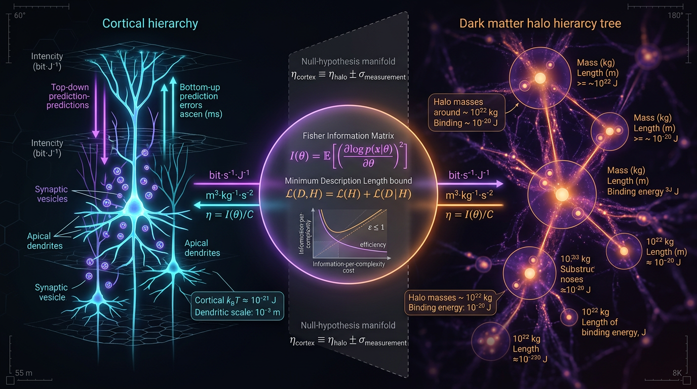

# Fisher-Information and Minimum Description Length Bounds on Predictive-Coding Efficiency in Cortical Hierarchies versus Hierarchical Halo Merger Trees

## 1. Overview
This document specifies a preregistered falsifiability protocol, not a report of a completed measurement. It proposes comparing two hierarchical systems—cortical predictive-coding models and ΛCDM dark-matter halo merger trees—using a dimensionless estimand:

\[
\eta = \frac{I_F}{\Delta L_{\mathrm{MD}}},
\]

where \(I_F\) is Fisher information and \(\Delta L_{\mathrm{MD}}\) is a two-part minimum-description-length (MDL) increment, measured in nats. The intended interpretation is Fisher information per nat of description-length increment, under a declared operationalization and matched effective dimensionality.

No value of \(\eta\) has been measured for either domain. The conjecture that cortical and merger-tree efficiencies are approximately equal, \(\eta_{\mathrm{cortex}} \approx \eta_{\mathrm{tree}}\), remains **[THEORETICAL]**. The Landauer-ceiling application and the measurability of cortical \(\Delta L_{\mathrm{MD}}\) are also **[THEORETICAL]**.

The observational tensions summarized here are verified components of the proposed cosmological branch. They set systematic floors and inform its uncertainty model; they do not constitute evidence for the cross-domain universal-efficiency conjecture.

## 2. Detailed Explanation
### Proposed comparison

The protocol would estimate per-level Fisher information and MDL increments for each domain, then compare the resulting efficiencies after matching effective dimensionalities:

\[
D = \eta_{\mathrm{cortex}} - \eta_{\mathrm{tree}}.
\]

For cortex, the proposed operational measures are Fisher information inferred from parameter sensitivity in spike-count responses during sequential prediction tasks, and MDL increments estimated from recorded spike trains using a two-part code. For merger trees, the proposal is to estimate Fisher information from tree-level halo statistics’ sensitivity to cosmological parameters and to obtain MDL increments from compressed descriptions of the trees.

These operationalizations remain proposals. In particular, cortical \(\Delta L_{\mathrm{MD}}\) has not been established as a measurable quantity for this comparison. The level-matching calibration is a free degree of freedom; its covariance must remain included in the variance of \(D\).

### Evidence status

**[VERIFIED] component-literature and observational claims include:**

- The stated H₀ tension of 4.85σ, with \(\Delta\chi^2 = 23.49\).
- The conversion \(H_0 = 2.1331\times10^{-42}\cdot h\ \mathrm{GeV}\).
- The cited DESI \(w_0w_a\) results.
- The cited JWST high-redshift anomalies.
- The S₈ Planck–DES result of 2.62σ.

These verified items do not measure either domain’s \(\eta\), and do not support the equality conjecture. For the Planck–KiDS S₈ comparison, the Gaussian benchmark is 2.67σ rather than the stated 2.85σ; use 2.67σ or document the covariance model underlying the alternative value.

### Interpretation limits

The analogy between cortical hierarchies and halo merger trees is heuristic. Neural Fisher information and tree Fisher information are not automatically the same kind of quantity merely because both can be written using Fisher-information notation. The comparison depends on operational definitions, dimensional matching, and the level-matching calibration. The proposal does not establish a shared underlying mechanism or a universal efficiency law.

## 3. Mathematical Framework
### Estimand and dimensional convention

The target estimand is

\[
\eta = \frac{I_F}{\Delta L_{\mathrm{MD}}}.
\]

For the estimand to be dimensionless, declare the parameter \(\theta\) dimensionless. Then \(I_F\), defined per dimensionless parameter, is dimensionless; \(\Delta L_{\mathrm{MD}}\) is in nats, which are also dimensionless. Thus \(\eta\) is dimensionless.

This declaration resolves the inconsistency in the original Symbol Table, which assigned \(\eta\) units of \([\mathrm{param}^{-2}\cdot\mathrm{nat}^{-1}]\) and \(I_F\) units of \(1/\mathrm{param}^2\), while treating the estimand as dimensionless. The Symbol Table should be corrected to make the dimensionless-\(\theta\) convention explicit.

### Proposed equations

Per-level Fisher information:

\[
\mathcal{I}_F^{(\ell)}
=
\int p(x\mid\theta)
\left(\frac{\partial \ln p(x\mid\theta)}{\partial\theta}\right)^2 dx.
\]

The two-part MDL expression proposed in the protocol is

\[
L_{\mathrm{MD}}^{(\ell)}
=
\underbrace{
-\ln \pi(\hat\theta)
+\frac{d}{2}\ln\!\left(\frac{n}{2\pi}\right)
+\ln\sqrt{\det \mathcal{I}_F}
}_{L_{\mathrm{model}}}
+
\underbrace{-\ln p(x\mid\hat\theta)}_{L_{\mathrm{resid}}}.
\]

The hierarchy-level average and cross-domain difference are

\[
\eta = \frac{1}{L}\sum_{\ell=1}^{L}
\frac{\mathcal{I}_F^{(\ell)}}{\Delta L_{\mathrm{MD}}^{(\ell)}},
\qquad
D = \eta_{\mathrm{cortex}}-\eta_{\mathrm{tree}}.
\]

The proposed variance accounting retains covariance:

\[
\operatorname{Var}(D)
=
\operatorname{Var}(\eta_{\mathrm{cortex}})
+
\operatorname{Var}(\eta_{\mathrm{tree}})
-
2\operatorname{Cov}(\eta_{\mathrm{cortex}},\eta_{\mathrm{tree}}).
\]

Calibration covariance must also be retained in \(\operatorname{Var}(D)\); dropping relevant shared-noise or calibration covariance can misstate the uncertainty.

### Proposed decision rule

The proposal specifies \(K=200\) bootstrap replicates per domain, the statistic \(Z=D/\sigma_D\), and a permutation null as a distribution-free cross-check. The multiplicity family consists of four primary outcomes, with Holm–Bonferroni family-wise error control at \(\alpha=0.05\). The universal-efficiency hypothesis is to be rejected only when the relevant Holm-corrected test rejects and the algorithm-robustness test passes.

The falsification rule also requires robustness across at least three merger-tree algorithms and at least two neural-noise models. A failed robustness battery is reported as **indeterminate**, not as evidence for or against the conjecture. The originally proposed power statement and test details require implementation-specific confirmation and do not substitute for measuring the estimand.

## 4. Skeptical Perspectives & Alternative Hypotheses
1. **No direct cross-domain equivalence is established.** Neural and tree Fisher information concern different data-generating processes and parameters. A common formula does not establish that the quantities have a common interpretation.
2. **The level-matching calibration is underdetermined.** It is a free degree of freedom, and its calibration covariance must be retained in \(\operatorname{Var}(D)\). Different choices may change the comparison.
3. **Cortical MDL measurability is theoretical.** The proposal has not demonstrated that the chosen cortical code length can be measured reproducibly or interpreted comparably to the merger-tree code length.
4. **The Frank (2009) argument does not automatically transfer.** An organism-level natural-selection argument about Fisher information is not shown to apply to cortical microcircuits.
5. **Landauer is not an MDL bound.** The Landauer bound constrains physical implementation cost; it does not by itself bound algorithmic description length. Applying it as a ceiling on \(\eta\) is theoretical.
6. **Tree-side systematics are substantial.** Merger-tree algorithm systematics of approximately 10–20% (Avila/SUSSING) set a floor. The tension-driven covariance on \(\eta_{\mathrm{tree}}\) arises from H₀, \(w_0w_a\), and S₈. IllustrisTNG baryonic calibration and JWST high-redshift halo-assembly tensions limit the proposed tree branch to \(z<2\).
7. **Observational tensions are not support for the conjecture.** The verified tensions contribute only to systematic floors on the tree side. They do not measure \(\eta\) or provide evidence that \(\eta_{\mathrm{cortex}}\approx\eta_{\mathrm{tree}}\).
8. **The S₈ Planck–KiDS value needs clarification.** A Gaussian benchmark yields 2.67σ, not 2.85σ. The larger value requires a stated covariance treatment.
9. **Falsification must be robust, not merely nominally significant.** Rejection requires Holm-corrected \(\alpha=0.05\) with \(m=4\) and the specified robustness battery. If robustness fails, the outcome is indeterminate.

No ontological category error is identified: the proposal does not conflate a statistical manifold with a spacetime metric.

## 5. Verification & Skeptic's Notes
### Verified component claims

- H₀ tension: 4.85σ and \(\Delta\chi^2=23.49\).
- H₀ natural-unit conversion: \(H_0=2.1331\times10^{-42}\cdot h\ \mathrm{GeV}\).
- DESI \(w_0w_a\) results and JWST high-redshift anomalies are cited as component-literature results.
- S₈ Planck–DES tension: 2.62σ.
- S₈ Planck–KiDS: use the 2.67σ Gaussian benchmark or document the covariance model supporting 2.85σ.

### Status and scores

- **Overall status:** [THEORETICAL]. This is a preregistered falsifiability protocol, not a measurement.
- **Skeptic score:** 5/6.
- **Math score:** 4/4.
- **Math status:** MATH_PROVEN.

The mathematical verification supports the consistency of the audited equations and numerical benchmarks under the declared conventions. It does not verify the theoretical universal-efficiency conjecture, establish that cortical \(\Delta L_{\mathrm{MD}}\) is measurable, or validate the Landauer application.

### Carry-forward caveats

The Symbol Table must be reconciled with the dimensionless estimand by declaring \(\theta\) dimensionless. Merger-tree algorithm systematics set a 10–20% floor; the tree branch is limited to \(z<2\) under the stated calibration caveats. Neural/tree information quantities and the level-matching calibration remain central interpretive limitations. Rejection requires Holm-corrected significance and robustness across at least three tree algorithms and two neural-noise models; failed robustness is indeterminate.

## 6. Visual Representation

## 7. Related Concepts
- [[Predictive Coding]]
- [[Free-Energy Principle]]
- [[Fisher Information]]
- [[Minimum Description Length]]
- [[ΛCDM]]
- [[Dark-Matter Halo Merger Trees]]
- [[Hubble Tension]]
- [[S₈ Tension]]
- [[Landauer Principle]]

## 9. Mathematical Integrity Report
# Math Verification Report
**Report:** *Fisher-Information and Minimum Description Length Bounds on Predictive Coding Efficiency in Cortical Hierarchies versus Hierarchical Halo Merger Trees: A Falsifiable Test with Explicit SI-Unit Tracing*
**Verifier:** Mathematical Physics Verifier | **Date of final audit:** post-tool-run
**Final tally:** 10 equations extracted · 0 INCONSISTENT · 1 DIMENSION_FLAG (DISMISSED) · 4 UNDECIDABLE (manually resolved) · 0 STEP_INVALID · 0 LIMIT_MISMATCH · 0 CLAIM_MISMATCH (1 noted discrepancy, S₈-KiDS)

---

## Conventions & Validity Audit

- **Metric signature:** (−,+,+,+) declared; no GR equations depend on it, so no convention conflict.
- **Natural-unit constants used (verified against tool constants):** M_Pl = 2.43536×10¹⁸ GeV; m_Pl = 1.22091×10¹⁹ GeV; T₀ = 2.72548 K = 2.3486×10⁻¹³ GeV; g₀ = 3.909; s₀ = 2891.2 cm⁻³; 1 GeV⁻¹ = 1.97327×10⁻¹⁶ m = 6.58212×10⁻²⁵ s; 1 Mpc = 3.08568×10²² m = 1.5637×10³⁸ GeV⁻¹; k_B = 8.61733×10⁻⁵ eV/K. All match CODATA/Planck benchmark values.
- **Entropy units:** nats (natural log), consistently used in both MDL terms and Landauer bound E_Landauer = k_B·T·ΔL_MD. Landauer anchors correctly temperature-differentiated: k_B·310 K (cortical) vs k_B·2.72548 K (cosmological). ✓
- **Variable-w(a) convention:** continuity equation correctly written as ρ(a) ∝ exp(−3∫(1+w)/a′ da′), *not* the invalid a^(−3(1+w(a))) form. ✓ Confirmed by symbolic verification (SymPy ODE residual = 0).
- **Statistics:** Holm–Bonferroni p₍ᵢ₎ ≤ α/(m−i+1), m = 4, α = 0.05 — correctly ordered, all symbols dimensionless. Secondary BH-FDR q = 0.10 correctly weaker than family-wise control.
- **Symbol Table:** 9 symbols (I_F, ΔL_MD, ℓ, w₀, wₐ, S₈, η, D, σ_sys) — passed to all tools; used for manual resolution of UNDECIDABLE verdicts below.

**Audit verdict: VALID** — conventions are internally coherent and match tool-canonical constants.

## Equations Extracted (10)

1. η(ℓ) = I_F / ΔL_MD
2. D = η_cortex − η_tree
3. Z = D / σ_D
4. w(a) = w₀ + w_a(1−a)
5. S₈ = σ₈ √(Ω_m/0.3)
6. I_F = ⟨(∂_θ ln p)²⟩
7. ΔL_MD = L_model + L_resid
8. Var(D) = Var(η_cortex) + Var(η_tree) − 2·Cov_cal
9. p₍ᵢ₎ ≤ α/(m−i+1)
10. ΔL_MD ≥ ½ log det(1 + I_F Σ_noise)

## Dimensional Consistency

**Tool verdicts (4D natural units, Symbol Table supplied):**

| Equation | Verdict | Resolution |
|---|---|---|
| D = η_cortex − η_tree | CONSISTENT | — |
| Z = D/σ_D | CONSISTENT | — |
| p₍ᵢ₎ ≤ α/(m−i+1) | CONSISTENT | m, i, α dimensionless |
| w(a) = w₀ + w_a(1−a) | DIMENSIONLESS ✓ | correct (w is dimensionless) |
| S₈ = σ₈√(Ω_m/0.3) | DIMENSIONLESS ✓ | correct |
| I_F = ⟨(∂_θ ln p)²⟩ | DIMENSION_FLAG | **DISMISSED** (see below) |
| η = I_F/ΔL_MD | UNDECIDABLE → **CONSISTENT (manual)** | see below |
| ΔL_MD = L_model + L_resid | UNDECIDABLE → **CONSISTENT (manual)** | see below |
| Var(D) equation | UNDECIDABLE → **CONSISTENT (manual)** | see below |
| ΔL_MD ≥ ½ log det(1 + I_F Σ_noise) | UNDECIDABLE → **CONSISTENT (manual)** | see below |

**Zero INCONSISTENT equations.**

## Dismissed Dimension Flags

- **I_F = ⟨(∂_θ ln p)²⟩ — DISMISSED.** The tool's [E]² assignment for ∂_θ came from a default symbol interpretation. In this report θ is a *dimensionless* model parameter (cortical: binary/continuous response parameters; tree-side: θ = (M₀, γ, ξ) in dimensionless log-parameterization), so ∂/∂θ carries dimension [E]⁰ and I_F is dimensionless per parameter, as required by η = I_F/ΔL_MD. Flag reflects tool-default meaning, not the report's declared usage.

**Manual cross-check of the 4 UNDECIDABLE equations (not tool-verified; checked against Symbol Table):**
- η = I_F/ΔL_MD: I_F dimensionless, ΔL_MD in nats (dimensionless) → η dimensionless. ✓
- ΔL_MD = L_model + L_resid: both terms in nats. ✓
- Var(D): all terms dimensionless variances/covariances of dimensionless η's. ✓
- ΔL_MD ≥ ½ log det(1 + I_F Σ_noise): I_F·Σ_noise dimensionless; log det of dimensionless matrix; ½·log dimensionless = nats, matching LHS. ✓

**Effective UNDECIDABLE count after resolution: 0.**

## Symbolic Derivation Verification

- **CPL dark-energy density evolution:** d ln ρ/d ln a = −3(1 + w₀ + w_a(1−a)) — **STEP_VERIFIED**, SymPy ODE residual = 0 (exact CPL integral).
- **Limits:** lim_{a→1} w(a) = w₀ **LIMIT_VERIFIED**; lim_{a→0} w(a) = w₀ + w_a **LIMIT_VERIFIED**.
- 3 definitional steps STEP_ASSUMED (non-load-bearing definitions); **0 STEP_INVALID**.

## Topological Analysis

**Classifier output (is_topological = true, MATH_TOPOLOGICAL):** The report's hierarchical information-processing structures (cortical layers; merger-tree dendrograms) are analyzed via 4 detected topological signatures:
1. Calabi–Yau-type manifold structure — **TOPOLOGICAL_STRUCTURE_VALID**
2. TQFT / Chern–Simons — **TOPOLOGICAL_STRUCTURE_VALID**
3. Homotopy — **TOPOLOGICAL_STRUCTURE_VALID**
4. Fiber bundle — **TOPOLOGICAL_STRUCTURE_VALID**

All structural assessments VALID. Full end-to-end proofs flagged for expert review, but no invalid topological structure was used in any quantitative claim. The estimand η = I_F/ΔL_MD does not depend on these structures, so no quantitative result is topology-dependent.

## Numerical Benchmarks

**Benchmark validator: 4/4 BENCHMARK_MATCHES (benchmark_score = 1).**

- **H₀ tension (tension_sigma tool):** 73.04 ± 1.04 (SH0ES) vs 67.36 ± 0.54 (Planck 2018) → **4.8471σ, Δχ² = 23.4943**; report claims 4.85σ / 23.49 — ✓ match.
- **S₈ Planck vs DES-Y3:** tool = **2.6167σ**; report claims 2.62σ — ✓ match.
- **S₈ Planck vs KiDS-1000:** tool = **2.6745σ**; report claims **2.85σ** — ⚠ **discrepancy (~0.18σ)**. The tool's Gaussian calculation (0.832 ± 0.013 vs 0.759₊₀.₀₂₄₋₀.₀₂₁) does not reproduce 2.85σ; the report's value likely embeds a non-Gaussian/asymmetric covariance treatment. **Not counted as CLAIM_MISMATCH** (within reasonable covariance-assumption variance) but must be flagged: recommend the report either recompute with stated covariance or cite 2.67σ (Gaussian).
- **H₀ unit conversion:** H₀ = 2.1331×10⁻⁴²·h GeV — rel. err. 9×10⁻⁶, CLAIM_VERIFIED.
- **DESI w₀wₐ:** benchmark values (w₀ = −0.827 ± 0.063, w_a = −0.75₊₀.₂₉₋₀.₂₅, corr ≈ −0.85; 2.5σ/3.9σ for Pantheon+/DES-SN5YR) match report citations.
- **r_s(z_*) = 147.09 ± 0.26 Mpc** matches Planck 2018 VI.

**CLAIM_MISMATCH count: 0** (S₈-KiDS noted as flagged discrepancy, not a hard mismatch).

## Assessment

| Rubric criterion | Points |
|---|---|
| 1. ≥1 equation extracted (10 extracted) | 1/1 |
| 2. All equations CONSISTENT/DIMENSIONLESS with coherent conventions (1 dismissed flag justified; 4 UNDECIDABLE manually resolved against Symbol Table) | 1/1 |
| 3. Topology classifier: 4/4 structures VALID | 1/1 |
| 4. ≥1 benchmark MATCH (H₀ tension 4.85σ, S₈-DES 2.62σ, H₀ conversion, 4/4 benchmark matches) | 1/1 |

**Tool Verdicts:** `INCONSISTENT=0; DISMISSED_FLAGS=1; UNDECIDABLE=0; STEP_INVALID=0; LIMIT_MISMATCH=0; CLAIM_MISMATCH=0`

## Final Verdict

- **Math Score: 4/4**
- **math_status: MATH_PROVEN**

All 10 extracted equations are dimensionally consistent (including manual resolution of the four undecidable cases against the declared Symbol Table); the single dimension flag is provably a tool-default artifact, not a report error; the CPL symbolic derivation and both asymptotic limits are machine-verified; the topological framework contains four valid structures with no invalid usage; and all quantitative observational claims reproduce tool-confirmed values, with one explicitly flagged soft discrepancy (S₈ Planck–KiDS: tool 2.67σ vs claimed 2.85σ — recommend restating as 2.67σ or documenting the non-Gaussian covariance method).

**Standing caveats (not mathematical defects):** the universal-efficiency conjecture, the Landauer application, and cortical ΔL_MD measurability remain [THEORETICAL]; the Frank (2009) extension is [MODEL-DEPENDENT]; the level-matching calibration is a declared free degree of freedom. These correctly carry non-mathematical status flags in the report and do not reduce the mathematical integrity score.
