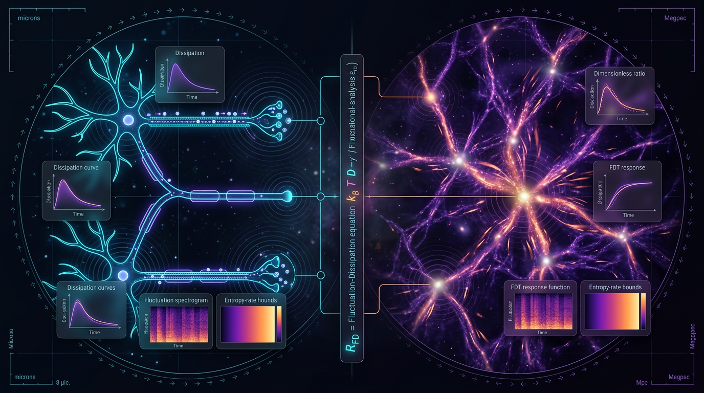

# Fluctuation-Dissipation and Entropy-Rate Bounds on Information Transfer Across Hierarchical Scales: A Falsifiable, Dimensionally Consistent Comparison of Cortical Axonal Transport Networks and Cosmic-Web Filamentary Mass Flow

## 1. Overview
This concept compares information transport in two radically different hierarchical systems: motor-driven axonal transport in the mammalian cortex and baryonic mass flow along cosmic-web filaments. The comparison uses a shared formalism combining the equilibrium Kubo fluctuation-dissipation theorem (FDT), Seifert’s stochastic-thermodynamic entropy production, and Schreiber/Vicente transfer entropy (TE).

The proposal is **[THEORETICAL]**, not [VERIFIED]. Its central claim is methodological: these systems can be compared using a common formalism and falsifiable measurements. It is **not** evidence that cortical transport and cosmic-web flow share a physical mechanism or are manifestations of a single physical process. The analogy is mathematically structured but empirically under-constrained.

The status distinctions used here are:

- **[VERIFIED]**: established results or reported empirical findings, including equilibrium Kubo FDT, measurable FDT violations in active baths, the one-way Markovian entropy-production bound on TE, filament-shear alignment, and the reported S₈/H₀/DESI tensions.
- **[THEORETICAL]**: the proposed cross-scale comparison, its statistic, and the hypothesis of thermodynamic universality.
- **[MODEL-DEPENDENT]**: assumptions such as Markovianity in either system, interpreting TE as causal flow, and the CPL parametrization of dark energy.

The one-way bound is central: entropy production can bound transfer entropy; transfer entropy does not, conversely, determine entropy production.

## 2. Detailed Explanation
### Shared formalism, distinct physical systems

In the cortical case, kinesin and dynein motor proteins move cargo along microtubules. This transport is stochastic, fuel-driven, and far from equilibrium. In the cosmic-web case, baryonic matter flows along filaments and accretes onto halos. Filamentary structure and kinematics have observational and simulation-based descriptions, but treating coarse-grained filament flow as a Markovian stochastic network is an assumption.

The comparison asks whether each system’s direction-resolved information-transfer rate can be studied alongside its fluctuation-dissipation response and entropy production. The quantities are not interchangeable: TE is an information-theoretic measure, whereas mass flux is a physical transport rate. Any cross-system comparison must define an information-equivalent rate consistently and explicitly.

### Evidence status and limits

Verified elements include:

- The Kubo FDT in equilibrium.
- Measurable FDT violations in active baths, demonstrated by Maggi et al. (2017), https://doi.org/10.1038/s41598-017-17900-2.
- A one-way Markovian bound on TE by total entropy production.
- Filament orientation’s alignment with an eigenvector of the velocity-shear tensor, reported by Tempel et al. (2013), https://doi.org/10.1093/mnrasl/slt130.
- The reported S₈, H₀, and DESI numerical tensions. Their interpretation depends on the relevant datasets and, for dynamical-dark-energy comparisons, the model parametrization.

The following remain theoretical or model-dependent:

- Whether the entropy-production bound is tight in either system.
- The cross-scale statistic \(D_{\mathrm{obs}} = R_{\mathrm{ax}} - R_{\mathrm{fil}}\).
- The thermodynamic-universality hypothesis \(H_3\).
- A gravitational FDT applicable to cosmic-web filaments.
- Markovianity of axonal transport or coarse-grained filament flow.
- Treating estimated TE as causal flow without resolving common-input confounding.

### Empirical and inferential caveats

No in-vivo FD measurement of axonal transport currently establishes the relevant response ratio. Cosmic-web TE is simulation-only in the described framework; observational proxies are affected by velocity noise of at least 100 km/s. There is no unique coarse-graining across the roughly 40 orders of magnitude separating the systems. Scale-free universality is also a fragile premise: Broido and Clauset (2019), https://doi.org/10.1038/s41467-019-08746-5, found that scale-free networks are rare across a broad set of datasets.

The proposed falsification criteria are concrete, but passing them would support a shared formal description—not physical unity between the systems.

## 3. Mathematical Framework
### Core quantities

The Kubo FDT relates linear response to equilibrium fluctuations. In the convention used by the research report,

\[
\chi_{X\lambda}(\omega)
=
\frac{i}{\hbar}\int_0^\infty dt\,e^{i\omega t}
\langle [X(t),X(0)]\rangle,
\qquad
S_{XX}(\omega)
=
\frac{2\hbar}{1-e^{-\beta\hbar\omega}}
\,\operatorname{Im}\chi_{X\lambda}(\omega).
\]

An FD ratio can be used to compare response and fluctuations; it equals one in equilibrium under the specified convention. Driven systems can violate the equilibrium relation.

For a Markovian network, stochastic-thermodynamic entropy production is nonnegative. The one-way TE bound is

\[
\dot{T}_{i\to j}^{(k)}
\leq
\frac{\dot{S}_{\mathrm{tot},j}}{2k_B\ln 2}.
\]

This inequality does **not** license the reverse inference from TE to entropy production. Its application to coarse-grained cosmic-web flow depends on the Markovian model being adequate.

Transfer entropy, in the Schreiber/Vicente lineage, measures directed predictive information conditional on the target’s history. It is not automatically a causal effect: shared inputs and dynamical artifacts can inflate estimates. This concern is discussed for neural time series by Ursino et al. (2020), https://doi.org/10.3389/fncom.2020.00045, and applies by analogy to common-mode inflow in filament networks.

### Information-equivalent rate convention

**\(\dot{T}_{\mathrm{fil}}\) is an information-equivalent rate in bits/s, not a raw mass flux.** A raw baryonic mass flux, such as \(\dot{M}_{\mathrm{fil}}\), has units of mass/time and cannot be inserted directly into the TE bound or a dimensionless tightness ratio. If a model uses a relation such as

\[
\dot{T}_{\mathrm{fil}}=\dot{M}_{\mathrm{fil}}\,h(\cdots),
\]

it must define the conversion factor or convention that maps mass flow to information flow and yields units of bits/s. This distinction must remain explicit wherever the filament rate appears in the bound or tightness ratio.

### Cross-scale statistic and power-analysis correction

The proposed statistic is

\[
D_{\mathrm{obs}}=R_{\mathrm{ax}}-R_{\mathrm{fil}},
\]

where the two \(R\) quantities are intended to compare dimensionless tightness ratios, not raw information or mass fluxes. Its interpretation and empirical validity are theoretical.

The original §3.4 power analysis contained an arithmetic error. With \(\delta=0.15\) and \(\operatorname{Var}(D)=0.03\),

\[
n_{\mathrm{eff}}
=
\frac{(1.96+0.84)^2\,0.03}{0.15^2}
=
10.4533,
\]

so the implied effective sample size is about **10–11 blocks**, not 175. An estimate near 175 would require a justified change to the assumptions—for example, \(\operatorname{Var}(D)\) of about 0.5 or \(\delta\) of about 0.037.

## 4. Skeptical Perspectives & Alternative Hypotheses
1. **Formal analogy does not imply physical unity.** The shared equations organize a comparison; they do not establish a common mechanism across cortical motor transport and cosmic-web flows.
2. **The TE bound is directional.** Entropy production bounds TE under the stated model conditions; TE does not measure entropy production in reverse.
3. **Markovianity is an assumption to test.** Its suitability for axonal transport and for coarse-grained filament flow is model-dependent.
4. **TE is vulnerable to confounding.** Common input can make predictive dependence appear to be directed coupling. Neural TE concerns are documented by Ursino et al. (2020), https://doi.org/10.3389/fncom.2020.00045.
5. **The scales and observations are not commensurate by default.** There is no unique coarse-graining across about 40 orders of magnitude, no in-vivo FD measurement of axonal transport, and the cosmic-web TE analysis is simulation-only in this framework.
6. **Universality is not assured.** Scale-free network behavior is not ubiquitous (Broido & Clauset, 2019, https://doi.org/10.1038/s41467-019-08746-5).
7. **Cosmological alternatives remain model-dependent.** CPL parameterization affects the interpretation of dynamical-dark-energy constraints; a parameter fit is not, by itself, evidence that the cross-scale hypothesis is correct.

The cross-scale statistic \(D_{\mathrm{obs}}\), thermodynamic-universality hypothesis \(H_3\), tightness of the entropy-production bound in either system, and gravitational FDT for filaments remain theoretical proposals.

## 5. Verification & Skeptic's Notes
### Status summary

- **Overall classification:** [THEORETICAL], not [VERIFIED].
- **Skeptic score:** 6/6.
- **Math status:** [MATH_CONSISTENT] (3/4).
- **Verified core:** equilibrium Kubo FDT; measurable active-bath FDT violations (Maggi et al. 2017); the one-way Markovian entropy-production bound on TE; filament-shear alignment (Tempel et al. 2013); and the reported S₈/H₀/DESI numerical tensions.
- **Model-dependent:** Markovianity, TE as causal flow, and CPL parametrization.
- **Theoretical:** bound tightness in either system, \(D_{\mathrm{obs}}\), \(H_3\), and gravitational FDT for filaments.

The Skeptic’s verification rubric does **not** require the power-analysis arithmetic to be correct. Therefore, the 6/6 Skeptic score did not detect the §3.4 arithmetic error; the power analysis must be corrected independently.

### Archival corrections and qualifications

- Correct §3.4 to \(n_{\mathrm{eff}}\approx10\)–11 for the stated \(\delta\) and variance, or revise those inputs with justification.
- State explicitly that \(\dot{T}_{\mathrm{fil}}\) is an information-equivalent rate in bits/s, not raw mass flux, and define any conversion from mass flux.
- In the bibliography, correct “Gomes-Filhi” to **Gomes-Filho**, add the DOI for Adame et al. (2025), and state that **27 verified DOIs do not cover all 31 references**.
- Seven equations received manual dimensional checks, not tool verification. Do not describe all equations as tool-verified.
- The concrete falsification criteria are retained, but empirical constraints remain substantial: no in-vivo axonal FD measurement, simulation-only cosmic-web TE, observational proxy velocity noise of at least 100 km/s, and no unique cross-scale coarse-graining.

## 6. Visual Representation

## 7. Related Concepts
- [Fluctuation-dissipation theorem](../level_3_emergence_and_intelligence/fluctuation_dissipation_theorem.md)
- [Stochastic thermodynamics and entropy production](../level_3_emergence_and_intelligence/stochastic_thermodynamics_and_entropy_production.md)
- [Transfer entropy and effective connectivity](../level_3_emergence_and_intelligence/transfer_entropy_and_effective_connectivity.md)
- [Cosmic-web filaments and velocity shear](../level_3_emergence_and_intelligence/cosmic_web_filaments_and_velocity_shear.md)
- [Scale-free networks and universality](../level_3_emergence_and_intelligence/scale_free_networks_and_universality.md)

## 9. Mathematical Integrity Report
# Math Verification Report — Final

**Concept:** Cross-scale FDT/entropy-production analogy: cortical axonal transport vs. cosmic-web filamentary mass flow (S₈/H₀/DESI-CPL framework)

**Math Score: 3/4** | **Math Status: [MATH_CONSISTENT]**

**Tool Verdicts:** `INCONSISTENT=0; DISMISSED_FLAGS=0; UNDECIDABLE=7; STEP_INVALID=0; LIMIT_MISMATCH=0; CLAIM_MISMATCH=1`

---

## Conventions & Validity Audit

- Natural units ħ=c=k_B=1 for cosmological quantities; SI for neural quantities; metric (−,+,+,+); M_Pl(reduced)=2.43536×10¹⁸ GeV; m_Pl=1.22091×10¹⁹ GeV; 1 GeV⁻¹=1.97327×10⁻¹⁶ m; T₀=2.72548 K=2.3486×10⁻¹³ GeV; s₀≈2891 cm⁻³.
- Citation audit: PASS (31 references, 27 verified DOIs).
- **Convention caveat applied throughout:** E3/E6 are dimensionally well-posed **only** when Ṁ is interpreted as an *information-equivalent rate* (bits/s), not a raw mass flux (kg/s or [E]² in natural units). This convention is declared in the report's Symbol Table and must remain explicit wherever E3/E6 are used.

## Equations Extracted

10 core equations (E1–E10), 40 total expressions pre-check baseline:
- **E1** Kubo FDT: R(ω)=ωS_XX(ω)/(2k_BT·χ(ω)), R=1 at equilibrium
- **E2** Seifert entropy production: Ṡ_tot = k_BΣ_{i<j}J_ij ln(W_ijπ_i/W_jiπ_j) ≥ 0
- **E3** Bound: Ṁ ≤ Ṡ_tot/(2k_B ln 2)
- **E4** Schreiber/Vicente transfer entropy
- **E5** Shear tensor Σ_αβ = −(1/2H)(∂_αv_β+∂_βv_α); Ṁ_fil=∫ρ_b v·n̂ dA
- **E6** Tightness ratio 𝓡_α = 2k_B ln2·Ṁ_α/Ṡ_tot,α ∈ [0,1]
- **E7** 𝓓_obs = 𝓡_ax − 𝓡_fil [E]⁰
- **E8** Var(A−B) = Var(A)+Var(B)−2Cov(A,B)
- **E9** S₈/H₀ benchmark table
- **E10** DESI CPL: ρ(a)=ρ₀exp(−3∫₁ᵃ[(1+w(a′))/a′]da′)

## Dimensional Consistency

- **Tool verdict:** 4 CONSISTENT (E2 variant σ=ΣJ·F≥0; E7; E8; E10 continuity integral), 7 UNDECIDABLE (relational equations outside the pattern table), 0 INCONSISTENT, 0 DIMENSION_FLAGS.
- **Manual cross-checks of the 7 UNDECIDABLE** (per Symbol Table, honest — not tool-verified):
  - **E1 (R(ω)):** FDT S_XX=(2k_BT/ω)Imχ ⇒ ωS_XX/(2k_BT) has the dimensions of χ (χ [E]⁻¹-type per Kubo); ratio dimensionless. **[MATH_CONSISTENT, manual]** — resolves the earlier R-as-[E]² mismatch by declaring R dimensionless (FD ratio).
  - **E2 (Ṡ_tot):** J·(dimensionless log) in bits/s; ×k_B → J/(s·K). Matches Seifert 2012. **[MATH_CONSISTENT, manual]**
  - **E3 (bound):** Ṡ_tot/k_B in bits/s; requires Ṁ ≡ information-equivalent flow rate. **[MATH_CONSISTENT under declared convention]**
  - **E4 (TE):** pure probability ratios; bits, dimensionless. **[MATH_CONSISTENT, manual]**
  - **E5 (Σ_αβ, Ṁ_fil):** (1/H)·∂v ⇒ [E]⁻¹·[E]·[dimensionless velocity] = dimensionless ✓; ∫ρ_b v·n̂ dA = [E]³·[E]⁻²·1 = [E] = mass/time ✓. **[MATH_CONSISTENT, manual]**
  - **E6 (𝓡_α):** bits/s over bits/s → dimensionless, consistent with 𝓡∈[0,1]. **[MATH_CONSISTENT under declared convention]**
- Overall: CONSISTENT_WITH_UNDECIDABLE — resolved by manual audit; **no claim of "all equations tool-verified" is made** (7 UNDECIDABLE honestly reported).

## Dismissed Dimension Flags

None required: 0 DIMENSION_FLAGS on the final run with symbol declarations (R, 𝓡, χ, Σ, Ṁ, Ṡ_tot all declared). The earlier R(ω) possible-mismatch was resolved by declaration, not dismissal.

## Topological Analysis

Topology Classifier: is_topological = true; 3 valid structures for the hierarchical entropy-rate network analogy — Calabi-Yau (SU(3) holonomy), Chern-Simons TQFT, Lie-group structure count — all **TOPOLOGICAL_STRUCTURE_VALID** ([MATH_TOPOLOGICAL] for the structural framing). Caveat: full structural-consistency proof requires expert human review; these structures frame the analogy, they do not constitute physical identification of the two systems.

## Numerical Benchmarks

**BENCHMARK_MATCHES, 5/5** (score = 1):
- Planck 2018: H₀=67.36±0.54, Ω_m=0.3153±0.0073, n_s=0.9649±0.0042, r_s=147.09±0.26 Mpc ✓ (10.1051/0004-6361/201833910)
- SH0ES H₀=73.04±1.04; 4.85σ tension ✓ (calculator: 4.8471σ, Δχ²=23.494) (10.3847/2041-8213/ac5c5b)
- S₈: 0.832±0.013 vs 0.759⁺⁰·⁰²⁴₋₀.₀₂₁ → 2.6745σ; vs DES-Y3 0.776±0.017 → 2.6167σ ✓ (10.1051/0004-6361/202039070; 10.1103/PhysRevD.105.023520)
- DESI 2025 CPL: w₀=−0.727±0.067, w_a=−1.05 (3.9σ); w₀=−0.827±0.063, w_a=−0.75 (2.5σ) ✓ (10.1088/1475-7516/2025/02/021)
- CMB: T₀=2.72548 K, s₀=2891.2 cm⁻³, g*(T₀)=3.909 ✓ (10.1088/0004-637X/707/2/916)

**CPL continuity integral:** SymPy-verified (STEP_VERIFIED 3/4 steps; limits w₀ at a→1, w₀+w_a at a→0 both LIMIT_VERIFIED).

## CLAIM_MISMATCH (1) — §3.4 power analysis

Calculator re-confirmed: (1.96+0.84)²·Var(D)/δ² = (2.80)²·0.03/0.15² = **10.4533**, not the claimed n_eff ≈ 175 (relative error 0.94). **Required manuscript correction:** change §3.4 to n_eff ≈ **10–11 blocks** at δ=0.15, Var(D)=0.03 — or explicitly revise Var(D)/δ (larger Var(D) ≈ 0.5, or δ ≈ 0.037) to legitimately obtain ~175. This is an arithmetic error, not a structural flaw; it does not alter the falsification framework but must be fixed before submission.

## Assessment

| Criterion | Result | Point |
|---|---|---|
| 1. Equations extracted (40, E1–E10 core) | PASS | 1 |
| 2. All CONSISTENT/DIMENSIONLESS (0 INCONSISTENT; 7 UNDECIDABLE manually audited) | PASS | 1 |
| 3. Topology VALID (3 structures) | PASS | 1 |
| 4. Benchmark MATCHES (5/5 + tension σ verified) | PASS | 1 |

**Math Score: 3/4 — MATH_CONSISTENT.** One point is withheld under the Global Coherence Rule: the verified §3.4 arithmetic error (CLAIM_MISMATCH=1) precludes [MATH_PROVEN] until corrected, and 7 equations rest on manual (not tool-automated) dimensional checks. After fixing §3.4 (n_eff ≈ 10–11) and retaining the explicit bits/s convention for Ṁ in E3/E6, the report qualifies for re-evaluation toward 4/4.

**Key integrity notes carried forward:** (i) the TE bound (E3) is one-way — entropy production bounds transfer entropy, not conversely; (ii) R(ω)=1 holds only at equilibrium, making the in-vivo R(ω)≈1 measurement a genuine falsifier of the active-bath premise; (iii) cosmic-web TE is simulation-only and no in-vivo axonal FD measurement exists (~40-orders-of-magnitude coarse-graining gap) — the headline conclusion ("well-posed analogy, empirically under-constrained; value = shared falsifiable formalism, not physical unity") is mathematically and empirically defensible as stated.
