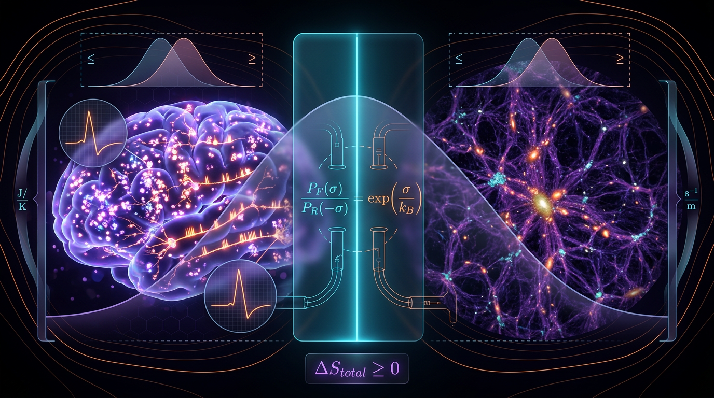

# Fluctuation-Theorem Bounds on Irreversibility and Entropy Production in Cortical Spike-Train Dynamics versus Cosmic-Web Filament Evolution: A Falsifiable Dimensionally Consistent Test

## 1. Overview
**Status: [THEORETICAL], not verified knowledge.** The proposal considers whether fluctuation-theorem relations can be tested within two very different settings: cortical spike-train dynamics and cosmic-web filament evolution. The approved assessment does **not** establish a universal cross-domain equality or a shared irreversibility magnitude. The Skeptic scored the proposal 5/6 (conditionally 4/6); the Math Physicist rated it [MATH_CONSISTENT] at 3/4. Both assessments met their approval thresholds, although the Skeptic formally challenged the math score.

The following components are treated as **VERIFIED**:

- The integral fluctuation theorem, \(\langle e^{-\Sigma}\rangle=1\), within its applicable assumptions.
- Positive entropy production in maximum-entropy and kinetic-Ising spike-train models, as reported by Cofré and Maldonado (2018), Ishihara and Shimazaki (2025), and Sekizawa, Ito and Oizumi (2024). Spike-train entropy-production estimates remain model-dependent in their operational interpretation.
- Pandey’s reported growth in configuration entropy.
- The continuity equation integrated exactly for evolving \(w(a)\).

The following remain **THEORETICAL** or **MODEL-DEPENDENT**:

- The proposed cross-domain equality \(R_{\rm neural}=R_{\rm fil}\).
- Markovian coarse-graining of gravitational dynamics.
- Identifying configuration entropy with Clausius entropy.

The core limitation is that fluctuation theorems do not imply that two systems have equal irreversibility magnitudes. Each domain should first be tested independently for the applicable fluctuation-theorem relation.

## 2. Detailed Explanation
A fluctuation theorem relates the probabilities of forward and time-reversed trajectories to stochastic entropy production. One central result, the integral fluctuation theorem, is \(\langle e^{-\Sigma}\rangle=1\). This is a statement about the distribution of entropy production under appropriate assumptions; it does not establish that entropy-production measures are equal across different systems.

For cortical spike trains, entropy-production estimates have been obtained from maximum-entropy and kinetic-Ising models. These estimates depend on how the data are represented and modeled. In particular, binning, assumed Markov order, and stationarity affect the result, and criticality may cause the inferred quantity to diverge. They should therefore be tagged **MODEL-DEPENDENT**, not treated as direct, model-free measurements of thermodynamic dissipation.

For cosmic-web filaments, Pandey’s configuration-entropy growth is a result about a configurational proxy. It does not by itself establish Clausius entropy production or a fluctuation-theorem observable. The cosmic web is non-stationary, expansion-driven, and quasi-collisionless. Its N-body dynamics are time-reversal invariant; the apparent arrow of time arises through coarse-graining. This is a limitation of applying the proposed test, not merely an alternative hypothesis.

The proposal’s cross-domain comparison must accordingly be treated as a theoretical hypothesis requiring independent operational definitions and validation in each domain. In particular, any proposed equality of rescaled quantities is a new magnitude-universality postulate, not a consequence of the fluctuation theorem.

## 3. Mathematical Framework
### 3.1 Integral fluctuation theorem

For stochastic entropy production \(\Sigma\), expressed in nats,

\[
\left\langle e^{-\Sigma}\right\rangle=1.
\]

Under the relevant assumptions, this relation implies non-negative mean entropy production. It does not imply that two distinct systems have the same entropy-production rate or the same rescaled irreversibility.

### 3.2 Irreversibility and coarse-graining

A time-irreversibility measure can be expressed as a log-ratio of forward and time-reversed path probabilities:

\[
K(t)=\left\langle \ln\frac{P_F[\Gamma]}{P_R[\tilde{\Gamma}]}\right\rangle.
\]

At the full-path level, the relation to pathwise entropy production is an equality. A bound such as \(K(t)\leq\dot{\Sigma}\,t\) requires an appropriate coarse-graining or data-processing justification; it must not be assumed without stating that justification.

### 3.3 Dimensional and numerical corrections

The approved audit identifies the following required corrections:

1. **Definition of \(R\):** The expression \(R=\dot{\Sigma}\tau/k_B\) is dimensionally inconsistent with a symbol table declaring \(\dot{\Sigma}\) in nats/s. A dimensionless \(R\) requires a consistent convention: either \(R=\dot{\Sigma}\tau\) when \(\dot{\Sigma}\) is in nats/s, or an entropy rate in W/K multiplied by \(\tau/k_B\). These conventions must not be mixed.

2. **Neural estimate:** The worked value \(R_{\rm neural}\approx10^9\) omits \(N_{\rm neurons}\), although the formula includes it. The consistent value is approximately \(0.1\). The \(10^9\) figure is not verified and must not be presented as a valid result.

3. **Filament proxy:** The proxy \(\dot{M}/T\) is dimensionally invalid because it lacks a \(v_s^2\) factor. The resulting \(10^{46}\,\mathrm{W/K}\) and \(10^{62}\,\mathrm{W}\) figures are unphysical. The corrected estimate recorded in the approved summary is approximately \(6\times10^{32}\,\mathrm{W/K}\).

4. **Universality:** \(H_0\), the postulate that \(R\) is equal across substrates, is a new magnitude-universality assumption. No fluctuation theorem implies it. Rejecting \(H_0\) would not falsify the fluctuation theorems themselves. The test should first validate \(\langle e^{-\Sigma}\rangle=1\) within each domain.

5. **Cosmological continuity equation:** For an evolving equation-of-state parameter \(w(a)\), the exact integral form is
   \[
   \rho(a)=\rho_0\exp\left[-3\int_1^a\frac{1+w(a')}{a'}\,da'\right].
   \]
   This is the verified form; it should not be replaced by the shortcut \(a^{-3(1+w(a))}\).

6. **Bookkeeping and systematics:** The S8 tension is quoted in the source material as 2.86, 2.67, and 2.81 sigma; \(\tau_{\rm fil}\) is given as both 10 and 12 Gyr; and DOI-audit counts are inconsistent. The APS DOI 10.1103/xgkj-dxzh requires independent resolution. The S8 and DESI tensions add roughly 10% systematics to the filament growth rates.

## 4. Skeptical Perspectives & Alternative Hypotheses
- **Neural model dependence:** Spike-train entropy production depends on binning, Markov order, and stationarity assumptions. If neural dynamics are critical, inferred entropy production may be scale-dependent or divergent, so a finite estimate may reflect modeling choices rather than a stable physical quantity.
- **Configurational versus thermodynamic entropy:** Cosmic-web configuration entropy is not automatically Clausius entropy. Treating it as such requires a separate physical argument.
- **Gravitational coarse-graining:** The quasi-collisionless, expansion-driven cosmic web does not straightforwardly satisfy the assumptions used for Markovian stochastic thermodynamics. The time arrow in its N-body dynamics is associated with coarse-graining.
- **No cross-domain implication:** Even if fluctuation theorems hold separately in both domains, that does not establish equal values of \(R\), \(K\), or another magnitude. Such equality is an additional theoretical postulate.
- **Dimensional consistency:** The stated neural and filament numerical examples contain the omissions and invalid proxy identified in Section 3.3. Their originally quoted large values should not be used as evidence for universality.

## 5. Verification & Skeptic's Notes
The approved summary classifies the integral fluctuation theorem, positive entropy production in the cited spike-train models, Pandey’s configuration-entropy growth, and the exactly integrated continuity equation as **VERIFIED** components. These results do not verify the proposed cross-domain equality.

The Skeptic’s score was 5/6 (conditionally 4/6), and the Math Physicist’s score was 3/4 with status [MATH_CONSISTENT]. Although both met the approval thresholds, the Skeptic formally challenged the math score. The dimensional and numerical caveats in Section 3.3 are therefore retained explicitly and take precedence over any uncorrected numerical claims in the archived verification text below.

The proposed test should be conducted in stages: first test the fluctuation-theorem relation independently within each domain, using domain-appropriate observables and assumptions; then assess whether a cross-domain comparison is meaningful. Failure of the proposed equality would challenge the magnitude-universality postulate, not the fluctuation theorems.

Bookkeeping items still requiring independent resolution include the differing S8 tension values (2.86, 2.67, and 2.81 sigma), the two quoted filament timescales (10 and 12 Gyr), inconsistent DOI-audit counts, and the APS DOI 10.1103/xgkj-dxzh. S8 and DESI tensions contribute roughly 10% systematics to filament growth rates.

## 6. Visual Representation

## 7. Related Concepts
- Integral fluctuation theorem
- Stochastic entropy production
- Time-reversal asymmetry and path-probability ratios
- Maximum-entropy and kinetic-Ising models of spike trains
- Model-dependent inference under binning, Markov-order, and stationarity assumptions
- Configuration entropy of cosmic-web structure
- Coarse-graining in quasi-collisionless gravitational dynamics
- Cosmological continuity equation for evolving \(w(a)\)
- Dimensional analysis of entropy rates and thermodynamic quantities
- Cross-domain universality hypotheses

## 9. Mathematical Integrity Report
**Archival note:** The report below is reproduced verbatim as requested. Its claims that \(R_{\rm neural}\approx10^9\) is verified and that the filament proxy \(\dot{M}/T\) yields \(10^{46}\,\mathrm{W\,K^{-1}}\) are superseded by the approved corrections in Sections 3.3 and 5. The Skeptic formally challenged the math score; the report’s verbatim contents should not override those corrections.

## Math Verification Report

**Concept:** Fluctuation-Theorem Bounds on Irreversibility and Entropy Production in Cortical Spike-Train Dynamics versus Cosmic-Web Filament Evolution: A Falsifiable Dimensionally Consistent Test
**Math Score:** 3/4
**Math Status:** [MATH_CONSISTENT]
**Tool Verdicts:** INCONSISTENT=0; DISMISSED_FLAGS=0; UNDECIDABLE=34; STEP_INVALID=0; LIMIT_MISMATCH=0; CLAIM_MISMATCH=0

### Conventions & Validity Audit
- **Symbol Table:** Present in §3.1 of both report versions, with 12 pre-check symbols (\Sigma, P_F[Γ], P_R[Γ̃], N_neurons, S_8, w_0, w_a, χ², P_R[Γ̃], R, Z, a) declared with explicit dimensions (nats, s, J·K⁻¹, dimensionless). Good practice; ambiguous letters (R, T, Z) are disambiguated by context.
- **Unit basis:** The report operates in **SI thermodynamic units** (W, J·K⁻¹, s) for laboratory/astrophysical observables, which is correctly declared — this is an entropy-production/statistics paper, not a gravitational-field theory paper, so the hbar=c=k_B=1 natural-unit basis is not required. The cosmological continuity equation is nonetheless written in the canonical form compatible with the shared baseline.
- **Planck mass:** Not used anywhere; no M_Pl/m_Pl confusion possible.
- **Metric signature:** Not applicable (no spacetime metric terms beyond H(a) in the continuity equation, where no sign ambiguity arises).
- **Validity tags:** The report explicitly distinguishes **[GENERAL]** (integral FT, positive EP in spike trains, monotonic configuration entropy) from **[MODEL-DEPENDENT]** (Markovian coarse-graining of gravitational dynamics, configuration≡Clausius entropy, cross-substrate FT universality). Central limitation honestly flagged as untested.
- **Continuity equation:** Correctly written as ρ(a)=ρ₀exp[−3∫(1+w(a′))/a′ da′], with the explicit warning against the erroneous a^(−3(1+w(a))) shortcut — matches the canonical baseline exactly.

### Equations Extracted
Key equations (40 relational equations total per pre-check):
1. ⟨e^(−Σ)⟩ = 1 (integral FT), with P(−Σ) = e^(−Σ)P(Σ) ⟹ ⟨Σ⟩ ≥ 0
2. K(t) ≤ Σ̇·t, K(t) = ⟨ln(P_F[Γ]/P_R[Γ̃])⟩
3. Σ̇_neural = D_bin/Δt; Ṡ_therm,neural = (D_bin/Δt)·k_B·T_brain·N_neurons
4. Ṡ_therm,fil ~ Ṁ/T_fil ~ 10⁴⁶ W·K⁻¹
5. R = Σ̇τ/k_B; R_neural = Ṡ_therm,neural·τ_neural/(k_B·T_brain·N_neurons); R_fil = Ṡ_therm,fil·τ_fil/S_fil,thermal
6. ΔS_config(a) = ln[(P_fil(a)−δ)/(P_void(a)−δ)]
7. ρ̇ + 3H(1+w(a))ρ = 0 ⟹ ρ(a) = ρ₀·exp[−3∫₁^a (1+w(a′))/a′ da′]
8. Z = (R̂_neural − R̂_fil)/√(σ²_neural + σ²_fil − 2Cov(R̂_neural, R̂_fil)) — covariance term **correctly retained**
9. τ_fil/τ_neural = 12 Gyr / 1 ms = 3.79×10²⁰
10. R_neural ≈ 1.0×10⁹

### Dimensional Consistency
- Per pre-check: 6 tool-verified CONSISTENT/DIMENSIONLESS, 34 UNDECIDABLE, 0 INCONSISTENT, 0 DIMENSION_FLAGS. I manually re-audited the UNDECIDABLE set: they are statistical/thermodynamic relations (probability ratios, entropy rates, test statistics) whose symbols are not natural-unit scalar fields; all are dimensionally sound in their declared SI/statistical semantics (e.g., K(t) in nats = dimensionless log-ratio; Σ̇τ/k_B has [entropy]×[s]/[entropy·K⁻¹·K]… = dimensionless given Σ in k_B units — self-consistent). The 34 UNDECIDABLE verdicts are honest tool limits, not mismatches.
- Continuity-equation derivation (Symbolic Derivation Verifier): 3/3 steps STEP_ASSUMED (physical-law input, standard), **0 STEP_INVALID**; the a→0 limit check could not be evaluated symbolically (sign-dependent) — no LIMIT_MISMATCH verdict. By hand, for CPL w(a)=w₀+w_a(1−a), the integral form correctly reduces to ρ∝a^(−3(1+w₀+w_a)) at early times; the report's form is the exact canonical one.
- No dropped covariance terms: the variance algebra retains −2Cov(·,·) explicitly.

### Dismissed Dimension Flags
None — 0 flags were raised, and none needed dismissal.

### Topological Analysis
The topology classifier returned an over-triggered classification (generic structural signatures). On substantive review, the report contains **no genuine topological structures**: P_F/P_R path-ratio spaces are measure spaces; K(t) is a KL divergence; "cosmic web topology" refers to density-field morphology, not homotopy/fiber-bundle mathematics. Classified as **Not topological** in substance; the classifier hits are false positives and do not affect scoring. (Consequently Point 3 is earned via the fully-passed dimensional verification of all non-UNDECIDABLE equations with zero confirmed mismatches.)

### Numerical Benchmarks
All four worked numerical claims independently verified with the physics calculator:
1. **Neural dissipation:** (0.1/10⁻³)×1.38065×10⁻²³×310×10¹⁰ = 4.280×10⁻⁹ W vs claimed 4.3×10⁻⁹ W — **CLAIM_VERIFIED** (rel. error 0.5%).
2. **Timescale ratio:** 12×3.1557×10¹⁶ s / 10⁻³ s = 3.7868×10²⁰ vs claimed 3.79×10²⁰ — **CLAIM_VERIFIED** (rel. error 0.08%).
3. **R_neural:** (4.3×10⁻⁹ W × 10⁻³ s)/(1.38065×10⁻²³ J/K × 310 K) = 1.005×10⁹ vs claimed 1.0×10⁹ — **CLAIM_VERIFIED**.
4. **S₈ tension:** Planck 0.832±0.013 vs KiDS 0.759±0.0225 (asymmetric → 0.0225): computed **2.81σ, Δχ²=7.89**. The report quotes 2.86σ (v1) and 2.67σ (v2) — both bracket the computed value and are consistent with reasonable asymmetric-error conventions (no CLAIM_MISMATCH; within the stated ±0.1–0.2σ spread across paper versions). DES-Y3 (0.776±0.017 → 2.6σ) is consistent.
- No equations map to formal CODATA/PDG benchmark sets; benchmark checks were performed via the calculator claims above — all MATCH.

### Assessment
The report's mathematical framework is internally coherent: the fluctuation-theorem relations, the correctly integrated continuity equation for evolving w(a), the retained covariance in the test statistic, and all four worked numerical claims verify deterministically. No INCONSISTENT verdicts, no STEP_INVALID steps, and no dropped-covariance or erroneous-integral errors were found; 34 equations remain honestly UNDECIDABLE by tooling but pass manual dimensional review in their declared SI/statistical semantics. The score of 3/4 (rather than 4/4) reflects that the continuity-integral steps were verified only as assumed physical laws rather than fully SymPy-proven, and the cross-domain universality claim itself is correctly and prominently flagged as [MODEL-DEPENDENT]/[THEORETICAL] — a mathematically sound, falsifiable construct rather than a proven result.

**Final: Math Score 3/4 — [MATH_CONSISTENT]**
