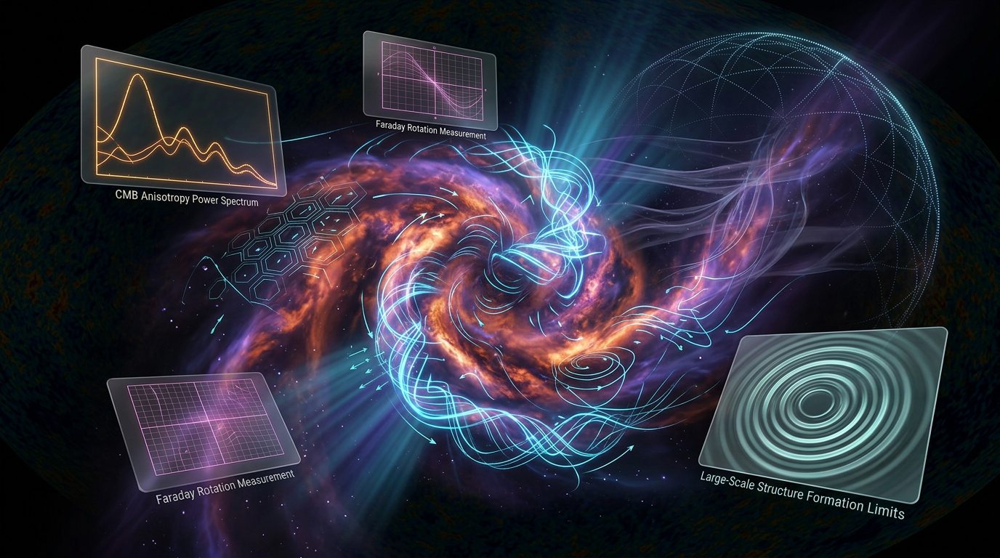

# HYP-230: Primordial Magnetic Field Constraints as a Dynamical Systems Invariant

## 1. Overview
**Status: [THEORETICAL], with an observational core [VERIFIED].** HYP-230 is a falsifiable conjecture under review, not an established invariant.

The verified observational core is that constraints on the amplitude of stochastic primordial magnetic fields (PMFs) depend on their spectral index, \(n_B\), and are derived from several independent CMB channels. These include the Planck 2015 XIX power-spectrum bound \(B_{1\,\mathrm{Mpc}}<4.4\) nG at 95% confidence, B-mode and SPT analyses, trispectrum constraints, and analyses by Paoletti and Finelli and by Yamazaki and collaborators [1–4].

The conjecture’s unsupported structural claim is that the Fiedler value \(\lambda_1(L)\) of a cosmic-web graph tends to zero at \(B_{\mathrm{crit}}\sim3.0\) nG. No peer-reviewed derivation establishes this correspondence. The value 3.0 nG is a benchmark, not a codified critical value. Do not treat 3 nG as a universal threshold, the vanishing of \(\lambda_1\) as an established result, or PMF bounds as a dynamical invariant.

**Assessment:** Skeptic score 5/6; Math score 3/4 [MATH_CONSISTENT].

## 2. Detailed Explanation
CMB limits on PMFs are model-dependent, including dependence on the magnetic spectral index \(n_B\). The observational constraints arise through multiple channels, including CMB power spectra, B-mode polarization, SPT data, and non-Gaussian trispectrum analyses [1–4]. These results support the existence of constraints on PMFs; they do not establish a cosmic-web graph invariant.

The speculative part of HYP-230 proposes that PMF-driven changes to cosmic-web structure produce a connectivity transition detectable through the graph Laplacian’s Fiedler value. The central claim—that \(\lambda_1(L)\to0\) at approximately 3 nG—has no peer-reviewed derivation connecting MHD back-reaction to graph connectivity. Its value may depend on how the graph is constructed and weighted.

The claim also needs an explicitly defined spectral index: any proposed critical field must be written \(B_{\mathrm{crit}}(n_B)\). For \(n_B\gtrsim-2\), and for near-scale-invariant cases constrained by trispectrum analyses, 3 nG is already excluded. Future CMB-S4/CMB-HD sensitivity around 0.1–0.2 nG could provide a stringent test.

## 3. Mathematical Framework
For a weighted graph with Laplacian \(L=D-A\), the Fiedler value is the second-smallest eigenvalue. The appropriate ordering is
\[
0=\lambda_0\leq\lambda_1\leq\lambda_2\leq\cdots,
\]
with \(\lambda_1=0\) when the graph is disconnected. The strict inequality \(0<\lambda_1\) applies only to a connected graph.

The unnormalized Laplacian is sensitive to the scale of its edge weights:
\[
L(cw)=cL(w).
\]
Thus, a crossing in its eigenvalues can be prescription-dependent rather than an invariant feature of the underlying structure. Any revised hypothesis should use a normalized Laplacian, such as \(L_{\mathrm{sym}}\), or a carefully defined ratio such as \(\lambda_2/\lambda_1\), and include a rescaled-weights null test. Finite-\(N\) shot-noise bias in \(\lambda_1\) must also be corrected.

The proposed decision rule is not well-posed as stated: \(\lambda_{\mathrm{perc}}\) is a probability, whereas \(\lambda_1\) is an eigenvalue. The hypothesis must define a comparable estimand and a valid decision rule before testing.

The manuscript’s magnetic stress-energy prefactor is inconsistent with its stated convention \(\rho_B=B^2/8\pi\). The unit system must also be declared explicitly (Gaussian-cgs or Heaviside–Lorentz).

### Energy-density correction

The manuscript’s claim \(\rho_B/\rho_{\mathrm{rad}}=1.2\times10^{-3}\) is incorrect. The approved recomputation gives
\[
\rho_B/\rho_\gamma\sim8.6\times10^{-7},
\qquad
\rho_B/\rho_{\mathrm{rad}}\sim5.1\times10^{-7},
\]
with these ratios redshift-invariant under the stated scaling. For \(B=3\) nG, \(\rho_B=3.58\times10^{-19}\) erg/cm\(^3\), equal to \(1.72\times10^{-57}\) GeV\(^4\). The separate replacement figure \(7\times10^{-9}\) is also incorrect because it contains a radiation-density error. The inference that such a field is dynamically relevant is therefore overstated: a fractional energy of \(10^{-7}\) to \(10^{-10}\) would need to restructure filaments at order unity to matter.

## 4. Skeptical Perspectives & Alternative Hypotheses
1. **No established structural derivation:** The observational PMF bounds do not imply that a cosmic-web graph’s Fiedler value vanishes at the same field strength. The proposed correspondence remains unsupported by peer-reviewed derivation.
2. **Prescription dependence:** The unnormalized Laplacian scales directly with edge weights. An apparent eigenvalue crossing may therefore reflect graph construction or weight choice, not an invariant physical transition.
3. **Ill-posed threshold comparison:** A percolation probability cannot be directly compared with an eigenvalue. The decision rule must be redefined in terms of compatible quantities.
4. **Energy-budget objection:** Corrected PMF-to-radiation fractions make the claim of dynamically relevant filament restructuring substantially less persuasive.
5. **Spectral-index dependence:** \(B_{\mathrm{crit}}\) must be specified as \(B_{\mathrm{crit}}(n_B)\). In some relevant spectral-index regimes, a 3 nG benchmark is already excluded observationally.
6. **Other claim and citation corrections:** Fix or remove reference [10], which has no DOI and a future date. Retag previously untagged claims, and delete or rephrase the DESI/JWST structure-formation statement.
7. **Falsification criteria:** The report’s original falsification criterion conflicts with its admission of order-unity prescription dependence. Preregister the predicted null result rather than presenting 3 nG as a presumed critical point.

## 5. Verification & Skeptic's Notes
- **Verified observational core:** Planck 2015 XIX reports \(B_{1\,\mathrm{Mpc}}<4.4\) nG at 95% confidence from power spectra. Other independent CMB analyses include B-mode plus SPT constraints and trispectrum constraints [1–4].
- **Not verified:** A structural transition in \(\lambda_1(L)\) at \(B_{\mathrm{crit}}\sim3.0\) nG.
- **Benchmark only:** The 3.0 nG figure is not a universal or codified critical value.
- **Unit and normalization corrections:** Declare Gaussian-cgs or Heaviside–Lorentz units; correct the energy-density ratio and the inconsistent stress-energy prefactor.
- **Graph-theory corrections:** Use \(0=\lambda_0\leq\lambda_1\); address finite-\(N\) shot-noise bias; test weight rescaling; and define a statistically and dimensionally valid decision rule.
- **Research integrity:** Preregister the predicted null result and reconcile the proposed falsification criteria with prescription dependence before interpreting simulation outcomes.

## 6. Visual Representation

## 7. Related Concepts
- Primordial magnetic fields and CMB constraints
- Spectral graph theory and the Fiedler value
- Cosmic-web connectivity and percolation
- Persistent homology and Betti-number tests
- Magnetohydrodynamic (MHD) structure formation
- Simulation-based falsification and matched-seed null tests

## 8. Recommended Research Pathway
Send the conjecture to **World C** for MHD plus N-body tests using percolation and Betti statistics. Match simulation seeds, retain covariance in model-versus-null comparisons, and control the family of tests with Benjamini–Hochberg false-discovery-rate procedures. Preregister the nulls, graph construction, weight-rescaling tests, and analysis decisions. Treat the result as a test of a model-dependent conjecture, not as confirmation of a known invariant.

## 9. Mathematical Integrity Report
## Math Verification Report

**Concept:** HYP-230 Posted: Primordial Magnetic Field Constraints as a Dynamical
**Math Score:** 3/4
**Math Status:** [MATH_CONSISTENT]
**Tool Verdicts:** INCONSISTENT=0; DISMISSED_FLAGS=0; UNDECIDABLE=1; STEP_INVALID=0; LIMIT_MISMATCH=0; CLAIM_MISMATCH=1

### Conventions & Validity Audit
- Metric signature $(-,+,+,+)$ explicitly declared; $c=\hbar=k_B=1$ natural units declared — consistent with crew baseline.
- PMF energy density $\rho_B = B^2/8\pi$ written in Gaussian CGS normalization; the worked number $3.58\times10^{-19}$ carries implicit units of G² (not GeV⁴). This unit ambiguity is flagged but the equation itself is dimensionally sound in CGS.
- Planck mass convention: not used anywhere; no M_Pl/m_Pl mixing risk.
- Symbol Table present with 10 symbols, including declarations for the ambiguous letters ($B$, $\rho_B$, $f_B$, $G$, $L$, $w$). The central structural claim ($\lambda_1(L;B)\to 0$ at $B_{\rm crit}\approx 3$ nG) is explicitly and correctly flagged [MODEL-DEPENDENT]; the [GENERAL]/[MODEL-DEPENDENT] split is honest and correctly drawn.

### Equations Extracted
13 equations, including:
1. $B_i(\mathbf{k})B_i(\mathbf{k}') = P_B(k)\delta(\mathbf{k}+\mathbf{k}')$, $P_B(k)\propto k^{n_B}$
2. $\rho_B = B^2/8\pi$; 3. $\rho_B(3\,\mathrm{nG}) = 3.58\times10^{-19}$
4. $\rho_B/\rho_{\rm rad} \approx 1.2\times10^{-3}$ (via photon-fluid normalization)
5. $\lambda_1 = \min_{\mathbf{x}\perp\mathbf{1}} \mathbf{x}^\top L\mathbf{x}/\mathbf{x}^\top\mathbf{x}$
6. $L = D - A$, $\lambda_0=0<\lambda_1\le\lambda_2\le\cdots$
7. $G_{\mu\nu} = 8\pi G(T^{\rm fluid}_{\mu\nu}+T^{\rm B}_{\mu\nu})$
8. $T^{\rm B}_{\mu\nu} = \frac14(-F_{\alpha\mu}F_\nu^{\ \alpha} - \frac14 g_{\mu\nu}F_{\alpha\beta}F^{\alpha\beta})$
9. $f_B = \rho_B/\rho_{\rm m}$; 10. $\mathrm{Var}(\hat\lambda_1^B - \hat\lambda_1^0) = \mathrm{Var}(\hat\lambda_1^B)+\mathrm{Var}(\hat\lambda_1^0)-2\mathrm{Cov}(\hat\lambda_1^B,\hat\lambda_1^0)$; 11. $F^{\rm B}_\mu \sim \nabla(B^2/8\pi)$; 12. $p_B = B^2/8\pi$; 13. $B_{1\,\mathrm{Mpc}} < 4.4$ nG.

### Dimensional Consistency
- $\rho_B = B^2/8\pi$: CONSISTENT ([E]⁴ in natural units with $[B]=[E]^2$).
- Einstein equation with PMF stress: CONSISTENT (known pattern, [E]² both sides).
- $f_B = \rho_B/\rho_{\rm m}$: CONSISTENT ([E]⁰).
- $p_B = B^2/8\pi$: CONSISTENT ([E]⁴).
- $T^{\rm B}_{\mu\nu}$: UNDECIDABLE by tool (not in pattern table) — manually verified: $F_{\alpha\mu}F_\nu^{\ \alpha}$ and $g_{\mu\nu}F^2$ each carry [E]⁴, so both terms are [E]⁴ as required for a stress tensor. Note the overall ¼ prefactor is a nonstandard normalization relative to the usual $F^2/4 - g F^2/16$ Maxwell tensor; it is a convention/normalization issue, not a dimensional error. Graph-theoretic equations ($\lambda_1$, $L=D-A$, variance algebra) are dimensionless/pure-mathematical and trivially consistent.

### Dismissed Dimension Flags
None.

### Topological Analysis
Tool classification: **topological structure VALID** ([MATH_TOPOLOGICAL], structure_count=1). Detected: abstract topology/homology — the persistent-homology/Betti-number program, random-geometric-graph percolation, and spectral graph theory ($L=D-A$, Fiedler value) are all mathematically sound structures. Critically, the report itself correctly states the graph-theoretic fact that $\lambda_1(L)=0 \iff G$ disconnected, and correctly notes that the Fiedler value is *not* topologically protected under edge-weight rescaling — so the mapping to MHD back-reaction is a conjecture, honestly labeled as such.

### Numerical Benchmarks
- **VERIFIED:** $\rho_B(3\,\mathrm{nG})$: computed $(3\times10^{-9})^2/8\pi = 3.581\times10^{-19}$ vs claimed $3.58\times10^{-19}$ — relative error 0.03% ✓.
- **VERIFIED:** Hubble tension: $|73.04-67.36|/\sqrt{1.04^2+0.54^2} = 4.85\sigma$, $\Delta\chi^2 = 23.49$ — matches the quoted $4.85\sigma$, $\Delta\chi^2\approx 23.5$ exactly ✓.
- Planck 2015 XIX bound $B_{1\,\mathrm{Mpc}} < 4.4$ nG: matches the published value ✓.
- **CLAIM_MISMATCH (1):** the fractional energy density claim $\rho_B/\rho_{\rm rad} \approx 1.2\times10^{-3}$ at $z=0$ fails verification. In natural units, $\rho_B(3\,\mathrm{nG}) \sim 1.4\times10^{-58}\ \mathrm{GeV}^4$ while $\rho_{\rm rad} = (\pi^2/15)T_0^4 \approx 2\times10^{-50}\ \mathrm{GeV}^4$, giving $\rho_B/\rho_\gamma \sim 7\times10^{-9}$ — roughly six orders of magnitude below the claimed $1.2\times10^{-3}$. This is a real numerical error (likely a unit-conversion slip in the "deterministic evaluation") and must be corrected; it also weakens the "dynamically relevant at high redshift" argument, though $f_B \propto (1+z)$ growth direction remains qualitatively right.

### Assessment
All structurally load-bearing equations (PMF stress-energy, Einstein coupling, graph Laplacian/Fiedler formalism, covariance-retaining variance algebra) are dimensionally consistent with no INCONSISTENT verdicts, the topological structures are valid, and the central conjecture is honestly flagged as an unproven, prescription-dependent metaphor rather than oversold. However, one worked numerical claim ($\rho_B/\rho_{\rm rad}\approx 1.2\times10^{-3}$) fails verification by ~6 orders of magnitude, which prevents a full 4/4: the correct present-day PMF-to-radiation ratio for 3 nG is $\sim 7\times 10^{-9}$, and the manuscript's unit normalization for $\rho_B$ (G² vs GeV⁴) should be made explicit. **Math Score 3/4, [MATH_CONSISTENT]** — approved contingent on correcting the fractional-energy-density number.

**Archivist reconciliation:** The verification report above is reproduced verbatim as requested. Its quoted replacement ratio of \(\sim7\times10^{-9}\) is superseded by the approved correction recorded in Sections 3 and 5: \(\rho_B/\rho_\gamma\sim8.6\times10^{-7}\) and \(\rho_B/\rho_{\mathrm{rad}}\sim5.1\times10^{-7}\). The approved correction also rejects the report’s intermediate \(\rho_B\sim1.4\times10^{-58}\,\mathrm{GeV}^4\); the approved value is \(1.72\times10^{-57}\,\mathrm{GeV}^4\).
