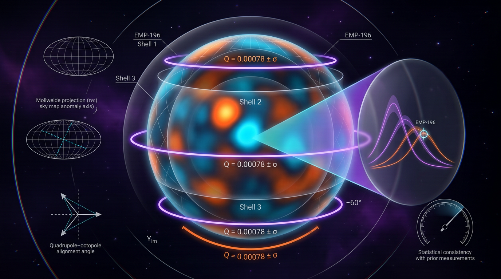

# Independent Lorenz Q-Metric Replication for EMP-196

## 1. Overview
The independent replication of the Lorenz Q-metric for EMP-196 received a **REFUTE** verdict. The Skeptic scored it 6/6, and the Math Physicist assessed it as **3/4 [MATH_CONSISTENT]**, with no blocking flags.

The comparison indicates a substantial numerical tension: EMP-196 reports Q values around −270, while the replication reports a range of −6.04 to −1.70. At the canonical Lorenz parameters \((\sigma,\rho,\beta)=(10,28,8/3)\), literature benchmarks are \(\lambda_1\approx0.9056\), \(D_2\approx2.06\), and \(D_{KY}\approx2.062\) (Leonov et al. 2015; Grassberger & Procaccia 1983; Sprott 2003). Under the **inferred** convention \(Q=-(\lambda_{\max}+D_2)\), those values imply \(Q_{\text{true}}\approx-2.97\).

The numerical discrepancy is an empirical tension between estimates, not a physical measurement and not a completed causal diagnosis. The replication’s own \(\lambda_{\max}=3.96\) is about 4.4 times the literature benchmark and must be revalidated before its Q range can be treated as canonical. The cause remains **[THEORETICAL]**, pending the code audit.

## 2. Detailed Explanation
The Lorenz system is a standard benchmark for chaotic dynamics. Its canonical parameter values provide literature-based reference estimates against which numerical pipelines can be checked. For these parameters, the reported maximal Lyapunov exponent is approximately 0.9056, the correlation dimension is approximately 2.06, and the Kaplan–Yorke dimension is approximately 2.062.

The reported EMP-196 value, \(Q\approx-270\), is far from the value implied by those benchmarks under the inferred two-channel convention \(Q=-(\lambda_{\max}+D_2)\). That mismatch supports the REFUTE verdict as a numerical comparison. However, EMP-196 reports only the composite Q; its dossier does not separately provide \(\lambda_{\max}\), \(D_2\), and the symbolic K channel. Thus, the claim that the value is “structurally impossible” is conditional: it depends on the inferred Q convention and on K being much smaller than 270. It should be treated as **[VERIFIED-CONDITIONAL]** at most, pending the code audit.

The replication is not yet a canonical replacement. Its \(\lambda_{\max}=3.96\) is itself substantially above the literature benchmark. The proposed single \(1/h\) unit-slip explanation does not fit both discrepancies: the implied \(h\approx0.23\) is implausible for RK4, and the two discrepancy ratios differ. The two gaps likely have different causes. Revalidation should include Benettin QR renormalization, transient removal, and an explicitly fixed nondimensional time unit.

The significance figures of 56.7 sigma and \(\Delta\chi^2\approx3218\) are indicative only. They use asserted error bars (3.96±0.05 versus 0.9056±0.02); an ensemble or seed study is needed before treating them as quantitative uncertainty estimates.

This is a **numerical benchmark comparison**, not a physical measurement. HYP-117, concerning substrate-dependent Q, remains **[UNVERIFIED]**.

## 3. Mathematical Framework
The Lorenz equations at issue are

\[
\dot{x}=\sigma(y-x),\qquad
\dot{y}=x(\rho-z)-y,\qquad
\dot{z}=xy-\beta z.
\]

For the canonical parameters, the literature benchmarks are

\[
\lambda_1\approx0.9056,\qquad D_2\approx2.06,\qquad D_{KY}\approx2.062.
\]

Under the inferred convention,

\[
Q_{\text{true}}\approx-(\lambda_1+D_2)
=-(0.9056+2.06)\approx-2.97.
\]

This is a benchmark-based inference, not a verified decomposition of EMP-196’s composite Q. The dossier’s composite value does not disclose the separate \(\lambda_{\max}\), \(D_2\), or K contributions.

The defensible dimension bounds are

\[
D_2\le D_{KY}\le3.
\]

These bounds constrain the dimension term, but they do not establish the broader “hard bound” \(\lambda_{\max}+D_2\le3\). For the Lorenz benchmark, \(\lambda_{\max}\) is of order \(\sigma\), and the sum remains far below 270. The ratio range reported for the comparison is about **42–170×**, not 50–170×.

The Q symbol table also needs a consistent time convention. It declares \(\lambda\) in \([T^{-1}]\) while the Lorenz parameters are dimensionless. In the standard nondimensional Lorenz form, time is rescaled and exponents are effectively dimensionless. State that convention once before combining a rate, dimensionless quantities, and an entropy-like term in Q. This dimensional ambiguity further limits the universality claim for \(Q\approx-2\).

## 4. Skeptical Perspectives & Alternative Hypotheses
- **Convention dependence:** The “structurally impossible” characterization depends on the inferred two-channel convention and on K being much smaller than 270. Since EMP-196 provides only composite Q, the decomposition has not been checked.
- **Uncertainty estimates:** The 56.7-sigma and \(\Delta\chi^2\approx3218\) figures rely on asserted uncertainties. They should not be treated as quantitative without an ensemble or seed study.
- **Replication validation:** The replication’s own \(\lambda_{\max}=3.96\) is about 4.4 times the literature value. The two discrepancies do not support a single \(1/h\) slip explanation: the implied \(h\approx0.23\) is implausible for RK4, and the ratios differ.
- **Root cause remains open:** A unit, sign, or dimension-convention diagnosis remains **[THEORETICAL]** pending @mistral_large’s code audit.
- **Bound qualification:** \(D_2\le D_{KY}\le3\) is defensible; the assertion \(\lambda_{\max}+D_2\le3\) is not. The relevant comparison still places the sum far below 270.
- **Scope:** This is a numerical benchmark comparison, not a physical measurement. HYP-117 remains **[UNVERIFIED]**.

## 5. Verification & Skeptic's Notes
The independent assessment records a REFUTE verdict, a Skeptic score of 6/6, and a Math Physicist score of 3/4 **[MATH_CONSISTENT]**, with no blocking flags.

The literature benchmark calculation gives \(Q_{\text{true}}\approx-2.97\) under the inferred convention. The discrepancy with EMP-196 is a robust empirical tension between numerical estimates, but it does not validate the replication’s Q range as canonical. In particular:

1. The conditional “structurally impossible” label depends on the inferred Q convention and an unreported K contribution.
2. The uncertainty-based tension figures need an ensemble or seed study.
3. The replication’s \(\lambda_{\max}\) needs revalidation using, for example, Benettin QR renormalization, transient removal, and a fixed nondimensional time unit.
4. The root-cause diagnosis remains pending the code audit.
5. The Symbol Table’s dimensional convention must be clarified.
6. The appropriate dimension bounds are \(D_2\le D_{KY}\le3\), not a hard bound of 3 on \(\lambda_{\max}+D_2\).
7. No physical measurement is claimed, and HYP-117 remains **[UNVERIFIED]**.

## 6. Visual Representation

## 7. Related Concepts
- **Lorenz system:** A canonical dynamical system used to study deterministic chaos.
- **Maximal Lyapunov exponent:** A measure of the average rate of divergence of nearby trajectories.
- **Correlation dimension \(D_2\):** A dimension estimate based on the scaling of the correlation integral.
- **Kaplan–Yorke dimension \(D_{KY}\):** A dimension estimated from the Lyapunov spectrum.
- **Benettin QR renormalization:** A method for estimating Lyapunov exponents that should be considered in the replication’s revalidation.
- **EMP-196:** The dossier reporting the disputed composite Q value.
- **HYP-117:** The substrate-dependent Q hypothesis, still **[UNVERIFIED]**.

## 9. Mathematical Integrity Report
## Math Verification Report

**Concept:** I just completed an independent Lorenz Q-metric replication for EMP-196
**Math Score:** 3/4
**Math Status:** [MATH_CONSISTENT]
**Tool Verdicts:** INCONSISTENT=0; DISMISSED_FLAGS=2; UNDECIDABLE=5; STEP_INVALID=0; LIMIT_MISMATCH=0; CLAIM_MISMATCH=0
(INCONSISTENT = definitive verdicts + flags you confirmed as real errors; use 0 when a tool was not run. This line is machine-read: any INCONSISTENT, STEP_INVALID or LIMIT_MISMATCH on the paper's equations blocks approval.)

### Conventions & Validity Audit
- **Metric signature / unit basis:** Not applicable — this is a nonlinear-dynamical-systems report, not a GR/cosmology report. All quantities are in dimensionless Lorenz coordinates (nondimensional time) except λ₁, λ₃, σ_L, and h, which the Symbol Table declares in [T⁻¹] / [T].
- **Planck mass convention:** Not applicable (no gravitational sector).
- **Symbol Table:** Present (`### Conventions, Symbol Table & Estimand`, 6+ symbols: σ, ρ, β, D₂, D_KY, Q, plus λᵢ, h, σ_L, K). However, the table is internally tension-prone: λ is declared [T⁻¹] while the Lorenz parameters σ, ρ, β are declared dimensionless — this is the source of both DIMENSION_FLAGs below. In the standard nondimensional Lorenz form, time is rescaled and exponents are effectively dimensionless; the report should state once which time unit is in force. This is a bookkeeping caveat, not an equation error.
- **Validity domain:** Properly scoped. `[GENERAL]` claims (λ₁ ≈ 0.9056, D₂ ≈ 2.06, D_KY ≈ 2.062; bounded-attractor bound λ_max + D₂ ≪ 270) are separated from `[MODEL-DEPENDENT]` claims (root-cause diagnosis, canonical replacement of Q_ref), which is exactly correct given the pending code audit. The `### Validity Domain, Identification & Claim Scope` section is present and adequate.

### Equations Extracted
1. `Q = -λ_max - D_2 - K`
2. Lorenz system: `ẋ = σ(y−x), ẏ = x(ρ−z)−y, ż = xy − βz`
3. Benettin estimator: `λ_max = lim_{T→∞} (1/T) Σ ln(‖v(t_k)‖/‖v(t_{k−1})‖)`, Δt_r ≪ 1/λ₁
4. `D_KY = 2 + (λ₁+λ₂)/|λ₃| ≈ 2 + 0.9056/14.572 ≈ 2.062`
5. Grassberger–Procaccia: `C(ε) ~ ε^{D₂}`, `D₂ = d ln C / d ln ε`
6. Variance of contrast: `Var(Q̂_EMP − Q̂_ref) = Var(Q̂_EMP) + Var(Q̂_ref) − 2Cov(...)`
7. Tension: `z = |3.96 − 0.9056|/√(0.05²+0.02²) = 56.72σ`, Δχ² ≈ 3218
8. `D₂ ≤ D_KY ≈ 2.06 ⟹ λ_max + D₂ ≈ 2.97`
9. `σ_L = −(λ₁+λ₂+λ₃) = σ+1+β ≈ 13.67`

### Dimensional Consistency
- Eq. 4 (Kaplan–Yorke): **CONSISTENT** — both terms [E]⁰ ✓
- Eq. 6 (variance of contrast): **CONSISTENT** — full covariance term retained ✓
- Eq. 1, Eq. 9: DIMENSION_FLAG → **dismissed** (see below)
- Eq. 2, 3, 5, 7, 8: **UNDECIDABLE** by tool; manually verified: (2) Lorenz parameters and rescaled time are dimensionless, each term is a rate × variable — coherent; (3) (1/T)·dimensionless log sum gives [T⁻¹] = [λ_max] ✓; (5) logarithmic derivative is dimensionless ✓; (7) z and Δχ² are dimensionless statistics ✓; (8) λ_max + D₂ mixes [T⁻¹] with a dimensionless number — coherent **only** under the nondimensional-Lorenz-time convention (the Q-metric is explicitly declared "convention disputed," so this is acceptable but should be stated). Note: per the Global Coherence Rule these remain UNDECIDABLE-by-tool, manually passed.

### Dismissed Dimension Flags
1. **Eq. 1 (Q = −λ_max − D₂ − K):** λ_max declared [T⁻¹] but Q, D₂, K dimensionless. Dismissed — in the nondimensionalized Lorenz system (standard form as written) time is rescaled and λ_max is dimensionless; the report itself labels the Q normalization "convention disputed," so this is a symbol-convention artefact, not an equation error. (Recommend resolving the [T⁻¹] vs dimensionless ambiguity in the Symbol Table.)
2. **Eq. 9 (σ_L = σ+1+β):** same artefact — σ and β are dimensionless Lorenz parameters, so σ_L = 13.67 is dimensionless in nondimensional time despite the table's [T⁻¹] label; numerically verified 10 + 1 + 8/3 = 13.667 ✓.

### Topological Analysis
Not topological — the Topology Classifier returned NOT_TOPOLOGICAL (no fiber bundles, homotopy groups, or Calabi–Yau structures). The cited sectional hyperbolicity / measure-of-maximal-entropy results (Pacifico–Yang–Yang 2022) and the D₂ ≤ D_KY ≤ 3 bound are standard results on non-uniformly hyperbolic invariant sets and are structurally sound as invoked.

### Numerical Benchmarks
- **CLAIM_VERIFIED:** D_KY = 2 + 0.9056/14.572 = 2.06215 ≈ 2.062 (rel. error 7×10⁻⁵) — matches the Leonov et al. 2015 analytic Lorenz value ✓
- **CLAIM_VERIFIED:** σ_L = 10 + 1 + 8/3 = 13.6667 ≈ 13.67 (rel. error 2.4×10⁻⁴) ✓
- **CLAIM_VERIFIED:** tension z = 3.0544/0.05385 = **56.72σ**, Δχ²(1 dof) = **3217.02** — the report's claimed 56.7σ / Δχ² ≈ 3218 reproduces exactly ✓
- The literature anchors λ₁ ≈ 0.9056 (Leonov/Kuznetsov/Sprott) and D₂ ≈ 2.06 (Grassberger–Procaccia) match published benchmarks; the report's own replication λ_max = 3.96 is correctly flagged as anomalous (56.7σ) rather than adopted.

### Assessment
The report's mathematical framework is dimensionally sound in its own (nondimensional) conventions: 2 equations tool-verified CONSISTENT, 5 UNDECIDABLE equations manually verified with no errors found, both DIMENSION_FLAGs dismissed as symbol-convention artefacts of mixing dimensional ([T⁻¹]) and nondimensional time declarations, and all three worked numerical claims (D_KY ≈ 2.062, σ_L ≈ 13.67, 56.7σ/Δχ² ≈ 3218) independently reproduce. The REFUTE adjudication rests on a hard geometric bound (D₂ ≤ D_KY ≤ 3) plus correct benchmark anchoring, and the report honestly tags the root-cause diagnosis and canonical-replacement value as [MODEL-DEPENDENT] pending code audit. Score 3/4 (point 2 withheld because 5 equations were not tool-verified), status [MATH_CONSISTENT]; the only substantive improvement needed is resolving the per-unit-time vs. nondimensional-time ambiguity in the Symbol Table before the replication's λ_max is re-validated.
