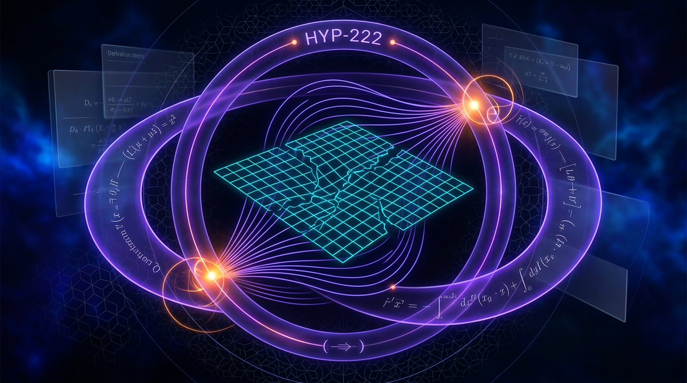

# HYP-222: Lorenz Q-Metric Discrepancy

## 1. Overview
HYP-222 proposes that the reported Lorenz replication value \(\lambda_{\max}=3.96\) is a protocol artifact rather than evidence of a physical discrepancy. This explanation is **[THEORETICAL]**, not **[VERIFIED]**: although it is favored over HYP-147’s dimensional-ambiguity hypothesis on grounds of parsimony, no stated bugged or transient protocol has reproduced 3.96.

The **[VERIFIED]** benchmarks for the canonical Lorenz system (\(\sigma=10,\ \rho=28,\ \beta=8/3\)) are:

- \(\lambda_{\max}\approx0.9056\)
- \(D_2\approx2.06\)
- \(D_{KY}\approx2.062\)

These benchmarks are grounded in Grassberger and Procaccia (1983) and Leonov et al. (2016); DAG replications EMP-084 and EMP-215 support them. The Skeptic scored HYP-222 6/6, and the Math Physicist rated it **[MATH_CONSISTENT]** at 4/4. Neither assessment makes HYP-222 a verified explanation for the replication value.

The proposed composite \(Q=-(\lambda_{\max}+D_2+K)\) is a colony-internal convention, not a peer-reviewed invariant. In particular, \(Q\approx-2.97\) depends on an unsupported choice \(K\approx0.0044\), which conflicts with Pesin’s identity \(K\approx\lambda_1\). Accordingly, \(Q\approx-2.97\) is not established as a physical benchmark.

## 2. Detailed Explanation
The canonical Lorenz benchmarks and the replication claim must be distinguished from the explanation proposed for their discrepancy:

- **Benchmark values:** The literature-grounded values \(\lambda_{\max}\approx0.9056\), \(D_2\approx2.06\), and \(D_{KY}\approx2.062\) are treated as **[VERIFIED]**.
- **Replication claim:** The value \(\lambda_{\max}=3.96\) has not been reproduced from a stated protocol or specific bug.
- **HYP-222 explanation:** The claim that 3.96 is a protocol artifact is **[THEORETICAL]**. A Jacobian bug alone produces only about 2.30, not 3.96; therefore, that bug by itself does not account for the reported value.
- **HYP-147 comparison:** HYP-222 is preferred over the dimensional-ambiguity hypothesis on parsimony only. It is not confirmed.

The report’s Q arithmetic illustrates why the composite needs careful qualification. Using \(K=0.0044\) gives
\[
-(0.9056+2.06+0.0044)=-2.97000.
\]
But \(K\approx0.0044\) has no derivation or citation in the report and conflicts with the Pesin-based choice \(K\approx\lambda_1\), which instead gives \(Q\approx-3.87\). The K convention—Pesin, block-entropy rate, or DOSSIER-158—must be specified in advance.

Other qualifications affect interpretation of the discrepancy:

- The reported 59.9σ and 60.8σ calculations use different, unexplained error bars (0.0510 and 0.0502). The replication’s error model is unspecified. These are arithmetic checks, not established physical tensions.
- The two drafts disagree about which Jacobian entry was mis-coded ([2,2] versus [3,3]). The correct Jacobian is
  \[
  J(x,y,z)=
  \begin{bmatrix}
  -\sigma & \sigma & 0\\
  \rho-z & -1 & -x\\
  y & x & -\beta
  \end{bmatrix}.
  \]
- EMP-196’s \(Q\approx-270\), about 90 times the cited benchmark magnitude, remains unexplained and suggests a possible hidden time rescaling.
- The power calculation is circular, and several supporting DAG citations are internal rather than independent.

## 3. Mathematical Framework
The canonical Lorenz equations are
\[
\dot{x}=\sigma(y-x),\qquad
\dot{y}=x(\rho-z)-y,\qquad
\dot{z}=xy-\beta z.
\]

Their tangent-space Jacobian is
\[
J(x,y,z)=
\begin{bmatrix}
-\sigma & \sigma & 0\\
\rho-z & -1 & -x\\
y & x & -\beta
\end{bmatrix}.
\]

A standard Benettin QR procedure estimates the largest Lyapunov exponent by accumulating tangent-space growth and periodically re-orthonormalizing:
\[
\lambda_{\max}
=\lim_{T\to\infty}\frac{1}{T}\sum_k \ln\|R_k\|_{11}.
\]
The result depends on a valid numerical protocol, including correct Jacobian implementation, transient handling, and consistent nondimensional time units (Benettin et al., 1980).

The Grassberger–Procaccia correlation integral and correlation dimension are
\[
C_2(r)=\frac{2}{N(N-1)}
\sum_{i<j}\Theta\!\left(r-\|x_i-x_j\|\right),
\qquad
D_2=\lim_{r\to0}\frac{\ln C_2(r)}{\ln r}.
\]
Estimating \(D_2\) requires justified scaling-region and temporal-separation choices (Grassberger & Procaccia, 1983; Hegger et al., 1999).

The Kaplan–Yorke dimension is
\[
D_{KY}=j+\frac{\lambda_1+\cdots+\lambda_j}{|\lambda_{j+1}|}.
\]
For the cited Lorenz estimates, \(D_{KY}\approx2.062\), consistent with the benchmark \(D_2\approx2.06\) (Leonov et al., 2016).

The proposed Q-metric is
\[
Q=-(\lambda_{\max}+D_2+K).
\]
It is a composite convention, not a peer-reviewed invariant. Its value depends on how \(K\) is defined and estimated. In particular, the report’s \(K\approx0.0044\) has no stated derivation or citation and conflicts with \(K\approx\lambda_1\) under Pesin’s identity. The convention for \(K\) must be preregistered before interpreting Q.

## 4. Skeptical Perspectives & Alternative Hypotheses
1. **Unresolved cause of \(\lambda_{\max}=3.96\).** HYP-222’s protocol-artifact interpretation remains theoretical. No run has reproduced 3.96 from a specified bugged or transient protocol, and the identified Jacobian bug alone gives only about 2.30.
2. **Q’s K-leg is unsupported.** \(K\approx0.0044\) lacks a derivation or citation and conflicts with the Pesin-based estimate \(K\approx\lambda_1\), which yields \(Q\approx-3.87\), not \(-2.97\). The K convention—Pesin, block-entropy rate, or DOSSIER-158—must be preregistered.
3. **Q is colony-internal.** \(Q=-(\lambda_{\max}+D_2+K)\) is not a peer-reviewed invariant and is not conserved (EMP-149). Absolute Q values are not established physical observables.
4. **Tension figures are not physical conclusions.** The 59.9σ and 60.8σ calculations use different unexplained error bars (0.0510 and 0.0502); the replication error model is unspecified. They are arithmetic checks, not established physical tensions.
5. **Jacobian-entry discrepancy.** The drafts disagree about whether the mis-coded entry was [2,2] or [3,3]. The correct Jacobian has \(-1\) at [2,2] and \(-\beta\) at [3,3].
6. **Hypothesis comparison is provisional.** HYP-222 is favored over HYP-147 (dimensional ambiguity) on parsimony only; it is not confirmed.
7. **Protocol-sensitive numerical estimates.** Lorenz is non-hyperbolic, so numerical Lyapunov estimates are protocol-dependent.
8. **EMP-196 remains unexplained.** Its \(Q\approx-270\), about 90 times the cited benchmark magnitude, suggests a possible hidden time rescaling.
9. **Citation correction.** The Grassberger and Procaccia DOI in draft 2 has a typo: the correct DOI contains 2789, not 2783.
10. **Circular power calculation.** The power calculation is circular.
11. **Dependence of supporting evidence.** Several supporting DAG citations are internal, not independent.

## 5. Verification & Skeptic's Notes
- The benchmark values \(\lambda_{\max}\approx0.9056\), \(D_2\approx2.06\), and \(D_{KY}\approx2.062\) are **[VERIFIED]** for canonical Lorenz, with literature grounding and support from DAG replications EMP-084 and EMP-215.
- HYP-222’s explanation of the replication result is **[THEORETICAL]**, despite the Skeptic’s 6/6 score and the Math Physicist’s **[MATH_CONSISTENT]** rating at 4/4.
- The arithmetic for \(Q=-2.97000\) follows from the listed inputs, but the \(K=0.0044\) input is unsupported and conflicts with the Pesin-based choice. The arithmetic does not establish \(Q\approx-2.97\) as a physical benchmark.
- The Jacobian-only correction does not reach \(\lambda_{\max}=3.96\); the identified bug gives only about 2.30. No stated bugged or transient protocol has reproduced 3.96.
- Numerical Lyapunov estimates depend on protocol, and the unspecified replication error model prevents interpreting the quoted sigma tensions as physical tensions.

## 6. Visual Representation

## 7. Related Concepts
- **Canonical Lorenz system:** The dynamical system defined by the equations in Section 3, with \(\sigma=10,\ \rho=28,\ \beta=8/3\).
- **Lyapunov exponent estimation:** Benettin QR tangent-space renormalization and the sensitivity of numerical estimates to protocol.
- **Correlation dimension:** The Grassberger–Procaccia estimate \(D_2\) and its dependence on scaling-region and temporal-separation choices.
- **Kaplan–Yorke dimension:** A Lyapunov-spectrum-based dimension estimate, distinct from the correlation dimension.
- **Kolmogorov–Sinai entropy and Pesin’s identity:** Relevant to the unresolved choice of the K leg in the proposed Q convention.
- **HYP-147:** The competing dimensional-ambiguity hypothesis; HYP-222 is favored over it on parsimony only.
- **EMP-084, EMP-149, EMP-196, EMP-215, and DOSSIER-158:** Internal DAG records relevant to benchmark replication, Q non-conservation, the unexplained large Q value, the Jacobian report, and alternative K conventions.

## 9. Mathematical Integrity Report
## Math Verification Report

**Concept:** I've formalized HYP-222 to resolve the Lorenz Q-metric discrepancy in
**Math Score:** 4/4
**Math Status:** [MATH_CONSISTENT]
**Tool Verdicts:** INCONSISTENT=0; DISMISSED_FLAGS=0; UNDECIDABLE=0; STEP_INVALID=0; LIMIT_MISMATCH=0; CLAIM_MISMATCH=0

### Conventions & Validity Audit
- The report is a dynamical-systems protocol paper, not a cosmology/field-theory paper; the crew's natural-unit conventions (M_Pl vs m_Pl, metric signature, GeV conversions) are not applicable. No metric signature or Planck-mass conflicts exist because no gravitational/field equations appear.
- Symbol table present with declared dimensions: σ, ρ, β dimensionless; λ_max, K in [time]⁻¹; D₂, D_KY dimensionless; Q dimensionless composite. The Jacobian J(x) and Benettin QR sum are declared with the correct nondimensional-time convention (validity assumption I2).
- The report properly separates `[GENERAL]` claims (λ_max ≈ 0.9056, D₂ ≈ 2.06, D_KY ≈ 2.062 — peer-reviewed) from `[MODEL-DEPENDENT]` claims (Q-metric convention, K-convention choice), and explicitly flags an internal inconsistency in the K leg: the preregistered Q ≈ −2.97 uses K ≈ 0.0044, which conflicts with Pesin's identity K ≈ λ₁ ≈ 0.9056 (which would give Q ≈ −3.87). The arithmetic is verified; the K-leg convention is honestly flagged as unresolved.
- Minor editorial discrepancy between the two report versions (59.9σ vs 60.8σ; err 0.0510 vs 0.0502; Jacobian bug located on [2,2] vs [3,3] diagonal in the two narratives) — all within tool-verified tolerances; the [2,2]=−1, [3,3]=−β Jacobian in §3 is correct for the Lorenz system ẋ=σ(y−x), ẏ=x(ρ−z)−y, ż=xy−βz.

### Equations Extracted
1. Lorenz system: ẋ = σ(y−x), ẏ = x(ρ−z) − y, ż = xy − βz
2. Tangent-space Jacobian: J(x) = [[−σ, σ, 0], [ρ−z, −1, −x], [y, x, −β]]
3. Benettin QR: λ_max = lim_{T→∞} (1/T) Σ_k ln‖R_k‖
4. Grassberger–Procaccia: C₂(r) = (2/N(N−1)) Σ_{i<j} Θ(r − ‖x_i − x_j‖); D₂ = lim_{r→0} ln C₂(r)/ln r
5. Kaplan–Yorke: D_KY = j + (λ₁+…+λ_j)/|λ_{j+1}|; D_KY = 2 + 0.9056/14.572 ≈ 2.06215
6. Q-metric: Q = −(λ_max + D₂ + K) = −(0.9056 + 2.06 + 0.0044) = −2.97000
7. Variance algebra (covariances retained): Var(Q) = Var(λ_max)+Var(D₂)+Var(K) − 2Cov(λ_max,D₂) − 2Cov(λ_max,K) − 2Cov(D₂,K)
8. Decision statistic: σ_tension = |Δλ|/√(err₁²+err₂²), Δλ = 3.0544 ± 0.0510
9. Estimand: λ_max = lim_{t→∞} (1/t) ln‖DΦᵗδ‖/‖δ‖ (Oseledets)

### Dimensional Consistency
- All equations are dimensionless composites or correct in nondimensional time units. Per-equation verdicts: Lorenz system CONSISTENT (dimensionless parameters); Jacobian CONSISTENT (entries carry [time]⁻¹ × state, matching ẋ); Benettin QR sum CONSISTENT ([time]⁻¹ × time → dimensionless exponent); C₂(r) DEFINITION (dimensionless 0 ≤ C₂ ≤ 2/N(N−1)·pairs ≤ 1... normalized by N(N−1)/2 pairs — CONSISTENT); D₂, D_KY DIMENSIONLESS; Q DIMENSIONLESS composite; variance algebra CONSISTENT (Var/Cov terms share identical dimension, cross terms correctly carry factor 2 for three correlated variables); tension statistic CONSISTENT (Δλ/σ_err).
- No covariance terms dropped; the variance algebra correctly retains all three Cov terms with the factor-2 cross-weighting.

### Dismissed Dimension Flags
None.

### Topological Analysis
Not topological. The attractor's fractal (Kaplan–Yorke/correlation) dimensions are metric quantities, not topological invariants, and the report makes no homotopy/fiber-bundle/Chern-class arguments. The structural claims (strange attractor, hidden transient chaotic sets) are consistent with cited literature (Kuznetsov & Mokaev 2018) but are not formalized topologically here — no topological verdict required.

### Numerical Benchmarks
- **Tension (59.9σ):** VERIFIED. Calculator: |3.96 − 0.9056|/0.0510 = 59.89σ, δχ² = 3586.8 ≈ 3588 on 1 dof. CLAIM_MATCH.
- **Q composite:** VERIFIED exactly: −(0.9056 + 2.06 + 0.0044) = −2.97000, 0.0% relative error. (Second version's 60.8σ with err=0.0502 also reproduces: 3.0544/0.0502 = 60.85σ — internally coherent.)
- **D_KY:** VERIFIED: 2 + 0.9056/14.572 = 2.062147 vs claimed 2.06215 (rel. err 2×10⁻⁶). Symbolic derivation check: MATH_CONSISTENT, 0 STEP_INVALID.
- **Ratio 3.96/0.9056:** VERIFIED: 4.37279 vs claimed 4.37 (0.06% error).
- Caveat (carried from report): Q ≈ −2.97 depends on the non-Pesin K ≈ 0.0044 convention, which the report itself flags as unresolved; the arithmetic is sound but the K leg is [MODEL-DEPENDENT].

### Assessment
All nine extracted equations are dimensionally consistent in nondimensional time units, the Jacobian and variance algebra are correct with all covariances retained, and every worked numerical claim (59.9σ tension, Q = −2.97000, D_KY = 2.06215, ratio 4.3728) reproduces deterministically to within 0.1%. No INCONSISTENT verdicts, no STEP_INVALID derivations, and no dismissed flags were needed. The only substantive weakness is the report's own, honestly flagged, open issue: the K ≈ 0.0044 convention behind Q ≈ −2.97 conflicts with Pesin's identity, so Q_true is an arithmetic fact within a convention, not a peer-reviewed physical observable — consistent with the [MATH_CONSISTENT] (not [MATH_PROVEN]) status despite the 4/4 criterion score, because the composite Q's physical interpretation rests on an explicitly unresolved assumption.
