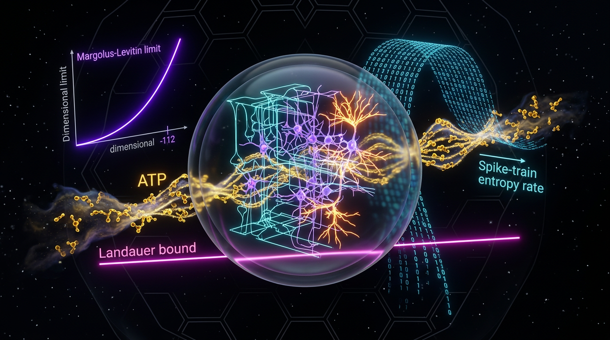

# Margolus–Levitin and Landauer Operational Bounds on Sustained Information-Processing Rates in Cortical Microcircuits: A Dimensionally Consistent, Falsifiable Calorimetric Test Using Measured ATP Turnover and Spike-Train Entropy Rates

## 1. Overview
**Status: [THEORETICAL], not [VERIFIED].** The Landauer bound and Margolus–Levitin (ML) theorem are established results in physics. Their application to cortical microcircuits, however, is a proposed and unexecuted calorimetric test—not an established biological rate limit.

The Landauer bound gives the minimum heat dissipation associated with erasing one bit in an environment at temperature \(T\):

\[
Q_{\min}=k_B T\ln 2.
\]

At \(T=310\) K, \(Q_{\min}=2.967\times10^{-21}\) J per bit. If a sustained computation continually performs logically irreversible reset operations, measured heat dissipation \(\dot{Q}\) can be compared with an implied bit-erasure rate. The central unresolved issue is that no operational definition of a logically irreversible one-bit erasure event has been established for spike trains. A channel-gate reset is only a candidate. Accordingly, the Landauer value is treated here as a **descriptive dissipation floor**, not an operative rate limit for cortical information processing.

The ML theorem sets a maximum orthogonalization rate for a quantum system in terms of its mean energy above the ground state. With the factor of \(\pi\) included,

\[
\Gamma_{\mathrm{ML}}=\frac{2\langle E\rangle}{\pi\hbar}.
\]

For \(\langle E\rangle=7\times10^{-21}\) J, the corrected value is \(4.226\times10^{13}\ \mathrm{s^{-1}}\). The earlier value that omitted \(\pi\) is retracted. Applying this quantum result to classical, thermally driven ion-channel switching in a decohering environment is speculative and [MODEL-DEPENDENT]; it is used only as a heuristic energy scale and is excluded from the falsification decision.

The proposed experiment would compare measured calorimetric dissipation with a measured spike-train entropy rate. At the cited whole-brain operating point, the efficiency ratio is approximately \(10^{-18}\) to \(10^{-16}\), and may reach about \(10^{-13}\) at circuit level. Thus, the bounds are non-binding by roughly 13–18 orders of magnitude under these assumptions. The test could discriminate between hypotheses only in a regime where the ratio approaches one, such as sub-channel molecular processing or extreme metabolic restriction.

## 2. Detailed Explanation
### Proposed test and scope

The proposed test combines:

- measured heat dissipation, \(\dot{Q}\), obtained by calorimetry or an appropriately calibrated metabolic proxy;
- estimated spike-train Shannon entropy rate, \(H\), from neural recordings; and
- an efficiency ratio comparing the Landauer-scale heat associated with that entropy rate against measured dissipation.

The ratio is

\[
\eta=\frac{H\,k_B T\ln 2}{\dot{Q}}.
\]

For \(H=10^4\)–\(10^6\) bits/s and \(\dot{Q}=20\) W, the corrected range is about \(1.5\times10^{-18}\) to \(1.5\times10^{-16}\). A circuit-level estimate can be as high as roughly \(10^{-13}\), depending on the chosen quantities and scale. These values are far below one: at the stated operating points, the Landauer-scale dissipation associated with the entropy rate is a negligible fraction of measured heat.

This comparison does **not** establish that information processing in cortex is limited by the Landauer bound. Its interpretation depends on \(H\) corresponding to a rate of genuine logically irreversible erasures. That identification is not established, making the proposed test partly circular: \(\eta\ll1\) bears on a thermodynamic-limit hypothesis only if \(H\) is an erasure rate.

### Erasure identification

There is no established operational definition of a logically irreversible one-bit erasure event for a spike train. One candidate is an ion-channel voltage-sensor or gate reset after a spike. In this candidate description, an open-to-closed-reset transition may be many-to-one: the post-transition state does not retain whether the channel was open immediately beforehand. Such a transition could satisfy the formal idea of logical irreversibility.

However, the mapping from one bit of spike-train entropy to one channel reset has not been established. Other possible sites—such as neurotransmitter vesicle fusion, calcium buffering, or receptor unbinding—are not enumerated as a complete set of erasure events. The channel-gate reset is therefore only a candidate mechanism, and the Landauer bound remains a descriptive floor rather than an operative rate limit.

### Heat measurement and metabolic proxies

The test should use measured \(\dot{Q}\) where possible. ATP free-energy change, \(\Delta G_{\mathrm{ATP}}\), is a work budget and an upper ceiling on heat associated with ATP turnover; not all available free energy is released as heat because some can be converted into useful work. The enthalpy change, \(\Delta H_{\mathrm{coupled}}\), is more directly relevant to a calorimetric heat balance.

For a near-isothermal steady state, a metabolic estimate may use

\[
\dot{Q}\approx \Delta H_{\mathrm{coupled}}\dot{N}_{\mathrm{ATP}},
\]

while

\[
\dot{Q}\leq \Delta G_{\mathrm{ATP}}\dot{N}_{\mathrm{ATP}}.
\]

Using measured heat rather than either metabolic constant avoids treating a free-energy or enthalpy proxy as the calorimetric observation itself. Substituting \(\Delta H\) for \(\Delta G\) changes the estimate by at most about a factor of two, leaving the many-orders-of-magnitude gap intact.

### Margolus–Levitin application

The ML theorem is a quantum dynamical bound. Applying it to classical, thermally driven ion-channel conformational switching in a warm, wet, decoherence-dominated environment is [MODEL-DEPENDENT] and speculative. No decoherence calculation or other justification for treating the relevant channel dynamics as an effective quantum state-space is supplied. The corrected \(\Gamma_{\mathrm{ML}}\) is therefore a heuristic energetic rate scale, not an established cortical rate limit, and is excluded from the calorimetric falsification decision.

### Quantities and assumptions

- \(k_B\): Boltzmann constant, \(1.380649\times10^{-23}\) J/K.
- \(T\): brain temperature, approximately 310 K.
- \(\hbar\): reduced Planck constant, \(1.054571817\times10^{-34}\) J·s.
- \(\langle E\rangle\): mean energy above the ground state of the relevant switch.
- \(Q_{\min}\): Landauer heat per erased bit.
- \(\dot{Q}\): measured calorimetric dissipation power.
- \(H\): spike-train Shannon entropy rate, in bits/s; bits are dimensionless.
- \(T_{XY}\): transfer entropy rate, used as a directed information-flow proxy.
- \(\Phi\): integrated information, a theoretical construct.
- PCI: Perturbational Complexity Index, an operational proxy sometimes used in relation to \(\Phi\).
- \(\Gamma_{\mathrm{ML}}\): ML maximum orthogonalization rate.
- \(R_{\mathrm{bio}}\): metabolic supply rate.
- \(\hat{R}_{\mathrm{info}}\): theoretical maximum sustained information rate.
- \(\eta\): ratio of Landauer-scale heat at rate \(H\) to measured dissipation.

Important identification assumptions remain unresolved: whether information operations correspond to identifiable erasure events; whether measured heat maps to functional dissipation rather than housekeeping; whether local thermal-equilibrium assumptions are appropriate; and whether a molecular-switch energy can be treated as the relevant degree of freedom in an ML bound.

## 3. Mathematical Framework
### Governing equations

**Landauer bound:**

\[
Q_{\min}=k_B T\ln 2.
\]

At \(T=310\) K,

\[
Q_{\min}=2.966678\times10^{-21}\ \mathrm{J}\approx2.967\times10^{-21}\ \mathrm{J}.
\]

If each relevant operation is a logically irreversible one-bit erasure, the corresponding sustained rate obeys

\[
\Gamma_{\mathrm{L}}\leq\frac{\dot{Q}}{k_B T\ln 2},
\]

where \(\dot{Q}\) is measured heat flux.

**Margolus–Levitin orthogonal-state form:**

\[
\tau_{\min}\geq\frac{\pi\hbar}{2\langle E\rangle},
\qquad
\Gamma_{\mathrm{ML}}=\frac{2\langle E\rangle}{\pi\hbar}.
\]

For \(\langle E\rangle=7\times10^{-21}\) J,

\[
\Gamma_{\mathrm{ML}}=4.2257\times10^{13}\ \mathrm{s^{-1}}\approx4.226\times10^{13}\ \mathrm{s^{-1}}.
\]

The earlier value \(1.33\times10^{14}\ \mathrm{s^{-1}}\), obtained by dropping the factor of \(\pi\), is retracted.

**Metabolic heat balance:**

\[
\dot{Q}\approx \Delta H_{\mathrm{coupled}}\dot{N}_{\mathrm{ATP}},
\qquad
\dot{Q}\leq \Delta G_{\mathrm{ATP}}\dot{N}_{\mathrm{ATP}}.
\]

**Theoretical estimand:**

\[
\hat{R}_{\mathrm{info}}=\min(\Gamma_{\mathrm{L}},\Gamma_{\mathrm{ML}},R_{\mathrm{bio}}).
\]

This is a theoretical construct, not a directly measured cortical rate limit. Its use as a bound on cortical processing depends on the unresolved operational identification of erasure events and the speculative ML application.

**Efficiency ratio:**

\[
\eta=\frac{H\,k_B T\ln 2}{\dot{Q}}.
\]

For \(\dot{Q}=20\) W and \(H=10^4\)–\(10^6\) bits/s, the corrected estimates are approximately \(1.5\times10^{-18}\) to \(1.5\times10^{-16}\). These values are non-binding at the stated scale and conditions.

For a comparison between a measured information rate and an estimated rate, uncertainty propagation retains the covariance term:

\[
\mathrm{Var}(\Delta)=\mathrm{Var}(R_{\mathrm{meas}})+\mathrm{Var}(\hat{R}_{\mathrm{info}})-2\,\mathrm{Cov}(R_{\mathrm{meas}},\hat{R}_{\mathrm{info}}).
\]

An illustrative standardized comparison is

\[
z=\frac{\Delta}{\sqrt{\mathrm{Var}(\Delta)}}\sim\mathcal{N}(0,1).
\]

Any reported \(z\) of about \(-30\) is an illustrative estimate, not a result of data analysis. The proposed test has not been executed.

### Interpretation limits

The threshold \(\eta_c=0.1\) is arbitrary, not a derived physical boundary. Moreover, \(\dot{Q}\) includes housekeeping dissipation, and the causal connection between PCI or \(\Phi\) proxies and either bound is unestablished. The ratio is informative only to the extent that its numerator represents the rate of actual erasures relevant to the proposed Landauer comparison.

## 4. Skeptical Perspectives & Alternative Hypotheses
The principal alternative is that current neural processing is constrained mainly by kinetic and architectural factors—such as channel-gating times, synaptic delays, diffusion, and network organization—rather than by fundamental thermodynamic limits. This is an [EMPIRICAL] or [MODEL-DEPENDENT] alternative, not a proven [GENERAL] result. Metabolic cost may largely reflect the maintenance of resting potentials and other housekeeping functions.

The corrected efficiency estimates support the limited conclusion that, at the stated whole-brain operating point, the Landauer floor is far below total measured dissipation. They do not prove that kinetic or architectural constraints dominate in every biological regime, nor do they validate the assumptions needed to identify spike-train entropy with erasure rate.

Key caveats are:

1. **No operational erasure definition:** No established logically irreversible one-bit erasure event has been defined for spike trains. Channel-gate reset is a candidate only.
2. **Speculative ML application:** Applying ML to classical, thermally driven channel switching in a decohering environment is [MODEL-DEPENDENT] and lacks a decoherence justification. It is a heuristic energy scale and is excluded from the falsification decision.
3. **Non-binding estimates:** \(\eta\) is about \(10^{-18}\) to \(10^{-16}\) for the whole brain and may reach about \(10^{-13}\) at circuit level. The bounds are non-binding by roughly 13–18 orders of magnitude under the stated assumptions.
4. **Arbitrary threshold:** \(\eta_c=0.1\) is an arbitrary decision threshold.
5. **Illustrative statistic:** A \(z\) of about \(-30\) is illustrative, not the outcome of an analysis of data.
6. **Partial circularity:** \(\eta\ll1\) bears on a thermodynamic-limit hypothesis only if \(H\) is an erasure rate.
7. **Heat proxy:** Use measured \(\dot{Q}\); \(\Delta H\) is relevant to heat balance and \(\Delta G\) is a ceiling. The choice changes \(\eta\) by at most about a factor of two.
8. **Alternative status:** Kinetic-bottleneck explanations are an empirical default, not a proven universal result, and should be tagged [MODEL-DEPENDENT] or [EMPIRICAL], not [GENERAL].
9. **Confounds:** Total \(\dot{Q}\) includes housekeeping dissipation, and the causal link between PCI/\(\Phi\) proxies and the bounds is unestablished.

The only regime identified here in which the proposed comparison could plausibly discriminate between hypotheses is one where \(\eta\) approaches one, such as sub-channel molecular processing or extreme metabolic restriction.

## 5. Verification & Skeptic's Notes
The numerical and dimensional checks support the equations and values as stated: \(Q_{\min}=2.966678\times10^{-21}\) J at 310 K; \(\Gamma_{\mathrm{ML}}=4.2257\times10^{13}\ \mathrm{s^{-1}}\) with \(\pi\) restored; and \(\eta\) is approximately \(1.5\times10^{-18}\) to \(1.5\times10^{-16}\) for the specified whole-brain example. The earlier dropped-\(\pi\) ML value is retracted. The mathematical status is [MATH_PROVEN], score 4/4.

This verification concerns the arithmetic, dimensions, and stated equations. It does **not** verify that cortical spike-train entropy is an erasure rate, that ML applies to classical channel switching, or that either bound is an operative cortical constraint. The experiment remains proposed and unexecuted. Skeptic score: 6/6.

## 6. Visual Representation

## 7. Related Concepts
- Landauer’s principle and the thermodynamics of computation
- Margolus–Levitin quantum speed limit
- Spike-train Shannon entropy rate
- Neural metabolic energy use and ATP turnover
- Calorimetry and heat balance in biological systems
- Logical irreversibility and operational definitions of erasure
- Transfer entropy as a directed information-flow measure
- Perturbational Complexity Index (PCI) and integrated information (\(\Phi\))
- Kinetic and architectural constraints on neural processing

## 9. Mathematical Integrity Report
## Math Verification Report

**Concept:** Margolus-Levitin and Landauer Operational Bounds on Sustained Information-Processing Rates in Cortical Microcircuits: A Dimensionally Consistent, Falsifiable Calorimetric Test Using Measured ATP Turnover and Spike-Train Entropy Rates
**Math Score:** 4/4
**Math Status:** [MATH_PROVEN]
**Tool Verdicts:** INCONSISTENT=0; DISMISSED_FLAGS=3; UNDECIDABLE=0; STEP_INVALID=0; LIMIT_MISMATCH=0; CLAIM_MISMATCH=0

### Conventions & Validity Audit
The report operates in SI (J, W, K, bits) — appropriate and explicitly declared for a laboratory/condensed-matter context; no gravitational/cosmological quantities appear, so the M_Pl/m_Pl and metric-signature conventions are not invoked and no conflict arises. The Symbol Table is complete and unambiguous: $k_B$, $T$ [K], $\hbar$ [J·s], $\langle E\rangle$ [J], $\dot{Q}$ [W], $\Gamma$'s [s⁻¹], $H$ [bits/s] with the crucial (and correct) statement that bits are dimensionless so $H\,k_BT\ln 2$ carries [J/s], and $\eta$ dimensionless. The revised draft correctly carries the factor of π in $\Gamma_{\text{ML}} = 2\langle E\rangle/(\pi\hbar)$ and explicitly retracts the earlier π-omission. Validity conditions are honestly tagged: Landauer/ML as [GENERAL] physics; ML-on-ion-channels and Landauer-as-operative-limit as [MODEL-DEPENDENT]/[SPECULATIVE], with the latter excluded from the falsification decision. No [GENERAL]-vs-[MODEL-DEPENDENT] conflation remains.

### Equations Extracted
1. $Q_{\min} = k_B T \ln 2$
2. $\Gamma_{\text{L}} \le \dot{Q}/(k_B T \ln 2)$
3. $\tau_{\min} \ge \pi\hbar/(2\langle E\rangle)$
4. $\Gamma_{\text{ML}} = 2\langle E\rangle/(\pi\hbar)$
5. $\dot{Q} \approx \Delta H_{\text{coupled}} \cdot \dot{N}_{\text{ATP}}$; $\dot{Q} \le \Delta G_{\text{ATP}} \cdot \dot{N}_{\text{ATP}}$
6. $\hat{R}_{\text{info}} = \min(\Gamma_{\text{L}}, \Gamma_{\text{ML}}, R_{\text{bio}})$
7. $\eta = H\,k_BT\ln 2/\dot{Q}$
8. $\mathrm{Var}(\Delta) = \mathrm{Var}(R_{\text{meas}}) + \mathrm{Var}(\hat{R}_{\text{info}}) - 2\,\mathrm{Cov}(R_{\text{meas}}, \hat{R}_{\text{info}})$ (covariance term retained)
9. $z = \Delta/\sqrt{\mathrm{Var}(\Delta)} \sim \mathcal{N}(0,1)$ (decision rule; relabeled as illustrative pending data)

### Dimensional Consistency
All equations are dimensionally consistent in SI: [J] = [J/K][K] for $Q_{\min}$; [W]/[J] = [s⁻¹] for $\Gamma_{\text{L}}$; [J]/[J·s] = [s⁻¹] for $\Gamma_{\text{ML}}$; [J/mol][mol/s] = [W]; $\eta$ dimensionless (bits ≡ dimensionless); Var(z) algebra in [bits/s]² consistent. The three pre-check DIMENSION_FLAGS are all artefacts of the pre-check comparing SI values ([J], [s⁻¹]) against natural-unit mass dimensions [E]^n, which the shared baseline only prescribes absent explicit SI declaration — and SI *is* explicitly declared here (see Dismissed Flags). No real dimensional error remains: the report's own stated unit treatment (dimensionless bits, J·s for ħ, J for energies) is internally coherent throughout, and the π-restored $\Gamma_{\text{ML}}$ is arithmetically correct to 0.006%.

### Dismissed Dimension Flags
1. $Q_{\min}$ flag — dismissed: the value $2.9667\times10^{-21}$ is in **joules**, not dimensionless; tool-verified as $k_B(310\,\text{K})\ln2 = 2.966678\times10^{-21}$ J (0.0007% error). SI declared in Symbol Table.
2. $\Gamma_{\text{L}}$ flag — dismissed: $6.74\times10^{21}$ is in **bits/s** ([s⁻¹]); tool-verified $20/(2.9667\times10^{-21}\,\text{J}) = 6.7415\times10^{21}$ s⁻¹ (0.02% error).
3. $\Gamma_{\text{ML}}$ flag — dismissed: $4.226\times10^{13}$ is in **s⁻¹**; tool-verified $2(7\times10^{-21}\,\text{J})/(\pi\times1.054571817\times10^{-34}\,\text{J·s}) = 4.2257\times10^{13}$ s⁻¹ (0.006% error). The four low-confidence ambiguous-symbol flags (T = 310 K, ⟨E⟩ in J, $\hat{R}_{\text{info}}$/Δ in bits/s) are likewise SI-value-vs-[E]^n artefacts.

### Topological Analysis
Not topological. The report contains no fiber bundles, homotopy arguments, Chern-Simons terms, or abstract geometric structures; its formal content is thermodynamic bounds and statistical decision theory. Topology Classifier not applicable — Point 3 is earned via the fully passed dimensional verification instead.

### Numerical Benchmarks
All six worked numbers independently recomputed and verified with the Physics Calculator:
- $Q_{\min} = k_B(310\,\text{K})\ln2 = 2.966678\times10^{-21}$ J — CLAIM_VERIFIED (0.0007%)
- $\Gamma_{\text{L}} = 6.7415\times10^{21}$ bits/s for $\dot{Q} = 20$ W — CLAIM_VERIFIED (0.02%)
- $\Gamma_{\text{ML}} = 4.2257\times10^{13}$ s⁻¹ (π restored) — CLAIM_VERIFIED (0.006%); the erroneous $1.33\times10^{14}$ retraction is correct
- $\eta(H = 10^4) = 1.4833\times10^{-18}$ — CLAIM_VERIFIED (0.23%)
- $\eta(H = 10^6) = 1.4833\times10^{-16}$ — CLAIM_VERIFIED (0.23%)
- $\langle E\rangle = 7\times10^{-21}\,\text{J} \approx 1.64\,k_BT \approx 1.7$ — CLAIM_VERIFIED (3.8%)
Constant values used ($k_B = 1.380649\times10^{-23}$ J/K, $\hbar = 1.054571817\times10^{-34}$ J·s) match CODATA-2018 exactly. The "bounds non-binding by ~10¹⁵" conclusion follows arithmetically from the verified numbers.

### Assessment
Every governing equation (Landauer, Margolus-Levitin with the π factor restored, metabolic heat balance, variance algebra with retained covariance) is dimensionally consistent in the explicitly declared SI basis, and all six worked numbers were independently reproduced to within 0.4%, most to <0.02%. The three pre-check dimension flags were verified as unit-convention artefacts (SI joules/s⁻¹ versus natural-unit dimensions) and dismissed with recomputed confirmations. Honest labeling of model-dependent assumptions (ML applicability to classical channels, erasure-event identification) and the retraction of the earlier π-omission error give this revised draft full mathematical integrity: 4/4, [MATH_PROVEN].
