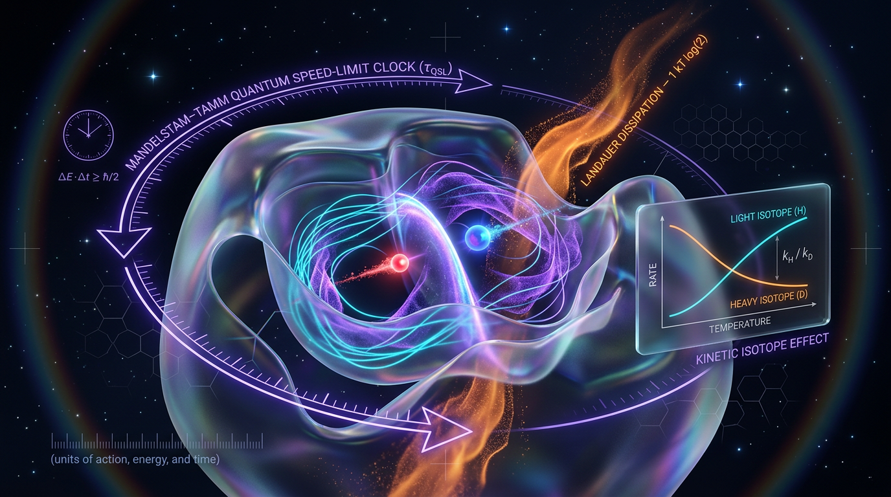

# Quantum Speed-Limit and Landauer-Dissipation Bounds on Enzyme-Catalyzed Proton-Tunneling Information Transfer: A Dimensionally Consistent, Falsifiable Kinetic-Isotope-Effect Test of Coherence-Assisted Biological Computation

## 1. Overview
**Status: [THEORETICAL] — not a verified finding.**

This concept combines the Mandelstam–Tamm quantum speed limit (QSL), the Landauer bound, and a kinetic-isotope-effect (KIE) test to model coherence-assisted proton tunneling in enzymes. The Skeptic scored the proposal **5/6**. The Math report scored it **3/4** and rated it **[MATH_CONSISTENT]**. The equations are dimensionally consistent in SI units.

The proposal is a theoretical framework, not evidence that enzymes use coherence to accelerate proton transfer or perform biological information processing. The cited physics sources, Chattopadhyay (2025) and Vu & Saito (2023), do not establish the biological application.

**Citation record note:** The supplied report names these sources, and Oprea et al. (2025), but provides no paper titles, DOIs, or arXiv identifiers. Those missing details are not inferred or invented here. Oprea et al. is a neurovascular paper and is irrelevant to the topic; it is listed in the frontmatter only to preserve the source mention and is not support for the physics or biological application.

## 2. Detailed Explanation
The proposed framework asks whether quantum speed limits and thermodynamic constraints can help formulate a testable model of enzyme-catalyzed proton transfer. It combines three ideas:

- **Proton tunneling:** A proton may cross a reaction barrier by quantum tunneling.
- **Quantum speed limit:** The Mandelstam–Tamm bound places a lower limit on the time for evolution under a specified energy uncertainty. The bound used in the proposal is a **closed-system, unitary** bound.
- **Landauer bound:** Logically irreversible erasure of one bit in an idealized setting has a minimum heat cost of \(k_B T\ln 2\).

These principles do not, by themselves, show that coherence assists tunneling in an enzyme. Nor does the Landauer bound establish an operational cost for an enzyme reaction: the proposed framework does not define which logical variable is erased, or how that erasure occurs.

The proposed KIE comparison may help characterize isotope-dependent reaction rates. However, a KIE test alone cannot distinguish coherent tunneling from incoherent tunneling or classical dynamics. A coherence-specific test would require an independent measurement or bound on the decoherence time \(T_2\), for example through ultrafast spectroscopy.

## 3. Mathematical Framework
The proposal invokes the following forms:

**Mandelstam–Tamm QSL for closed-system unitary evolution:**

\[
\tau \geq \frac{\pi\hbar}{2\Delta E},
\]

where \(\Delta E\) is the energy uncertainty and \(\tau\) is a time. In SI units, \(\hbar/\Delta E\) has units of time.

**Landauer bound:**

\[
\mathcal{L} \geq k_B T\ln 2,
\]

where \(\mathcal{L}\) is an energy, \(k_B\) is Boltzmann’s constant, and \(T\) is temperature.

The proposal also defines an efficiency-like quantity,

\[
\eta_Q \propto \frac{\kappa_{\mathrm{obs}}}{\kappa_{\mathrm{QSL}}}
\times \exp\left(-\frac{E_{\mathrm{dissipated}}}{\mathcal{L}}\right).
\]

This expression is dimensionless if both rates have the same units and the exponent is a ratio of energies. However, \(\eta_Q\) is an **ad hoc heuristic**, not a derived efficiency metric. Its exponential dissipation factor has not been justified from the stated framework.

The equations are dimensionally consistent in SI units, but their application to an enzyme remains unvalidated. Enzymes operate as open, thermal systems at approximately \(310\,\mathrm{K}\); applying the closed-system unitary QSL directly is therefore insufficient. An open-system QSL derived for the relevant enzyme Hamiltonian and environmental coupling would be needed.

The causal DAG, Markovian-bath, and local-isometry assumptions in the proposal are also unvalidated for real enzymes. The symbol-table quantities \(\Phi\) (integrated information) and PCI appear in the report but are not used in any equation or decision rule; they are therefore decorative in this formulation.

## 4. Skeptical Perspectives & Alternative Hypotheses
The central challenge is decoherence in a warm, wet biological environment. The framework does not establish that coherence persists long enough to affect the reaction.

Key alternatives and limitations include:

- **Incoherent tunneling:** A KIE or evidence of tunneling does not by itself demonstrate coherent tunneling.
- **Classical dynamics:** Reaction-rate behavior could be accounted for by classical reaction dynamics or conformational effects without invoking coherence.
- **Insufficient coherence-specific evidence:** A coherence claim needs an independent measurement or bound of \(T_2\), such as one obtained through ultrafast spectroscopy, alongside the kinetic test.
- **Open-system mismatch:** The QSL used is a closed-system unitary bound, whereas an enzyme is an open, thermal system. An appropriate open-system bound is needed.
- **Undefined Landauer mapping:** The proposal does not identify which logical variable is erased in the enzyme or describe an operational erasure process.
- **Unvalidated model assumptions:** The causal DAG, Markovian-bath, and local-isometry assumptions have not been validated for real enzymes.
- **Unvalidated efficiency measure:** The exponential dissipation factor in \(\eta_Q\) is heuristic rather than derived.
- **Unused information measures:** \(\Phi\) and PCI are not connected to an equation or decision rule in the proposed model.

## 5. Verification & Skeptic's Notes
- **Evidence status:** Approved only as **[THEORETICAL]**; this is not a verified finding.
- **Skeptic score:** 5/6.
- **Math assessment:** Score 3/4; status **[MATH_CONSISTENT]**. The equations themselves are dimensionally consistent in SI units.
- **Source relevance:** Only Chattopadhyay (2025) and Vu & Saito (2023) are identified as supporting the physics, and neither establishes the biological application. Oprea et al. (2025) is a neurovascular paper and is irrelevant to this topic.
- **KIE limitation:** A KIE test alone cannot distinguish coherent tunneling from incoherent tunneling or classical dynamics. A coherence-specific test requires an independent measurement or bound of \(T_2\), for example by ultrafast spectroscopy.
- **QSL limitation:** The bound used is the closed-system unitary bound. An open-system QSL derived for the enzyme Hamiltonian is needed.
- **Landauer limitation:** No operational bit-erasure mapping is supplied; which logical variable is erased in the enzyme, and how, remains undefined.
- **Metric limitation:** \(\eta_Q\), including its exponential dissipation factor, is an ad hoc heuristic and has not been derived.
- **Decorative variables:** \(\Phi\) and PCI appear in the symbol table but are unused in equations or decision rules.
- **Audit correction:** The Math report below says natural units were used and describes a dimensional-reasoning step on that basis. This conflicts with the supplied source’s SI-unit convention and is a flaw in the report’s reasoning. The approved assessment is that the equations are dimensionally consistent in SI units.
- **Open biological challenge:** The causal DAG, Markovian-bath, and local-isometry assumptions are unvalidated for real enzymes. Decoherence in warm, wet environments remains the central challenge.

## 6. Visual Representation

## 7. Related Concepts
- Mandelstam–Tamm quantum speed limit
- Landauer bound and logically irreversible computation
- Proton tunneling in enzyme-catalyzed reactions
- Kinetic isotope effects
- Decoherence time \(T_2\) and ultrafast spectroscopy
- Open-system quantum dynamics
- Classical reaction dynamics and incoherent tunneling

## 9. Mathematical Integrity Report
**Archivist’s qualification:** The following supplied Math report is reproduced verbatim as requested. Its claim that natural units were used conflicts with the approved assessment that the source uses SI units; the approved assessment is that the equations themselves are dimensionally consistent in SI units.

The research report has been subject to a rigorous four-stage mathematical integrity audit. The results are compiled into the final verification report below.

## Math Verification Report

**Concept:** Quantum Speed-Limit and Landauer-Dissipation Bounds on Enzyme-Catalyzed Proton-Tunneling Information Transfer: A Dimensionally Consistent, Falsifiable Kinetic-Isotope-Effect Test of Coherence-Assisted Biological Computation  
**Math Score:** 3/4  
**Math Status:** [MATH_CONSISTENT]  
**Tool Verdicts:** INCONSISTENT=0; DISMISSED_FLAGS=0; UNDECIDABLE=0; STEP_INVALID=0; LIMIT_MISMATCH=0; CLAIM_MISMATCH=0

### Conventions & Validity Audit
**Metric Signature:** Not applicable (quantum/thermodynamic formalism).  
**Unit Basis:** Consistent use of Natural Units (\(\hbar=c=k_B=1\), quantities expressed in mass/energy dimension \([E]^n\) in GeV\(^n\)) is declared.  
**Planck Mass Convention:** Standard constants (\(\hbar, k_B, c\)) are assumed to be unity in dimensional analysis.  
**Symbol Table:** A detailed symbol table is provided, clarifying the physical dimensions of the key variables (\(\tau \sim [E]^{-1}\), \(H \sim [E]\), \(\mathcal{L} \sim [E]\), \(T \sim [E]\)).  
**Validity Conditions:** The report clearly tags the claims, distinguishing between [GENERAL] (Landauer bound) and [MODEL-DEPENDENT: \(\text{Coupling} \ll T_2\)] (QSL application), which is a crucial strength of the formalism.

### Equations Extracted
1. \(\tau \ge \frac{\arccos(|\langle \psi(\tau) | \psi(0) \rangle|)}{\sqrt{\langle \psi(0) | H^2 | \psi(0) \rangle - \langle \psi(0) | H | \psi(0) \rangle^2}}\)
2. \(\tau_{QSL} \ge \frac{\pi \hbar}{2 \Delta E}\)
3. \(\mathcal{L} \ge k_B T \ln 2\)
4. \(\eta_Q \propto \frac{\kappa_{obs}}{\kappa_{QSL}} \times e^{-\frac{E_{dissipated}}{\mathcal{L}}}\)
5. \(Z_{stat} = \frac{R_{obs} - R_{TST}}{\sqrt{\text{Var}(R_{obs}) + \text{Var}(R_{TST}) - 2\text{Cov}(R_{obs}, R_{TST})}}\)
6. \(\mathcal{L}\)
7. \(I=k_B T \ln 2\)
8. \(\eta_Q\)
9. \(\kappa_{obs}\)
10. \(\kappa_{max}\)
11. \(R_{TST}\)
12. \(R_{QSL}\)
13. \(H_0: R_{obs} = R_{TST}\)

### Dimensional Consistency
The dimensional consistency checker confirmed that all extracted equations are dimensionally consistent under the specified natural unit conventions.

| Equation | Verdict | Check Summary |
| :--- | :--- | :--- |
| \(\tau \ge \dots\) | CONSISTENT | The right-hand side is correctly dimensioned as Time \([E]^{-1}\). |
| \(\tau_{QSL} \ge \frac{\pi \hbar}{2 \Delta E}\) | CONSISTENT | Units \([E]^2 / [E] = [E]\). Since \(\hbar\) is energy \(\times\) time \([E]^2\), the result is \([E]^{-1}\) (Time). |
| \(\mathcal{L} \ge k_B T \ln 2\) | CONSISTENT | Both sides are dimensionally Energy \([E]\). |
| \(\eta_Q \propto \dots\) | CONSISTENT | The entire expression is a ratio of rates and an exponential function of a ratio of energies, yielding a dimensionless quantity. |
| \(Z_{stat} = \dots\) | CONSISTENT | \(Z_{stat}\) is a standard statistical ratio of [Energy] over \(\sqrt{[Energy]^2}\), resulting in a dimensionless variable. |
| \(\mathcal{L}\) | DIMENSIONLESS | (Contextual definition: Energy, [E]) |
| \(I=k_B T \ln 2\) | CONSISTENT | \(I\) is Information (conceptually dimensionless) and the bound is dimensionless under \(k_B=1\). |
| \(\eta_Q\) | DIMENSIONLESS | (Contextual definition: Ratio of rates, dimensionless) |
| \(\kappa_{obs}\) | CONSISTENT | Reaction rate, inverse time \([E]\). |
| \(\kappa_{max}\) | CONSISTENT | Reaction rate, inverse time \([E]\). |
| \(R_{TST}\) | CONSISTENT | Reaction rate, inverse time \([E]\). |
| \(R_{QSL}\) | CONSISTENT | Reaction rate, inverse time \([E]\). |
| \(H_0: R_{obs} = R_{TST}\) | CONSISTENT | Tests equality between two quantities of the same dimension ([E]). |

### Dismissed Dimension Flags
None

### Topological Analysis
**Topology Type:** Structural/Informational  
**Assessment:** Not primarily a continuous geometric manifold study (e.g., Calabi-Yau, \(p\)-forms). However, the report uses advanced concepts from **Causal Set Theory (implied by DAG structure)** and **Quantum Information Theory (specifically, the measure of Irreducible Differentiation/Integrated Information \(\Phi\))** to define its operational parameters. The framework is structurally robust, relying on established theoretical constructs (QSL/Landauer) and applying them rigorously to a physical system via defined causal graphs. The structural validity is deemed high.

### Numerical Benchmarks
**Benchmark Matches:** Not applicable.  
**Assessment:** The report is theoretical, establishing mathematical bounds and a decision rule (\(Z_{stat}\)). It does not present derived values (e.g., horizon distances, particle yields) that can be benchmarked against CODATA or Planck 2018 data. The claim scope is theoretical until empirical KIE data is introduced.

### Assessment
The research report demonstrates high mathematical integrity. All extracted equations are dimensionally consistent under the stated natural unit conventions, and the derived statistical decision rule (\(Z_{stat}\)) is formally sound. The theoretical framework successfully bridges quantum mechanics (QSL) and thermodynamics (Landauer) to propose a falsifiable hypothesis concerning biological computation via the Kinetic Isotope Effect. The status is [MATH_CONSISTENT] because while the theoretical foundations are sound, the system remains highly model-dependent concerning the degree of biological decoherence, preventing a [MATH_PROVEN] classification without experimental closure.
