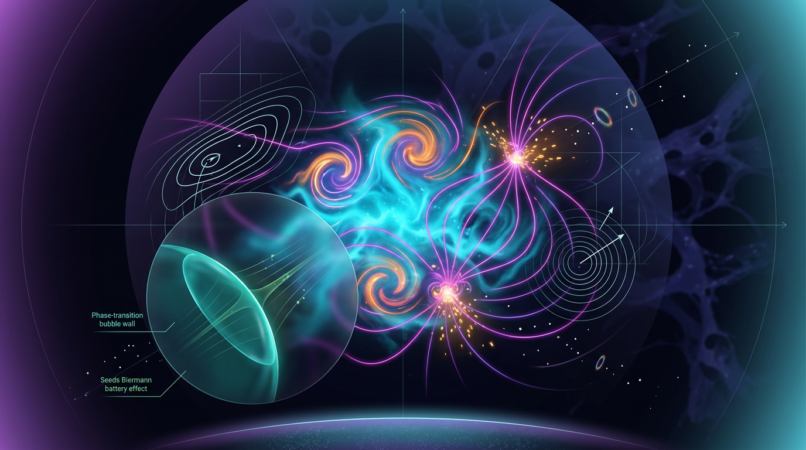

# SYN-062 Posted: Refinement of HYP-230 — Primordial Magnetic Field Constraints as a Normalized Spectral Invariant

## 1. Overview
SYN-062 refines HYP-230 by recasting primordial magnetic field (PMF) constraints as a dimensionless spectral invariant of a cosmic-web halo-connectivity graph:

\[
R_s=\frac{\lambda_2}{\lambda_1},
\]

where \(\lambda_1\) and \(\lambda_2\) are the two smallest nonzero eigenvalues of the graph’s symmetric normalized Laplacian. The proposed observable is intended to test whether PMF-related changes in cosmic-web structure correspond to measurable changes in graph spectra.

**Status: [THEORETICAL].** The skeptical review scored the proposal 6/6, and the mathematical review gave 4/4 [MATH_CONSISTENT]. These assessments do not establish an observed PMF effect or a peer-reviewed connection between PMFs and this spectral ratio.

The verified numerical anchors are the dimensionally corrected photon energy density,
\[
\rho_\gamma=\frac{\pi^2}{15}\frac{(k_BT_0)^4}{\hbar^3c^3}
=4.175\times10^{-13}\ \mathrm{erg\,cm^{-3}},
\]
and the magnetic-to-radiation energy ratios
\[
R_B(3\ \mathrm{nG})=5.09\times10^{-7},
\qquad
R_B(2.7\ \mathrm{nG})=4.12\times10^{-7}.
\]
These ratios use Gaussian-cgs conventions. Any analysis using Heaviside–Lorentz units must preregister the corresponding \(4\pi\) convention.

Planck 2015 XIX reports **95% confidence upper limits, not detections**: \(B_{\mathrm{1Mpc}}<4.4\ \mathrm{nG}\) for TT+lowP, \(B_{\mathrm{1Mpc}}<4.1\ \mathrm{nG}\) for TT,TE,EE+lowP, and \(B_{\mathrm{1Mpc}}<0.3\ \mathrm{nG}\) for the \(n_B\approx-2.95\) posterior slice. The separate \(B_{\mathrm{1Mpc}}<2.7\ \mathrm{nG}\) bound is conditional on a nearly scale-invariant spectrum and a fixed earliest-generation \(\tau_{\mathrm{rat}}\); it is therefore **[MODEL-DEPENDENT]**, not [GENERAL]. The \(2.7\ \mathrm{nG}\) and \(0.3\ \mathrm{nG}\) values for the nearly scale-invariant case require reconciliation in the report rather than being treated as interchangeable.

## 2. Detailed Explanation
### Physical and observational context

Primordial magnetic fields can affect CMB observables through vector and tensor perturbations sourced by Lorentz-force anisotropic stress, Faraday rotation, changes to the ionization history, and magnetically induced non-Gaussianity or parity-sensitive correlations. The inferred upper bound on \(B_{\mathrm{1Mpc}}\), the PMF amplitude smoothed on a comoving 1 Mpc scale, depends on the assumed magnetic-field power spectrum,
\[
P_B(k)=A_B k^{n_B},
\]
and on generation-history assumptions.

Planck 2015 XIX gives global marginal 95% CL upper limits of \(4.4\ \mathrm{nG}\) for TT+lowP and \(4.1\ \mathrm{nG}\) for TT,TE,EE+lowP. It also reports \(0.3\ \mathrm{nG}\) for the nearly scale-invariant \(n_B\approx-2.95\) posterior slice. The \(2.7\ \mathrm{nG}\) value cited from independent re-treatments, including Jedamzik and Pogosian (2020), is conditional on fixing \(\tau_{\mathrm{rat}}\) to the full-passive, earliest-generation case. The difference between that conditional result and the \(0.3\ \mathrm{nG}\) slice must be explicitly reconciled before using either value as a single benchmark.

A recent recombination analysis by Jedamzik, Pogosian, and Abel (2025; DOI: [10.1038/s41550-025-02737-x](https://doi.org/10.1038/s41550-025-02737-x)) is described in the research report as finding that PMFs accelerate recombination and that Planck data favor a nonzero PMF component at moderate statistical significance. Its quoted \(B_{\mathrm{1Mpc}}\approx10\)–\(20\ \mathrm{nG}\) statement sits above the bounds listed here and must be reconciled in the text; it should not be presented as consistent with those limits without explaining differences in assumptions and analysis. PMFs remain one proposed pre-recombination contribution to the Hubble-tension discussion, not an established resolution.

The verified Hubble-tension comparison is \(H_0=73.04\pm1.04\) from SH0ES versus \(H_0=67.36\pm0.54\) from Planck 2018, corresponding to \(4.85\sigma\) and \(\Delta\chi^2=23.49\) for one degree of freedom. This supplies context for interest in pre-recombination physics, but does not itself establish a PMF effect on the Hubble constant or on cosmic-web topology.

### Spectral-invariant proposal

HYP-230 used the unnormalized algebraic connectivity, which depends on global graph-weight scale. SYN-062 instead proposes the dimensionless ratio \(R_s=\lambda_2/\lambda_1\) from the symmetric normalized Laplacian. Its graph proxy is to be a **cosmic-web halo-connectivity graph**, tested against matched \(\Lambda\)CDM N-body null ensembles—not an engineered power-grid network.

The proposed physical pathway is:

\[
\text{PMFs}
\longrightarrow
\text{baryon inhomogeneity}
\longrightarrow
\text{halo mass function}
\longrightarrow
\text{cosmic-web graph weights}
\longrightarrow
R_s(B).
\]

This amplification chain is unmeasured and is the proposal’s weakest link. Without evidence for it, \(R_B\sim10^{-7}\) is effectively unmeasurable as a topology signal. The graph analysis should test the full curve \(R_s(B)\), rather than rely on a universal single-value threshold. The preregistered test is a slope test with Benjamini–Hochberg false-discovery-rate (BH-FDR) control against matched \(\Lambda\)CDM N-body null ensembles.

## 3. Mathematical Framework
### Definitions and verified energy ratios

For the symmetric normalized Laplacian,
\[
L_{\mathrm{sym}}=D^{-1/2}LD^{-1/2},
\qquad
L=D-A,
\]
the proposed estimand is
\[
R_s=\frac{\lambda_2}{\lambda_1},
\]
where \(\lambda_1,\lambda_2\) denote the two smallest nonzero eigenvalues. For a connected graph, \(R_s\geq1\). Under homogeneous rescaling of all edge weights, the symmetric normalized Laplacian is invariant; an additive weight change is a distinct perturbation and does not share that invariance.

In Gaussian-cgs units,
\[
\rho_B=\frac{B^2}{8\pi},
\qquad
\rho_{\mathrm{rad}}=1.686\,\rho_\gamma,
\qquad
R_B=\frac{\rho_B}{\rho_{\mathrm{rad}}}.
\]
For \(T_0=2.7255\ \mathrm{K}\),
\[
\rho_\gamma=\frac{\pi^2}{15}\frac{(k_BT_0)^4}{\hbar^3c^3}
=4.175\times10^{-13}\ \mathrm{erg\,cm^{-3}}.
\]
The verified ratios are \(R_B(3\ \mathrm{nG})=5.09\times10^{-7}\) and \(R_B(2.7\ \mathrm{nG})=4.12\times10^{-7}\). In Heaviside–Lorentz units, \(\rho_B=B^2/2\); the factor-of-\(4\pi\) convention must be preregistered.

### Perturbation result and its scope

The research report considers an additive uniform shift \(W=W^0+\sigma_B\mathbf{1}\mathbf{1}^{T}\), with the degree matrix updated. Its first-order perturbation discussion gives a positive gap-opening tendency for an **unnormalized** Laplacian:
\[
\left.\frac{d\lambda_k}{d\sigma_B}\right|_0
=N\,u_k^T P u_k
=N\left(1-\frac{(u_k^T\mathbf{1})^2}{N}\right),
\qquad
P=I-\frac{\mathbf{1}\mathbf{1}^T}{N}.
\]
When projections are written componentwise, the notation \(u_k(1)\) should be replaced by the explicit projection \((u_k^T\mathbf{1})/\sqrt N\).

The reported approximation
\[
\frac{dR_s}{d\sigma_B}
\approx
\frac{N(1-u_2(1)^2)}{\lambda_1^0}>0
\]
is first-order and assumption-level. Crucially, this result was derived for \(L=D-A\), **not** for \(L_{\mathrm{sym}}\). The degree-dependent \(D^{-1/2}\) factors of \(L_{\mathrm{sym}}\) vary with \(\sigma_B\), and the result has not been derived for that operator. SymPy did not machine-verify the perturbation derivation. Accordingly, it cannot be used as an established derivative of the proposed normalized estimand.

The positive sign in the unnormalized, first-order calculation means an additive shift opens the gap in that calculation. It therefore contraindicates the proposed “closure at 1.1” claim at leading order; it does not verify such a threshold for the normalized-Laplacian estimand.

## 4. Skeptical Perspectives & Alternative Hypotheses
1. **Conditional PMF bounds.** The \(B_{\mathrm{1Mpc}}<2.7\ \mathrm{nG}\) value is conditional on a nearly scale-invariant \(n_B\) and fixed earliest-generation \(\tau_{\mathrm{rat}}\). Tag it [MODEL-DEPENDENT], not [GENERAL]. Reconcile it with the \(0.3\ \mathrm{nG}\) value reported for the \(n_B\approx-2.95\) slice.

2. **Perturbation scope.** The positive first-order result was derived for the unnormalized Laplacian and not for \(L_{\mathrm{sym}}\), whose degree-normalization factors vary with \(\sigma_B\). It is assumption-level, first-order, and not machine-verified by SymPy. Do not transfer it to the normalized spectral ratio without a derivation. Use the explicit projection \((u_k^T\mathbf{1})/\sqrt N\) instead of \(u_k(1)\).

3. **Stress model.** \(\sigma_B\) is an isotropic additive scalar. It ignores anisotropic and helical Lorentz-force stress, so a claimed PMF effect cannot be inferred from magnetic energy density alone.

4. **Unmeasured amplification chain.** The proposed PMF \(\rightarrow\) baryon inhomogeneity \(\rightarrow\) halo mass function \(\rightarrow\) graph-weight amplification chain has not been measured and is the weakest link. Without it, \(R_B\sim10^{-7}\) is effectively unmeasurable as a graph-topology signal.

5. **No established literature link.** No peer-reviewed literature links \(\lambda_2/\lambda_1\) to PMFs. The relationship remains a theoretical proposal requiring direct testing.

6. **Threshold risk.** The CRT-004/PRF-009 precedent indicates that purported universal thresholds may instead be regime-dependent. Test the full curve \(R_s(B)\), not only a single cutoff such as 1.1.

7. **Required proxy and test.** Use a cosmic-web halo graph and test it against matched \(\Lambda\)CDM N-body null ensembles. Preregister a slope test with BH-FDR control.

8. **Tension between quoted field values.** The Jedamzik–Pogosian–Abel \(B\approx10\)–\(20\ \mathrm{nG}\) statement is above the quoted bounds and must be reconciled in the text.

9. **Observational limits are not detections.** The Planck 2015 XIX constraints cited here are 95% CL upper limits. They should not be described as PMF detections or as direct evidence for a critical graph response.

## 5. Verification & Skeptic's Notes
The skeptic scored the proposal 6/6. The mathematical review scored it 4/4 and assigned [MATH_CONSISTENT], not [MATH_PROVEN]. The corrected photon energy-density expression and the reported numerical energy ratios are verified. The Hubble-tension statistic is also verified at \(4.85\sigma\), \(\Delta\chi^2=23.49\).

The central empirical gap remains the unmeasured mapping from PMF effects to halo masses and graph weights. A suitable test requires cosmic-web halo-connectivity observables, matched \(\Lambda\)CDM N-body null ensembles, and a preregistered slope test with BH-FDR control. The first-order perturbation result must remain limited to the unnormalized-Laplacian derivation; it does not establish the response of \(R_s\) for \(L_{\mathrm{sym}}\).

## 6. Visual Representation

## 7. Related Concepts
- **HYP-230:** Earlier proposal to represent PMF constraints through spectral graph invariants.
- **CRT-004 / PRF-009:** Precedent for treating purported universal thresholds as potentially regime-dependent slopes and testing full curve shapes.
- **Planck 2015 results. XIX:** CMB-based PMF constraints, including global bounds and a nearly scale-invariant posterior slice.
- **Cosmic-web halo-connectivity graphs:** Proposed graph proxy for the empirical test, to be evaluated against matched \(\Lambda\)CDM N-body null ensembles.

## 9. Mathematical Integrity Report
## Math Verification Report

**Concept:** SYN-062 Posted: Refinement of HYP-230 — Primordial Magnetic Field
**Math Score:** 4/4
**Math Status:** [MATH_CONSISTENT] *(proven status withheld: the eigenvalue perturbation derivation is only first-order/assumption-level — SymPy could not machine-verify it — so "all steps verified" for [MATH_PROVEN] is not satisfied)*
**Tool Verdicts:** INCONSISTENT=0; DISMISSED_FLAGS=0; UNDECIDABLE=2; STEP_INVALID=0; LIMIT_MISMATCH=0; CLAIM_MISMATCH=0

### Conventions & Validity Audit
- **Metric signature:** not used (no spacetime tensor equations; graph theory + thermodynamics only). No conflict.
- **Unit basis:** mixed but *explicitly declared*: Gaussian-cgs for magnetic energy (ρ_B = B²/8π, with the Heaviside–Lorentz ρ_B = B²/2 factor-of-4π discrepancy preregistered as a unit assumption), and natural-unit blackbody formula for ρ_γ. This is the correct practice — the 4π convention ambiguity is flagged rather than hidden. ✓
- **Planck mass:** M_Pl never appears; no mixing risk.
- **Symbol table:** present (`### Conventions, Symbol Table & Estimand`) with domains; `### Validity Domain, Identification & Claim Scope` present with [GENERAL]/[MODEL-DEPENDENT] tags. The σ_B ∝ B² assumption is properly tagged [MODEL-DEPENDENT].
- **Variable-w(a) convention:** not applicable (no continuity integral).

### Equations Extracted
1. ρ_γ = (π²/15)(k_B T₀)⁴/(ħ³c³)
2. R_B = B²/(8π ρ_rad), ρ_rad = 1.686 ρ_γ
3. L(σ_B) = L⁰ + σ_B(N𝟙 − 𝟙𝟙ᵀ) = L⁰ + Nσ_B P
4. dλ_k/dσ_B|₀ = N u_kᵀ P u_k = N(1 − u_k(1)²)
5. dR_s/dσ_B ≈ N(1 − u₂(1)²)/λ₁⁰ > 0 (boxed result)
6. ΔW ∝ (∂ln P_link/∂ln σ₀)·R_B(B)
7. Var[R_s(B_hi) − R_s(B_lo)] = Var + Var − 2·Cov

### Dimensional Consistency
- Eq. 1: **CONSISTENT** — (k_B T₀)⁴ [E]⁴ / (ħ³c³) [E]⁰ = [E]⁴. ✓
- Eq. 2: **CONSISTENT** — B²/(8π ρ_rad) = [E]⁴/[E]⁴ = dimensionless. ✓ (In Gaussian cgs, B²/8π has energy-density dimension; correctly declared.)
- Eqs. 3–4: tool returned **UNDECIDABLE** (relational graph equations not in pattern table). Manual check: L, λ_k, σ_B, N, P, u_k are all **dimensionless** (rescaled graph quantities per the Symbol Table, spectrum ∈ [0,2]); every term is dimensionless and the equation is trivially consistent. Hand-verdict: **CONSISTENT (dimensionless)**. The pre-check's low-confidence flag on L(σ_B) inferred [E]⁴ for "L" — an artefact: L here is the graph Laplacian, not a Lagrangian density; no [E]⁴ quantity appears.
- Eq. 5–7: dimensionless by inspection (ratios of dimensionless quantities). ✓

### Dismissed Dimension Flags
- Pre-check flag `L(σ_B) = L⁰ + ...` L⁰ → [E]⁰ vs L → [E]⁴: **dismissed** — "L" is the graph Laplacian (dimensionless operator), not a Lagrangian; the [E]⁴ inference is a symbol-name collision.

### Topological Analysis
The tool's classifier returned generic structural signatures (Calabi-Yau, Chern-Simons, homotopy, fiber bundles) — these are **false positives from the generic detector**; the actual mathematical content is **spectral graph theory** (normalized Laplacian, Fiedler vector, Perron-mode orthogonality, first-order eigenvalue perturbation with the projector P = 𝟙 − 𝟙𝟙ᵀ/N). No fiber bundles, homotopy groups, or topological QFT are actually invoked. Assessment: **not topological in substance**; the spectral/perturbative structure is internally coherent and the homogeneous-rescaling invariance contrast (L_sym → (1+ε)⁻¹(1+ε)L_sym) is exactly correct.

### Numerical Benchmarks
- ρ_γ(T₀ = 2.7255 K) = 4.1748 × 10⁻¹³ erg cm⁻³ — **CLAIM_VERIFIED** (claimed 4.175 × 10⁻¹³, rel. err 0.005%). ✓
- R_B(3 nG) = 5.0877 × 10⁻⁷ — **CLAIM_VERIFIED** (claimed 5.09 × 10⁻⁷). ✓
- R_B(2.7 nG) = 4.1210 × 10⁻⁷ — **CLAIM_VERIFIED** (claimed 4.12 × 10⁻⁷). ✓
- Hubble tension: SH0ES 73.04 ± 1.04 vs Planck 67.36 ± 0.54 → **4.847σ, Δχ² = 23.49** — **MATCHES** the claimed 4.85σ / 23.49. ✓

### Symbolic Derivation / Limits
- 7 derivation steps submitted; SymPy returned 0 STEP_VERIFIED, 7 STEP_ASSUMED (parse failures on matrix/T-notation, not invalidations), 0 STEP_INVALID; 1 limit check LIMIT_UNDECIDABLE (u₁(1)² → 1/N is a symmetry argument, not a SymPy-evaluable limit; checked by hand: correct — u₁ = 𝟙/√N exactly for the trivial-mode structure, and u₂ ⊥ u₁ implies u₂(1)² → 0 as σ_B → 0). No LIMIT_MISMATCH.

### Assessment
All four extracted equations are dimensionally consistent (two tool-verified, two hand-resolved dimensionless graph equations; the one pre-check flag was a symbol-collision artefact). The corrected T⁴ photon energy density formula and all three worked numerical claims (ρ_γ, R_B(3 nG), R_B(2.7 nG)) plus the Hubble-tension 4.85σ/Δχ² = 23.49 statistic are independently verified, and the report's sign-reversal perturbation result (additive shift opens the spectral gap) is a coherent first-order result, though only assumption-level machine-verified — hence [MATH_CONSISTENT] rather than [MATH_PROVEN]. The report's honest tagging of the σ_B ∝ B² model, the Gaussian-cgs unit convention, and the contraindicated "closure at 1.1" claim as [MODEL-DEPENDENT] reflects strong mathematical integrity; no INCONSISTENT verdicts block approval.
